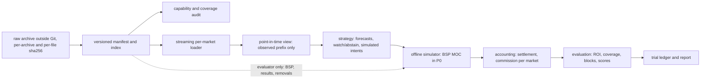

# Backtest lab: data plan, point-in-time rules and the P0 BSP contract

Prepared **2026-10-14**. 計劃同實驗合約，唔係 edge 或者盈利證據。寫呢份文件嗰陣 repo 冇任何 backtest 結果，亦冇跑過任何 backtest；P0 archive 下載咗未、下載咗幾多，manifest 未建立之前一律當未知。

**回測只係實驗室：出嚟嘅數唔係 edge 嘅證據，策略嘅單永遠唔會去到 Betfair。**

呢份文件講 Betfair historical data 嘅離線回測：用咩資料、每段日期做咩用、引擎點分層、策略睇得到乜、P0 嘅 BSP 模型同會計點計，同埋實驗點樣先凍結、後睇結果。設計由 Claude 提出，Astra 2026-10-14 review 並且修正（下文「Astra」指嗰份 design agreement）；Yu 嘅決定喺 §2.7 同 §12；§3 嘅 holdout 收窄係 Astra 2026-10-14 嘅技術決定，Claude 採納，Yu 同日同意；已決定同仲未決定嘅問題喺 §13。Claude 實作，Astra review。外部事實嘅出處同讀取日期喺 [§14](#14-sources-with-access-dates)；冇核實嘅嘢逐項標明。

## 1. Purpose and status

- **目的。** 將來嘅策略可以喺 historical 檔案上重播、模擬、計數，全部跟同一套 point-in-time、結算同會計規則，唔使每個實驗自己寫一次 loader 同會計。
- **唔係 edge 證據。** repo 仍然冇任何已確立嘅盈利策略（AGENTS.md）。2015–16 年嘅結果就算好睇，都只係 engineering／research 證據，唔代表而家有 edge；BSP 本身有冇效率都未證明（§9）。
- **冇單會去 Betfair。** AGENTS.md（2026-10-14 改）規定：策略只可以喺 `betangel_research/betfair/backtest` 入面、用明確畀佢嘅本地 historical、recorded 或 synthetic 檔案產生*模擬* order intent，只有離線 simulator 可以食；冇策略可以經 order gateway 或者 exchange API 落單；backtester 唔可以直接或者間接 import gateway、account／session／credential client、network transport 或者 trading CLI，亦唔可以讀 account profile 或者 live order state；root analysis module 照舊唔 import betfair。管理手動 gateway 同 arming 嗰條 bullet 冇改。
- **點樣守。** [`tests/test_betfair_backtest_boundaries.py`](../tests/test_betfair_backtest_boundaries.py) 淨係用 AST（乜都唔 import、唔執行）將成個 `betangel_research` 砌做 import graph：由 bytes parse，所以同 importer 一樣跟 PEP 263 coding cookie（另外要求 package 每個檔都係純 UTF-8）；function 入面同條件式嘅 import 都計，relative import 按 package 同 level 解析；`from X import Y` 嘅 `Y` 唔係 module，就一定要係 `X` 自己 bind 嘅名。解析唔到嘅 import、由 internal module 嘅 star import、source 旁邊 scan 唔到但 importer 載得入嘅檔（`.pyc`、extension module），同埋同名並存嘅 `X.py` 同 `X/__init__.py`（importer 先載 package，所以 scan 都讀 package，但照樣當失敗），全部當失敗。由每個 backtest module 出發，transitive closure 唔准去到 forbidden 嘅 betfair module（`gateway`、`api`、`auth`、`credentials`、`transport`、`esa`、`cli`、`__main__`、`killswitch`、`arming`、`presence`、`reconcile`、`paths`、`config`、`recorder`、`capability`、`risk`、`journal`）；closure 入面每個 module 只可以 import allowlist 上面嘅標準庫 module（`BACKTEST_STDLIB`：`argparse`、`json`、`pathlib`、`re` 等等）；查 allowlist 之前，先睇 package 旁邊（喺 repo 根用 `-m` 行嗰陣嘅 `sys.path[0]`）同 closure 入面每個 module 旁邊（直接當 script 行嗰陣嘅 `sys.path[0]`）嘅檔（`.py`、無 source 嘅 `.pyc`、extension module）同目錄，名唔分大細楷比較（macOS／Windows 設咗 `PYTHONCASEOK` 嗰陣，importer 都唔分）：closure import 嘅外部名喺度有同名檔或者目錄，就拒絕（Astra 2026-10-14 嘅 reproduction：package 旁邊一個 import gateway 嘅 `fractions.py`，以前淨係查 allowlist 會放行）；喺度任何同標準庫 module 同名嘅檔或者目錄，closure 有冇 import 都一律拒絕，因為標準庫自己用絕對名 import 自己（例如 `pathlib` import `fnmatch`，package 旁邊一個 `fnmatch.py` 就會經 `pathlib` 被載入）；root rule 一樣咁查。Importer 可能會先載佢哋（冇 `__init__.py` 嘅目錄同 builtin／frozen module 其實唔會被蓋過，呢度保守咁一齊拒絕）；第三方 package、`_socket` 呢類 private module、同埋經 `timeit`、`pickle`、`ctypes`、`concurrent.futures` 呢類 wrapper 去到網絡、process 或者 import 機制嘅，全部唔准；唔准用 `importlib`、`__import__`、`exec`、`eval`、`__package__`／`__path__`、`sys.modules`／`sys.path` 呢類動態 import；backtest module 唔准 bind backtest 以外嘅 internal package object；closure 入面唔准出現 state root、client certificate 目錄或者 home 目錄（`Path.home`、`expanduser`）。Root module 唔可以間接去到 betfair，亦只可以 import 標準庫（`scripts`、`tests` 呢類 repo 目錄喺 scan 範圍以外）。[`tests/test_betfair_backtest_contract.py`](../tests/test_betfair_backtest_contract.py) 再喺一個隔離嘅 interpreter 跑一次 validator，核對實際載入咗嘅 module。
- **佢證明唔到嘅嘢。** 標準庫自己入面嘅 import 冇追（例如 `pathlib` 自己 import `os`），不過上面講嘅搜尋位置入面任何標準庫名嘅檔都已經拒絕，所以標準庫唔會喺嗰度載到 repo 嘅檔；runtime 先砌出嚟、傳畀 `getattr` 嘅字串睇唔到，經 module object 嘅 attribute 去到佢 import 過嘅 module 亦睇唔到；`sys.path` 上 repo 以外嘅位置（另一個工作目錄、`PYTHONPATH`、user 或 site packages）有冇同名檔，亦睇唔到；repo 入面只喺其他啟動方式先入 `sys.path` 嘅目錄亦冇 scan（行 `scripts/` 入面嘅 script 嗰陣；`tests/` 係 `unittest discover` 嘅 `sys.path[0]`，只有 real-tree 測試查佢有冇標準庫名）；Python 唔會阻止一個 process 按路徑開檔，所以「唔讀 live state」都要靠 code review。Astra 講得清楚：「must not」係架構規則，唔係話 Python 有 sandbox；測試亦唔係 sandbox。一個以 Yu 身份刻意作惡嘅 process 照樣 import 得到任何嘢，同 [接入指南 §2](betfair-integration.md#2-threat-model) 嘅威脅模型一樣。

| 部分 | 狀態 |
|---|---|
| 本文件、AGENTS.md 嘅 scope bullet、P0 experiment contract 同佢嘅 validator、兩個測試 | task (a) 交付（§4） |
| Archive manifest、index、capability audit | task (b)，計劃中 |
| BSP runner、會計、metrics、trial ledger、report | task (c)，計劃中 |
| LIMIT 單、flumine 對照、付費資料、racing data、prospective | P1–P4，暫定，未批（§4） |

## 2. Data plan

### 2.1 Betfair Historical Data tiers (horse racing, read 2026-10-14)

| Tier | 內容（spec） | 解像度 | 價錢（每個 sport-month） |
|---|---|---|---|
| BASIC | `LTP`、`MARKET_DEF` | 1 分鐘 | **£0**，每個月都係 |
| ADVANCED | `EX_BEST_OFFERS`（sample 有 3 層）、`TV`、`TRD`、`LTP`、`MARKET_DEF` | 1 秒 | £69 |
| PRO | `EX_ALL_OFFERS`、`TRD`、`TV`、`LTP`、`MARKET_DEF`、`SP_TRADED`、`SP_PROJECTED` | tick-by-tick | £230 |

- 價錢嚟自 portal 公開嘅 `GetStandardRateCard`（portal 寫 "all in GBP"）。單位係 sport-month，包晒所有國家：**唔可以淨係買 GB/IE**（`inferred`：rate card 按 sport-month 計價，portal 購物籃按 sport、plan、月份分項；Betfair 冇寫明）；GB/IE、`WIN`、file type `M` 只係下載時嘅 filter。
- **12 個月 bundle**：任何 12 個月、一個 sport，經 Developer Support 買；horse racing ADV £699、PRO £2,299（support 文章 2026-09-24 更新）。
- **免費年**：`GetPricePlan` 將 horse racing 2015-05..2016-04 列做所有 tier £0。佢亦列咗其他折扣月（例如 2020-03..05 全部 £0），本計劃冇用。
- **起始月有衝突**：介紹頁同 spec 寫 "from May 2015"，FAQ 寫 "from April 2015"，`AvailableData.csv` 列 horse racing 2015-04 有 19 個檔。P0 由 2015-05 開始，唔倚賴 2015-04。
- **幾時有**：portal FAQ 話資料喺 event settlement 之後 5 日先出，而且一個 event 嘅 market 要等成個 event 所有 market settle 晒先一齊出。§3 嘅 prospective 規則就係因為咁。
- **大細**：2026-09 horse racing 全部國家，portal 列 BASIC 92、ADV 3316、PRO 6463（單位推斷係 MB，`inferred`；三個 tier 都係 25,719 個檔，portal 購物籃叫佢做 markets）。GB/IE WIN 只係其中一部分；實際大細等 manifest 量度（§12），唔用推算。

### 2.2 Terms

- Portal 條款 "Personal Use Only"：所有 historical data 只限個人、內部用途，商業用途要另外搵 Betfair。"No onward distribution"：轉售、分發畀其他機構或個人、或者畀佢哋用，全部禁止，除非同 Betfair 有書面協議。下載或者使用即係接受條款。
- 要用 Betfair account 登入，經 account 買。Portal bundle 有 `INSUFFICIENT_FUNDS` 呢個錯誤字串，所以推斷係由 account 餘額扣錢（`inferred`）。.es、.it、.ro、.se 嘅 account 唔適用。
- **我哋嘅做法**（唔係 Betfair 嘅書面解釋）：raw 檔案同由佢抽出嚟嘅逐 market 資料，留喺 Git 同所有 worktree 以外（AGENTS.md：licensed raw data 唔入 Git）；雲端 bucket 一定 private（§12）；repo 只放代碼、contract、manifest hash 同結果摘要。結果摘要可唔可以公開分享，未問過 Betfair，唔當已准許。

### 2.3 What BASIC can and cannot support

下面「有」嘅欄位喺 2017 Punchestown BASIC sample 逐個 parse 過（2026-10-14 再數一次：runner change 只有 `ltp`；market definition 有 `ACTIVE`、`REMOVED`、`LOSER`、`WINNER`、`PLACED` 幾種 runner status）。一個 sample 唔代表 2015–16 或者 2023–25 嘅每個檔都一樣，所以 task (b) 嘅 capability audit 要逐檔數。

| 有（BASIC） | 冇（BASIC） |
|---|---|
| 每 1 分鐘嘅 runner `ltp`（成交價，唔係可執行報價） | 可執行嘅 back／lay 報價、depth、排隊位置 |
| Market definition：`marketTime`、`suspendTime`、`openDate`、`status`、`inPlay`、`betDelay`、`numberOfWinners`、`marketBaseRate`、`discountAllowed`、`bspMarket`、`bspReconciled`、`settledTime` 等 | 成交量（`tv`、`trd`）、runner 或 market 嘅 matched 總額 |
| Runner：`status`（ACTIVE／WINNER／LOSER／REMOVED…）、`adjustmentFactor`、`removalDate`、最終 `bsp` | `SP_PROJECTED`（near／far）、`SP_TRADED`（BSP 嘅 back／lay 量） |
| 由 market definition 得出嘅結果同 removal | 一分鐘以下嘅時間、我哋自己注碼對 BSP reconciliation 嘅影響 |

**冇就係冇，唔係零。**

- 某一分鐘冇 `ltp` 更新，係「冇新成交價」或者「唔知」，唔係價錢變咗 0；BASIC 冇成交量欄位，唔係成交量 0。
- 冇 `bsp`、`bspReconciled` 唔係 true、冇 CLOSED 嘅 market definition：BSP 同結果都係「未知」，唔可以當 0 或者當輸（§7）。結算唔當 0、唔當輸；§8 嘅悲觀 all-issued ROI 只係另外報嘅下限，唔係結算。
- **Capability 分兩類，contract 分開寫（`capabilities.decision` 同 `capabilities.outcome`）：**
  - **決定時間嘅 input**（`ltp`、`market_definition` 等）：決定時間嘅 observed prefix 入面冇，就要有明確嘅 `unsupported` 或者 `abstain` 原因寫入 ledger（§6），唔可以靜靜跳過（`on_missing` `unsupported_abstain`）。有冇係睇決定時間嘅 prefix，唔係睇成個檔之後有冇。
  - **結果**（`final_bsp`、`results`）：只係用嚟結算。冇或者之後改咗，**都唔可以改變之前已經做咗嘅決定**：張單照出、照留喺 ledger、exposure 照計，結算做 unresolved（`on_missing` `unresolved_settlement`；§7 `missing_bsp_or_result`）。因為結果冇而 abstain，會令 population 跟結果有冇而變，違反 prefix-invariance（§5），所以 validator 拒絕（`would_change_an_earlier_decision`）；將結果寫入 decision 類亦拒絕（`final_bsp_is_an_outcome`）。
  - 一整個 data product（一個 tier 或者 provider）嘅 spec 或者 audit 顯示成個 product 都冇某個 capability（例如成個 tier 都冇 BSP 欄位），而且判斷唔睇邊啲 market 有冇結果，就可以喺凍結之前喺 contract 入面拒絕（例如 `population.tier` 或者 `population.provider` 揀另一個）。已接受嘅 product 入面個別 market 或者檔冇 BSP，照留喺 cohort，張單照出，結算 unresolved；唔可以按結果有冇揀走一批檔，單一 market 冇結果亦唔可以事後變成策略嘅 abstain。
- P0 contract：decision 要 `ltp`、`market_definition`，outcome 要 `final_bsp`、`results`。Decision 類亦識 `best_offers`、`all_offers`、`traded_volume`、`traded_ladder`、`sp_projected`、`sp_traded`，留畀 ADV／PRO 嘅 contract。邊個檔真係有邊個 capability，要等 task (b) 嘅 audit，contract 本身證明唔到。

### 2.4 Strategy class and minimum tier

| 策略類別 | 最低 tier | 點解／限制 |
|---|---|---|
| Fixed-stake BACK at BSP（MOC），用賽前嘅 1 分鐘 LTP、schedule、field 做決定 | BASIC | 最終 BSP 同結果喺 market definition；要假設我哋嘅注碼唔改 BSP，BASIC 重建唔到（§7） |
| 只出概率、唔落單嘅 forecast／calibration（LTP 衍生） | BASIC | LTP 唔係可執行報價；只計 proper score（§8） |
| LAY at BSP、LOC | 未定（延後） | liability 同 LOC 嘅 matching 要另外建模，唔聲稱 BASIC 夠 |
| 賽前 LIMIT 單、E01（price／volume，30／60／180 秒 feature）、motif lane | ADVANCED | 要報價、size 同成交量；motif reader 只認 ADV 格式，BASIC 會被標 `unsupported_basic_or_unknown_fields`，PRO 欄位會被標 `unsupported_pro_or_mixed_fields`（[接入指南 §9](betfair-integration.md#9-stream-recorder)） |
| 排隊位置、full depth、被動 fill、BSP projection（`SP_PROJECTED`／`SP_TRADED`）、flumine simulation | PRO | 要 tick-by-tick 同 `EX_ALL_OFFERS`；Betfair Data Scientists 嘅 flumine 教學只用 PRO 檔，寫明冇喺 BASIC／ADVANCED 試過；flumine 本身最低要邊個 tier，未核實（§11） |

Astra 特別講明：BASIC 嘅 P0 係一個新嘅 LTP／BSP 實驗，**唔係原封不動嘅 E01**。E01 要 quotes、sizes、volume 同 30／60／180 秒 feature；motif 亦要更豐富嘅資料同 context。

### 2.5 The BSP CSV licence question

`promo.betfair.com/betfairsp/prices` 有每日嘅 BSP CSV：免費、唔使登入，UK／IRE WIN 由 2007-04 起，PLACE 由 2008-08-16 起；檔名日期係賽事翌日（`13102026` 嗰個係 2026-10-12 嘅賽事）。欄位有 `bsp`、`ppwap`、`morningwap`、`ppmax`／`ppmin`、`ipmax`／`ipmin` 同幾個成交量；`bsp` 有 8 個小數位。欄位名大細楷跟檔案年份唔同（[data audit](data-audit.md) 睇過嘅 2017 檔係大寫 `EVENT_ID`、`BSP`…，2026-10 檔係細寫），parser 要唔分大細楷。

但係 BSP 頁尾寫 "may not be used for any purpose without a licence"，冇講適用邊個 licence；Historical Data portal 嘅條款就寫 "any business purpose" 先要 licence，並准個人、內部用途。BSP CSV 屬唔屬後者嘅授權範圍，未清楚。**P0 唔用 BSP CSV**：BSP 由 BASIC 檔嘅 market definition 嚟。Repo 嘅 [data audit](data-audit.md) 之前睇過兩個 2017 IE CSV（喺 Git 以外）。要拎 BSP CSV 做 cross-check 之前，先要 Yu 決定，或者向 Betfair 問清楚。

### 2.6 Racing data: deferred

P0 唔需要賽馬 form data，全部延後。2026-10-14 睇過嘅選擇（價錢係當日公開頁面，未買、未試）：

| 來源 | 價錢同條款（摘要） |
|---|---|
| The Racing API | Free £0、Basic £27.99、Standard £59.99、Pro £99.99 每月；Pro historical add-on 一次過 £499；ToS（2023-07-12 更新）禁止未經准許轉售 |
| Timeform API | 只有 commercial terms，冇公開價錢 |
| Smartform（Betwise） | database £195 + 每月 £65；由 2003-01-01 起；授權係畀 Betwise 會員個人用 |
| Proform | Standard £37.50、Premium £97.50 每月；TPD sectionals add-on 每月 £50（第一年要一次過預繳 £600） |
| Betfair Data Scientists hub | UK/IE ratings model CSV（2024、2025、2026-01..09），有 `WIN_BSP`、`WIN_RESULT`；"you use the data at your own risk" |

- Sporting Life 條款明確禁止 screen scraping；Racing Post 條款 403、At The Races 有 challenge；BHA 結果頁冇 API；三個嘅條款都係 `unverified`。
- 將來用任何 racing data，都要先確定每個欄位幾時公佈；今日嘅新聞、修訂過嘅 rating 或者 LLM 嘅知識，唔會自動變成當時用得到嘅 context（AGENTS.md 同 [edge framework](edge-framework.md)）。
- Hub 嘅 2026-01..08 檔落喺 holdout 期（§3），唔好下載；2026-09 嗰個研究時已經下載過，係已知暴露（§3）。

### 2.7 Greyhounds and soccer: not now (Yu, 2026-10-14)

Yu 2026-10-14 問咗 greyhound racing 同 soccer 要唔要，之後（約 13:57Z）決定："no need for greyhound and soccer now. We focus on horse racing." 所以而家只做 horse racing（P0 係 GB/IE、WIN）。下面嘅價錢同檔數留做參考，將來再諗嗰陣用；冇因為呢個決定改過任何數字。

- **價錢同 coverage（參考）**（2026-10-14 讀）：同一份 `GetStandardRateCard` 每個 sport-month：Greyhound Racing BASIC £0、ADV £49、PRO £150；Soccer BASIC £0、ADV £69、PRO £230。`GetPricePlan` 2015-05..2016-04 兩個 sport 都係所有 tier £0。`AvailableData.csv` 兩個都由 2015-04 起有檔；2026-09 全部國家：greyhound BASIC 43、ADV 1107、PRO 2395（單位推斷係 MB，`inferred`），28,170 個檔；soccer BASIC 487、ADV 16,281、PRO 23,603，206,525 個檔。只係價錢同檔數，冇做 capability audit、冇睇內容。
- Contract schema v1 嘅 `population.sport` 只收 `horse_racing`；`greyhound_racing` 同 `soccer` 會被拒（`not_in_schema_v1`）。呢個範圍同 Yu 嘅決定一致；將來 Yu 要加，要開 schema v2 同新 contract。`countries` 只收 GB、IE，`market_types` 只收 WIN。
- 引擎保持 sport-agnostic：market、runner、決定、結算同會計嘅 interface 唔寫死 horse racing。將來加一個 sport，要先做佢自己嘅價錢查核同 capability audit（例如 soccer 有好多 market type、`numberOfWinners` 唔一定係 1、有 handicap market），再開一份新 contract。

## 3. Date ranges and roles

| 範圍 | 角色 | 規則 |
|---|---|---|
| 2015-05..2016-04，BASIC horse racing | **P0 engineering corpus**（所有 tier £0） | 只係 engineering／research 證據，唔係而家有 edge 嘅證據 |
| 2023-01..2025-12，BASIC horse racing | **Research corpus** | schema v1 唔再切 research：`fitting.kind` 只准 `none`（唔由結果估任何參數），train／validation／test 或者 walk-forward 要 schema v2（§13） |
| 2026-01..2026-08 | **Holdout：刻意唔下載** | 靠「唔下載」封住：就本 project 嘅記錄冇下載過，但冇獨立 audit 證明冇人睇過；呢個係 workflow control，唔係保安封條 |
| 2026-09 | **已暴露：只做 exploratory** | 研究時下載過有結果嘅 hub CSV（見下面「已知暴露」）；永遠唔係 holdout，v1 冇任何 split 收得佢 |
| 2026-10 起 | **Prospective**，有條件 | 只有喺凍結之後、事件之前記錄咗嘅決定先算；2026-10-12 嘅賽事已經暴露，永遠唔算 |
| 2017-04-29 Punchestown samples（BASIC／ADV／PRO）、兩個 2017 IE BSP CSV、繼承嘅兩場 pilot | 已經睇過 | **永遠唔係 holdout**，只可以做 exploratory／engineering |

**原本嘅提議作廢（superseded）。** 9716526 嗰版將 holdout 定做 2026-01..2026-09；呢個範圍已經作廢，因為 2026-09 有已知暴露（見下面）。v1 未被接受，所以直接更正 v1（`schema_version` 照係 1，P0 contract 嘅 hash 變咗）。

Contract（§10）將頭三段寫做 `population.splits`：`engineering`、`research`，同 `holdout`（`state: sealed_not_downloaded`）。Validator 將 holdout 釘死喺 2026-01..2026-08（`SEALED_HOLDOUT`；寫其他月份報 `not_the_sealed_holdout`，例如原本嘅 2026-01..2026-09 會報 `not_the_sealed_holdout` 同 `exposed_not_holdout`），拒絕同呢段重疊嘅 engineering 或 research（`overlaps_sealed_holdout`）、包含已經睇過月份（`INSPECTED_MONTHS`，2017-04）嘅 holdout（`inspected_not_holdout`）、包含已暴露月份（`EXPOSED_MONTHS` 嘅 2026-09，同 `NOT_PROSPECTIVE_DATES` 嘅 2026-10-12 所屬嘅 2026-10）嘅任何 split（holdout 報 `exposed_not_holdout`；engineering 或 research 報 `exposed_exploratory_only`，而且因為排喺 holdout 之後，亦報 `not_after_other_splits`）、重疊嘅 split、唔係排喺最後嘅 holdout，同埋任何評估 holdout 嘅 contract（`population.evaluate_split` 寫 `holdout` 會報 `sealed`）。改呢啲常數就係改 schema。`registration.kind` 決定評估邊段：`engineering_check` 只可以評估 engineering，`registered_hypothesis` 只可以評估 research。Engineering 嘅月份由第一次跑開始就當睇過。

**Prospective 點先算。** 次序一定要係：contract 凍結（有 hash）→ 喺事件之前記錄決定 → 事件發生 → archive 出（portal FAQ：settlement 之後大約 5 日）→ 評估。一個喺凍結之後先*公佈*嘅月份唔夠，因為 archive 本身就係 settlement 之後先出：佢入面嘅事件可能早過凍結。最好連預測都喺結果之前記錄。

**已知暴露（2026-10-14）。** Data-options 研究為咗睇格式，喺 session scratchpad（Git 以外）下載咗兩個有結果嘅檔：Betfair Data Scientists hub 嘅 `uk_ie_2026-09.csv`（2026-09 UK/IE，有 `WIN_BSP` 同 `WIN_RESULT`）同 BSP CSV `13102026`（2026-10-12 嘅賽事）。寫呢份文件嗰陣睇過兩個檔嘅 header 同頭一至三行；研究嗰陣睇過幾多，冇記錄（`unknown`）。所以 2026-09 唔可以話「完全冇人見過」。兩個 scratch 檔 2026-10-14 已經刪走（刪之前嘅 sha256：`uk_ie_2026-09.csv` `8e999e30a7fc17b2dd981cc8d223071b63d94797fbe08884d7ef67d0ec22ec92`，`sample_ukwin_13102026.csv` `e1bdc0816bac5ebac2a1fdefa4a46f661cfb65ab0fbbd080ab3dc3545c5e2244`）；刪咗唔會令佢哋變返未睇過。

**決定（2026-10-14）：Astra 嘅技術決定，Claude 採納，Yu 同日同意（「very sensible decision」）。**

- Holdout 收窄到 **2026-01..2026-08**（`SEALED_HOLDOUT`），`state` 照係 `sealed_not_downloaded`。冇證據要放棄呢八個月，但亦冇人做過獨立 audit 證明冇人睇過：佢哋係 holdout，只係因為就本 project 嘅記錄冇下載過。
- **2026-09 記做已暴露、只做 exploratory**：`contract.py` 嘅 `EXPOSED_MONTHS` 記低檔名、來源、sha256、刪除日期、`inspection_extent` `unknown`，同已知最少睇過嘅（`known_minimum`：2026-10-14 為咗寫呢份計劃睇過 header 同頭一至三行）；validator 拒絕任何包含佢嘅 split。
- **2026-10-12 嘅賽事唔可以做 prospective**：佢哋早過任何凍結，而且結果已經下載過；記喺 `NOT_PROSPECTIVE_DATES`（同樣有 sha256 同 `known_minimum`），validator 拒絕任何包含 2026-10 嘅 split（v1 嘅 split 以月計，所以成個月都拒絕）。Schema v1 冇 prospective split，所以呢個係畀之後嘅 schema 同 trial ledger 用嘅記錄。
- 將來嘅 trial ledger 都要帶住呢兩個 hash、已知最少睇過嘅（header 同頭一至三行），同「研究時睇過幾多：unknown」呢個記錄。

## 4. Architecture



**Raw archive。** 放喺 Git 同所有 worktree 以外，用一個可設定嘅 data root。每個 archive（tar）同入面每個檔都記 sha256，記咗就唔改。解壓要有界同安全：拒絕絕對路徑、`..`、symlink／hardlink，限制檔數、大細同壓縮比。Manifest 同 index 有 schema version。Index 由 market definition 記 market、event、venue、country、type、`marketTime`、runner、removal、`marketBaseRate`；BSP 同結果都喺 index 入面，但只畀 evaluator 用，策略睇唔到（§5）。

**代碼位置。** 全部喺 `betangel_research/betfair/backtest/`，用獨立嘅 `python3 -m betangel_research.betfair.backtest` 行，唔經現有兩個 CLI。佢只收明確畀佢嘅本地檔案，冇 storage client、冇 account client。Root module 唔 import betfair 嘅規則保留。Repo 已經有 forecast replay／scoring、motif trace 同固定 order 嘅 `PaperExchange` replay；欠嘅係一個統一嘅 strategy／corpus runner。Reuse 要留意（Astra）：

- `PaperExchange` 唔支援 MOC／LOC，用 LIMIT／LAPSE 假設（[落單路徑 §11](betfair-order-path.md#11-paper-model-assumptions)），**唔係現成嘅 BSP engine**；用佢要畀明確嘅本地 run path，唔讀 profile 或者 live state。
- `motifs` 會 lazy import root `__main__`；要 reuse 就 reuse 佢嘅純 policy。
- 現有 `pnl.py` 遇到 removal 或者 dead heat 就將成個 market 剔出 P&L 總數；backtest 唔可以咁做，要留低做 unresolved（§7）。
- 舊嘅 `test_betfair_boundaries` 只掃直屬檔案、假設 relative import 只係上一層、冇查 transitive import；所以 task (a) 另外寫咗 §1 嗰個 recursive、識 package 嘅 boundary test。

**而家邊啲 module 真係 reuse 得（task (a) 嘅 boundary test 記低咗，2026-10-14 喺 base `8b0da84` 上）：**

| 結果 | Modules | 原因 |
|---|---|---|
| 乾淨 | `constants`、`ticks`、`pnl`、`errors`、`secret`，同 root 嘅 `evaluation`、`stream`、`temporal` | closure 冇 forbidden module，只用 allowlist 上面嘅標準庫 |
| Forbidden | `journal` | Gateway open 嗰陣 fold 嘅 order journal；`OrderJournal(path, mode="live")` 會寫 live order state（intent、resume、kill、halt），AGENTS.md 唔准 backtester 碰 |
| 唔乾淨 | `receipts`，同所有 import 佢嘅：`schemas`、`filters`、`lifecycle`、`book`、`paper`、`validate` | `receipts` 喺 module level import `subprocess`（`git_state` 會跑 git），亦 import `os`、`fcntl`、`secrets`、`time` 呢啲 allowlist 以外嘅 module |
| 唔乾淨（另加） | `validate`、`paper` | `validate` import `config`（讀 profile 嘅 `config.json`），`config` 再 import `paths`（state root、live journal、KILL file）；`paper` 經 `validate` 去到兩者，亦直接 import `journal` |

即係話 task (c) 有兩條路：一係先開一個獨立 task 將純函數拆出嚟（例如將 canonical JSON 同時間 parse 搬去一個冇 `git_state` 嘅 module、將 `money_pence` 搬出 `config`），畀 Astra 另外 review；一係只用 `constants`、`ticks`、`pnl` 寫自己嘅純代碼。Function 入面 lazy import 都唔得，boundary test 一樣計。P1 想 reuse `PaperExchange` 都要等呢個拆分，而且要一個 review 過、收唔到 `mode="live"` 嘅 paper-only journal facade。

**Tasks。** Claude 一個人寫，Astra review；每個 task 要窄、要先 claim。Collector、feeds、deploy 同 root entrypoint 唔喺呢啲 task 範圍。

| Task | 交付 |
|---|---|
| (a) plan 同 contract | 本文件；AGENTS.md scope bullet（coordinator 套用）；`betangel_research/betfair/backtest/` 嘅 `__init__.py`（只有 docstring）、`contract.py`（schema v1 validator 同 canonical sha256）同 `__main__.py`（`validate-contract`）；P0 draft contract [`research/experiments/backtest-p0-bsp-v1.json`](../research/experiments/backtest-p0-bsp-v1.json)；[`tests/test_betfair_backtest_contract.py`](../tests/test_betfair_backtest_contract.py) 同 [`tests/test_betfair_backtest_boundaries.py`](../tests/test_betfair_backtest_boundaries.py)。冇 loader、冇 simulator、冇會計 |
| (b) archive | manifest、index、安全解壓、capability／coverage audit（計劃中） |
| (c) BSP runner | streaming loader、point-in-time view、strategy API、BSP simulator、會計、metrics、trial ledger、report，同 §9 嘅 synthetic 測試；一定要包括 §5 嘅 prefix-invariance 測試，連「之後嘅 BSP 同結果刪走或者改咗，之前嘅決定一模一樣」（計劃中） |

**之後（暫定，Yu 同 Astra 未批；只有 (a)–(c) 係同意咗嘅範圍）：**

- **P1**：LIMIT 單。將 `PaperExchange` in-process 接入（in-memory journal；要先過上面嘅 reuse 拆分同 paper-only journal facade），喺免費年嘅 PRO 檔同 flumine 對照（§11）。
- **P2**：付費 ADV／PRO 資料。Yu 決定，而且要對住 P0／P1 量度到嘅結果先傾。
- **P3**：racing data 同其他 context（§2.6），要先解決公佈時間同授權。
- **P4**：prospective：凍結之後喺事件之前記錄決定，archive 出咗先評估（§3）。

## 5. Point-in-time rules

策略喺時間 `t` 嘅 view 只可以有**已經觀察到嘅 prefix**：

- **當時知道嘅 runner**（包括之後退出嘅）、當時公佈嘅 schedule（`marketTime` 可以之後改）同 status、**每個欄位自己嘅時間戳**（最後一次更新嘅 `pt`）、有上限嘅歷史，同 provenance（檔案 sha256、行號）。歷史嘅上限由每個 feature 聲明：`features[].lookback_s`（0..86400 秒）係 feature 喺決定時間嗰陣生效嘅 state 以外，最多可以讀幾多秒之前嘅歷史；0 即係淨係讀嗰陣生效嘅 state（每個欄位最新嘅值同佢自己嘅 `pt`）。P0 兩個 feature 都係 0，`as_of` 都係 `decision_time`。
- **同一個 `pt` 嘅 message 當一批**，按檔案次序處理完先畀策略睇；策略唔會見到半批。（現有 paper model 都係咁：同一時間有幾個 snapshot 就用最後嗰個，[落單路徑 §11](betfair-order-path.md#11-paper-model-assumptions) 第 2 步。）
- **Timer**：策略可以要求喺某個時間醒，例如 P0 嘅「第一次公佈嘅 `marketTime` 前 300 秒」；醒嗰陣嘅 view 係 `pt ≤` 嗰個時間嘅 prefix。Timer 同埋同一個 `pt` 嘅一批 data 撞正同一時間：view 嘅定義已經包咗嗰批，所以 schema v1 只准 `decision_timing.equal_pt_order` `timer_after_equal_pt_batch`（先處理完嗰批，timer 先醒）。BASIC 一分鐘先更新一次，timer 之間 view 可能完全冇變。
- **Delay**：intent 嘅生效時間 = 決定時間 + `decision_timing.delay_s`（0..3600 秒整數）；validator 要求 `offset_s + delay_s < 0`，即係生效時間喺第一次公佈嘅 `marketTime` 之前。P0 draft 嘅 `delay_s` 係 null（draft 准 null），task (c) 要喺任何 run 之前定。生效時間亦要喺觀察到嘅 suspend／in-play 之前；BASIC 一分鐘嘅解像度令呢個邊界有不確定性，要明確處理，唔可以靜靜當成功。
- **Image／reset**：有 `img` 嘅 message 係取代成個 market 嘅 state，唔係 merge（`decision_timing.image_handling` `img_replaces_market_state`，schema v1 只准呢個）。2017 BASIC sample 冇 `img`，所以 loader 嘅處理要用 synthetic 檔測。
- **Historic `pt` 只係 proxy**：佢係 Betfair 嘅 publish time，唔係我哋量度到嘅收到時間或者延遲（[edge framework](edge-framework.md)：historical download 嘅 retrieval time 唔係當時 delivery speed 嘅證據）。所有 delay 都係假設。

**Evaluator 嘅資料同策略嘅資料分開。** 最終 BSP、結果、喺決定時間之後先出現嘅 removal 同修訂過嘅 metadata，就算喺 index 入面，都唔可以入策略嘅 view；只有 simulator 同 evaluator 讀得到。決定時間或之前已經觀察到嘅 removal 屬於 prefix（見上面第一點）。Contract 層面：`final_bsp` 同 `results` 只可以寫喺 `capabilities.outcome`（結算要用），寫喺 `capabilities.decision` 會被拒（`final_bsp_is_an_outcome`），亦唔可以做 feature（`outcome_not_a_feature`）；佢哋冇或者之後改咗，只影響結算（unresolved），唔會令之前任何決定變 abstain（§2.3）；每個 variant 用 `uses_features` 列明佢用邊啲已聲明嘅 feature（冇聲明嘅報 `undeclared_feature`），runner 只畀佢睇呢啲。Feature 定義同 variant 描述係自由文字，validator **冇**檢查入面有冇偷用結果；真正嘅防線係 runtime 嘅 observed-prefix view 同 review。

**唔用回顧式規則。** 「最後一個賽前 update」或者「實際開跑前 60 秒」都要事後先知道實際開跑時間。決定時間一定要由當時睇得到嘅嘢定。P0 contract 用 `decision_timing.anchor` `first_published_scheduled_off`、`offset_s` −300：第一次公佈嘅 `marketTime` 前 5 分鐘，之後 `marketTime` 改咗都唔會郁個決定時間。Validator 拒絕任何其他 anchor；名入面（唔分大細楷）有 `actual`、`last`、`latest`、`final`、`revised`、`close`、`suspend`、`in_play`、`inplay`、`turn`、`result`、`settle`、`reconcil`、`bsp`、`winner`、`post` 呢啲字串嘅，會報 `retrospective`，其他報 `not_allowed`（例如有連字號嘅 `in-play-start`）。`offset_s` 一定要係 −86400 至 −1 嘅整數。

**Prefix-invariance 測試。** 將 stream 喺 `t` 截斷再跑，`t` 或之前嘅決定要同用完整 stream 跑出嚟嘅一模一樣；即係將來嘅改變唔可以改到之前嘅決定（task (c)）。Task (c) 一定要另外測：將 `t` 之後先出現嘅最終 BSP、結果、removal 同 market definition **刪走**或者**改咗**（例如 resettlement），`t` 或之前嘅決定（decision ID、abstain／unsupported 原因、intent）都要一模一樣；可以變嘅只有結算，包括由 resolved 變 unresolved。呢個係 contract 入面 `engineering_acceptance` 嘅 `prefix_invariance` 準則（§10）。

## 6. Decisions and the issuance ledger

- **穩定嘅 decision ID**：同一份 contract、同一個策略版本、同一份 input，重跑一定得出同一個 ID；佢唔可以靠結果或者檔案入面嘅位置。
- **完整嘅 issuance ledger**：cohort 入面每個應該考慮嘅 (market, runner, decision point) 都有一行，包括之後退出嘅 runner、`abstain`、冇 label、settlement 唔支援嘅情況。唔准喺睇咗結果之後剔走任何一行。每個 variant 每行只有一個結果：`issued`（出單）、`not_selected`（variant 冇為呢個 market abstain，但冇揀呢隻 runner，即係下面嘅 watch）、`abstained`（連決定時間嘅原因）或者 `unsupported`（連缺咗嘅 `capabilities.decision` input）；按結果同原因數，加埋等於行數（`engineering_acceptance` 嘅 `issuance_exposure_reconciliation`，§10）。
- **重複決定要有 decision axis**：一個策略喺同一個 market 決定幾次（例如幾個時間點），scoring 要知道每次係邊個 axis，唔可以事後揀最好嗰次。
- **Forecast、hypothesis、intent 同 label、fill 分開**：策略只出 forecast（概率）、watch／abstain 同模擬 intent；label 由 evaluator 由結果砌，fill 由 simulator 決定。
- **留畀 E01**：完整 runner cohort、資料新鮮度、training cutoff 同 model version、只用過去嘅 context。今日嘅新聞或者 LLM 知識唔會自動係當時有效嘅 context。

**P0 contract 嘅 cohort（`cohort`，文字規則，task (c) 照住實作）：**

- Market：評估月份入面每個 GB 或 IE horse-racing WIN market，只要佢第一個 market definition 喺決定時間或者之前公佈咗；決定時間之後公佈嘅嘢唔會加入或者剔走任何 market。
- Runner：決定時間或者之前最新嗰個 market definition 入面每個 ACTIVE runner；之後先被 remove 嘅 runner 照留喺 issuance ledger。
- Abstain 原因：`market_not_published_by_decision`（決定時間之前冇 market definition）、`market_not_open_pre_off`（唔係 OPEN 或者已經 in-play），同決定時間嘅 observed prefix 缺少 decision capability（`capabilities.decision`）時嗰個 capability 嘅 unsupported 原因。
- **缺結果唔係 abstain 原因**：冇 `final_bsp` 或者 `results`（`capabilities.outcome`），張單照出、照留喺 ledger、exposure 照計，結算做 unresolved（§7）。
- **原因只可以嚟自決定時間**：`cohort.exclusions` 同 variant 描述係自由文字，validator 唔讀入面意思，改變唔到上面呢條。Runner 嘅 abstain／unsupported 原因只可以係上面兩個固定 cohort 原因、`capabilities.decision` 缺咗嘅 input，或者 variant 用自己聲明嘅 feature 定嘅規則（例如 `ltp_favourite` 打和）；exclusion 文字唔可以加一個按結果 abstain 嘅原因，因為 `capabilities.outcome.on_missing` 只准 `unresolved_settlement`。

## 7. P0 BSP model

P0 只模擬一種單：**fixed-stake BACK at BSP（MOC）**。

| 假設 | 內容 |
|---|---|
| 接受 | 賽前送出嘅 MOC 無條件被接受 |
| 影響 | 我哋嘅注碼對 BSP 影響可以忽略；BASIC 重建唔到我哋加入嘅注碼點樣改變 reconciliation |
| 價錢 | 用檔案畀嘅 BSP，保留原本精度；**唔會**夾去 LIMIT 嘅 tick ladder，亦唔聲稱可以重建到準確到一便士。PRO sample 嘅 stream `bsp` 似乎截到兩個小數位，同 BSP CSV（8 個小數位）差少過 0.01（[data audit](data-audit.md)）；Betfair 用邊個值結算、BASIC 係咪一樣，未核實 |
| 延後 | LOC、LAY |

P0 draft contract 嘅 `staking`：`side` BACK、`price` BSP、`acceptance` `unconditional_pre_off`、`market_impact` `assumed_negligible`、`stake_pence` 100（即係 £1）。Validator 拒絕 `LAY`、`LIMIT`、`LIMIT_ON_CLOSE`（`deferred`）。`capabilities.outcome.required` 一定要有 `results`（冇就報 `missing_results`），用 BSP 就一定要有 `final_bsp`（`missing_final_bsp`）；`capabilities.decision.required` 一定要有 `market_definition`（`missing_market_definition`）。結果寫入 decision 類報 `<cap>_is_an_outcome`，decision input 寫入 outcome 類報 `<cap>_is_a_decision_input`；decision 類用 `unresolved_settlement` 報 `not_for_decision_inputs`，outcome 類用 `unsupported_abstain` 報 `would_change_an_earlier_decision`。

**結算。** 每種情況都喺 contract 嘅 `settlement` 寫明；做唔到嘅就係 **unresolved**，保留決定同 exposure，唔准喺睇咗結果之後靜靜剔走，亦唔准當 0 結算。Schema v1 每個 `settlement` 欄位都只准 `unresolved`，P0 draft 全部寫 `unresolved`；要真係結算呢啲情況，就要 schema v2 加規則，喺凍結之前改 contract（hash 會變）：

| 情況 | `settlement` 欄位 | 處理（v1） |
|---|---|---|
| WINNER／LOSER，有 BSP | — | 按 BSP 結算 |
| Market void | `market_void` | unresolved |
| 我哋嘅 runner 喺決定時間之後先被 remove | `own_runner_removed_after_decision` | unresolved |
| 其他 runner 喺決定時間之後先被 remove | `other_runner_removed_after_decision` | 對 BSP 單嘅影響喺本文件未核實；unresolved |
| Market CLOSED 之後再改結果、`bsp` 或 `numberOfWinners`（例如 resettlement） | `result_revised_after_close` | unresolved |
| Dead heat（`numberOfWinners` 係 1 但有多過一個 WINNER） | `dead_heat` | unresolved |
| 冇 CLOSED market definition、冇 BSP、`bspReconciled` 唔係 true | `missing_bsp_or_result` | unresolved，exposure 照計；之前嘅決定唔改，唔會變 abstain（`capabilities.outcome.on_missing` `unresolved_settlement`） |

決定時間或之前已經被 remove 嘅 runner 由 cohort 規則排除（§6），唔係 unresolved。淨係 `marketTime`、`version` 或者其他唔影響結算嘅欄位改變，唔會令一注變 unresolved。

## 8. Commission and metrics

**Commission。** 按 market 計：`commission_m = c × max(g_m, 0)`，`g_m` 係一個 market 嘅淨贏輸；rate `c` 同 rounding 規則喺 contract 聲明（公式同 +£10／−£10 例子亦喺 [research plan §4](research-plan.md#4-count-costs-correctly)）。檔案入面嘅 `marketBaseRate`（2017 IE sample 係 5.0）**唔等於**實際收費：實際 rate 跟 account 嘅 package（UK 係 My Betfair Rewards；Betfair 自己嘅例子係 Basic 2%，5% 同 8% 只有二手來源，[fact register](betfair-facts.md) F62）。Yu 用邊個 package、P0 應該用邊個 rate，**仲未決定**（§13）。

P0 draft contract 暫時聲明 `commission_rate` 0.05、`rate_source` `declared_assumption`、`basis` `positive_net_market_winnings`、`rounding` `per_market_ceil_penny`（每個 market 嘅 commission 向上捨入到一便士）。5% 係 example config 用嘅保守數，嚟自二手來源（F62），唔係任何 account 嘅實際收費。`rate_source` 寫 `market_base_rate` 會被拒（`not_effective_charge`）；知道 Yu 嘅 package 之後可以改用 `account_statement_verified`。Commission 用精確算術計（例如 `Decimal(repr(rate))` 或者整數 basis points），唔好用 float 乘完再 ceil：rate 0.07、market 淨贏 100p，`math.ceil(0.07 * 100)` 會得 8p 而唔係 7p。Contract 入面 `commission_rate` 一定要寫成 JSON float（`0.05`；`0` 報 `not_float`，`-0.0` 報 `negative_zero`），等同一個 rate 只有一個 hash。

**Metrics（P0，淨 BACK）：** 全部按 variant 分開計。每個 variant 定義：`N_R` = resolved 注嘅淨贏輸（每個 market 扣咗 commission 之後加埋）、`S_R` = resolved 注嘅總 stake、`S_U` = unresolved 注嘅總 stake。

- **Resolved ROI** = `N_R / S_R`（primary，`sum_net_over_sum_stakes_resolved`）。佢係有條件嘅：只計有結算嘅注，所以就算 resolved ROI 係正數，本身都證明唔到所有出咗嘅注加埋都賺錢。
- **悲觀 all-issued ROI** = `(N_R − S_U) / (S_R + S_U)`（`roi_worst_case_unresolved_lost`：unresolved 全部當輸）。P0 每個 variant 每個 market 最多一注 BACK：一注輸咗就係輸晒 stake、冇 commission，所以呢條式就係所有出咗嘅注嘅最差情況；每個 market 多過一注嘅 contract 要重新推導。
- 分母係 0（`S_R = 0`，或者 `S_R + S_U = 0`），嗰個 ROI **冇定義**，照報冇定義，唔當 0。
- **唔准將 candidate 同 baseline 對沖**：每個 variant 自己一套會計，commission 按 (variant, market) 計；唔可以將兩個 variant 喺同一個 market 嘅注夾埋計 net 或者 commission。
- Unresolved 嘅注數同 stake（`S_U`）一定並排報（`unresolved_exposure`），唔當 0、唔剔走。Validator 要求 secondary metrics 有 `coverage`、`unresolved_exposure` 同 `roi_worst_case_unresolved_lost`。
- **不確定性**：先按 market 加埋 net，再按日或者 block resample；保留同一場賽、同一個 meeting 之間嘅相關，亦要睇長啲嘅時間 block（例如週、月）。
- **Drawdown** 要用全域時間次序計，唔可以將每個 market 嘅 trace 駁埋。
- **冇動態共用 bankroll**（延後）。
- **CLV**：入場價就係 BSP，所以「執行 CLV vs BSP」機械上一定係 0，冇意思。之前嘅 LTP 去 BSP 嘅變動可以另外報，但佢係唔可執行嘅比較，唔係執行結果。
- **一定要報**：模擬嘅 resolved ROI 同悲觀 all-issued ROI（分母係 0 就報冇定義）、coverage（cohort、決定、abstain、unsupported 數目）、unresolved exposure；策略有出概率就報 proper score（race-level log loss、Brier、calibration，見 [edge framework](edge-framework.md)）。

P0 draft contract：primary metric `roi`（`sum_net_over_sum_stakes_resolved`）；secondary 有 `abstentions_by_reason`、`bet_count`、`coverage`、`ltp_to_bsp_movement_non_executable`、`max_drawdown_global_chronology`、`net_pnl`、`roi_worst_case_unresolved_lost`、`total_stakes`、`unresolved_exposure`。對返上面嘅定義：`net_pnl` = `N_R`；`total_stakes` = `S_R + S_U`（`S_R` 同 `S_U` 亦分開報，`S_U` 喺 `unresolved_exposure`）；`bet_count` = 出咗嘅注 = resolved + unresolved。`clv_vs_bsp` 會被拒（`zero_by_construction_for_bsp_entry`）；`brier_score` 同 `log_loss` 喺 schema v1 延後（`deferred_no_forecast_output`），因為冇 variant 聲明得到概率輸出。不確定性用 `block_bootstrap`，先按 market 計 net，block 係 `race_day`，10,000 次 resample，95%。Schema 准 `race_day`、`iso_week`、`calendar_month`，拒絕短過一日嘅 block（`shorter_than_race_day`）；但一份 contract 只可以揀一個 block，「同時睇長啲嘅 block」點樣寫入 contract 仲未定（§13）。

## 9. Baselines and engine checks

**Random selection 唔係 engine 嘅答案。** 佢係一個有不確定性嘅 empirical baseline，唔可以用嚟證明引擎啱。就算賠率完全公平（`o = 1/p`），一注 fixed-stake BACK 扣 commission `c` 之後嘅期望 net ROI 係 `−c(1−p)`，唔係 `−c`：

```text
E[net] / stake = p × (1 − c) × (o − 1) − (1 − p)
               = (1 − c)(1 − p) − (1 − p)        # o − 1 = (1 − p) / p
               = −c × (1 − p)
p = 0.5, c = 0.02  →  −1%
```

而且 BSP 係咪公平（有效率）本身都未證明，所以 random-at-BSP 嘅結果唔係已知答案。

P0 draft contract 有兩個 variant：`ltp_favourite`（candidate：決定時間 `ltp_at_decision` 最低嗰隻，打和或者有任何 runner 冇 LTP 就成個 market abstain）同 `seeded_random_runner`（baseline：由 `seeds.selection` 同 market id 揀一隻 ACTIVE runner）。後者係有不確定性嘅 empirical baseline，唔係 engine oracle。

**引擎正確性用 synthetic fixture，答案人手計好**（contract 嘅 `engineering_acceptance` 入面 `known_accounting_answers` 呢條準則，§10）。2% commission：

| Fixture | 人手答案 |
|---|---|
| 兩個獨立 market：£1 BACK @ 2.0 贏（+£1，commission £0.02）；£1 BACK @ 2.0 輸（−£1） | 合計 net −£0.02 |
| 同一個 market 入面 +£10 同 −£10 | market 淨 0，commission 0，net 0 |
| 兩個獨立 market：+£10 同 −£10 | commission £0.20，net −£0.20 |
| Void、dead heat | Schema v1 一律 unresolved：要見到 unresolved 同 exposure；有 v2 規則之後先人手計 |

## 10. Experiment protocol

**Contract 先凍結。** 每個實驗喺睇任何結果或者做任何搜尋之前，寫一份 strategy card／experiment contract 並凍結：切法、cohort、exclusion、feature、成本、staking、primary metric、stopping rule 同所有 variant。P0 嘅係 [`research/experiments/backtest-p0-bsp-v1.json`](../research/experiments/backtest-p0-bsp-v1.json)，用下面命令驗證：

```sh
python3 -m betangel_research.betfair.backtest validate-contract --contract research/experiments/backtest-p0-bsp-v1.json
```

- 佢讀一個本地 regular file（FIFO、device、目錄報 `not_a_regular_file`，喺開檔之前查），印一行 JSON `{"status", "contract_sha256", "problems"}`：`valid_draft` 或 `valid_frozen` 係 exit 0，`invalid` 係 exit 2（argparse 用法錯誤都係 2）；加 `--require-frozen` 嘅話 `valid_draft` 係 exit 3，等 shell gate 唔會將 draft 當 frozen。`problems` 列晒所有問題（`<path>:<reason>`），唔係淨係第一個。`invalid` 嘅 contract 都會印 sha256，但只係用嚟認檔；寫 trial ledger 之前一定要查 `status` 係 `valid_frozen`。
- 讀檔好嚴：UTF-8、唔准重複 key、唔准 NaN／Infinity，超出 ±2^63 嘅整數報 `number_too_large`；每一層嘅未知 key 都拒絕；集合式嘅 list 一定要排好序、冇重複，`features` 同 `engineering_acceptance.criteria` 按 `name`、`variants` 按 `id` 排序，比例欄位（`costs.commission_rate`、`financial_rule.decision_threshold`、`uncertainty.confidence_level`）一定要係 JSON float、唔准 `-0.0`，等同一個意思只有一個 hash。`contract_sha256` 係 Python `json` 寫出嚟嘅 canonical JSON（按 code point 排 key、緊湊分隔、UTF-8、float 用 `repr`）嘅 sha256；唔係 RFC 8785，其他語言要重現就要跟 Python 嘅 float 格式。
- **Draft 同 frozen**：draft 只可以將 `decision_timing.delay_s`、`stopping_rule.max_trials`，同 `registered_hypothesis` 嘅 `financial_rule.hypothesis`、`financial_rule.decision_threshold`、`financial_rule.decision_rule` 留 null，`frozen_on` 一定係 null；frozen 乜都唔可以 null，`frozen_on` 唔可以早過 schema v1 嘅日期 2026-10-14（`before_schema_v1`；將來嘅日期冇時鐘就查唔到）。Frozen 另外要至少一個 exclusion（`empty_in_frozen`），任何文字欄位都唔可以係 placeholder（例如 `TBD`、`TODO`、`n/a`、`-`、`?`，報 `placeholder_in_frozen`），hypothesis、決定規則、`financial_rule.reason`、engineering 準則嘅定義、stopping rule、cohort 規則、feature 定義同 variant 描述最少 20 個字元（`too_short_in_frozen`），ROI 門檻要喺 −1 同 999 之間。呢啲係擋住空殼凍結嘅 heuristic，唔證明文字有意思。
- **兩種 registration，各自有誠實嘅凍結形式**（Astra 2026-10-14 re-review）：
  - `financial_rule` 有類型，一定要對應 `registration.kind`。`registered_hypothesis` 用 `roi_threshold`：hypothesis、ROI 門檻、決定規則，凍結時全部要填。`engineering_check` 用 `not_applicable` 加一段 `reason`：明確寫明冇財務 hypothesis、冇 ROI 門檻、冇決定規則；唔係留 null，亦唔使為咗過凍結作一個出嚟。用錯類型報 `not_applicable_required_for_engineering_check` 或者 `roi_threshold_required_for_registered_hypothesis`。
  - 兩種都一定要有 `engineering_acceptance`：三條確定性嘅準則，名固定（`ENGINEERING_CRITERIA`），每條有定義。`known_accounting_answers`：§9 synthetic fixture 嘅人手答案，準確到一便士；void、dead heat 呢類 fixture 係 unresolved 而且 exposure 照計。`prefix_invariance`：§5，包括將之後先出嘅 BSP 同結果刪走或者改咗。`issuance_exposure_reconciliation`：§6 嘅 ledger 每個 cohort 位一行、冇事後剔走；每行只有一個結果（`issued`、`not_selected`、`abstained` 連原因、`unsupported` 連 capability），按結果同原因數加埋等於行數；issued = resolved + unresolved；issued stake = `S_R + S_U`（§8）。`rule` 係固定 token `all_criteria_must_hold_outcome_metrics_not_judged`（`ENGINEERING_RULES`；寫其他嘢，包括自由文字，報 `not_allowed`）：任何一條唔過，成個 run 就唔過；觀察到嘅 ROI、net、drawdown 只係報，唔可以令 run 過或者唔過。準則嘅定義係自由文字，validator 只查 placeholder 同長度（同 feature 定義一樣），入面有冇偷偷加結果條件，要靠凍結時嘅 review。
  - Operational 嘅選擇（delay、成本、cohort、variant、seed、trial 上限同 stopping rule）兩種都一定要凍結時填好。冇任何繞過 frozen gate 嘅路：跑之前同寫 trial ledger 之前，照樣要 `valid_frozen`（`--require-frozen`）。
- **P0 而家係 `draft`**，`registration.kind` 係 `engineering_check`：佢只評估 engineering 年；`financial_rule` 係 `not_applicable`，因為呢次跑嘅任何結果都唔可以支持或者否定一個 edge；`engineering_acceptance` 已經寫好。淨係 `delay_s` 同 `max_trials` 仲係 null，task (c) 喺凍結同任何 run 之前定；P0 凍結咗先跑，唔會以 draft 身份跑。Astra 嘅 reproduction（draft 加 `status` frozen、`frozen_on` 2026-10-14、`delay_s` 1、`max_trials` 2）以前報三個 `null_in_frozen`，而家係 `valid_frozen`；`delay_s` 或者 `max_trials` 係 null 就照樣 `null_in_frozen`。Stopping rule：每個 variant 跑晒成個 engineering split；睇咗結果之後要加、減或者改任何 variant、feature、cohort 規則或者成本，就要開新 contract、新 hash；每個 trial 連 contract sha256 寫入 trial ledger。
- **Validator 證明到同證明唔到。** 一份 valid contract 只證明呢啲選擇係用呢個格式寫低、hash 係呢個；佢證明唔到係咪喺任何人睇結果之前寫、檔案存唔存在、有冇聲明嘅 capability，更加唔係盈利證據。

**凍結前後嘅其他規則：**

- **Integrity inventory** 可以喺凍結之前跑（檔數、market 數、欄位同 BSP coverage），但唔可以做全 corpus 嘅結果分析。
- **Trial ledger** 記低每個 trial：started、failed、aborted、completed，用咗邊個 variant、input hash、seed 同 training cutoff。失敗同中途放棄嘅都計（[edge framework](edge-framework.md)：揀嚟揀去本身就係 overfitting 嘅來源）。
- **Holdout gate**：schema v1 嘅 validator 一律拒絕評估 holdout（`evaluate_split` 寫 `holdout` 報 `sealed`，frozen 都一樣）；而家冇任何讀資料嘅 tooling。幾時、點樣解封要新 schema，同 Yu、Astra 決定（§13）。呢個係 workflow control，唔係防到直接打開 raw 檔嘅保安封條；2026-01..08 而家靠唔下載嚟封，2026-09 已暴露、唔係 holdout（§3）。
- **Walk-forward** 要真係每一步只用過去資料 fit、要 purge，唔係將一個用晒成段時間揀出嚟嘅 model 按日期切開再計分。Schema v1 嘅 `fitting.kind` 只准 `none`，寫 `walk_forward` 報 `deferred`；聲明 `none` 但其實喺結果上 fit，validator 查唔到，要靠 review。

## 11. P1: flumine cross-check conditions

- 兩邊要用**一樣**嘅決定、時鐘、成本同執行假設；兩個 simulator 夾，都唔代表係真相。
- Betfair Data Scientists 嘅 flumine simulation 教學只用 PRO 檔（"has not been tested on the BASIC or ADVANCED level files"），並列明冇 market catalogue、冇 cross matching、冇 market impact；ratings 教學用 PRO，話方法應該用 ADVANCED 都得、BASIC 唔得。flumine 本身用唔用得 ADV／BASIC 未核實，P1 照計劃用 PRO。免費年 2015-05..2016-04 嘅 PRO 檔係 £0。
- flumine 3.2.7（PyPI 2026-10-13，MIT）嘅 source：`commission_base` 旁邊寫住 `# not implemented`，market summary 只報 `max(profit × commission_base, 0)`；即係 commission 要我哋自己計。佢嘅 docs 亦列咗 known issue，例如 PLACE market 嘅 dead heat 冇處理。

## 12. Storage

- **Lab 機（Yu 2026-10-14 決定）。** 一部專用、清空咗嘅 MacBook Pro（大約 256 GB），同 MacBook Air 喺同一個屋企網絡，做 raw archive 同重型計算：資料放 `~/betangel-data/historic/`（Git 同任何 clone 以外），MacBook Air 上面嘅 Claude 經 LAN SSH（`<name>.local`，冇 Tailscale）用。Lab 機**冇任何 Betfair credentials**，唔跑任何會 login 嘅命令；落單、Keychain 同 live client 留喺 MacBook Air。設定步驟喺 session archive 嘅 `lab-setup-brief.md`（Git 以外）。篩咗 GB/IE WIN 嘅 PRO 大約每個月 1 GB（Yu 喺 portal 見到嘅數）。
- **之後先上一個獨立嘅 private Tigris bucket。** 唔係 collector 嘅 backup bucket 或者 prefix，亦唔原封不動 reuse collector 嘅 backup uploader 同 retention（現有文件只係提議 backup retention）。Upload／materialization 用有範圍限制嘅 credentials；離線 runner 只收本地檔案，冇 storage client。
- **£0 資料唔等於 £0 雲端。** Tigris 嘅免費額（Astra 2026-10-14 讀）係每個 account 每個月：頭 5 GB Standard storage、10k Class A、100k Class B request，唔係每個 bucket。現有 account 用咗幾多，`unverified`。所以上傳大批之前，先量 archive 大細同剩餘額度。
- **Credentials 只放 macOS Keychain**，用隱藏輸入（`security add-generic-password … -w`，`-w` 放最後，見 [接入指南 §5](betfair-integration.md#5-keychain-setup)），唔入檔案、argv 或者 log。

## 13. Open questions

**已決定（2026-10-14，留低做記錄）：**

- **Greyhound racing 同 soccer：而家唔做。** Yu（約 13:57Z）："no need for greyhound and soccer now. We focus on horse racing."（§2.7；價錢同檔數留做參考）。Schema v1 本來就只收 `horse_racing`。
- **2026-09 已知暴露：** holdout 收窄到 2026-01..2026-08，2026-09 記做已暴露、只做 exploratory，2026-10-12 嘅賽事唔可以做 prospective；原本嘅 2026-01..2026-09 作廢（§3）。呢個係 Astra 2026-10-14 嘅技術決定，Claude 採納，Yu 同日同意。
- **Engineering check 點凍結：** 用有類型嘅 `financial_rule` `not_applicable` 加確定性嘅 `engineering_acceptance`，operational 選擇凍結時照填；唔以 draft 身份跑，冇繞過 frozen gate（§10）。（Astra R3 要求唔以 draft 身份跑、唔繞過 frozen gate；`financial_rule`／`engineering_acceptance` 嘅 schema 形狀係 Claude 嘅實作，等 Astra 再 review，見下面）

**未決定：**

- **Commission rate**：Yu 嘅 Rewards package 同 P0 用邊個 rate（§8）。
- **BSP CSV 授權**（§2.5）。
- **Holdout 幾時、點樣解封**：schema v1 一律拒絕評估 holdout（§10）；解封程序要 Yu 同 Astra 定，再開新 schema。
- **2015-04 coverage**：portal 頁面之間有衝突（§2.1）；P0 唔用。
- **Removal、void、dead heat 對 BSP 單嘅實際規則**：本文件未核實 Betfair 規則；schema v1 每個 `settlement` 欄位只准 `unresolved`（§7）。
- **Schema v1 未有嘅嘢**：research 入面嘅 train／validation／test 或者 walk-forward 切法（`fitting.kind` 只准 `none`）、真正結算 void／removal／dead-heat 嘅規則、按 tier 收緊 `offset_s` 上限（而家 BASIC 一分鐘取樣下 `offset_s` −1 照樣通過）、同一份 contract 報幾個 bootstrap block、holdout 解封程序。v1 拒絕未知 key，所以要先開 schema v2（新 hash）。
- **Astra 2026-10-14 re-review 之後嘅更正，等佢再 review**：佢喺 9716526 要求嘅 R1–R4 同 N1–N3 喺呢版做咗：decision／outcome capability 分開（`capabilities.decision`／`capabilities.outcome`）、holdout 收窄同 `EXPOSED_MONTHS`／`NOT_PROSPECTIVE_DATES`、`financial_rule` 同 `engineering_acceptance`、boundary test 嘅 shadowing 規則、拒絕 year 0000、§8 嘅 metrics 定義。之後 internal review 再收緊咗：`engineering_acceptance.rule` 改做固定 token、issuance ledger 每行嘅結果加咗 `not_selected`、已暴露嘅月份喺任何 split 都報、`EXPOSED_MONTHS`／`NOT_PROSPECTIVE_DATES` 加咗 `known_minimum`、boundary test 拒絕搜尋位置入面所有標準庫名（唔分大細楷）同並存嘅 `X.py`／`X/__init__.py`。呢啲新欄位同規則佢未睇過；v1 喺佢接受之前都唔算定稿。
- **Runner 點拒絕 state root 底下嘅輸入（架構未定）**：boundary test 查嘅係成個 backtest closure，唔止 backtest package；backtest import 嘅任何 module，放喺邊度都喺 closure 入面，一樣唔准寫 state root 字串或者查 home 目錄（Astra 試過：root module 入面一個 `Path.home()` helper 照樣令嗰個測試 fail）。所以將 guard 搬出 backtest **唔係**解決方法，亦唔會令佢豁免。要麼一個 review 過嘅 boundary 改動，要麼一個真正分開、backtest 唔 import 嘅 preflight 階段；task (c) 開始之前要同 Astra 定。
- **長啲嘅 bootstrap block**：一份 contract 只揀一個 block（P0 係 `race_day`），點樣同時報週或月 block 未定（§8）。
- **P1–P4 嘅內容同次序**：暫定（§4）。

## 14. Sources with access dates

全部 **2026-10-14** 讀取，除非另外註明。

- **Betfair Historical Data portal** [historicdata.betfair.com](https://historicdata.betfair.com/)：portal 係 JS app，文字由佢自己嘅 translation bundle 讀（頁面冇日期）；條款（"Personal Use Only"、"No onward distribution"）、FAQ（5 日、"from April 2015"）同 historic data API 說明。[`GetStandardRateCard`](https://historicdata.betfair.com/api/GetStandardRateCard)（公開、唔使登入）同 `GetPricePlan`：價錢同折扣月。`AvailableData.csv`：每月檔數同大細。
- **[Betfair Historical Data Feed Specification](https://historicdata.betfair.com/files/Betfair-Historical-Data-Feed-Specification.pdf)**（Last-Modified 2026-05-20）：三個 tier 嘅內容同解像度。
- **官方 samples** `https://historicdata.betfair.com/files/horse-racing-{basic,adv,pro}-sample.bz2`：2017-04-29 Punchestown；欄位係本地 parse 出嚟，已經睇過，見 [data audit](data-audit.md)。
- **Betfair Developer Support**：[Are bulk purchase discounts available?](https://support.developer.betfair.com/hc/en-us/articles/360019984158)（2026-09-24 更新）；[How frequently is the historical data updated?](https://support.developer.betfair.com/hc/en-us/articles/360002427051-How-frequently-is-the-historical-data-updated)（Astra 引用）。
- **Betfair support** [a_id/10620](https://support.betfair.com/app/answers/detail/a_id/10620/)：Astra 引用；本文件冇重讀，冇任何事實單靠佢。
- **BSP CSV** [promo.betfair.com/betfairsp/prices](https://promo.betfair.com/betfairsp/prices) 同 [SP_history](https://promo.betfair.com/betfairsp/SP_history.html)：coverage、欄位同頁尾 licence 句。
- **Betfair Data Scientists hub**：[data listing](https://betfair-datascientists.github.io/data/dataListing/)、flumine simulation 同 backtesting ratings 教學。
- **flumine 3.2.7**（PyPI 2026-10-13，MIT）：docs（known issues 等）同 sdist source `flumine/clients/baseclient.py`、`flumine/markets/market.py`，本地讀。
- **Tigris** [pricing](https://www.tigrisdata.com/pricing/)：Astra 讀；本文件冇重讀。
- **Racing data**（全部公開頁面，未買、未試）：The Racing API（public plans JSON、ToS、FAQ）、timeform.com 嘅 commercial page、Betwise Smartform、Proform、Sporting Life T&Cs；Racing Post 條款 403、At The Races 有 challenge、BHA 結果頁冇 API，三個嘅條款 `unverified`。
- **Repo 內**：[research plan §4](research-plan.md#4-count-costs-correctly)（commission 計法，2026-10-09）、[fact register](betfair-facts.md) F62（Rewards）、[edge framework](edge-framework.md)、[data audit](data-audit.md)、[接入指南](betfair-integration.md)、[落單路徑](betfair-order-path.md)。
