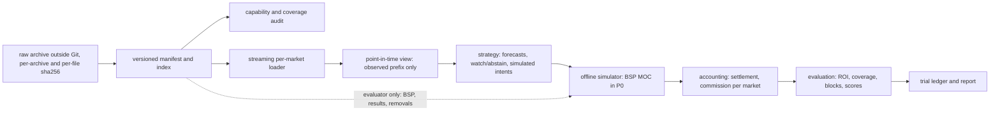

# Backtest lab: data plan, point-in-time rules and the P0 BSP contract

Prepared **2026-10-14**；**2026-10-15** 按 task (c) 已合併嘅代碼更新（c2b3b4，§1），**2026-10-16** 更新 readiness 工具狀態同 lab runbook。計劃同實驗合約，唔係 edge 或者盈利證據。寫第一版嗰陣 repo 冇任何 backtest 結果，亦冇跑過任何 backtest；之後 task (c) 嘅測試同 engine certification 用 synthetic 資料跑過，但就本 project 嘅記錄，**到而家都冇跑過任何真資料 backtest、冇任何真結果、冇任何 engineering pass**（記錄唔係檔案系統普查，§10.1）。Archive 嘅實際內容以 manifest 為準；lab 報告返嚟嘅數（§10）呢度冇核實。

**回測只係實驗室：出嚟嘅數唔係 edge 嘅證據，策略嘅單永遠唔會去到 Betfair。**

呢份文件講 Betfair historical data 嘅離線回測：用咩資料、每段日期做咩用、引擎點分層、策略睇得到乜、P0 嘅 BSP 模型同會計點計，同埋實驗點樣先凍結、後睇結果。設計由 Claude 提出，Astra 2026-10-14 review 並且修正（下文「Astra」指嗰份 design agreement）；Yu 嘅決定喺 §2.7 同 §12；§3 嘅 holdout 收窄係 Astra 2026-10-14 嘅技術決定，Claude 採納，Yu 同日同意；已決定同仲未決定嘅問題喺 §13。Claude 實作，Astra review。Task (c) 嘅設計同決定：Astra 2026-10-14 嘅 c2 設計協議（D1–D14，下文寫「c2 D3」）；Astra 2026-10-15 對 c2b3b 提議（report_8cc414cf）嘅決定 1–14 同執行控制 A–E（下文寫「c2b3b 決定 10」、「控制 E」）；同 Astra 對 c2b3b3 嘅 review（Q1–Q11，連 Claude 要話畀 Yu 知嘅 Y1–Y3）。兩套「1–14」唔係同一套，下文一律加前綴。外部事實嘅出處同讀取日期喺 [§14](#14-sources-with-access-dates)；冇核實嘅嘢逐項標明。

## 1. Purpose and status

- **目的。** 將來嘅策略可以喺 historical 檔案上重播、模擬、計數，全部跟同一套 point-in-time、結算同會計規則，唔使每個實驗自己寫一次 loader 同會計。
- **唔係 edge 證據。** repo 仍然冇任何已確立嘅盈利策略（AGENTS.md）。2015–16 年嘅結果就算好睇，都只係 engineering／research 證據，唔代表而家有 edge；BSP 本身有冇效率都未證明（§9）。
- **冇單會去 Betfair。** AGENTS.md（2026-10-14 改）規定：策略只可以喺 `betangel_research/betfair/backtest` 入面、用明確畀佢嘅本地 historical、recorded 或 synthetic 檔案產生*模擬* order intent，只有離線 simulator 可以食；冇策略可以經 order gateway 或者 exchange API 落單；backtester 唔可以直接或者間接 import gateway、account／session／credential client、network transport 或者 trading CLI，亦唔可以讀 account profile 或者 live order state；root analysis module 照舊唔 import betfair。管理手動 gateway 同 arming 嗰條 bullet 冇改。
- **點樣守。** [`tests/test_betfair_backtest_boundaries.py`](../tests/test_betfair_backtest_boundaries.py) 淨係用 AST（乜都唔 import、唔執行）將成個 `betangel_research` 砌做 import graph：由 bytes parse，所以同 importer 一樣跟 PEP 263 coding cookie（另外要求 package 每個檔都係純 UTF-8）；function 入面同條件式嘅 import 都計，relative import 按 package 同 level 解析；`from X import Y` 嘅 `Y` 唔係 module，就一定要係 `X` 自己 bind 嘅名。解析唔到嘅 import、由 internal module 嘅 star import、source 旁邊 scan 唔到但 importer 載得入嘅檔（`.pyc`、extension module），同埋同名並存嘅 `X.py` 同 `X/__init__.py`（importer 先載 package，所以 scan 都讀 package，但照樣當失敗），全部當失敗。由每個 backtest module 出發，transitive closure 唔准去到 forbidden 嘅 betfair module（`gateway`、`api`、`auth`、`credentials`、`transport`、`esa`、`cli`、`__main__`、`killswitch`、`arming`、`presence`、`reconcile`、`paths`、`config`、`recorder`、`capability`、`risk`、`journal`）；closure 入面每個 module 只可以 import allowlist 上面嘅標準庫 module（`BACKTEST_STDLIB`：`argparse`、`json`、`pathlib`、`re` 等等）；查 allowlist 之前，先睇 package 旁邊（喺 repo 根用 `-m` 行嗰陣嘅 `sys.path[0]`）同 closure 入面每個 module 旁邊（直接當 script 行嗰陣嘅 `sys.path[0]`）嘅檔（`.py`、無 source 嘅 `.pyc`、extension module）同目錄，名唔分大細楷比較（macOS／Windows 設咗 `PYTHONCASEOK` 嗰陣，importer 都唔分）：closure import 嘅外部名喺度有同名檔或者目錄，就拒絕（Astra 2026-10-14 嘅 reproduction：package 旁邊一個 import gateway 嘅 `fractions.py`，以前淨係查 allowlist 會放行）；喺度任何同標準庫 module 同名嘅檔或者目錄，closure 有冇 import 都一律拒絕，因為標準庫自己用絕對名 import 自己（例如 `pathlib` import `fnmatch`，package 旁邊一個 `fnmatch.py` 就會經 `pathlib` 被載入）；root rule 一樣咁查。Importer 可能會先載佢哋（冇 `__init__.py` 嘅目錄同 builtin／frozen module 其實唔會被蓋過，呢度保守咁一齊拒絕）；第三方 package、`_socket` 呢類 private module、同埋經 `timeit`、`pickle`、`ctypes`、`concurrent.futures` 呢類 wrapper 去到網絡、process 或者 import 機制嘅，全部唔准；唔准用 `importlib`、`__import__`、`exec`、`eval`、`__package__`／`__path__`、`sys.modules`／`sys.path` 呢類動態 import；backtest module 唔准 bind backtest 以外嘅 internal package object；closure 入面唔准出現 state root、client certificate 目錄或者 home 目錄（`Path.home`、`expanduser`）。Root module 唔可以間接去到 betfair，亦只可以 import 標準庫（`scripts`、`tests` 呢類 repo 目錄喺 scan 範圍以外）。[`tests/test_betfair_backtest_contract.py`](../tests/test_betfair_backtest_contract.py) 再喺一個隔離嘅 interpreter 跑一次 validator，核對實際載入咗嘅 module。Task (c) 加咗 `path_guard.py`（c2 D12）：boundary test 淨係准佢嗰一個 top-level `DENIED_COMPONENT_SEQUENCES` assignment 寫 `Library/Application Support/betangel-research/betfair` 同 `.config/betangel-research/betfair` 呢兩組名（核對準確嘅值），其他字串、import 同 home 目錄規則照舊；`__main__` 喺 function 入面先 import `runner` 同 `certify`，所以 `validate-contract` 照樣淨係載入 `contract.py`。
- **佢證明唔到嘅嘢。** 標準庫自己入面嘅 import 冇追（例如 `pathlib` 自己 import `os`），不過上面講嘅搜尋位置入面任何標準庫名嘅檔都已經拒絕，所以標準庫唔會喺嗰度載到 repo 嘅檔；runtime 先砌出嚟、傳畀 `getattr` 嘅字串睇唔到，經 module object 嘅 attribute 去到佢 import 過嘅 module 亦睇唔到；`sys.path` 上 repo 以外嘅位置（另一個工作目錄、`PYTHONPATH`、user 或 site packages）有冇同名檔，亦睇唔到；repo 入面只喺其他啟動方式先入 `sys.path` 嘅目錄亦冇 scan（行 `scripts/` 入面嘅 script 嗰陣；`tests/` 係 `unittest discover` 嘅 `sys.path[0]`，只有 real-tree 測試查佢有冇標準庫名）；Python 唔會阻止一個 process 按路徑開檔，所以「唔讀 live state」都要靠 code review。Astra 講得清楚：「must not」係架構規則，唔係話 Python 有 sandbox；測試亦唔係 sandbox。一個以 Yu 身份刻意作惡嘅 process 照樣 import 得到任何嘢，同 [接入指南 §2](betfair-integration.md#2-threat-model) 嘅威脅模型一樣。`path_guard` 係一張拒絕名單：佢擋嘅只係 client 兩個固定嘅 live-state／certificate 目錄，唔係 OS 隔離，亦搵唔到 operator 放喺其他地方嘅 certificate，或者歷史檔入面嘅 secret（c2 D12）。

| 部分 | 狀態 |
|---|---|
| 本文件、AGENTS.md 嘅 scope bullet、P0 experiment contract 同佢嘅 validator、兩個測試 | task (a) 交付（§4） |
| Archive manifest、index、capability audit | task (b) 交付（§4.1；TAR 格式事實喺 §2.8）；Astra review 咗三輪，喺 794c456 接受，PR #7 合併（main da44d71） |
| BSP runner、會計、metrics、trial ledger、report、engine certification | task (c) 交付咗 c1、c2a、c2b1、c2b2、c2b3a、c2b3b1、c2b3b2a、c2b3b2b、c2b3b3（§4）；c2b3b4 係 P0 draft 嘅文字、contract test 同本文件（加埋三個 test 檔入面跟 draft 新數值改嘅幾行：淨係 test，certificate key 唔郁）。全部只用 synthetic 資料：**冇真資料 run、冇結果、冇 engineering pass**，P0 contract 仲係 `draft`（§10） |
| Readiness R1（`readiness.py`；c2b3b 決定 14） | `betangel_research/betfair/readiness.py` 已交付，PR #20 已合併（main 1f35646）；只做 synthetic verification，未喺 lab 或真資料上跑。工具喺 certificate source descriptor 以外，唔授權 freeze、certification 或 run（§10） |
| 跑真資料之前 | 全部未開始；C0 嘅 L1/L2/L3 → freeze/5a/5b → C1 certification → 第 7 步通知及 Yu 同意 → 真 run（§10.1） |
| LIMIT 單、flumine 對照、付費資料、racing data、prospective | P1–P4，暫定，未批（§4） |

## 2. Data plan

### 2.1 Betfair Historical Data tiers (horse racing, read 2026-10-14)

| Tier | 內容（spec） | 解像度 | 價錢（每個 sport-month） |
|---|---|---|---|
| BASIC | `LTP`、`MARKET_DEF` | 1 分鐘 | **£0**，每個月都係 |
| ADVANCED | `EX_BEST_OFFERS`（sample 有 3 層）、`TV`、`TRD`、`LTP`、`MARKET_DEF` | 1 秒 | £69 |
| PRO | `EX_ALL_OFFERS`、`TRD`、`TV`、`LTP`、`MARKET_DEF`、`SP_TRADED`、`SP_PROJECTED` | tick-by-tick | £230 |

- 價錢嚟自 portal 公開嘅 `GetStandardRateCard`（portal 寫 "all in GBP"）。單位係 sport-month，包晒所有國家：**唔可以淨係買 GB/IE**（`inferred`：rate card 按 sport-month 計價，portal 購物籃按 sport、plan、月份分項；Betfair 冇寫明）；GB/IE、`WIN`、file type `M` 只係下載時嘅 filter。
- **12 個月 bundle**：任何 12 個月、一個 sport，經 Developer Support 買；horse racing ADV £699、PRO £2,299（support 文章 2026-09-24 更新）。
- **免費年**：`GetPricePlan` 將 horse racing 2015-05..2016-04 列做所有 tier £0。佢亦列咗其他折扣月（例如 2020-03..05 全部 £0），本計劃冇用。
- **起始月有衝突**：介紹頁同 spec 寫 "from May 2015"，FAQ 寫 "from April 2015"，`AvailableData.csv` 列 horse racing 2015-04 有 19 個檔。P0 由 2015-05 開始，唔倚賴 2015-04。
- **幾時有**：portal FAQ 話資料喺 event settlement 之後 5 日先出，而且一個 event 嘅 market 要等成個 event 所有 market settle 晒先一齊出。§3 嘅 prospective 規則就係因為咁。
- **大細**：2026-09 horse racing 全部國家，portal 列 BASIC 92、ADV 3316、PRO 6463（單位推斷係 MB，`inferred`；三個 tier 都係 25,719 個檔，portal 購物籃叫佢做 markets）。GB/IE WIN 只係其中一部分；實際大細等 manifest 量度（§12），唔用推算。

### 2.2 Terms

- Portal 條款 "Personal Use Only"：所有 historical data 只限個人、內部用途，商業用途要另外搵 Betfair。"No onward distribution"：轉售、分發畀其他機構或個人、或者畀佢哋用，全部禁止，除非同 Betfair 有書面協議。下載或者使用即係接受條款。
- 要用 Betfair account 登入，經 account 買。Portal bundle 有 `INSUFFICIENT_FUNDS` 呢個錯誤字串，所以推斷係由 account 餘額扣錢（`inferred`）。.es、.it、.ro、.se 嘅 account 唔適用。
- **我哋嘅做法**（唔係 Betfair 嘅書面解釋）：raw 檔案同由佢抽出嚟嘅逐 market 資料，留喺 Git 同所有 worktree 以外（AGENTS.md：licensed raw data 唔入 Git）；雲端 bucket 一定 private（§12）；repo 只放代碼、contract、manifest hash 同結果摘要。結果摘要可唔可以公開分享，未問過 Betfair，唔當已准許。

### 2.3 What BASIC can and cannot support

下面「有」嘅欄位喺 2017 Punchestown BASIC sample 逐個 parse 過（2026-10-14 再數一次：runner change 只有 `ltp`；market definition 有 `ACTIVE`、`REMOVED`、`LOSER`、`WINNER`、`PLACED` 幾種 runner status）。一個 sample 唔代表 2015–16 或者 2023–25 嘅每個檔都一樣，所以 task (b) 嘅 capability audit 要逐檔數。

| 有（BASIC） | 冇（BASIC） |
|---|---|
| 每 1 分鐘嘅 runner `ltp`（成交價，唔係可執行報價） | 可執行嘅 back／lay 報價、depth、排隊位置 |
| Market definition：`marketTime`、`suspendTime`、`openDate`、`status`、`inPlay`、`betDelay`、`numberOfWinners`、`marketBaseRate`、`discountAllowed`、`bspMarket`、`bspReconciled`、`settledTime` 等 | 成交量（`tv`、`trd`）、runner 或 market 嘅 matched 總額 |
| Runner：`status`（ACTIVE／WINNER／LOSER／REMOVED…）、`adjustmentFactor`、`removalDate`、最終 `bsp` | `SP_PROJECTED`（near／far）、`SP_TRADED`（BSP 嘅 back／lay 量） |
| 由 market definition 得出嘅結果同 removal | 一分鐘以下嘅時間、我哋自己注碼對 BSP reconciliation 嘅影響 |

**冇就係冇，唔係零。**

- 某一分鐘冇 `ltp` 更新，係「冇新成交價」或者「唔知」，唔係價錢變咗 0；BASIC 冇成交量欄位，唔係成交量 0。
- 冇 `bsp`、`bspReconciled` 唔係 true、冇 CLOSED 嘅 market definition：BSP 同結果都係「未知」，唔可以當 0 或者當輸（§7）。結算唔當 0、唔當輸；§8 嘅悲觀 all-issued ROI 只係另外報嘅下限，唔係結算。
- **Capability 分兩類，contract 分開寫（`capabilities.decision` 同 `capabilities.outcome`）：**
  - **決定時間嘅 input**（`ltp`、`market_definition` 等）：決定時間嘅 observed prefix 入面冇，就要有明確嘅 `unsupported` 或者 `abstain` 原因寫入 ledger（§6），唔可以靜靜跳過（`on_missing` `unsupported_abstain`）。有冇係睇決定時間嘅 prefix，唔係睇成個檔之後有冇。
  - **結果**（`final_bsp`、`results`）：只係用嚟結算。冇或者之後改咗，**都唔可以改變之前已經做咗嘅決定**：張單照出、照留喺 ledger、exposure 照計，結算做 unresolved（`on_missing` `unresolved_settlement`；§7 `missing_bsp_or_result`）。因為結果冇而 abstain，會令 population 跟結果有冇而變，違反 prefix-invariance（§5），所以 validator 拒絕（`would_change_an_earlier_decision`）；將結果寫入 decision 類亦拒絕（`final_bsp_is_an_outcome`）。
  - 一整個 data product（一個 tier 或者 provider）嘅 spec 或者 audit 顯示成個 product 都冇某個 capability（例如成個 tier 都冇 BSP 欄位），而且判斷唔睇邊啲 market 有冇結果，就可以喺凍結之前喺 contract 入面拒絕（例如 `population.tier` 或者 `population.provider` 揀另一個）。已接受嘅 product 入面個別 market 或者檔冇 BSP，照留喺 cohort，張單照出，結算 unresolved；唔可以按結果有冇揀走一批檔，單一 market 冇結果亦唔可以事後變成策略嘅 abstain。
- P0 contract：decision 要 `ltp`、`market_definition`，outcome 要 `final_bsp`、`results`。Decision 類亦識 `best_offers`、`all_offers`、`traded_volume`、`traded_ladder`、`sp_projected`、`sp_traded`，留畀 ADV／PRO 嘅 contract。邊個檔真係有邊個 capability，要等 task (b) 嘅 audit，contract 本身證明唔到；audit 嘅 `fields_present_before_cutoff` 同 `fields_valued_before_cutoff` 就係按 cutoff 之前嘅 prefix 數（`fields_present` 係成個檔，連結果都計埋，唔可以用嚟判斷 decision capability，§4.1）。

### 2.4 Strategy class and minimum tier

| 策略類別 | 最低 tier | 點解／限制 |
|---|---|---|
| Fixed-stake BACK at BSP（MOC），用賽前嘅 1 分鐘 LTP、schedule、field 做決定 | BASIC | 最終 BSP 同結果喺 market definition；要假設我哋嘅注碼唔改 BSP，BASIC 重建唔到（§7） |
| 只出概率、唔落單嘅 forecast／calibration（LTP 衍生） | BASIC | LTP 唔係可執行報價；只計 proper score（§8） |
| LAY at BSP、LOC | 未定（延後） | liability 同 LOC 嘅 matching 要另外建模，唔聲稱 BASIC 夠 |
| 賽前 LIMIT 單、E01（price／volume，30／60／180 秒 feature）、motif lane | ADVANCED | 要報價、size 同成交量；motif reader 只認 ADV 格式，BASIC 會被標 `unsupported_basic_or_unknown_fields`，PRO 欄位會被標 `unsupported_pro_or_mixed_fields`（[接入指南 §9](betfair-integration.md#9-stream-recorder)） |
| 排隊位置、full depth、被動 fill、BSP projection（`SP_PROJECTED`／`SP_TRADED`）、flumine simulation | PRO | 要 tick-by-tick 同 `EX_ALL_OFFERS`；Betfair Data Scientists 嘅 flumine 教學只用 PRO 檔，寫明冇喺 BASIC／ADVANCED 試過；flumine 本身最低要邊個 tier，未核實（§11） |

Astra 特別講明：BASIC 嘅 P0 係一個新嘅 LTP／BSP 實驗，**唔係原封不動嘅 E01**。E01 要 quotes、sizes、volume 同 30／60／180 秒 feature；motif 亦要更豐富嘅資料同 context。

### 2.5 The BSP CSV licence question

`promo.betfair.com/betfairsp/prices` 有每日嘅 BSP CSV：免費、唔使登入，UK／IRE WIN 由 2007-04 起，PLACE 由 2008-08-16 起；檔名日期係賽事翌日（`13102026` 嗰個係 2026-10-12 嘅賽事）。欄位有 `bsp`、`ppwap`、`morningwap`、`ppmax`／`ppmin`、`ipmax`／`ipmin` 同幾個成交量；`bsp` 有 8 個小數位。欄位名大細楷跟檔案年份唔同（[data audit](data-audit.md) 睇過嘅 2017 檔係大寫 `EVENT_ID`、`BSP`…，2026-10 檔係細寫），parser 要唔分大細楷。

但係 BSP 頁尾寫 "may not be used for any purpose without a licence"，冇講適用邊個 licence；Historical Data portal 嘅條款就寫 "any business purpose" 先要 licence，並准個人、內部用途。BSP CSV 屬唔屬後者嘅授權範圍，未清楚。**P0 唔用 BSP CSV**：BSP 由 BASIC 檔嘅 market definition 嚟。Repo 嘅 [data audit](data-audit.md) 之前睇過兩個 2017 IE CSV（喺 Git 以外）。要拎 BSP CSV 做 cross-check 之前，先要 Yu 決定，或者向 Betfair 問清楚。

### 2.6 Racing data: deferred

P0 唔需要賽馬 form data，全部延後。2026-10-14 睇過嘅選擇（價錢係當日公開頁面，未買、未試）：

| 來源 | 價錢同條款（摘要） |
|---|---|
| The Racing API | Free £0、Basic £27.99、Standard £59.99、Pro £99.99 每月；Pro historical add-on 一次過 £499；ToS（2023-07-12 更新）禁止未經准許轉售 |
| Timeform API | 只有 commercial terms，冇公開價錢 |
| Smartform（Betwise） | database £195 + 每月 £65；由 2003-01-01 起；授權係畀 Betwise 會員個人用 |
| Proform | Standard £37.50、Premium £97.50 每月；TPD sectionals add-on 每月 £50（第一年要一次過預繳 £600） |
| Betfair Data Scientists hub | UK/IE ratings model CSV（2024、2025、2026-01..09），有 `WIN_BSP`、`WIN_RESULT`；"you use the data at your own risk" |

- Sporting Life 條款明確禁止 screen scraping；Racing Post 條款 403、At The Races 有 challenge；BHA 結果頁冇 API；三個嘅條款都係 `unverified`。
- 將來用任何 racing data，都要先確定每個欄位幾時公佈；今日嘅新聞、修訂過嘅 rating 或者 LLM 嘅知識，唔會自動變成當時用得到嘅 context（AGENTS.md 同 [edge framework](edge-framework.md)）。
- Hub 嘅 2026-01..08 檔落喺 holdout 期（§3），唔好下載；2026-09 嗰個研究時已經下載過，係已知暴露（§3）。

### 2.7 Greyhounds and soccer: not now (Yu, 2026-10-14)

Yu 2026-10-14 問咗 greyhound racing 同 soccer 要唔要，之後（約 13:57Z）決定："no need for greyhound and soccer now. We focus on horse racing." 所以而家只做 horse racing（P0 係 GB/IE、WIN）。下面嘅價錢同檔數留做參考，將來再諗嗰陣用；冇因為呢個決定改過任何數字。

- **價錢同 coverage（參考）**（2026-10-14 讀）：同一份 `GetStandardRateCard` 每個 sport-month：Greyhound Racing BASIC £0、ADV £49、PRO £150；Soccer BASIC £0、ADV £69、PRO £230。`GetPricePlan` 2015-05..2016-04 兩個 sport 都係所有 tier £0。`AvailableData.csv` 兩個都由 2015-04 起有檔；2026-09 全部國家：greyhound BASIC 43、ADV 1107、PRO 2395（單位推斷係 MB，`inferred`），28,170 個檔；soccer BASIC 487、ADV 16,281、PRO 23,603，206,525 個檔。只係價錢同檔數，冇做 capability audit、冇睇內容。
- Contract schema v1 嘅 `population.sport` 只收 `horse_racing`；`greyhound_racing` 同 `soccer` 會被拒（`not_in_schema_v1`）。呢個範圍同 Yu 嘅決定一致；將來 Yu 要加，要開 schema v2 同新 contract。`countries` 只收 GB、IE，`market_types` 只收 WIN。
- 引擎保持 sport-agnostic：market、runner、決定、結算同會計嘅 interface 唔寫死 horse racing。將來加一個 sport，要先做佢自己嘅價錢查核同 capability audit（例如 soccer 有好多 market type、`numberOfWinners` 唔一定係 1、有 handicap market），再開一份新 contract。

### 2.8 What a Historical Data TAR looks like (task (b), read 2026-10-14)

- **Betfair 自己寫嘅**：portal FAQ 寫 "The files are downloaded as compressed .tar files"，資料係 ".json format"；"File are provided by both marketId and eventId"，event 檔包晒成個 event 所有 market，按 published time 排；下載 filter 有 File Type（M=market、E=event），FAQ 建議淨係揀 M 或者 E 嚟減細下載量，即係一個 TAR 可以兩樣都有，同一個 market 會出現兩次。Spec PDF 就寫 "provided as tar.bz2 files"。
- **Betfair 嘅文字冇講 TAR 入面嘅路徑格式。** 唯一寫咗嘅路徑係 historic API `DownloadListOfFiles` 嘅例子 `/data/xds/historic/BASIC/28139610/1.130129050.bz2`，即係 `<PLAN>/<eventId>/<marketId>.bz2`，**冇日期**。Betfair Data Scientists 兩個教學用 `tarfile.TarFile`（冇外層壓縮）開 TAR，再逐個 member `bz2.open`；flumine 教學由 member 檔名攞 market id。
- **Task (b) 嘅假設（`unverified`）**：TAR 入面係 `<PLAN>/<YYYY>/<Mon>/<D>/<eventId>/<marketId 或 eventId>.bz2`（用家普遍報告嘅格式，本文件冇 Betfair 原文證明）。`archive.py` 只認呢個格式；其他格式（包括上面 API 嗰個冇日期嘅）一律報 `no_parseable_month` 拒絕，唔估月份。第一個真 TAR 嘅 manifest 會話畀我哋知：如果所有 member 都係 `no_parseable_month`，就要改 layout（新 manifest schema），唔可以放寬去估。外層 TAR 有冇再壓縮都未見過：`archive.py` 只收冇壓縮嘅 TAR（同教學一樣），壓縮咗嘅報 `archive:not_a_readable_tar`。
- **真 TAR 證實咗（2026-10-14，Yu 喺 portal 下載嘅 BASIC GB/IE WIN M 檔；只列 header 同檔名，冇解壓、冇讀內容）**：52,561 個 member 全部係 `BASIC/<YYYY>/<Mon>/<D>/<eventId>/<marketId>.bz2`（例如 `BASIC/2015/May/1/27434261/1.118541020.bz2`），即係上面嘅假設啱；全部係普通檔（type `0`）、冇 E 檔。外層 TAR 冇壓縮，header magic `ustar\0` `00`，Python 讀到係 PAX format：**每個 member 都有一個 pax extended header**，入面淨係 `atime`、`ctime`、`mtime`、`LIBARCHIVE.creationtime`（大約 150 bytes，mtime 例如 1557303870 即係 2019-05-08），冇 `path`／`size` 覆寫，冇 global header；最後一個 member 之後正好 1,024 個 zero byte，冇補到 10,240 byte 嘅 record。即係用 libarchive 砌嘅。檔案 496,945,664 bytes，sha256 `3a16add79316fccb1a44bb86098fdc9eee2e090888c48656ec76978d88aad2cb`。`tests/test_betfair_backtest_archive.py` 有一個照呢個容器格式砌嘅 regression test。
- **路徑上嗰個日期係乜嘢日期，未知**（可能係 event 日期）。所以 index 另外由第一次公佈嘅 `marketTime` 計月份，唔夾就標 `month_mismatch`；ingest 亦會掃 member 內容入面嘅 `marketTime` 月份做第二重把關（§4.1）。
- **Smoke run 見到嘅**（2026-10-14；2017 Punchestown 三個 sample，已經睇過嘅資料，抄去 scratch 砌成上面嘅 layout，只做格式測試，冇入 repo）：event 檔壓縮比 BASIC 20.2、ADVANCED 10.0、PRO 12.3；每個 tier 34 個 market（8 WIN、7 PLACE、12 OTHER_PLACE、7 EACH_WAY），全部有 CLOSED、冇 dead heat、冇 `marketTime` 修改、路徑同 `marketTime` 月份全部夾；removal 喺 cutoff 前 50 個、後 5 個（每個 tier）。PRO 嘅 runner change 有 `tv`（spec 表寫 PRO 嘅 runner `tv` 係 N），而且每個 `mc` 都有 `con` 同 `img` key（`img` true 只喺 34 個入面 22 個 market）；ADVANCED 有 `batb`／`batl`、冇 `atb`／`atl`，PRO 相反；`spn`／`spf`／`spb`／`spl` 只喺 PRO 嘅 BSP market（7 WIN、7 PLACE）。**8 個 WIN market 入面有 1 個 `bspMarket` 係 false**（`1m7f Charity Stks`），即係冇 BSP；`bspMarket` 係決定時間已知嘅欄位：P0 將 false 嘅 market abstain 做 `bsp_market_false`（c2 D6，§6）。另外有兩個 WIN market 嘅 `name` 喺開跑前改過（例如 `3m Chs` → `3m XC Chs`）。
- **Review 修正之後再跑一次**（同日，同一個 TAR，sha256 `f2dcfde8…`）：上面嘅數照舊。另外：每個 tier 有 20 個 market `bspMarket` false（1 WIN、7 EACH_WAY、12 OTHER_PLACE），缺最終 BSP 嘅就係呢 20 個，BSP market 一個都冇缺。EACH_WAY 嘅 `numberOfWinners` 係名次數（2、3 或 4），結算係 1 個 WINNER 加其餘 PLACED，所以 dead heat 要按 market type 判（§4.1）；三個 tier 21 個 EACH_WAY 全部判到，冇 dead heat。PRO 嘅 runner change 入面 `spn`／`spf` 有引號字串：`spf` `"NaN"` 14,656 個、`"Infinity"` 271 個，`spn` `"NaN"` 14 個、`"Infinity"` 1,168 個（數字嘅 `spn` 51,355、`spf` 37,610）；market definition 嘅 1,181 個 runner `bsp` 全部係數字。Cutoff 之前：三個 tier 所有 WIN 同 EACH_WAY market 都有 > 0 嘅 `ltp`；PRO 8 個 WIN 入面 7 個（BSP market）有數字嘅 `spn`／`spf`。冇 allowlist 以外嘅 definition 欄位、冇未知 runner status、路徑日期同 event id 全部夾、冇 CLOSED 之後改結果。Python `tarfile`（GNU format）同 bsdtar 3.5.3 寫嘅 TAR 都以兩個以上 zero block 結尾，過到 end-of-archive 規則；但 macOS `/usr/bin/tar` 預設會加 AppleDouble `._*` member，成個 TAR 會因 `unsafe_name` 被拒（`COPYFILE_DISABLE=1 tar --no-mac-metadata --no-xattrs` 砌嘅就收）。Ingest 290 MB（解壓後）大約 3.6 秒，index 大約 11 秒，audit 0.1 秒，呢部 MacBook Air 上量；每行 record 平均 14 KB（7.7–27 KB）。
- **Astra review（R1–R4、N1–N2）修正之後再跑**（同日，同一批三個 sample 重新 stage 成同一個 layout；TAR sha256 `a61ff10c…`，同上面唔同只係因為 stage 檔嘅 mtime）：修正前（35bfe6f）同修正後嘅 code 各自喺一個新 data root 跑 ingest → index → audit → 再 ingest → 再 index，兩邊嘅 manifest（sha256 `f5b92272…`）、markets 檔、head（`index_sha256` `abc49c75…`）同 audit JSON 逐 byte 一樣：102 個 market、removal cutoff 前 150 個、後 15 個、冇 dead heat、冇 `marketTime` 修改、全部 CLOSED、冇讀唔完嘅檔，第二次 ingest `already_ingested`、第二次 index `unchanged`。即係 PRO 嘅 274 個 `img` true change（全部帶齊 definition 同 runner，§5）冇改到任何 record，冇 member 失敗所以 R3 冇影響，冇 pax sparse，`marketTime` 冇喺 chunk 邊界改月份。兩個版本總時間都係大約 31 秒（五步加埋）。之後 verification 嘅修正再跑一次（同一個 TAR，新 data root）：manifest、markets 檔、head 同 audit JSON 照樣同 35bfe6f 逐 byte 一樣（`index_sha256` `abc49c75…`），第二次 ingest `already_ingested`、第二次 index `unchanged`，大約 31 秒。
- **Astra 再 review（R1 primary 來源）修正之後再跑**（同一個 TAR `a61ff10c…`，三個 member 同 data-options 嘅三個 sample 逐 byte 一樣，喺 scratch 跑）：修正前（0db64db）同修正後各自一個新 data root 跑同樣五步，manifest（`f5b92272…`）、markets 檔（`9235359d…`）、head（`index_sha256` `abc49c75…`）同 audit JSON 同上一輪逐 byte 一樣：102 個 market，第二次 ingest `already_ingested`、第二次 index `unchanged`，兩邊都係大約 31 秒。呢個 TAR 淨係有 E 檔、每個 market 都喺開跑前公佈，所以 primary 同 view 都冇變，冇一個空 view（§4.1）；即係呢個 smoke 證明唔到新規則，只證明佢冇改到普通情況。

## 3. Date ranges and roles

| 範圍 | 角色 | 規則 |
|---|---|---|
| 2015-05..2016-04，BASIC horse racing | **P0 engineering corpus**（所有 tier £0） | 只係 engineering／research 證據，唔係而家有 edge 嘅證據 |
| 2023-01..2025-12，BASIC horse racing | **Research corpus** | schema v1 唔再切 research：`fitting.kind` 只准 `none`（唔由結果估任何參數），train／validation／test 或者 walk-forward 要 schema v2（§13） |
| 2026-01..2026-08 | **Holdout：刻意唔下載** | 靠「唔下載」封住：就本 project 嘅記錄冇下載過，但冇獨立 audit 證明冇人睇過；呢個係 workflow control，唔係保安封條 |
| 2026-09 | **已暴露：只做 exploratory** | 研究時下載過有結果嘅 hub CSV（見下面「已知暴露」）；永遠唔係 holdout，v1 冇任何 split 收得佢 |
| 2026-10 起 | **Prospective**，有條件 | 只有喺凍結之後、事件之前記錄咗嘅決定先算；2026-10-12 嘅賽事已經暴露，永遠唔算 |
| 2017-04-29 Punchestown samples（BASIC／ADV／PRO）、兩個 2017 IE BSP CSV、繼承嘅兩場 pilot | 已經睇過 | **永遠唔係 holdout**，只可以做 exploratory／engineering |

**月份點計。** 上面所有月份（holdout、ingest 嘅 month gate、audit 嘅分組、`month_mismatch`）都係 `marketTime` 嘅 UTC 曆月；例如澳洲當地 2026-01-01、`marketTime` 係 `2025-12-31T23:30Z` 嘅賽事屬於 2025-12。TAR 路徑上嘅日期係乜嘢日期（UTC、當地、event 日）未知（§2.8）。

**原本嘅提議作廢（superseded）。** 9716526 嗰版將 holdout 定做 2026-01..2026-09；呢個範圍已經作廢，因為 2026-09 有已知暴露（見下面）。當時 v1 仲未被接受（Astra 之後喺 5cb102d 接受，PR #6 合併（main 1daee5b），§13），所以直接更正 v1（`schema_version` 照係 1，P0 contract 嘅 hash 變咗）。

Contract（§10）將頭三段寫做 `population.splits`：`engineering`、`research`，同 `holdout`（`state: sealed_not_downloaded`）。Validator 將 holdout 釘死喺 2026-01..2026-08（`SEALED_HOLDOUT`；寫其他月份報 `not_the_sealed_holdout`，例如原本嘅 2026-01..2026-09 會報 `not_the_sealed_holdout` 同 `exposed_not_holdout`），拒絕同呢段重疊嘅 engineering 或 research（`overlaps_sealed_holdout`）、包含已經睇過月份（`INSPECTED_MONTHS`，2017-04）嘅 holdout（`inspected_not_holdout`）或者 research（`inspected_exploratory_only`；兩種 `registration.kind` 都係咁，engineering 就可以包含）、包含已暴露月份（`EXPOSED_MONTHS` 嘅 2026-09，同 `NOT_PROSPECTIVE_DATES` 嘅 2026-10-12 所屬嘅 2026-10）嘅任何 split（holdout 報 `exposed_not_holdout`；engineering 或 research 報 `exposed_exploratory_only`，而且因為排喺 holdout 之後，亦報 `not_after_other_splits`）、重疊嘅 split、唔係排喺最後嘅 holdout，同埋任何評估 holdout 嘅 contract（`population.evaluate_split` 寫 `holdout` 會報 `sealed`）。改呢啲常數就係改 schema。`registration.kind` 決定評估邊段：`engineering_check` 只可以評估 engineering，`registered_hypothesis` 只可以評估 research。Engineering 嘅月份由第一次跑開始就當睇過；同一個 data root 入面 research split 嘅 record，P0 run 都會機械式讀（§10 嘅 c2b3b 決定 10），所以佢哋唔可以話未掂過。Validator 只係用固定常數擋住已知睇過嘅月份，唔證明 research 其他月份未掂過：邊啲月份已經評估過，由 trial ledger 同工作流程記錄。

**Prospective 點先算。** 次序一定要係：contract 凍結（有 hash）→ 喺事件之前記錄決定 → 事件發生 → archive 出（portal FAQ：settlement 之後大約 5 日）→ 評估。一個喺凍結之後先*公佈*嘅月份唔夠，因為 archive 本身就係 settlement 之後先出：佢入面嘅事件可能早過凍結。最好連預測都喺結果之前記錄。

**已知暴露（2026-10-14）。** Data-options 研究為咗睇格式，喺 session scratchpad（Git 以外）下載咗兩個有結果嘅檔：Betfair Data Scientists hub 嘅 `uk_ie_2026-09.csv`（2026-09 UK/IE，有 `WIN_BSP` 同 `WIN_RESULT`）同 BSP CSV `13102026`（2026-10-12 嘅賽事）。寫呢份文件嗰陣睇過兩個檔嘅 header 同頭一至三行；研究嗰陣睇過幾多，冇記錄（`unknown`）。所以 2026-09 唔可以話「完全冇人見過」。兩個 scratch 檔 2026-10-14 已經刪走（刪之前嘅 sha256：`uk_ie_2026-09.csv` `8e999e30a7fc17b2dd981cc8d223071b63d94797fbe08884d7ef67d0ec22ec92`，`sample_ukwin_13102026.csv` `e1bdc0816bac5ebac2a1fdefa4a46f661cfb65ab0fbbd080ab3dc3545c5e2244`）；刪咗唔會令佢哋變返未睇過。

**決定（2026-10-14）：Astra 嘅技術決定，Claude 採納，Yu 同日同意（「very sensible decision」）。**

- Holdout 收窄到 **2026-01..2026-08**（`SEALED_HOLDOUT`），`state` 照係 `sealed_not_downloaded`。冇證據要放棄呢八個月，但亦冇人做過獨立 audit 證明冇人睇過：佢哋係 holdout，只係因為就本 project 嘅記錄冇下載過。
- **2026-09 記做已暴露、只做 exploratory**：`contract.py` 嘅 `EXPOSED_MONTHS` 記低檔名、來源、sha256、刪除日期、`inspection_extent` `unknown`，同已知最少睇過嘅（`known_minimum`：2026-10-14 為咗寫呢份計劃睇過 header 同頭一至三行）；validator 拒絕任何包含佢嘅 split。
- **2026-10-12 嘅賽事唔可以做 prospective**：佢哋早過任何凍結，而且結果已經下載過；記喺 `NOT_PROSPECTIVE_DATES`（同樣有 sha256 同 `known_minimum`），validator 拒絕任何包含 2026-10 嘅 split（v1 嘅 split 以月計，所以成個月都拒絕）。Schema v1 冇 prospective split，所以呢個係畀之後嘅 schema 同 trial ledger 用嘅記錄。
- 將來嘅 trial ledger 都要帶住呢兩個 hash、已知最少睇過嘅（header 同頭一至三行），同「研究時睇過幾多：unknown」呢個記錄。

## 4. Architecture



**Raw archive。** 放喺 Git 同所有 worktree 以外，用一個可設定嘅 data root。每個 archive（tar）同入面每個檔都記 sha256，記咗就唔改。解壓要有界同安全：拒絕絕對路徑、`..`、symlink／hardlink，限制檔數、大細同壓縮比。Manifest 同 index 有 schema version。Index 由 market definition 記 market、event、venue、country、type、`marketTime`、runner、removal、`marketBaseRate`；BSP 同結果都喺 index 入面，但只畀 evaluator 用，策略睇唔到（§5）。Task (b) 已經照呢段實作，用法同細節喺 §4.1。

**代碼位置。** 全部喺 `betangel_research/betfair/backtest/`，用獨立嘅 `python3 -m betangel_research.betfair.backtest` 行，唔經現有兩個 CLI。佢只收明確畀佢嘅本地檔案，冇 storage client、冇 account client。Root module 唔 import betfair 嘅規則保留。Repo 已經有 forecast replay／scoring、motif trace 同固定 order 嘅 `PaperExchange` replay；統一嘅 strategy／corpus runner 係 task (c) 寫嘅 `runner.py`（下面 tasks 表）。Reuse 要留意（Astra）：

- `PaperExchange` 唔支援 MOC／LOC，用 LIMIT／LAPSE 假設（[落單路徑 §11](betfair-order-path.md#11-paper-model-assumptions)），**唔係現成嘅 BSP engine**；用佢要畀明確嘅本地 run path，唔讀 profile 或者 live state。
- `motifs` 會 lazy import root `__main__`；要 reuse 就 reuse 佢嘅純 policy。
- 現有 `pnl.py` 遇到 removal 或者 dead heat 就將成個 market 剔出 P&L 總數；backtest 唔可以咁做，要留低做 unresolved（§7）。
- 舊嘅 `test_betfair_boundaries` 只掃直屬檔案、假設 relative import 只係上一層、冇查 transitive import；所以 task (a) 另外寫咗 §1 嗰個 recursive、識 package 嘅 boundary test。

**而家邊啲 module 真係 reuse 得（task (a) 嘅 boundary test 記低咗，2026-10-14 喺 base `8b0da84` 上）：**

| 結果 | Modules | 原因 |
|---|---|---|
| 乾淨 | `constants`、`ticks`、`pnl`、`errors`、`secret`，同 root 嘅 `evaluation`、`stream`、`temporal` | closure 冇 forbidden module，只用 allowlist 上面嘅標準庫 |
| Forbidden | `journal` | Gateway open 嗰陣 fold 嘅 order journal；`OrderJournal(path, mode="live")` 會寫 live order state（intent、resume、kill、halt），AGENTS.md 唔准 backtester 碰 |
| 唔乾淨 | `receipts`，同所有 import 佢嘅：`schemas`、`filters`、`lifecycle`、`book`、`paper`、`validate` | `receipts` 喺 module level import `subprocess`（`git_state` 會跑 git），亦 import `os`、`fcntl`、`secrets`、`time` 呢啲 allowlist 以外嘅 module |
| 唔乾淨（另加） | `validate`、`paper` | `validate` import `config`（讀 profile 嘅 `config.json`），`config` 再 import `paths`（state root、live journal、KILL file）；`paper` 經 `validate` 去到兩者，亦直接 import `journal` |

即係話 task (c) 有兩條路：一係先開一個獨立 task 將純函數拆出嚟（例如將 canonical JSON 同時間 parse 搬去一個冇 `git_state` 嘅 module、將 `money_pence` 搬出 `config`），畀 Astra 另外 review；一係只用 `constants`、`ticks`、`pnl` 寫自己嘅純代碼。Function 入面 lazy import 都唔得，boundary test 一樣計。P1 想 reuse `PaperExchange` 都要等呢個拆分，而且要一個 review 過、收唔到 `mode="live"` 嘅 paper-only journal facade。**Task (c) 行咗第二條路**：佢嘅 module 全部係自己寫嘅純代碼，冇 import `receipts`、`config`、`paper` 或者 `PaperExchange`（boundary test 照查），淨係 reuse root 嘅 `temporal`（同 task (b) 一樣）；上面嘅拆分冇做，P1 照舊要先做。

**Tasks。** Claude 一個人寫，Astra review；每個 task 要窄、要先 claim。Collector、feeds、deploy 同 root entrypoint 唔喺呢啲 task 範圍。

| Task | 交付 |
|---|---|
| (a) plan 同 contract | 本文件；AGENTS.md scope bullet（coordinator 套用）；`betangel_research/betfair/backtest/` 嘅 `__init__.py`（只有 docstring）、`contract.py`（schema v1 validator 同 canonical sha256）同 `__main__.py`（`validate-contract`）；P0 draft contract [`research/experiments/backtest-p0-bsp-v1.json`](../research/experiments/backtest-p0-bsp-v1.json)；[`tests/test_betfair_backtest_contract.py`](../tests/test_betfair_backtest_contract.py) 同 [`tests/test_betfair_backtest_boundaries.py`](../tests/test_betfair_backtest_boundaries.py)。冇 loader、冇 simulator、冇會計 |
| (b) archive | `archive.py`（有界、安全、按月份把關嘅 TAR ingest 同 manifest）、`market_index.py`（逐 market index，`decision_time` 同 `evaluator_only_outcome` 分開）、`coverage_audit.py`（只有整數計數嘅 capability／coverage audit）、`__main__.py` 三個 subcommand、[`tests/test_betfair_backtest_archive.py`](../tests/test_betfair_backtest_archive.py)；boundary test 加咗 `tarfile`（§4.1）。已交付；Astra review 咗三輪，喺 794c456 接受，PR #7 合併（main da44d71；§4.1） |
| (c) BSP runner | 分幾個 task 交付：c1 `accounting.py`（BSP 結算同 commission）、`metrics.py`（ROI、block bootstrap）、`trial_ledger.py`；c2a `replay.py`（primary member 重播到決定時間）、`cohort.py`（population、cohort、兩個 P0 variant、issuance ledger）；c2b1 `path_guard.py`（c2 D12）、`outcome.py`（evaluator 嘅結算 input）；c2b2 `runner.py` 嘅 core（preflight、per-contract lock、trial 預留、artifact、receipt）；c2b3a `engineering.py`（三條準則）；c2b3b1 將準則接入 runner；c2b3b2a `certification_fixtures.py`、`certify.py`（synthetic certification case）；c2b3b2b `certificate.py` 同 `certify-engine`；c2b3b3 certificate binding 同 stop rule；c2b3b4 P0 draft 嘅文字、contract test 同本文件（加埋三個 test 檔入面跟 draft 新數值改嘅幾行）。BSP simulator 就係 `accounting.settle`，report 就係每個 run 嘅 `results.json`。§5 嘅 prefix-invariance（「之後嘅 BSP 同結果刪走或者改咗，之前嘅決定一模一樣」）喺 synthetic certification 度測，真 input 上面淨係測 primary-source prefix 一致（§5、§10）。全部只用 synthetic 資料，**冇真資料 run**（§10.1） |

**之後（暫定，Yu 同 Astra 未批；只有 (a)–(c) 係同意咗嘅範圍）：**

- **P1**：LIMIT 單。將 `PaperExchange` in-process 接入（in-memory journal；要先過上面嘅 reuse 拆分同 paper-only journal facade），喺免費年嘅 PRO 檔同 flumine 對照（§11）。
- **P2**：付費 ADV／PRO 資料。Yu 決定，而且要對住 P0／P1 量度到嘅結果先傾。
- **P3**：racing data 同其他 context（§2.6），要先解決公佈時間同授權。
- **P4**：prospective：凍結之後喺事件之前記錄決定，archive 出咗先評估（§3）。

### 4.1 Archive tools (task (b))

全部只收明確畀佢嘅本地檔案同一個明確嘅 data root；冇 network、冇 account、冇 profile、唔落單。2026-10-14 交付之後，內部 review（security、data、point-in-time、tests 四個 lens）搵到嘅問題同日修正咗；之後 Astra review 搵到四個 P2（R1–R4）同兩個 nonblocking（N1、N2），同日再修正，每個都有一個先重現佢個例子、修正後先過嘅 regression test。下面寫嘅係兩輪修正之後嘅行為：primary 來源唔再睇讀唔讀得完（R1）、image 真係喺佢個 `pt` reset market state（R2）、失敗 member 嘅解壓量計入成個 archive 嘅上限（R3）、pax GNU sparse 喺 tarfile 讀 sparse map 之前拒絕（R4）、俾 chunk 邊界切開嘅 `marketTime` 唔再用字面月份（N1）、`manifests/<sha>.json.partial` 喺寫任何嘢之前查（N2）。之後再做咗一輪內部 verification（index、archive、tests 三個 lens，連 mutation 測試），搵到 R3 嘅上限漏咗 libbz2 失敗時丟咗嘅輸出（blocker）、讀得到 `pt` 嘅壞 message 仍然會將 view 截早（R1 同一類），同幾個未測或者寫過頭嘅邊界；同日修正，下面逐項寫明。之後 Astra 再 review（R2、R3、R4、N1、N2 閂咗）話 R1 仲有一樣：primary 揀「第一個有呢個 market 嘅 record 嘅來源」，而一個來源*會唔會*有 record 本身就係將來嘅資訊；同日改成淨係按 member 存唔存在同路徑揀，冇 view 嘅 market 一律用同一個明確嘅空 view（見 `decision_time` 同 `other_sources`）。之後再一輪內部 verification（invariance 同 tests 兩個 lens）搵到：冇以呢個 market 命名嘅 M 檔時，primary 仍然睇「喺邊度見到呢個 market」，任何時間（包括開跑後）見到都算，所以開跑後先加或者截走嘅一行仍然可以換來源、抹走或者變出之前嘅 view；同日改成睇最早提到呢個 market 嘅 message（見 `other_sources` 嘅「最早提到」），連埋幾個未測嘅 guard 同寫過頭嘅說法。

```sh
python3 -m betangel_research.betfair.backtest archive-ingest --tar <下載咗嘅>.tar --data-root ~/betangel-data/historic
python3 -m betangel_research.betfair.backtest archive-index --data-root ~/betangel-data/historic [--archive <sha256>]
python3 -m betangel_research.betfair.backtest archive-audit --data-root ~/betangel-data/historic
```

- **輸出同 exit code**：每個命令印一行 JSON（key 排好序）；`status` 係 `refused` 就 exit 2，列晒所有 `problems`（`<位置>:<原因>`）；其他 exit 0；argparse 用法錯誤都係 2。檔案系統出錯（冇權限、應該係檔嘅位置係目錄、唯讀嘅 data root、`manifests/` 讀唔到）一律變成有位置嘅 refusal（例如 `raw:<路徑>:unreadable`、`manifest:<sha>:unreadable`、`index:<sha>:write_failed`、`manifests:unreadable`、`data_root:unreadable`），唔會 traceback，亦唔會當成 `empty`。`validate-contract` 照舊。Task (c) 嘅 `run-backtest`、`reconcile-trials` 同 `certify-engine` 有自己嘅 exit code（包括 4），見 §10 同 §10.1。
- **Data root**：一定要已經存在、列得出內容，唔可以喺呢個 repo 入面（按檔案身份比較，所以經 `/System/Volumes/Data` firmlink 或者大細楷唔同嘅寫法都認得出），亦唔可以喺任何 Git worktree 入面（佢自己或者任何上層目錄有 `.git` 檔、目錄，或者懸空嘅 `.git` symlink，就拒絕；所以 lab 機嘅 home 如果本身係一個 Git repo，`~/betangel-data` 都會被拒）。Data root 底下任何一層（`raw/`、`manifests/`、`index/` 或者更深）有 `.git` 都拒絕（`unsafe_target`）：licensed bytes 唔會寫入任何 Git worktree。Layout：`raw/<archive sha256>/<member 路徑>`（同 TAR 入面一模一樣嘅 bz2 bytes，永遠唔解壓落 disk）、`manifests/<archive sha256>.json`、`index/<archive sha256>/head-v1.json` 同 `markets-v1.jsonl`。
- **信任假設**：data root 同佢所有上層目錄只可以由 operator 寫，而且同一時間只跑一個工具。路徑係先查（`safe_path`）後按名開；冇 `os`（`dir_fd`、`O_NOFOLLOW` 都唔喺 allowlist），另一個 process 可以喺中間將查過嘅目錄換成 symlink（review 試過，咁樣寫得出 data root 以外）。每次 rename 之後會再查一次：換咗就拒絕，但已經寫出去嘅檔收唔返。
- **Ingest 點樣安全**：TAR 讀兩次（`tarfile` 嘅 `"r|"` stream，唔 seek，從來唔 call extract）：第一次 hash 成個檔、查晒每個 header、對要留嘅 member 做有界嘅 bz2 解壓檢查（用 `BZ2Decompressor` 嘅 `max_length`，最多 hold 1 MiB，唔寫解壓資料）；第二次先寫，邊寫邊再 hash，有任何唔同（包括 TAR 中途唔見咗）就拒絕。以下任何一樣都會拒絕成個 archive，乜都唔寫：
  - 名同類型：絕對路徑（包括 `C:` 呢類 drive letter）、`..`、唔係 ASCII 字母、數字同 `._-` 嘅名（亦唔准 `.` 開頭，所以 macOS `tar` 加嘅 AppleDouble `._*` member 會被拒）、多過 8 層、symlink、hardlink、device、FIFO、其他非 regular member（contiguous、sparse）、重複名、淨係大細楷唔同嘅名、檔名撞另一個 member 嘅目錄。
  - 大細：member 太多、單個或者總大細超過上限、header 宣稱嘅大細超出檔案結尾（喺 tarfile 跳去下一個 header 之前查：review 量過，一個 2 KiB、宣稱 2^60 bytes 嘅檔以前會令 ingest 行幾年）。
  - Extended header（喺 tarfile 讀佢之前，經 `TarInfo._proc_member` 呢個 tarfile 自己註明可以 override 嘅 hook 查）：pax 或者 GNU long name header 超過 64 KiB（tarfile 會成個讀入記憶體先；review 量過 256 MiB 嘅 header 用到 1.4 GiB RSS，而家 25 MiB）、一個 member 前面連住多過 4 個 extended header（tarfile 每個遞迴一次，5,000 個會 `RecursionError`）、任何 pax global header（佢會靜靜改後面所有 member 嘅讀法）、舊式 GNU sparse header（截斷咗嘅話 tarfile 自己會 `IndexError`）。
  - **Pax GNU sparse（R4）**：任何版本（0.0、0.1、1.0，或者其他 major／minor）、任何 `GNU.sparse.*` key（`major`、`minor`、`realsize`、`map`、`size`、`name`、`numblocks`、`offset`、`numbytes`）都報 `<名>:not_regular`，喺 tarfile 用佢之前拒絕。原因：tarfile 處理 pax header 時，攞咗下一個 header 之後、`_scan` 任何檢查之前，就會 call sparse hook（`_proc_gnusparse_00`／`_01`／`_10`）；1.0 版會由 member data 讀成個 sparse map，冇上限（Astra 嘅例子：`max_member_bytes` 1 KiB，tarfile 照讀 200,192 bytes、砌 50,000 個 sparse entry 先至被拒）。而家 `BoundedTarInfo` override 咗呢三個 hook（直接拒絕，唔行 stdlib 嗰個）同 `_apply_pax_info`（其他 `GNU.sparse.*` key 改得到 member 嘅名同大細，喺嗰度拒絕）。測試包住 stdlib 三個 hook：普通 tarfile 讀同一個 TAR 會行 `_proc_gnusparse_10`、砌 50,000 個 entry（證明個 probe 有效），ingest 一個 hook 都冇行過。`GNU.sparse.*` 唔分大細楷都拒絕（stdlib 只認準確嘅大細楷，所以細楷嗰啲本身冇害，照拒）。libarchive 嘅普通 pax key（`atime`、`ctime`、`mtime`、`LIBARCHIVE.creationtime`）照收，真容器格式嘅 regression test 照過。呢四個 override 係 tarfile 嘅 private method（見「證明唔到嘅嘢」）。
  - **TAR 冇乾淨咁結尾**：最後一個 member 之後只可以有 zero bytes，而且最少兩個 512-byte zero block（POSIX 嘅寫法；Python `tarfile`、bsdtar、GNU tar、Go 都係咁寫）。冇呢條，喺 member 邊界截斷、第二個 header checksum 壞咗、member 之後有垃圾、中間插咗 zero block、兩個 TAR 駁埋、或者 pax `size=-1`（tarfile 會吞咗自己個錯），都會當完整 archive 收，少咗 member 都冇人知（review 逐個重現過）。
  - Member 內容：空、唔係 bz2、截斷、最後一個 bz2 stream 後面有多餘 bytes、解壓後超過上限或者超過壓縮大細嘅 `max_ratio` 倍（bz2 bomb）。名或者月份被拒嘅 member 從來唔解壓。
  - **成個 archive 嘅解壓量（R3）**：`max_total_decompressed_bytes` 計晒每個解壓檢查過嘅 member 用咗嘅量，**失敗嘅都計**（以前淨係計成功嘅：Astra 嘅例子，三個 2 MiB random member、上限 1 MiB，每個失敗 member 都由成個上限重新開始，總共解壓咗 5,399,886 bytes，member 越多越多）。上限用完就唔再解壓任何 member（header 照查、檔照 hash，所以其他問題照列），所以一次 ingest 嘅解壓量最多係上限加一個 1 MiB chunk，唔理有幾多個 member 失敗。
    - **libbz2 丟咗嘅輸出都計**：libbz2 解完成個 block 先查佢嘅 CRC，查唔過 `BZ2Decompressor.decompress` 就 raise，嗰次 call 已經解咗嘅資料（最多佢嘅 `max_length`，即 1 MiB）就咁丟咗，`_decompressed` 一個 byte 都冇 yield，所以以前呢類 member 完全唔計。Verification 嘅例子：1,000 個 48-byte、block CRC 壞咗嘅 member（`bz2.compress` 1,000,000 個零，改一個 CRC byte；每個解晒 1,000,000 bytes 先失敗），上限 1 MiB，實際解咗大約 1 GB（約 950 倍），0.5 秒；換成 BWT 重嘅 block，每個失敗 member 大約 3.7 ms CPU，冇上限限住。而家失敗嘅 call 當用咗成個 chunk（1 MiB，佢最多可能解咗咁多）：同一個例子只有 2 次失敗嘅 call、上界 2,097,152 bytes（等於上限加一個 chunk），之後嘅 member 唔再解壓，0.02 秒。代價係一個開頭已經唔係 bz2 嘅 member 都當用咗 1 MiB：成個 archive 反正都會被拒，呢個只係令佢早啲停止解壓。
    - **測試量嘅係總工作量，唔止最後 status**：喺 `BZ2Decompressor` 度數，成功嘅 call 數佢嘅輸出，raise 嘅 call 數佢嘅 `max_length`（yield 出嚟嘅 bytes 睇唔到丟咗嘅輸出）。Astra 嘅例子而家係 1,799,962 bytes（上限加一個 chunk 係 2,097,152）；三個喺最後一個 bz2 block 截斷嘅 member（每個解壓大約 1.8 MB 先報 `truncated_bz2`）、上限 2 MiB，亦都喺上限加一個 chunk 之內；40 個 CRC 壞咗嘅 member、上限 1 MiB：只有頭兩個失敗 call，之後唔再解壓。
- **上限**（`archive.LIMIT_CEILINGS`，每個都寫咗理由，測試釘死咗數值；`Limits.stricter` 只可以收緊，等於上限嘅值照收）：TAR 64 GiB；400,000 個 member（連目錄）；單個 member 壓縮 1 GiB、解壓 8 GiB；成個 archive 解壓 1 TiB；壓縮比 200（sample 最高 20.2；20 MiB 嘅零壓縮後得 49 bytes）；路徑 200 字元、最多 8 層；一行 16 MiB（`max_line_bytes`，計埋行尾嘅 newline：連 newline 啱啱好 16 MiB 嘅一行讀得到，多一個 byte 就係 `line_too_long`；runner 嘅 prefix check 用同一條規則；sample 最長一行 59,418 bytes）；extended header 64 KiB、最多連住 4 個。
- **月份把關**（用 `contract.py` 嘅常數；月份一律係 UTC 曆月，§3）：月份只由路徑嚟。2026-01..08（`month_sealed_holdout`）、2026-09（`month_exposed_exploratory_only`）、2026-10（`month_not_prospective`）、之後任何月份（`month_prospective_out_of_scope`），同埋路徑解唔到月份（`no_parseable_month`、`invalid_date_in_path`）或者檔名唔係 market／event id（`unrecognised_file_name`）嘅 member：只 hash，唔解壓、唔寫，記喺 manifest 嘅 `refused`（連原因同準確嘅 sha256、大細），archive 其餘部分照樣 ingest。
  - **第二重：內容。** 留低嘅 member 解壓檢查時會掃 `marketTime` 值（UTC 月份；parse 唔到就用佢開頭嘅 `YYYY-MM`）：任何一個屬於上面嘅拒絕類別，成個 member 都拒絕（原因係 `content_` 加 month gate 嘅原因，例如 `content_month_sealed_holdout`；manifest 記低 `content_months`），唔理路徑寫乜，亦唔理嗰個值係唔係決定時間之後先改。即係 review 嘅 E5：12 月 31 日嘅賽事開跑之後改期到 1 月 1 日，佢嘅 market 檔同成個 event 檔（連同一個 meeting 冇受影響嘅賽事）都被拒。呢個方向保護 holdout，但係用決定時間之後嘅資訊剔走 population：runner 喺 `results.json` 嘅 `population.source_refusals.members_refused_at_ingest_by_reason` 照報呢啲被拒 member（只會喺 2025-12／2026-01 交界出現），佢哋唔入任何決定時間嘅 population（§6）。
  - **Chunk 邊界（N1）**：解壓係逐個 1 MiB chunk 掃。一個 `marketTime` 值俾 chunk 邊界切開（例如 `2026-01-01T00:00:00+01:00` 喺 `2026-01` 之後切），以前會即刻記低字面月份 2026-01，下一個 chunk 再記正確嘅 UTC 2025-12，於是錯拒做 `content_month_sealed_holdout`（保守方向，唔係 holdout 漏出）。而家切開嘅值（個 match 喺 window 最後 128 bytes 開始嘅）會帶去下一個 chunk 讀完先計，只記 2025-12；member 本身喺值中間完咗，或者個 match（由 `"marketTime"` 計起）開始得太早帶唔過去，先用字面月份（保守方向，只會錯拒）。測試逐個位置切一刀、喺值入面逐對位置切兩刀，全部只得 2025-12；128 bytes 嘅邊界亦釘死（啱啱好 128 bytes 嘅 match 帶得過去，多一個 byte 就用字面月份；呢個 guard 以前冇測試，拎走佢 holdout 月份嘅 raw bytes 會照寫）。**限制**：key 同值之間嘅空白多到個 match 長過 128 bytes（喺月份之後切，大約 90 個空白以上就用字面月份；喺月份寫完之前切，大約 110 個以上就搵唔到），兩個 chunk 都搵唔到嘅值同下面嘅 escape 一樣漏咗，由 index 把關。
  - **Content scan 係 best effort**：佢只掃冇 escape 嘅 bytes，JSON escape（例如 `"2026-03…"` 或者 `"marketTime"`）同上面講嘅長空白加啱位切開都過到，raw bytes 會照寫；正式嘅把關係 index 嗰度 parse 咗嘅 `marketTime`，嗰個 market 會入 `refused_markets`，唔會有 record。Betfair 嘅檔冇見過 escape 數字，要人手砌先會咁。
  - 2017-04（`INSPECTED_MONTHS`）照收，路徑或者內容係呢個月都標 `inspected_month`。
  - **報告。** `sealed_holdout_members` 唔係 0，即係有人下載咗 holdout 嘅檔：冇儲存，但要按 §3 記低。有 member 喺知道月份之前已經被拒（上面三種解唔到嘅），`month_unknown_members` 就唔係 0，而 `sealed_holdout_members` 係 null：唔知，唔係 0。一個 member 都冇留低嘅 archive 會被拒（`archive:nothing_kept`，exit 2，照樣報 archive sha256 同所有計數），唔寫 manifest，例如成個 TAR 都係 API 嗰種冇日期嘅 layout。
- **Manifest**：`schema_version` 1，canonical JSON（同 contract 一樣嘅 bytes 規則）：archive 名、大細、sha256、plan（多過一個 tier 就係 `mixed`）、layout、month gate、limits、每個 member（路徑、大細、sha256、解壓大細、plan、路徑嘅月份同日期、event id、market id、檔案類型、`content_months`、`inspected_month`）、被拒 member（路徑、大細、sha256、原因、路徑月份或者 null、內容被拒嘅就連 `content_months`）、目錄；所有 list 排好序。同一個 archive 再 ingest：manifest bytes 一樣、raw 檔逐個再 hash（唔見咗嘅補返）→ `already_ingested`；改咗檔名或者 limits 會令 manifest 唔同 → `would_change` 拒絕；gate 改咗 → `gate_changed` 拒絕；raw 檔 hash 唔同（就算大細一樣）→ `existing_hash_mismatch` 拒絕，永遠唔覆蓋。寫檔用 `.partial`（exclusive create）再 rename；`.partial` 留低（中斷或者同時跑）就拒絕，要人手清。Raw 檔同 `manifests/<sha>.json.partial` 嘅 `.partial`（懸空嘅 symlink 都算）喺寫任何 raw 檔之前一齊查，全部列晒（N2：以前 manifest 嗰個要等 raw 抄完、寫 manifest 先發現，raw 已經寫咗；懸空 symlink 以前過到檢查，去到 exclusive create 先失敗，前面嘅 raw 檔已經寫咗）。就算 archive 已經完整 ingest 咗、manifest 一模一樣（冇 partial 會係 `already_ingested`），留低嘅 manifest `.partial` 照樣拒絕；manifest 會變嘅話先報 `would_change`／`gate_changed`，連埋 manifest 嗰個 `.partial`，raw 嘅 `.partial` 就未查。冇 fsync（`os` 唔喺 allowlist），crash 之後可能有唔完整嘅檔：下次 ingest 或者 index 會因為 hash 唔夾而拒絕，唔會信佢。
- **Index**：每個 (plan, market id) 一行 canonical JSON，按 plan 同 market id 排；唔同 tier 永遠唔 merge。每行有分開嘅 top-level object：`provenance`、`checks`、`coverage`、`decision_time`、`evaluator_only_outcome`。**只有 `decision_time` 可以畀策略睇**，其他全部係 provenance、audit 或者 evaluator 用：
  - **`decision_time`**：只有 cutoff 之前公佈嘅事實，每個連 `pt`：第一次公佈嘅 `marketTime`、definition 欄位嘅 timeline（`marketTime` 同佢開跑前嘅修改、status、`inPlay`、宣佈嘅 `numberOfWinners`、`marketBaseRate`、`bspMarket`、`version` 等等）、runner（`sortPriority`／`name`／status／`adjustmentFactor`／`removalDate`／listed）、removal（REMOVED 或 REMOVED_VACANT，連當時嘅 `removalDate` 同 `adjustmentFactor`），同 `view_ends`（`{pt, reason}`，即係 cutoff 本身）。Cutoff 係以下最早嗰個：第一次公佈嘅 `marketTime`、第一個帶結果嘅 market definition（CLOSED、`settledTime`、`bspReconciled` true、任何 WINNER／LOSER／PLACED、任何 runner `bsp`）、同埋（member 讀唔完嘅話）`complete_before_pt`。所以入面一定冇結果，亦冇開跑時間或之後公佈嘅嘢。**之前「v1 決定時間仲早，所以照住 `pt` 篩就得」呢句唔啱**（review 嘅 E6：開跑前 20 分鐘 CLOSED、全部 runner REMOVED 嘅 market，篩完仲係 OPEN、ACTIVE）：`view_ends` 同其他 entry 一樣有 `pt`，consumer 只留 `pt` ≤ 決定時間嘅 entry；**決定時間 ≥ `view_ends.pt`，即係呢個 view 唔完整**（market 已經有帶結果嘅 definition、到咗開跑時間、或者 member 讀唔落去）：task (c) 嘅 cohort 唔會用呢個截咗嘅 view 模擬，亦唔會剔走：eligible 嘅 market 得一行 `selection_id` null（其他 class 冇行，照 class 計入 population，§6）；`view_ends.reason` 係 `member_unreadable_from_pt` 就係 unsupported `decision_view_unreadable`（冇 detail），其他原因就係 abstained `market_not_open_pre_off`，detail 係 `view_ends` 嘅原因（§6）。
  - **冇 view（R1 再 review）**：primary 喺 cutoff 之前冇公佈過呢個 market 嘅 `marketTime`（parse 得到嘅），即係佢完全冇呢個 market（淨係 heartbeat、淨係其他 market、或者喺任何佢嘅 message 之前已經讀唔落去）、冇 `marketTime` 或者 parse 唔到、第一次公佈喺佢講嘅開跑時間或之後、第一次公佈就係帶結果嘅 definition、或者喺嗰之前已經讀唔落去：`decision_time` 一律係**同一個明確嘅空 view**：冇 definition、runner、removal，`first_published_market_time` null，`view_ends` `{pt: null, reason: primary_source_no_observation_before_cutoff}`。以前呢幾種各有唔同嘅 `view_ends`（null、開跑時間、`complete_before_pt`），之後先出嘅嘢可以將一種變成另一種：Astra 嘅例子入面，M 開跑後先出嘅第一個 definition 會令佢由冇 record 變成 `view_ends` 係開跑時間。點解冇 view 仍然記喺 evaluator 嗰邊嘅 `decision_cutoff`（例如 `no_first_published_market_time`，或者 `member_unreadable_from_pt` 連 `complete_before_pt`）。空 view 冇決定時間（primary 冇第一次公佈嘅 `marketTime` 做 anchor），而且**有冇呢個 record 本身唔係 prefix-invariant**：開跑前冇任何 member 提過嘅 market，要有 member 之後先提到佢先有 record（verification 嘅 scratch sweep：開跑後加嘢令 92 個空 view record 出現、截走令 64 個消失，全部 `decision_time` 都係空 view，冇一個改到有 view 嘅 market 或者佢嘅 primary）。所以 task (c) 冇將佢存唔存在當決定時間嘅事實：cohort 將呢啲 record 分做 `no_view` 診斷，冇行、冇 abstain，唔入任何決定時間嘅 population，亦唔入 prefix 比較（prefix tally 喺 record 階段同佢自己嘅 classification、同再決定一次比：一樣就當 `not_candidate`，唔同就係 `failed_against_record`）；佢哋喺 `results.json` 嘅 population 計數按 class 報，冇一個靜靜剔走（§6、§10）。將每個綁去任何 member 第一次提到呢個 market 嘅 `pt` 要新嘅 index schema（v1 冇記呢個值），冇做。
  - **Image（R2，§5 `img_replaces_market_state`）**：`img` true 嘅 market change 喺佢個 `pt` 取代成個已公佈嘅 market state，唔係 merge。佢有 definition 就照常成個套用；image 冇帶嘅嘢（冇 definition 就係所有 definition 欄位、結算欄位同所有 runner；有 definition 就係佢冇列嘅 runner）喺 image 嘅 `pt` 記一個 null（runner `listed` false），即係由嗰刻起唔再係 current，之前公佈過嘅 history 照留（timeline 唔刪）。以前 image 淨係記喺 coverage（`mc.img`），state 照舊：Astra 嘅例子，開跑前 10 分鐘 OPEN、兩隻 ACTIVE，開跑前 6 分鐘一個冇 definition 嘅 image，`decision_time` 同 `img` false 一模一樣。普通（非 image）definition 冇列一隻 runner，照舊淨係記 `listed` false（佢嘅 status timeline 唔變，即係仲係 ACTIVE），所以 task (c) 揀 cohort 嘅 runner 要決定時間嘅 status ACTIVE **而且** `listed` true（§6）。`img` 唔係 boolean（亦唔係 null）就當讀唔落去（`malformed_image_flag`），唔估係 merge 定 replace。Image reset 加嘅 null 唔當 removal（REMOVED → null → REMOVED 仍然係一個 removal），亦唔當 `marketTime` 修改（audit 只計改做另一個值）。
  - **讀唔完嘅 member**：每個 message 成個檢查過先套用；讀唔落去嘅 member（JSON 錯、`pt` 倒退或者唔係整數、segmented、行太長、太大、NaN、`1e999` 呢類溢出做 infinity 嘅數、形狀唔啱、runner id 重複）記做 unreadable，連 `complete_before_pt`：壞嗰行讀到 `pt` 先失敗（segmented、形狀唔啱、market id 唔啱、`img` 唔係 boolean、runner id 重複：呢啲都喺 `pt` 查完先查）就係嗰行嘅 `pt`，因為 `pt` 唔會倒退，佢之前公佈嘅 message 全部套用咗；讀唔到 `pt`（JSON 錯、NaN、行太長、喺行中間截斷）就係最後一個套用咗嘅 message 嘅 `pt`。兩樣都係只信 `complete_before_pt` 之前公佈嘅（壞嗰行可能屬於同一個 `pt` 嗰批）。之前見過嘅 market 照樣入 index，只用 `complete_before_pt` 之前嘅資料，`read_complete` false：所以 cutoff 之後先公佈嘅壞資料唔會令成個 meeting 嘅 market 消失（review 嘅 E4），亦唔會改到佢哋嘅 `decision_time`；壞喺 cutoff 之前，`decision_time` 就喺 `complete_before_pt` 完（`view_ends.reason` `member_unreadable_from_pt`），就算另一個來源（例如 E 檔）讀得完都唔會換 primary（R1，見下面 `other_sources`）。Task (c) 將 `read_complete` false 嘅 market 結算當 unresolved（`outcome_incomplete`；之後可能有改）。讀喺 CLOSED definition 之前已經停咗嘅 member，佢嘅注冇 CLOSED 先有嘅結算原因（`no_winner_in_result`、`other_runner_status_unexpected`，兩個都要 `closed` true）；讀到 CLOSED 之後先失敗嘅 member 就仍然可以有，因為 `final_status` 嚟自讀到嘅部分。
    - **讀得到 `pt` 嘅壞行（R1 verification）**：以前一律當讀唔到，用最後套用咗嘅 `pt`：off 前 10 分鐘最後一個 definition，跟住 off 後 10 分鐘一行形狀唔啱（或者 `img` 1、segmented、market id 唔啱、runner id 重複）嘅 message，`complete_before_pt` 係 off 前 10 分鐘，嗰批被截走，off 前 5 分鐘嘅決定就冇 view；中間有個 off 後嘅 heartbeat 就冇事。即係決定時間之後嘅失敗改咗之前嘅決定，同 Astra 嘅 R1 同一類（R2 修正令 off 後一個 `img` 1 由靜靜 merge 變成呢種失敗）。而家呢五種都同完整檔嘅 `decision_time` 一樣；同樣嘅壞行喺 off 前 5 分鐘，view 就喺 off 前 5 分鐘完，off 前 10 分鐘嗰批照留。
    - **讀唔到 `pt` 嘅壞行係例外**：佢屬於邊個時間唔知，所以 view 喺最後套用咗嘅 `pt` 完，就算佢實際上喺決定時間之後（例如喺決定時間之後第一行中間截斷）。修正後喺 scratch 量（一個 synthetic market，有冇 image 兩款，四個決定時間，決定時間之後每個行邊界加 250 個隨機位置，共 2,192 個截斷）：截喺行邊界嘅冇一個改到決定時間嘅 view；改到嘅 43 個全部截喺決定時間之後第一行入面。
    - **第一批都截咗**：連第一次公佈嘅 `marketTime` 都唔喺 `complete_before_pt` 之前（例如截喺第一批入面），`decision_time` 係上面嘅明確空 view（以前係 `{complete_before_pt, member_unreadable_from_pt}`，再之前係 null，好似個 market 冇 `marketTime`）；`decision_cutoff` 照寫 `{complete_before_pt, member_unreadable_from_pt}`。冇 `marketTime` 嘅 definition 照舊唔入 `decision_time`：讀唔讀得完都係空 view。
  - **`evaluator_only_outcome`**：cutoff 同原因、`read_complete`、cutoff 之後嘅 removal 同修訂、`bspReconciled`／`settledTime` 同 runner `bsp` 嘅 timeline（原值）、最終 runner status、最終 BSP（只有 ≥ 1.01 嘅有限數字先算，否則 null；PRO sample 嘅 rc 有 `"NaN"`／`"Infinity"` 字串，§2.8；兩樣都只計最後仲 `listed` 嘅 runner，見下面）、`unusable_final_bsp_runner_ids`（有值但唔用得）、缺最終 BSP 嘅 runner（最終 status 唔係 REMOVED、REMOVED_VACANT 或者 HIDDEN）、有冇 CLOSED、settled time（冇 definition 嘅 image 之後係 null）、贏家數目（最後嘅 state 冇結果就係 null，唔係 0：即係最後 status 唔係 CLOSED，而最後仲 `listed` 嘅 runner 又冇 WINNER／LOSER／PLACED；以前睇 history，CLOSED 之後被 image 清空或者重開嘅 market 都報 0）、宣佈嘅 `numberOfWinners`、`dead_heat`（最後 status 唔係 CLOSED 就係 null；以前睇「CLOSED 過」，重開咗嘅 market 報 false）、`results_revised_after_close`（CLOSED 之後 runner status、`bsp`、runner 喺 definition 出現或者消失、或者 `numberOfWinners` 再改；未 CLOSED 就 null）。**只有最後仲 `listed` 嘅 runner（喺最後一個 definition 入面，之後亦冇俾 image 清空）先係而家嘅結果（R2）**：image 或者之後嘅 definition 冇再列嘅 runner，最終 status 同 BSP 都係 null（`listed` false），佢舊嘅 WINNER／BSP 只留喺 timeline，唔入贏家數目、`dead_heat`、缺 BSP 或者 BSP 唔用得。Astra 嘅例子：CLOSED definition 寫 runner 1 WINNER／BSP 2、runner 2 LOSER／BSP 3，之後一個 image definition 淨係有 runner 2 WINNER／BSP 3；以前 runner 1 仲係 WINNER，贏家 2 個、`dead_heat` true、audit 計一個 dead heat；而家贏家 1 個、`dead_heat` false、`results_revised_after_close` true（結算 unresolved）。**Dead heat 按 market type**：EACH_WAY 嘅 `numberOfWinners` 係名次數，結算係 1 個 WINNER 加其餘 PLACED，所以 WINNER 多過 1 個或者 WINNER + PLACED 多過宣佈數就係 dead heat；WIN、PLACE、OTHER_PLACE 係 WINNER 多過宣佈數；宣佈數 < 1（flumine 3.2.7 當 0 係「贏家數目唔定」）、冇宣佈、其他 type 或者最後 status 唔係 CLOSED：null（判斷唔到）。
  - **`checks`**：路徑月份、第一次公佈嘅 `marketTime` 嘅 UTC 月份、`month_mismatch`、`date_mismatch`（路徑日期 vs 第一次公佈嘅 `marketTime` 嘅 UTC 日期）、`event_id_mismatch`（路徑 event id vs 第一個 definition 嘅 `eventId`）、market 檔有冇裝住另一個 market、`untracked_definition_fields`（definition 入面唔喺 allowlist 嘅 key：只有名入 coverage，值唔入 `decision_time`；allowlist 仍然係防漏）、`unrecognised_runner_statuses`（spec 冇列嘅 status，唔會靜靜歸類）。第一個真 TAR 就靠 `date_mismatch` 同 `event_id_mismatch` 驗證路徑 layout 嘅意思。
  - **`coverage`（只畀 audit 用，同結果有關）**：`whole_file` 係成個 member 出現過嘅欄位名（所以 `md.runners.bsp`、`md.settledTime` 有冇，等於話你知有冇結果）；`before_cutoff` 係 cutoff 之前已經出現嘅；`valued_whole_file`／`valued_before_cutoff` 只計有用得嘅值（`rc.ltp` > 0、有限數字嘅 `rc.spn`／`rc.spf`、≥ 1.01 嘅 `bsp`）。§2.3 嘅 decision capability 要睇 before-cutoff 嗰兩個。
  - **Primary 來源同 `other_sources`（只畀 audit 用）**：同一個 market 喺 M 檔同 E 檔都有，primary（決定用嘅來源）**按 member 存唔存在同佢嘅路徑揀；冇以呢個 market 命名嘅 M 檔，就再睇邊個 member 最早提到呢個 market**，唔睇之後講乜、最後有冇呢個 market 嘅 record、讀唔讀得完，因為三樣都可以由決定時間之後先出嘅嘢決定：manifest 有以呢個 market 命名嘅 M 檔（留低定被拒都算：被拒可以係因為內容），佢就係 primary（多過一個就按路徑第一個，佢有冇呢個 market、讀唔讀得完都係），唔理入面有乜；冇嘅話，搵第一個提到呢個 market 嘅 message 最早（`pt` 最細，同 `pt` 就按路徑）嘅 member（佢呢個 market 嘅 record 俾 month gate 拒咗都計），primary 係嗰個 member 目錄入面嘅 E 檔（manifest 有就算，留低定被拒都係，佢有冇提過呢個 market 都係），冇 E 檔就係嗰個 member 本身（以其他 market 命名嘅 M 檔）。Primary 讀到（成個或者部分）但冇呢個 market 嘅 record，record 就係 primary 嘅 provenance、上面嘅空 view 同乜都未結算嘅 outcome（冇 timeline、冇最終 runner、`final_status`、`winners_observed`、`dead_heat` 全部 null，唔係 0；`closed_reached` false）。Primary 被拒（ingest 時按路徑或者內容月份、index 時按路徑月份，或者佢入面呢個 market 嘅 `marketTime` 月份），成個 market 冇 record：其他來源嘅 record 唔會頂上，逐個記入 head 嘅 `refused_markets`，原因 `primary_source_refused`。其他來源記低 `read_complete`、`agrees`（成個 record 比，包括結果，所以係結果衍生嘅）同 `agrees_decision_time`（淨係比 `decision_time`）；同名但冇呢個 market 嘅 record 嘅另一個 M 檔都會列，兩樣都係 null（audit 當唔夾）。`other_sources` 同 `read_complete` 永遠唔係 decision input，cohort、abstain 原因同 intent 都唔可以睇佢哋。
    - **R1 嘅原例子**：M 同 E 喺開跑前 10 分鐘唔夾（M：runner 1 ACTIVE；E：REMOVED），兩個都喺開跑後 10 分鐘有一個 heartbeat；M 喺 heartbeat 之後多一行讀唔到嘅資料，以前 primary 就由 M 變 E（讀得完嘅排第一），`decision_time` 由 ACTIVE 變成開跑前已 REMOVED。上一輪改成按名揀「有 record 嘅來源」，兩個 TAR 已經一樣（M 嘅），淨係結算嗰邊 `read_complete` 唔同。每個來源自己嘅 view 喺佢讀唔落去嘅地方完，唔會用另一個來源補。
    - **R1 再 review（Astra 第二輪）**：「有 record 嘅來源」仍然唔得：一個來源*會唔會*有 record 係將來嘅資訊。Astra 嘅例子（兩個檔都讀得完；OFF = 1433167200000，market 1.100000001，event 27000001）：M 淨係 heartbeat，E 喺開跑前 10 分鐘有正常 definition（GB、WIN、OPEN、BSP、兩隻 ACTIVE）、開跑後一個 heartbeat；第二個 TAR 淨係喺 M 加一個開跑後 10 分鐘（root 嘅版本）或者 20 分鐘（另一個 reviewer 嘅版本）先出嘅第一個 definition，同 E 嘅一樣。以前第一個 TAR 嘅 primary 係 E（第一次公佈嘅 `marketTime`、兩隻 ACTIVE），第二個變 M（乜都冇）：開跑後先出嘅 message 抹走咗之前嘅 view，task (c) 喺 `decision_time` 篩都救唔返，因為 E 嘅 view 已經唔喺 record。而家 M 存在，兩個 TAR 嘅 primary 都係 M，`decision_time` 都係同一個空 view；E 淨係列喺 `other_sources`（讀得完、`agrees_decision_time` false）。
    - **以前兩個例外冇咗**：M 喺任何呢個 market 嘅 message 之前已經讀唔落去，以前 primary 係 E，而家係 M（空 view）。M 被 month gate 拒、E 嘅月份過到（例如淨係 M 有一個開跑後改去 2026-02 嘅 `marketTime`），以前 E 嘅 record 照入 index（一個 M 話喺 holdout 嘅 market 經 E 留低），而家成個 market 冇 record，E 嗰個記做 `primary_source_refused`（ingest 時內容被拒同 index 時 `marketTime` 被拒都測咗）。代價：M 同 E 唔夾嘅時候，以前用 E 嘅 market 而家冇 view 或者冇 record；Betfair 嘅 M 同 E 應該一樣（未用真資料核實）。Record 仍然要有讀咗嘅 member 見到呢個 market，**而且最少一個 member 嘅 record 過到 month gate** 先有：完全讀唔到、又冇其他來源見到呢個 market 嘅 M，照舊冇 record（只喺 head 嘅 `files` 列做 unreadable）；見到佢嘅 member 嘅 record 全部俾 `marketTime` 月份拒咗（例如 M 淨係 heartbeat，E 開跑後將佢改去 2026-02，key escape 咗令 ingest 掃唔到），亦冇 record，連 M 嘅空 view 都冇（否則一個 holdout 嘅 market 會經空 view 入 index），`refused_markets` 淨係有 E 嗰個 `market_time_month_sealed_holdout`。
    - **實際上 M 一定係 primary**：Yu 下載嘅真 BASIC TAR 淨係有 M 檔（§2.8：52,561 個 member 全部係 `BASIC/<YYYY>/<Mon>/<D>/<eventId>/<marketId>.bz2`，冇 E 檔）。只要每個 M 檔裝嘅係佢自己個 market（淨係睇過檔名，未讀內容核實），每個 market 嘅 primary 就係佢自己個檔。E 同目錄規則淨係用喺淨係 E 檔嘅 TAR、M 加 E 嘅 TAR，或者 M 檔裝住其他 market 嘅時候。
    - **最早提到（R1 verification）**：上一版冇以呢個 market 命名嘅 M 檔時，揀「見到呢個 market 嘅任何 event 目錄入面按路徑第一個 E 檔，冇就見到佢嘅第一個 member」，任何時間見到都算，所以開跑後先提到或者截走一行照樣換來源（verification 經 public `ingest_archive` → `index_archives` 重現，全部檔讀得完，OFF = 1433167200000）：A1，淨係 E 檔嘅 TAR（三個 sample TAR 都係呢個 layout），E1（`…/27000002/27000002.bz2`）開跑前 10 分鐘有呢個 market（兩隻 ACTIVE），按路徑排先嘅 E0（`…/27000001/27000001.bz2`，另一個 market）開跑後 30 分鐘先加呢個 market 嘅 definition，primary 就由 E1（有 view）變 E0（空 view）；A3，冇 E 檔，按路徑排先嘅 `1.100000000.bz2` 開跑後先提到，primary 由 `1.100000002.bz2`（有 view）變佢（空 view）；A5，截斷：E0 開跑後 15 分鐘先提到，primary 係 E0（空 view），喺 E0 開跑後第一行之後截斷，primary 變 E1（有 view）；A4，E0 存在但從來冇提過，E0 目錄入面一個以其他 market 命名嘅 M 檔開跑後先提到，primary 由 E1 變 E0（空 view），兩個 E 檔都冇改過：呢個係上一版對 0db64db 嘅 regression（0db64db 保留 E1）。而家揀第一個提到呢個 market 嘅 message 最早嘅 member（同埋佢目錄嘅 E 檔）：任何時間 `t` 之後加一行淨係加 `t` 之後嘅提及，截走亦淨係刪 `t` 之後嘅提及，所以 `t` 或之前最早嗰個唔會變；gate 拒咗嘅 record 都計，否則開跑後一個改去 holdout 月份嘅 `marketTime` 會將來源換去下一個 member。四個例子而家 primary 同 `decision_time` 都唔變；以呢個 market 命名嘅 M 檔嗰條規則冇改。
    - **剩低嘅限制**：（1）開跑前冇任何 member 提過嘅 market，primary 由一個開跑後嘅提及揀，開跑後再加一個更早（但仍然喺開跑後）嘅提及、或者截走嗰個，primary 仍然會換。兩邊喺決定時間都冇 view（空 view；加嘅 `marketTime` 遲過開跑時間就係之後一個新決定），所以冇決定改變，但 record 嘅 provenance 會變；record 存唔存在亦唔係 prefix-invariant（上面「冇 view」）。（2）Ingest 時因為內容月份被拒嘅 member 冇讀過，佢提過乜唔知：佢係最早提到嘅話，開跑後令佢被 content gate 拒嘅一行可以換來源，或者令成個 market 因為 primary 被拒而冇 record；content gate 本身已經係用決定時間之後嘅資訊剔走 member，只會喺 2025-12／2026-01 交界出現（見上面）。（3）邊啲 member 存在係下載嗰陣（portal 嘅 File Type filter）定嘅，唔係 stream 定：同一個 market 喺 M 加 E 嘅 TAR 同淨係 E 嘅 TAR 可以有唔同 view（M 同 E 唔夾先會）。真 BASIC TAR 淨係有以自己 market 命名嘅 M 檔（上面），呢三樣喺嗰度都唔會發生，要淨係 E 檔或者 M 檔裝住其他 market 先會。Market id 淨係前面多咗 0 唔同（例如 `1.0100000001` 同 `1.100000001`）而家係兩個 record，以前會 merge 埋一齊。
    - **測試**：`PrimarySourceTests` 十三個 test。上一輪嘅七個：Astra 嘅例子兩個版本（經 public `ingest_archive` → `index_archives`，兩個 TAR 嘅 `decision_time` 一樣、都係 M 嘅空 view）；M 開跑前有 record、E 唔夾，E 開跑後加結果、改 `marketTime`、image、壞行或者截短都唔改 M 嘅 view；冇 M、E 有 record，E 開跑後加嘢都唔改 view，同目錄另一個 M 檔開跑後先提到呢個 market 亦唔改，反過來淨係另一個 M 檔有、E 冇，primary 係 E（空 view），E 開跑後先加都唔變；primary 被拒就成個 market 冇 record；`other_sources` 按名、E、其他 M 檔排（同名但乜都冇嘅第二個 M 檔列做 null），兩個 event 目錄都有嘅 market 用路徑第一個 E；前面多咗 0 嘅 market id 係兩個 market；同埋下面嘅 property-style loop。今輪加嘅六個：A1、A3、A5（冇以佢命名嘅 M 檔，開跑後加或者截走都唔換最早提到嘅來源、唔改佢開跑前 10 分鐘嘅 view）；A4；兩個以呢個 market 命名嘅 M 檔，按路徑第一個永遠係 primary（佢淨係 heartbeat、開跑後先加 definition、或者開跑後一行讀唔到都係；verification 嘅 mutant M11、M21 揀「讀得完」或者「有呢個 market」嗰個，以前冇 test 殺到）；所有 record 都俾 gate 拒嘅 market 冇 record（M15）；最早提到嘅 member 嘅 record 俾 gate 拒，成個 market 拒絕，唔會交畀之後（而且路徑排先）提到嘅 member；ingest 時被拒嘅 E 檔照係 primary（M08）。Property-style loop：hashlib 定 seed，七個 base TAR，每個 member 都以開跑後嘅行結尾：一個 event 目錄嘅四個（A，Astra 嘅；B，M 有 record 加唔夾嘅 E；C，E 加同目錄另一個 M 檔；D，淨係另一個 M 檔有、E 存在冇提過），兩個 event 目錄、冇以佢命名嘅 M 檔嘅兩個（E，淨係 E 檔，按路徑排先嘅 E0 開跑後先提到、E1 有；F，E0 冇提過、E0 目錄入面一個以其他 market 命名嘅 M 檔，E1 有），同埋 G，冇 E 檔、兩個以其他 market 命名嘅 M 檔（按路徑第二個有）。每個 base 逐個 member 加一個開跑後嘅 definition、同喺佢開跑後第一行之後截斷，再加 24 個隨機 variant（喺嗰點或之後隨機截斷、加隨機開跑後嘅行：definition、結果、image、其他 market、壞行，或者兩樣都做）：`decision_time` 同 primary 一次都冇變。上一輪嘅七個入面六個喺 0db64db fail（M 有 record 嗰個以前已經啱），上一輪改咗預期嘅四個舊 test（空 view 嘅三種寫法、以其他 market 命名嘅 M 檔）亦係；今輪 A1、A3、A5、A4、gate 嗰個同 property loop（E、F、G 三個 base；A–D 上一版已經過）喺上一版（verification 前）fail，A4 喺 0db64db 過（佢正係分得開三個規則嗰個）；兩個同名 M 檔、淨係 gate 拒嘅 record、ingest 被拒嘅 E 三個喺上一版已經過，佢哋釘死嘅係之前冇 test 嘅 guard。
    - **Mutation 同 sweep（scratch，2026-10-14）**：上一輪實作者嘅 14 個 mutant 入面 11 個仲適用（另外 3 個改嘅係已經換走嘅「見到嘅目錄」規則），全部殺咗。Verification 嘅 22 個（佢 `mutate.py` 嘅 20 個加 M21、M22；當中 M06、M09、M10、M20 按新 code 改寫）同今輪 8 個改「最早提到」規則嘅（只睇路徑、揀最遲、唔要 E 檔、上一版嘅目錄規則、用最後一個 message 嘅 `pt`、唔計 gate 拒咗嘅 record、同 `pt` 按路徑倒序、淨係計留低嘅 E 檔），共 30 個，喺修正後嘅 code 全部俾最少一個 test 殺咗（上一版 verification 嘅 M08、M11、M15、M21 冇殺到；今輪第一次跑仲有兩個冇殺到，即係唔計 gate 拒咗嘅 record，加咗 gate 嗰個 test 先殺到）。殺到唔等於冇 bug。Sweep（只係描述呢啲 synthetic layout，唔係證明）：上面七個 base，25 個 seed、每個 base 48 個隨機 variant（8,400 個）：修正後 0 個改到 `decision_time` 或 primary（3,936 個改到 outcome），上一版 726 個，全部喺 E、F、G（A–D 兩版都係 0）。所以上一輪寫嘅「4,800 個 variant、0 個改到」淨係講 A–D 四個單一目錄嘅 base，量唔到多目錄嘅問題。Verification 嘅兩個 sweep 喺修正後再跑：單一目錄 grid（M × E × 同目錄另一個 M 檔，8,015 個 variant）結果同上一版一模一樣；多目錄隨機 sweep（3,096 個 variant）改到 primary 或 `decision_time` 嘅由 135 個（60 個由有 view 變空 view）跌到 24 個，全部係開跑前冇 member 提過嘅 market、兩邊都係空 view、淨係 primary 變（上面限制 1）。截喺開跑後第一行入面係上面讀唔到 `pt` 嘅已知例外，冇抽；加嘅 `marketTime` 都唔遲過開跑時間，因為宣佈一個更遲嘅開跑時間係之後一個新決定，唔係改之前嘅決定。
  - **完整性**：member hash 唔夾或者唔見咗 → 成個 index 拒絕。`head-v1.json` 有 manifest sha256、markets 檔 sha256 同每個檔嘅狀態、`complete_before_pt` 同 market id；`index_sha256` 就係 head 嘅 sha256。已有 index 而 bytes 唔同就拒絕（`index_would_change`；manifest 係舊 gate 寫嘅就報 `gate_changed`）：改意思要開新 schema version 同新檔名。
  - **記憶體**：record 一邊讀一邊寫去 `index/<sha>/markets-v1.jsonl.spill`，之後由 spill merge 出 markets 檔，記憶體只留每個 record 一個 key（spill 留低就拒絕，要人手清）。Review 嘅 synthetic 測試（每個 market 12 隻 runner、20 次 `adjustmentFactor` 修改）：4,000 個 market 嘅 index peak RSS 由 426 MB 跌到 43 MB，1,000 個由 127 MB 跌到 31 MB；而家主要係 manifest 同 head（每個 member 大約 4 KB），推算 400,000 個 member 嘅上限大約 1.5 GB（推算，冇量）。Audit 一行行讀，31–42 MB。
- **Audit**：按 tier × 月份（第一次公佈嘅 `marketTime` 嘅 UTC 月份；冇就係 `unknown`）× country × marketType（都係第一次公佈嘅值），只報整數計數：market 數；成個檔出現過嘅欄位（`fields_present`）、cutoff 之前出現過嘅（`fields_present_before_cutoff`）同 cutoff 之前有用得嘅值嘅（`fields_valued_before_cutoff`），同從來冇出現嘅已知欄位（`fields_absent`、`fields_absent_before_cutoff`：冇就寫冇，唔當 0）；`bspMarket` true／false／冇；缺最終 BSP（全部同 BSP market）、BSP 唔用得；removal（cutoff 前後）；dead heat、CLOSED 但判斷唔到 dead heat、CLOSED 之後改結果；從未 CLOSED（primary 冇呢個 market 嘅 record 嘅 market 都計入：佢 `closed_reached` false、`final_status` null，即係「乜都冇」，唔係真係見到冇 CLOSED；佢亦唔計缺最終 BSP，因為冇最終 runner）；月份、日期、event id 唔夾；`marketTime` 修改（改做另一個值；image reset 記嘅 null 同再公佈同一個值唔計）；讀唔完嘅 member 嘅 market；兩個重疊註記（`markets_never_closed_read_incomplete`：從未 CLOSED 而且讀唔完；`markets_missing_final_bsp_read_incomplete`：缺最終 BSP 而且讀唔完，冇其他條件），係擺喺主計數旁邊嘅子集，唔係另一個分類，唔可以同主計數加埋：每個 market 照計主計數；讀唔讀得完係成個 member 計（event 檔後面一行壞咗，成個檔嘅 market 都標讀唔完）；入咗子集唔代表個缺口係因為讀唔完，亦唔代表之前見到嘅結算資料唔用得；未知 runner status；多個來源、來源唔夾（成個 record 同淨係 `decision_time`；冇呢個 market 嘅 record 嘅 M 檔，`agrees` null，都當唔夾）；仲有讀唔到嘅檔（連 `complete_before_pt` 同仲交到幾多個 market）、被拒 member 同 market、未 index 嘅 archive、每個 archive 嘅 manifest gate 係咪而家嘅（`month_gate_current`）、喺幾個 archive 重複嘅 market（`markets_in_more_than_one_archive` 數 market，每個只計一次，唔理重複咗幾多個 archive；多出嚟嘅副本數 = 各 archive 嘅 market 數加埋減 `totals.markets`）。冇 win rate、冇價錢、冇 BSP 值、冇回報。佢核對 head 同 manifest、markets 檔同 head（hash 同行數），再將而家嘅 month gate 套落每個 record：路徑月份或者 `marketTime` 月份而家被拒嘅，成個 audit 拒絕（`stale_gate`），舊 gate 建嘅 index 唔會被計。唔寫任何嘢。冇最少 group 大細：一個 group 得一個 market，嗰啲計數就等於講晒嗰個 market 嘅結算 coverage（§10）。
- **Boundary**：`BACKTEST_STDLIB` 加咗 `tarfile`，係成個 backtest package 都用得嘅 allowlist；`tests/test_betfair_backtest_archive.py` 用 AST 釘死：成個 `betangel_research` 只有 `archive.py` import `tarfile`，佢唯一嘅 `tarfile.open` 係 `mode="r|"`，冇 extract、建立 archive 或者 filter 呢類 attribute（tarfile 自己 import `pwd`／`grp` 係為咗 extract 同建立 archive，呢度兩樣都冇用）。`__main__` 喺 function 入面先 import 三個新 module（task (c) 之後 `runner` 同 `certify` 都一樣），所以 `validate-contract` 照樣只載入 `contract.py`（contract test 冇改）；boundary test 記低嘅 `__main__` import 集合因此加咗呢三個 backtest module。`archive` 同 `market_index` reuse root 嘅 `temporal.timestamp_ms`（乾淨，見上面 reuse 表）；冇用 root `stream.messages`，因為佢按路徑開檔、冇行長同大細上限、冇 hash 檢查，所以另外寫咗一個同規則（blank 行、`op` mcm、`pt` 唔倒退、冇 `segmentType`）嘅有界 reader。
- **證明唔到嘅嘢**：測試全部用測試入面即場砌嘅 synthetic TAR 同 stream；佢哋證明唔到真 TAR 用 §2.8 嘅 layout、以兩個 zero block 結尾、冇 pax global header，亦證明唔到 cutoff 之前嘅 `pt` 就係我哋當時真係收到嘅時間（§5）。Content scan 係 best effort（見上面）；信任假設之外嘅同時寫入防唔到；head 嘅記憶體冇上限，只係推算。Mutation 測試（逐個改一處 code，睇測試有冇 fail；2026-10-14 喺 scratch 副本跑）：review 嘅 163 個 mutant 入面仲適用嘅 135 個殺咗 129 個，剩低 6 個改嘅係重複嘅防線（例如 `stricter` 收 bool 會先俾 `__post_init__` 擋；`decision_safe` 本身係 belt and braces），輸出唔變；修正新加嘅 97 個 mutant 全部殺咗。殺到唔等於冇 bug，只係話呢啲改動測試睇得出。Astra review（R1–R4、N1–N2）嘅修正：每個 regression test 喺修正前嘅 code（35bfe6f）上 fail、修正後過；之後嘅 verification 報告佢跑咗 36 個 mutant，28 個殺咗、2 個等價、6 個係測試缺口。補咗嗰啲測試同今輪修正之後，喺 scratch 副本再跑 57 個 mutant（verification 嗰批 39 個，連今輪 18 個，每個撤銷或者削弱一處修正）：56 個殺咗；剩低嗰個（`content_months` 拎走 `match.end() < end`）係等價，因為個 match 會帶去下一個 window，最後一次 scan 一定計到，20,000 個隨機值同切法比較冇一個唔同。今輪每個新 regression test 都喺今輪修正前嘅 code 上 fail、修正後過。R4 嘅 guard 靠 tarfile 嘅 private、冇文件嘅 method（`_proc_gnusparse_00`／`_01`／`_10` 同 `_apply_pax_info`；`_proc_member` 先係文件寫明可以 override 嘅）：名同 call site 喺 Python 3.14.6 同 3.11.15 核實過，改咗名測試會 fail，但係將來 Python 用新名加一個 sparse hook，測試睇唔到。Image 處理淨係用 synthetic stream 測過，真 PRO sample 嘅 image 全部帶齊 definition 同 runner（§5），所以真資料仲未行過 reset 嗰條路。

## 5. Point-in-time rules

策略喺時間 `t` 嘅 view 只可以有**已經觀察到嘅 prefix**：

- **當時知道嘅 runner**（包括之後退出嘅）、當時公佈嘅 schedule（`marketTime` 可以之後改）同 status、**每個欄位自己嘅時間戳**（最後一次更新嘅 `pt`）、有上限嘅歷史，同 provenance（檔案 sha256、行號）。歷史嘅上限由每個 feature 聲明：`features[].lookback_s`（0..86400 秒）係 feature 喺決定時間嗰陣生效嘅 state 以外，最多可以讀幾多秒之前嘅歷史；0 即係淨係讀嗰陣生效嘅 state（每個欄位最新嘅值同佢自己嘅 `pt`）。P0 兩個 feature 都係 0，`as_of` 都係 `decision_time`。
- **同一個 `pt` 嘅 message 當一批**，按檔案次序處理完先畀策略睇；策略唔會見到半批。（現有 paper model 都係咁：同一時間有幾個 snapshot 就用最後嗰個，[落單路徑 §11](betfair-order-path.md#11-paper-model-assumptions) 第 2 步。）
- **Timer**：策略可以要求喺某個時間醒，例如 P0 嘅「第一次公佈嘅 `marketTime` 前 300 秒」；醒嗰陣嘅 view 係 `pt ≤` 嗰個時間嘅 prefix。Timer 同埋同一個 `pt` 嘅一批 data 撞正同一時間：view 嘅定義已經包咗嗰批，所以 schema v1 只准 `decision_timing.equal_pt_order` `timer_after_equal_pt_batch`（先處理完嗰批，timer 先醒）。BASIC 一分鐘先更新一次，timer 之間 view 可能完全冇變。
- **Delay**：intent 嘅生效時間 = 決定時間 + `decision_timing.delay_s`（0..3600 秒整數）；validator 要求 `offset_s + delay_s < 0`，即係生效時間喺第一次公佈嘅 `marketTime` 之前。P0 嘅 `delay_s` 係 **0**（c2 D3）：一個明確嘅即時模擬接受假設，唔係量度到嘅延遲，亦唔證明真係落得到單；intent 嘅 `effective_ms` 就係決定時間。Runner 拒絕任何其他 delay（`contract:not_supported:delay_s_other_than_0`），certified profile 亦釘死 0。決定時間嗰陣 market 一定要 status `OPEN`、`inPlay` 正係 false，否則 abstained `market_not_open_pre_off`；兩個欄位唔知或者形狀唔啱就係 unsupported（§6）。BASIC 一分鐘嘅解像度令決定時間附近嘅 suspend／in-play 有不確定性：呢個係照講嘅限制，冇解決，唔當成功。
- **Image／reset**：有 `img` 嘅 message 係取代成個 market 嘅 state，唔係 merge（`decision_timing.image_handling` `img_replaces_market_state`，schema v1 只准呢個）。2017 BASIC 同 ADVANCED sample 冇 `img`；PRO sample 有 274 個 `img` true 嘅 market change，全部都唔係 market 嘅第一個 change、全部帶 definition、冇一個漏咗之前有嘅 runner（2026-10-14 數，淨係睇格式）。Task (b) 嘅 index 已經照呢條做（§4.1 Image）：image 冇帶嘅欄位同 runner 喺 image 嘅 `pt` 變 null（runner `listed` false），之前嘅 history 照留；最後仲 `listed` 嘅 runner（喺最後一個 definition 入面、冇俾之後嘅 image 清空）先算而家嘅結果。冇 definition 嘅 image、少咗 runner 嘅 image definition、CLOSED 之後漏咗 WINNER 嘅 image 都係用 synthetic stream 測。Task (c) 嘅 replay（`replay.py`）跟同一個規則，image 亦會 reset 冇帶嘅 `ltp`。
- **價錢**：每隻 runner 嘅 input 係 `{ltp, ltp_pt}`：`ltp` 係決定時間或之前最後一個 `rc.ltp` 嘅值，`ltp_pt` 係呢個值開始生效嘅 `pt`（replay 嘅 timeline 淨係記改變，同一個值再公佈唔會郁 `ltp_pt`）。只有有限、大過 0 嘅數先用得；冇、null、俾 image reset 咗都係 missing，唔係 0。第一個價就係 null 嘅 runner 冇 timeline，所以 `ltp` 同 `ltp_pt` 都係 null；有過價之後先變 null，`ltp` 係 null，`ltp_pt` 就係第一個 null 嘅 `pt`。
- **Historic `pt` 只係 proxy**：佢係 Betfair 嘅 publish time，唔係我哋量度到嘅收到時間或者延遲（[edge framework](edge-framework.md)：historical download 嘅 retrieval time 唔係當時 delivery speed 嘅證據）。所有 delay 都係假設。

**Evaluator 嘅資料同策略嘅資料分開。** 最終 BSP、結果、喺決定時間之後先出現嘅 removal 同修訂過嘅 metadata，就算喺 index 入面，都唔可以入策略嘅 view；只有 simulator 同 evaluator 讀得到。決定時間或之前已經觀察到嘅 removal 屬於 prefix（見上面第一點）。Contract 層面：`final_bsp` 同 `results` 只可以寫喺 `capabilities.outcome`（結算要用），寫喺 `capabilities.decision` 會被拒（`final_bsp_is_an_outcome`），亦唔可以做 feature（`outcome_not_a_feature`）；佢哋冇或者之後改咗，只影響結算（unresolved），唔會令之前任何決定變 abstain（§2.3）；每個 variant 用 `uses_features` 列明佢用邊啲已聲明嘅 feature（冇聲明嘅報 `undeclared_feature`），runner 只畀佢睇呢啲。Feature 定義同 variant 描述係自由文字，validator **冇**檢查入面有冇偷用結果；真正嘅防線係 runtime 嘅 observed-prefix view 同 review。

**唔用回顧式規則。** 「最後一個賽前 update」或者「實際開跑前 60 秒」都要事後先知道實際開跑時間。決定時間一定要由當時睇得到嘅嘢定。P0 contract 用 `decision_timing.anchor` `first_published_scheduled_off`、`offset_s` −300：第一次公佈嘅 `marketTime` 前 5 分鐘，之後 `marketTime` 改咗都唔會郁個決定時間。Validator 拒絕任何其他 anchor；名入面（唔分大細楷）有 `actual`、`last`、`latest`、`final`、`revised`、`close`、`suspend`、`in_play`、`inplay`、`turn`、`result`、`settle`、`reconcil`、`bsp`、`winner`、`post` 呢啲字串嘅，會報 `retrospective`，其他報 `not_allowed`（例如有連字號嘅 `in-play-start`）。`offset_s` 一定要係 −86400 至 −1 嘅整數。

**Prefix-invariance。** 將來嘅改變唔可以改到之前嘅決定：將 stream 喺 `t` 截斷，或者將 `t` 之後先出現嘅最終 BSP、結果、removal 同 market definition **刪走**或者**改咗**（例如 resettlement），`t` 或之前嘅決定（population、decision ID、abstain／unsupported 原因、intent）都要同完整 stream 一模一樣；可以變嘅只有結算，包括由 resolved 變 unresolved（有界嘅例外：診斷 record 存唔存在、`t` 之後第一行讀唔到 `pt` 令決定變 `decision_view_unreadable`、按內容月份嘅 gate 拒絕；見 §4.1 同 contract 嘅 `cohort.market_rule`）。呢個係 contract 入面 `engineering_acceptance` 嘅 `prefix_invariance` 準則（§10），task (c) 分兩部分做，兩部分都要過：

- **(i) `primary_source_prefix_consistency`，喺 run 嘅真 input 上面**：每個 record 先喺 record 階段同佢自己嘅 classification 比（market、plan、class、原因、anchor 同 `t`），唔夾就喺嗰度 failed（`failed_against_record`）。冇 view 同 anchor 遲過 `t` 嘅 record 停喺呢個階段：佢嘅決定淨係同再決定一次嗰個 record 比，之後按原因分開計做 `not_candidate`（兩樣唔同就係 `failed_against_record`）。其餘每個 record 都係 candidate：佢嘅 primary member 重新讀到 `t` 嗰批完，淨係用呢段 prefix 再決定一次，同 run 嘅決定逐個欄位比（§10）。佢係**有條件**嘅：index 揀嘅 primary 同已核實嘅路徑集合（verified path universe）當固定，所以佢證明嘅只係 primary 來源嘅 prefix 一致；真實世界另一個未來、揀邊個來源、ingest 拒絕咗嘅 member，同 index 冇嘅 market，佢都測唔到（source-universe 嘅限制）。
- **(ii) `synthetic_certification`**：截斷、刪走、改咗嘅未來，喺 synthetic 世界經真嘅 ingest、index 同 runner evaluation 測（engine certificate，§9）。Run 一定要有 certified certificate 先開始得，所以呢部分記 `{status: passed, certificate_sha256}`。真 corpus 上面**冇**跑過任何截斷或者改咗嘅未來。

## 6. Decisions and the issuance ledger

- **穩定嘅 decision ID**：同一份 contract、同一個策略版本、同一份 input，重跑一定得出同一個 ID；佢唔可以靠結果或者檔案入面嘅位置。P0 嘅 ID 係 `[DECISION_ID_DOMAIN, contract sha256, market id, selection id 或者 null, decision axis]` 嘅 canonical JSON 嘅 sha256，axis 例如 `first_published_scheduled_off-300s`；兩個 variant 共用同一個 ID，`(variant, decision_id)` 先係一張單嘅 key（c2 D9）。冇任何檔案或者 input 嘅 hash 入 ID 或者 seed。
- **完整嘅 issuance ledger**：cohort 入面每個應該考慮嘅 (market, runner, decision point) 都有一行，包括之後退出嘅 runner、`abstain`、冇 label、settlement 唔支援嘅情況。唔准喺睇咗結果之後剔走任何一行。每個 variant 每行只有一個結果：`issued`（出單）、`not_selected`（variant 冇為呢個 market abstain，但冇揀呢隻 runner，即係下面嘅 watch）、`abstained`（連決定時間嘅原因）或者 `unsupported`（連缺咗嘅 `capabilities.decision` input，或者讀唔到嘅 view）；按結果同原因數，加埋等於行數（`engineering_acceptance` 嘅 `issuance_exposure_reconciliation`，§10）。P0 嘅 ledger（每個 run 嘅 `issuance-ledger.jsonl`，`ledger_schema` 1）每行一個 canonical JSON，按 anchor 時間、market id、selection id（null 排先）排；seeded variant 每行仲有 `drawn`。
- **重複決定要有 decision axis**：一個策略喺同一個 market 決定幾次（例如幾個時間點），scoring 要知道每次係邊個 axis，唔可以事後揀最好嗰次。
- **Forecast、hypothesis、intent 同 label、fill 分開**：策略只出 forecast（概率）、watch／abstain 同模擬 intent；label 由 evaluator 由結果砌，fill 由 simulator 決定。
- **留畀 E01**：完整 runner cohort、資料新鮮度、training cutoff 同 model version、只用過去嘅 context。今日嘅新聞或者 LLM 知識唔會自動係當時有效嘅 context。

**P0 contract 嘅 cohort（`cohort` 同 variant 描述；`cohort.py` 照住做，c2 D2、D5–D8、D10）：**

- **Population**：決定時間 `t` = 第一次公佈嘅 `marketTime`（anchor）+ `offset_s`。每個 index record 一個 class，按次序：
  1. `no_view`：index 嘅明確空 view（§4.1「冇 view」）。冇決定時間，存唔存在亦唔係 prefix-invariant，所以係 population 以外嘅診斷。
  2. `anchor_not_known_by_decision`：anchor 喺 `t` 之後先公佈（例如開跑前 4 分鐘先有第一個 definition，就冇開跑前 5 分鐘嘅決定）。都係 population 以外嘅診斷，同 `no_view` 分開；唔會用之後嘅 metadata 砌一個之前嘅 abstain。
  3. `excluded`，第一個已知唔夾嘅原因，按次序：member 路徑嘅 plan 唔係 contract 嘅 tier（`plan_not_contract_tier`）、anchor 嘅 UTC 月份唔喺評估嘅 split（`month_not_evaluated`）、`eventTypeId` 唔係 `"7"`（`event_type_not_horse_racing`）、`countryCode`（`country_not_in_population`）、`marketType`（`market_type_not_in_population`），後三個睇 `t` 嗰陣嘅值。任何一個欄位已知唔夾就係 excluded，唔理其他欄位知唔知。
  4. `unclassifiable`：冇已知唔夾，但後三個欄位有一個喺 `t` 冇或者唔係文字；原因就係第一個咁嘅欄位名（`eventTypeId`、`countryCode`、`marketType`）。唔估入、唔估出，亦唔用之後嘅 metadata 補。
  5. `eligible`：淨係呢啲 market 有 issuance 行。

  兩個診斷 class 冇行、冇 abstain、唔入 prefix 比較（prefix tally 喺 record 階段同佢自己嘅 classification、同再決定一次比：一樣就當 `not_candidate`，唔同就係 `failed_against_record`），但每個 record 都按 class 同原因計入 `results.json` 嘅 `population`，research split 嘅都計，冇一個靜靜剔走。Source 層面嘅拒絕（ingest 拒絕嘅 member、冇 index 到嘅檔、index 嘅 `refused_markets`，包括 `primary_source_refused`）去唔到 cohort：`population.source_refusals` 分三層報，唔加埋（c2 D5，§4.1）。
- **Runner**：eligible market 嘅 runner 集合喺 `t` 知道而且唔係空，就每隻 `t` 嗰陣 status 正係 `ACTIVE` **而且** `listed` 正係 true 嘅 runner 一行，按 selection id 排；之後先 remove 嘅 runner 照留。普通 definition 冇再列嘅 runner（status 仲係 ACTIVE，`listed` false）同 image 清空咗嘅 runner（status null）唔算（§4.1）。View 喺 `t` 或之前停咗、runner 集合唔知（有隻 listed runner 嘅 status 唔係 spec 列嘅）或者知道係空，就得一行 `selection_id` null。
- **Market 條件，第一個適用嘅為準**，每個 variant、每行都一樣；原因同行數分開定：
  1. View 喺 `t` 或之前停咗（`view_ends.pt` ≤ `t`）：`view_ends.reason` 係 `member_unreadable_from_pt` 就係 unsupported `decision_view_unreadable`，**detail 係 null**；其他原因（P0 嘅 `t` 喺開跑前，所以實際上係 `first_outcome_bearing_definition`）就係 abstained `market_not_open_pre_off`，detail 係 `view_ends` 嘅原因。一行 `selection_id` null，唔讀 runner state。
  2. `t` 嗰陣嘅 status 唔係文字：unsupported `market_definition`（detail `status_unknown`）；唔係 `OPEN`：abstained `market_not_open_pre_off`。
  3. `inPlay` 唔係 boolean：unsupported `market_definition`（`in_play_unknown`）；true：abstained `market_not_open_pre_off`。
  4. `bspMarket` 唔係 boolean：unsupported `market_definition`（`bsp_market_unknown`）；false：abstained `bsp_market_false`（c2 D6：P0 淨係 BACK at BSP，Historical Data spec 話 `bspMarket` 係呢個 market 支唔支援 SP 落注）。
  5. 有隻 listed runner 嘅 status 唔係 spec 列嘅：unsupported `market_definition`（`runner_status_unknown`），一行 `selection_id` null；有隻 ACTIVE 而且 listed 嘅 runner id 唔係正整數：unsupported `market_definition`（`runner_id_not_positive`）。
  6. 冇 runner ACTIVE 而且 listed：abstained `no_active_runner`，一行 `selection_id` null。

  之後係價錢 input，對每個 variant 都係 gate（`ltp` 係 `capabilities.decision` 要嘅 input）：`t` 或之前有個 `rc` 嘅 runner id parse 唔到，每行都係 unsupported `ltp`（detail `malformed_price_change`），因為冇價可以肯定屬於邊隻；否則 `ltp` 用唔得嘅 runner 係 unsupported `ltp`（`missing`），唔當 0（§5「價錢」）。每行都留喺 ledger。
- **Variant 規則**（contract 嘅 variant 描述照寫）：
  - `ltp_favourite`：有任何一行 unsupported `ltp`，就冇單，supported 嘅行 abstained `ltp_missing_in_market`；最低嘅可用價打和，冇單，每行 abstained `ltp_tie`；否則最低嗰隻 issued，其他 `not_selected`。
  - `seeded_random_runner`：由**所有** ACTIVE 而且 listed 嘅 runner（唔理價錢 input，selection id 按數字排）抽一次，`metrics.HashStream` 用 `seeds.selection` 同 label `selection/v1/<market id>`，所以淨係靠 seed 同 market id，唔靠次序或者其他 market。抽中嗰隻 supported 就 issued；unsupported 就冇單、**唔再抽**，其他 supported 嘅行都係 `not_selected`。每行記 `drawn`：抽中嗰行 true（唔理佢嘅結果）、其他 false，market 條件令佢冇得抽就係 null（c2 D7、D8）。
- **缺結果唔係 abstain 原因**：冇 `final_bsp` 或者 `results`（`capabilities.outcome`），張單照出、照留喺 ledger、exposure 照計，結算做 unresolved（§7）。
- **原因只可以嚟自決定時間**：`cohort.exclusions` 同 variant 描述係自由文字，validator 唔讀入面意思，改變唔到上面呢條。Runner 嘅 abstain／unsupported 原因只可以係上面嘅固定 cohort 原因（`cohort.py` 嘅代碼；contract test 核對 contract 文字點名嘅原因全部喺 `cohort.py` 出現），或者 variant 用自己聲明嘅 feature 定嘅規則；exclusion 文字唔可以加一個按結果 abstain 嘅原因，因為 `capabilities.outcome.on_missing` 只准 `unresolved_settlement`。舊 draft 寫嘅 `market_not_published_by_decision` 從來唔喺代碼入面，已經刪走：`t` 之前未公佈 anchor 嘅 market 係上面嘅 `anchor_not_known_by_decision` 診斷，唔係 abstain。

## 7. P0 BSP model

P0 只模擬一種單：**fixed-stake BACK at BSP（MOC）**。

| 假設 | 內容 |
|---|---|
| 接受 | 賽前送出嘅 MOC 無條件被接受 |
| 影響 | 我哋嘅注碼對 BSP 影響可以忽略；BASIC 重建唔到我哋加入嘅注碼點樣改變 reconciliation |
| 價錢 | 用檔案畀嘅 BSP，保留原本精度；**唔會**夾去 LIMIT 嘅 tick ladder，亦唔聲稱可以重建到準確到一便士。PRO sample 嘅 stream `bsp` 似乎截到兩個小數位，同 BSP CSV（8 個小數位）差少過 0.01（[data audit](data-audit.md)）；Betfair 用邊個值結算、BASIC 係咪一樣，未核實 |
| 延後 | LOC、LAY |

P0 draft contract 嘅 `staking`：`side` BACK、`price` BSP、`acceptance` `unconditional_pre_off`、`market_impact` `assumed_negligible`、`stake_pence` 100（即係 £1）。Validator 拒絕 `LAY`、`LIMIT`、`LIMIT_ON_CLOSE`（`deferred`）。`capabilities.outcome.required` 一定要有 `results`（冇就報 `missing_results`），用 BSP 就一定要有 `final_bsp`（`missing_final_bsp`）；`capabilities.decision.required` 一定要有 `market_definition`（`missing_market_definition`）。結果寫入 decision 類報 `<cap>_is_an_outcome`，decision input 寫入 outcome 類報 `<cap>_is_a_decision_input`；decision 類用 `unresolved_settlement` 報 `not_for_decision_inputs`，outcome 類用 `unsupported_abstain` 報 `would_change_an_earlier_decision`。

**結算。** 每種情況都喺 contract 嘅 `settlement` 寫明；做唔到嘅就係 **unresolved**，保留決定同 exposure，唔准喺睇咗結果之後靜靜剔走，亦唔准當 0 結算。Schema v1 每個 `settlement` 欄位都只准 `unresolved`，P0 draft 全部寫 `unresolved`；要真係結算呢啲情況，就要 schema v2 加規則，喺凍結之前改 contract（hash 會變）：

| 情況 | `settlement` 欄位 | 處理（v1） |
|---|---|---|
| WINNER／LOSER，有 BSP | — | 按 BSP 結算 |
| Market void | `market_void` | unresolved |
| 我哋嘅 runner 喺決定時間之後先被 remove | `own_runner_removed_after_decision` | unresolved |
| 其他 runner 喺決定時間之後先被 remove | `other_runner_removed_after_decision` | 對 BSP 單嘅影響喺本文件未核實；unresolved |
| Market CLOSED 之後再改結果、`bsp` 或 `numberOfWinners`（例如 resettlement） | `result_revised_after_close` | unresolved |
| Dead heat（`numberOfWinners` 係 1 但有多過一個 WINNER） | `dead_heat` | unresolved |
| 冇 CLOSED market definition、冇 BSP、`bspReconciled` 唔係 true | `missing_bsp_or_result` | unresolved，exposure 照計；之前嘅決定唔改，唔會變 abstain（`capabilities.outcome.on_missing` `unresolved_settlement`） |

決定時間或之前已經被 remove 嘅 runner 由 cohort 規則排除（§6），唔係 unresolved。淨係 `marketTime`、`version` 或者其他唔影響結算嘅欄位改變，唔會令一注變 unresolved。

## 8. Commission and metrics

**Commission。** 按 market 計：`commission_m = c × max(g_m, 0)`，`g_m` 係一個 market 嘅淨贏輸；rate `c` 同 rounding 規則喺 contract 聲明（公式同 +£10／−£10 例子亦喺 [research plan §4](research-plan.md#4-count-costs-correctly)）。檔案入面嘅 `marketBaseRate`（2017 IE sample 係 5.0）**唔等於**實際收費：實際 rate 跟 account 嘅 package（UK 係 My Betfair Rewards；Betfair 自己嘅例子係 Basic 2%，5% 同 8% 只有二手來源，[fact register](betfair-facts.md) F62）。Yu 揀咗 Basic package，2%：lab session 2026-10-15 先轉達，Yu 同日直接向 Claude 確認（§13）。

P0 draft contract 聲明 `commission_rate` 0.02、`rate_source` `declared_assumption`、`basis` `positive_net_market_winnings`、`rounding` `per_market_ceil_penny`（每個 market 嘅 commission 向上捨入到一便士）。2% 係 Yu 揀嘅 Basic package 嘅 rate（Yu 2026-10-15 直接確認；Betfair 自己嘅例子都係 Basic 2%，F62，`partially_unverified`），唔係量度到嘅實際收費：冇對過 account statement 或者結算，其他收費（例如 F61 嘅 transaction charge）冇模擬，所以唔可以當做 Yu 實際付嘅總收費。`rate_source` 只收 `declared_assumption` 同 `account_statement_verified`：知道 package 唔等於核實咗收費，要真係對過 account statement 先可以寫後者；寫 `market_base_rate` 會被拒（`not_effective_charge`）。凍結之前 Yu 換 package 嘅話，要改 draft 嘅 rate 同 `costs.note`（hash 會變）。Commission rate 係 engine certificate 嘅 published parameter，喺 certified profile 以外（profile 淨係有 `costs.basis`），所以改 rate 唔使重新 certify；不過 certificate 嘅 parameter 點只係有限嘅見證：0.05 配 `per_market_ceil_penny`（`certification_fixtures.p0_rules`）同 0.02 配 `per_market_half_up_penny`（`second_point_rules`），P0 而家嘅 (0.02, `per_market_ceil_penny`) 呢一對本身唔係見證過嘅點（c2b3b 決定 3）。Known accounting answers 用 fixture 自己嘅 2% ceil 計，同 contract 嘅 rate 無關（§9）。`p0_rules` 嘅 docstring 仲寫 0.05 係「P0's operational values」：c2b3b4 冇改佢，因為改 backtest 嘅 source 會令 certificate key 變。BASIC 上面每注 P0 都係 unresolved（見下面），所以真資料 P0 嘅 net 用唔到呢個 rate。Commission 用精確算術計（例如 `Decimal(repr(rate))` 或者整數 basis points），唔好用 float 乘完再 ceil：rate 0.07、market 淨贏 100p，`math.ceil(0.07 * 100)` 會得 8p 而唔係 7p。Contract 入面 `commission_rate` 一定要寫成 JSON float（`0.05`；`0` 報 `not_float`，`-0.0` 報 `negative_zero`），等同一個 rate 只有一個 hash。

**Metrics（P0，淨 BACK）：** 全部按 variant 分開計。每個 variant 定義：`N_R` = resolved 注嘅淨贏輸（每個 market 扣咗 commission 之後加埋）、`S_R` = resolved 注嘅總 stake、`S_U` = unresolved 注嘅總 stake。

- **Resolved ROI** = `N_R / S_R`（primary，`sum_net_over_sum_stakes_resolved`）。佢係有條件嘅：只計有結算嘅注，所以就算 resolved ROI 係正數，本身都證明唔到所有出咗嘅注加埋都賺錢。
- **悲觀 all-issued ROI** = `(N_R − S_U) / (S_R + S_U)`（`roi_worst_case_unresolved_lost`：unresolved 全部當輸）。P0 每個 variant 每個 market 最多一注 BACK：一注輸咗就係輸晒 stake、冇 commission，所以呢條式就係所有出咗嘅注嘅最差情況；每個 market 多過一注嘅 contract 要重新推導。
- 分母係 0（`S_R = 0`，或者 `S_R + S_U = 0`），嗰個 ROI **冇定義**，照報冇定義，唔當 0。
- **BASIC 上面每注 P0 都係 unresolved**（c2 D11）：Betfair 冇 market 層面嘅 void flag，CLOSED 淨係代表 settle 咗，所以真 BASIC outcome 嘅 `market_void` 永遠係 unknown：每注嘅 reasons 都包括 `void_unknown`（metrics 嘅 `reason_mentions` 數晒），每注都係 unresolved；不過 `results.json` 嘅 `settlement.unresolved_reasons` 同 metrics 嘅 `bets_by_reason` 數嘅係 precedence 最前嗰個 reason，讀唔完或者最後唔係 CLOSED 嘅 market 會報 `outcome_incomplete`、`outcome_completeness_unknown`、`market_not_closed` 或者 `closed_unknown`。即係 `S_R` = 0，resolved ROI 冇定義（唔報 0）；有出單嘅話悲觀 all-issued ROI 機械上係 −100%，只係下限，唔係量度到嘅虧損；同一個原因，`net_pnl`（`N_R`）同 `max_drawdown_global_chronology` 機械上係 0（unresolved 唔郁條 curve）：唔係 break-even 證據；resolved 嘅會計淨係喺 synthetic fixture 測（§9）。
- **唔准將 candidate 同 baseline 對沖**：每個 variant 自己一套會計，commission 按 (variant, market) 計；唔可以將兩個 variant 喺同一個 market 嘅注夾埋計 net 或者 commission。
- Unresolved 嘅注數同 stake（`S_U`）一定並排報（`unresolved_exposure`），唔當 0、唔剔走。Validator 要求 secondary metrics 有 `coverage`、`unresolved_exposure` 同 `roi_worst_case_unresolved_lost`。
- **不確定性**：先按 market 加埋 net，再按日或者 block resample；保留同一場賽、同一個 meeting 之間嘅相關，亦要睇長啲嘅時間 block（例如週、月）。
- **Drawdown** 要用全域時間次序計，唔可以將每個 market 嘅 trace 駁埋。
- **冇動態共用 bankroll**（延後）。
- **CLV**：入場價就係 BSP，所以「執行 CLV vs BSP」機械上一定係 0，冇意思。之前嘅 LTP 去 BSP 嘅變動可以另外報，但佢係唔可執行嘅比較，唔係執行結果。
- **一定要報**：模擬嘅 resolved ROI 同悲觀 all-issued ROI（分母係 0 就報冇定義）、coverage（cohort、決定、abstain、unsupported 數目）、unresolved exposure；策略有出概率就報 proper score（race-level log loss、Brier、calibration，見 [edge framework](edge-framework.md)）。

P0 draft contract：primary metric `roi`（`sum_net_over_sum_stakes_resolved`）；secondary 有 `abstentions_by_reason`、
`bet_count`、`coverage`、`ltp_to_bsp_movement_non_executable`、`max_drawdown_global_chronology`、`net_pnl`、
`roi_worst_case_unresolved_lost`、`total_stakes`、`unresolved_exposure`。**`ltp_to_bsp_movement_non_executable`
而家淨係聲明咗、冇實作**：冇代碼計佢，`results.json` 冇報（`runner._evaluate` 嘅 metrics 淨係結算 metrics 同 bootstrap；`results.json` 其餘係
population、issuance 計數、certification 同 engineering acceptance；`metrics.py` 冇 LTP 同 BSP 嘅比較）；一個 synthetic run 就算
engineering acceptance passed 都唔會有呢個診斷。佢喺 `P0_PROFILE` 入面（`certificate.py`），所以唔可以淨係喺 draft 刪咗個 selector：刪走或者實作都係另外
review 嘅 profile／source 改動，key 會變、要重新 certify。2026-10-16 已決定延後（Claude 轉達 Yu 嘅決定，Astra
同意；§13）；保留聲明同未實作披露。`valid_frozen`、profile 一樣同 engineering pass 都唔證明每個聲明咗嘅 metric 有實作。對返上面嘅定義：`net_pnl` =
`N_R`；`total_stakes` = `S_R + S_U`（`S_R` 同 `S_U` 亦分開報，`S_U` 喺 `unresolved_exposure`）；`bet_count` = 出咗嘅注 = resolved +
unresolved。`clv_vs_bsp` 會被拒（`zero_by_construction_for_bsp_entry`）；`brier_score` 同 `log_loss` 喺 schema v1
延後（`deferred_no_forecast_output`），因為冇 variant 聲明得到概率輸出。不確定性用 `block_bootstrap`，先按 market 計 net，block 係
`race_day`，10,000 次 resample，95%。Schema 准 `race_day`、`iso_week`、`calendar_month`，拒絕短過一日嘅
block（`shorter_than_race_day`）；但一份 contract 只可以揀一個 block，「同時睇長啲嘅 block」點樣寫入 contract 仲未定（§13）。

## 9. Baselines and engine checks

**Random selection 唔係 engine 嘅答案。** 佢係一個有不確定性嘅 empirical baseline，唔可以用嚟證明引擎啱。就算賠率完全公平（`o = 1/p`），一注 fixed-stake BACK 扣 commission `c` 之後嘅期望 net ROI 係 `−c(1−p)`，唔係 `−c`：

```text
E[net] / stake = p × (1 − c) × (o − 1) − (1 − p)
               = (1 − c)(1 − p) − (1 − p)        # o − 1 = (1 − p) / p
               = −c × (1 − p)
p = 0.5, c = 0.02  →  −1%
```

而且 BSP 係咪公平（有效率）本身都未證明，所以 random-at-BSP 嘅結果唔係已知答案。

P0 draft contract 有兩個 variant：`ltp_favourite`（candidate：決定時間 `ltp_at_decision` 最低而且唯一嗰隻；有 runner 缺價或者打和就冇單）同 `seeded_random_runner`（baseline：由所有 ACTIVE 而且 listed 嘅 runner，按 `seeds.selection` 同 market id 抽一次，唔再抽）；規則見 §6。後者係有不確定性嘅 empirical baseline，唔係 engine oracle；兩個 variant 支援同出單嘅 market 唔一樣，佢哋各自嘅 ROI 唔係受控比較（c2 D7）。

**會計答案用 synthetic fixture，人手計好**（contract 嘅 `engineering_acceptance` 入面 `known_accounting_answers` 呢條準則，§10）：`engineering.KAT_CASES` 13 個 case，id 由 runner 嘅 `KAT_CASE_IDS` 釘死。全部用 fixture 自己嘅 synthetic 規則：commission 2%、`per_market_ceil_penny`，除非個 case 寫明 half-up；同 contract 嘅 `commission_rate`、或者 Yu 實際嘅收費無關。每注嘅 status、原因、結算 case 同 gross pence，每個 (variant, market) 嘅 commission、net 同 unresolved stake，同總 net，都同人手寫嘅常數比，唔係由被測嘅代碼計出嚟。Run 喺任何 trial 開始之前先跑佢：case 集合唔同、出錯或者唔係 passed，就拒絕（`engineering:known_accounting_answers_not_the_known_set`、`_error`、`_not_passed`），一個 trial 都唔用；acceptance 報嘅就係呢個查過嘅結果（c2b3b 決定 8）。

| Fixture | 人手答案 |
|---|---|
| `s9_win_and_loss_in_two_markets`：兩個獨立 market，£1 BACK @ 2.0 贏（+£1，commission £0.02）同輸（−£1） | 合計 net −£0.02 |
| `s9_plus_and_minus_ten_in_one_market`：同一個 market 入面 +£10 同 −£10 | market 淨 0，commission 0，net 0 |
| `s9_plus_and_minus_ten_in_two_markets`：兩個獨立 market，+£10 同 −£10 | commission £0.20，net −£0.20 |
| `penny_rounding_against_us`、`winnings_floor_and_commission_ceiling`、`commission_half_up_rounding` | 贏錢向下捨入到一便士，commission 向上（或者 half-up）捨入：例如 100p × 1.375 = 137.5 → 137，2% = 2.74 → 3，net 134 |
| `variants_are_never_netted`：同一個 market 兩個 variant，+100p 同 −100p | 兩個 variant 分開計，唔對沖 |
| Void、dead heat、自己或者其他 runner 喺決定之後先 remove、CLOSED 之後改結果、冇 BSP（6 個 `…_unresolved…` case） | Schema v1 一律 unresolved：要見到 unresolved 同 exposure；有 v2 規則之後先人手計 |

**Engine certification（c2b3b2a、c2b3b2b；c2b3b 決定 2–6、控制 A、B）。** `certify-engine`（§10.1）喺 lab-state root 底下砌 synthetic 世界，經真嘅 ingest、index、runner 嘅 `_inputs`、`_first_pass` 同 `_evaluate`，跑 protocol 登記嘅 38 個 case（`certificate.CASES`：19 個 check、17 個 negative control、2 個 incomplete control），每個 case 嘅觀察結果同人手寫嘅期望常數比（canonical JSON）。包括：scenario 世界嘅 full、cut、deleted、revised 四個形式（同樣嘅 anchor-by-t membership、決定同 issuance ledger bytes，而且未來真係唔同）、第二個 parameter 點（offset −600、stake 250、seed 7、0.02 half-up）、market 條件、primary 來源規則、month gate 同 content gate、4,096 bytes 同 64 MiB 嘅啱啱好同多一個 byte、read limit、兩個一定要 incomplete 嘅 case，同 future leak、ledger 改咗一個 byte、對調咗嘅注、改咗嘅 member 等等 negative control。Negative control 淨係見到佢指定嘅準確拒絕、failed 或者 incomplete 結果先算 as_expected；case 冇要求嘅 exception 係 error，永遠唔當成功。Fixture TAR 由一個淨係寫 bytes 嘅 ustar writer 砌：只係砌 fixture，唔係新嘅 archive writer，亦冇放寬 production ingest（c2b3b 決定 2）。38 個都 as_expected，certificate 先係 `certified`，先會儲存。

**Certificate 證明到同證明唔到（c2b3b 決定 3、5，控制 B）。** 佢係一張本地 reproducibility 收據：呢啲 disk 上嘅 source（`betangel_research/betfair/backtest` 每個 `.py`、兩個上層 `__init__.py` 同 `temporal.py`）、呢個 interpreter、呢啲 limit 同呢個 case registry，答啱晒每個人手標好嘅 case。佢**唔證明**實際載入嘅 bytecode（`__pycache__` 或者 `PYTHONPYCACHEPREFIX` 入面嘅 `.pyc`）、另一個工作目錄、`PYTHONPATH`、site 或者 user package、`.pth` 或者 `sitecustomize` 檔、native library、標準庫，或者一個刻意作惡嘅 process；descriptor 跳過 `__pycache__` 只係因為唔讀 bytecode，唔係其他 source layout 嘅豁免。兩個 parameter 點只係有限嘅見證，唔證明每個 offset、stake、rate、rounding、seed 或者月份都啱。Runner 測試入面嘅 canned certificate 唔係 certification；suite 入面真 certificate 嘅證據淨係嗰個 fresh process 跑真 `certify-engine` 再跑 `run-backtest` 嘅 control。

## 10. Experiment protocol

**Contract 先凍結。** 每個實驗喺睇任何結果或者做任何搜尋之前，寫一份 strategy card／experiment contract 並凍結：切法、cohort、exclusion、feature、成本、staking、primary metric、stopping rule 同所有 variant。P0 嘅係 [`research/experiments/backtest-p0-bsp-v1.json`](../research/experiments/backtest-p0-bsp-v1.json)，用下面命令驗證：

```sh
python3 -m betangel_research.betfair.backtest validate-contract --contract research/experiments/backtest-p0-bsp-v1.json
```

- 佢讀一個本地 regular file（FIFO、device、目錄報 `not_a_regular_file`，喺開檔之前查），印一行 JSON `{"status", "contract_sha256", "problems"}`：`valid_draft` 或 `valid_frozen` 係 exit 0，`invalid` 係 exit 2（argparse 用法錯誤都係 2）；加 `--require-frozen` 嘅話 `valid_draft` 係 exit 3，等 shell gate 唔會將 draft 當 frozen。`problems` 列晒所有問題（`<path>:<reason>`），唔係淨係第一個。`invalid` 嘅 contract 都會印 sha256，但只係用嚟認檔；寫 trial ledger 之前一定要查 `status` 係 `valid_frozen`。
- 讀檔好嚴：UTF-8、唔准重複 key、唔准 NaN／Infinity，超出 ±2^63 嘅整數報 `number_too_large`；每一層嘅未知 key 都拒絕；集合式嘅 list 一定要排好序、冇重複，`features` 同 `engineering_acceptance.criteria` 按 `name`、`variants` 按 `id` 排序，比例欄位（`costs.commission_rate`、`financial_rule.decision_threshold`、`uncertainty.confidence_level`）一定要係 JSON float、唔准 `-0.0`，等同一個意思只有一個 hash。`contract_sha256` 係 Python `json` 寫出嚟嘅 canonical JSON（按 code point 排 key、緊湊分隔、UTF-8、float 用 `repr`）嘅 sha256；唔係 RFC 8785，其他語言要重現就要跟 Python 嘅 float 格式。
- **Draft 同 frozen**：draft 只可以將 `decision_timing.delay_s`、`stopping_rule.max_trials`，同 `registered_hypothesis` 嘅 `financial_rule.hypothesis`、`financial_rule.decision_threshold`、`financial_rule.decision_rule` 留 null，`frozen_on` 一定係 null；frozen 乜都唔可以 null，`frozen_on` 唔可以早過 schema v1 嘅日期 2026-10-14（`before_schema_v1`；將來嘅日期冇時鐘就查唔到）。Frozen 另外要至少一個 exclusion（`empty_in_frozen`），任何文字欄位都唔可以係 placeholder（例如 `TBD`、`TODO`、`n/a`、`-`、`?`，報 `placeholder_in_frozen`），hypothesis、決定規則、`financial_rule.reason`、engineering 準則嘅定義、stopping rule、cohort 規則、feature 定義同 variant 描述最少 20 個字元（`too_short_in_frozen`），ROI 門檻要喺 −1 同 999 之間。呢啲係擋住空殼凍結嘅 heuristic，唔證明文字有意思。
- **兩種 registration，各自有誠實嘅凍結形式**（Astra 2026-10-14 re-review）：
  - `financial_rule` 有類型，一定要對應 `registration.kind`。`registered_hypothesis` 用 `roi_threshold`：hypothesis、ROI 門檻、決定規則，凍結時全部要填。`engineering_check` 用 `not_applicable` 加一段 `reason`：明確寫明冇財務 hypothesis、冇 ROI 門檻、冇決定規則；唔係留 null，亦唔使為咗過凍結作一個出嚟。用錯類型報 `not_applicable_required_for_engineering_check` 或者 `roi_threshold_required_for_registered_hypothesis`。
  - 兩種都一定要有 `engineering_acceptance`：三條確定性嘅準則，名固定（`ENGINEERING_CRITERIA`），每條有定義。`known_accounting_answers`：§9 嘅 13 個人手 case，準確到一便士；void、dead heat 呢類 case 係 unresolved 而且 exposure 照計；run 開始之前查，唔過就拒絕。`prefix_invariance`：§5 嘅兩部分，(i) 真 input 上面嘅 primary-source prefix 一致，(ii) synthetic certification（截斷、刪走、改咗嘅未來）。`issuance_exposure_reconciliation`：每個 input record 決定一次，淨係 eligible market 有行，每行屬於自己嘅決定（market、plan、axis、anchor、決定時間同重新計嘅 decision ID）；啲行係咪就係 `cohort.runner_rule` 畀嘅嗰啲、有冇行由一個決定度剔走，呢條準則都唔查（行由 `cohort.py` 出，runner 喺結算之後先由啲決定寫 ledger），不過一個 issued 嘅行剔走咗而佢嘅注仲喺交畀會計或者結算咗嘅注入面，下面嘅注對數就會 fail；每行每個 variant 只有一個結果（`issued`、`not_selected`、`abstained` 連原因、`unsupported` 連缺咗嘅 `capabilities.decision` input 或者讀唔到嘅 view（`decision_view_unreadable`）），按結果同原因數加埋等於行數；讀返落 disk 嘅 ledger 要逐個 byte 等於決定嘅 canonical ledger；issued 嘅行、交畀會計嘅注同結算咗嘅注要一樣；issued = resolved + unresolved；issued stake = `S_R + S_U`（§8）。`rule` 係固定 token `all_criteria_must_hold_outcome_metrics_not_judged`（`ENGINEERING_RULES`；寫其他嘢，包括自由文字，報 `not_allowed`）：任何一條 failed，成個 acceptance 就 failed；冇 failed 但有一條 incomplete（或者準則多咗、少咗、status 唔認得），就係 incomplete；三條都 passed 先係 passed（`engineering.engineering_status`）。觀察到嘅 ROI、net、drawdown 只係報，唔可以令 run 過或者唔過。準則嘅定義係自由文字，validator 只查 placeholder 同長度（同 feature 定義一樣），入面有冇偷偷加結果條件，要靠凍結時嘅 review。
  - Operational 嘅選擇（delay、成本、cohort、variant、seed、trial 上限同 stopping rule）兩種都一定要凍結時填好。冇任何繞過 frozen gate 嘅路：跑之前同寫 trial ledger 之前，照樣要 `valid_frozen`（`--require-frozen`）。
- **P0 而家係 `draft`**，`registration.kind` 係 `engineering_check`：佢只評估 engineering 年；`financial_rule` 係
  `not_applicable`，因為呢次跑嘅任何結果都唔可以支持或者否定一個 edge；`engineering_acceptance` 已經寫好。c2b3b4 填咗 operational 選擇：`delay_s` 0（c2
  D3）、`max_trials` 4（c2 D4）、`commission_rate` 0.02（§8），cohort、原因同準則嘅文字跟足代碼（§5、§6、下面）；而家淨係 `frozen_on` 係 null。Contract
  test 證明一個淨係改 `status` 做 `frozen` 同填 `frozen_on` 嘅 flip-only freeze 係 `valid_frozen`，而且 `certificate.profile_of` 同
  `P0_PROFILE` 嘅 canonical bytes 一樣；但個 test 喺記憶體入面砌，冇凍結 repo 個檔。凍結係一個獨立、要 review 嘅改動，Yu 事先知（§10.1）；trial ledger 同 run
  用 frozen contract 嘅 `contract_sha256`（canonical JSON 嘅 sha256，`validate-contract` 印嘅嗰個，唔係檔案 bytes 嘅 sha256），唔係 draft
  嘅。P0 凍結咗先跑，唔會以 draft 身份跑：runner 拒絕唔係 `valid_frozen` 嘅 contract（`contract:not_valid_frozen`），亦拒絕 certified profile
  以外嘅 contract（`contract:not_supported:not_the_certified_profile`）。Astra 嘅 reproduction（draft 加 `status`
  frozen、`frozen_on` 2026-10-14、`delay_s` 1、`max_trials` 2）以前報三個 `null_in_frozen`；`delay_s` 或者 `max_trials` 係 null 就照樣
  `null_in_frozen`。Stopping rule：每個 variant 跑晒成個 engineering split；睇咗結果之後要加、減或者改任何 variant、feature、cohort 規則或者成本，就要開新
  contract、新 hash；每個 trial 連 contract sha256 寫入 trial ledger。每個 run 逐個記錄兩個 start（每個 variant
  一個，一個寫完先寫下一個），兩個都記錄咗先開始評估；一個嘗試可能淨係記錄咗一個 start 就停。記錄咗嘅 start 全部計（failed、aborted、reconcile 嘅都計），所以 `max_trials` 4 即係四個
  start：**最多**兩次兩個 variant 都預留齊嘅 run，唔保證有兩次完整嘅 run，亦唔係話最多 invoke 兩次：淨係記錄到一個 start 嘅嘗試可以令 invocation 多過兩次（例如兩次各記錄一個
  start 之後，第三次仍然可以預留齊兩個 start 再跑），每個記錄咗嘅 start 照計。剩低嘅 start 係留畀一次有記錄嘅、retry failed 或者 aborted 嘅嘗試，唔係睇結果再試，亦唔係自動
  retry；呢個更正冇畀多任何 retry 權（c2 D4；Astra 對 c2b3b4 嘅 R2）。Secondary metric `ltp_to_bsp_movement_non_executable`
  聲明咗但冇實作、冇報，已明確延後（2026-10-16 決定，§8、§13）。
- **Engineering acceptance 點計（c2b3b 決定 1、6、9）**：`results.json` 嘅 `engineering_acceptance` 有 `status`、`rule`、`criteria_version` 1 同三條準則嘅結果。`prefix_invariance` 有兩部分：`primary_source_prefix_consistency`（prefix tally 嘅結果）同 `synthetic_certification`（`{status: passed, certificate_sha256}`：run 一定要有 certified certificate 先開始得，所以呢部分記嘅係 run 綁住嗰張 certificate）；任何一部分 failed 就 failed，兩部分都 passed 先 passed，否則 incomplete。`known_accounting_answers` 係 preflight 查過嗰個結果；`issuance_exposure_reconciliation` 用 run 嘅決定、issued 嘅注、結算同讀返嘅 ledger，對住每個 input key。Close 同 receipt 帶一個精簡 binding（status、rule、criteria version、acceptance canonical JSON 嘅 tagged sha256、certificate sha256），完整證據喺 `results.json`。
- **Prefix tally 嘅計數（控制 E）**：每個 input record 剛好一個結果。`records` = `not_candidate` + `failed_against_record` + `candidates` + `missing`；`candidates` = `unexercised` + `assessable`；`assessable` = `compared` = `passed` + `failed`。`failed_against_record` 係 record 階段嘅失敗：決定唔係嗰個 record 自己嘅 classification，或者一個診斷 record 嘅決定同再決定一次唔同。有任何 `failed` 或者 `failed_against_record`，或者計數對唔上（`counts_reconcile` false），就 failed。`not_candidate_by_reason` 就係 population 以外嘅診斷（`no_view`、`anchor_not_known_by_decision`），淨係喺 record 階段同 record 自己比；`unexercised_by_reason` 列 `unknown_pt_before_boundary:<index 嘅原因>` 同 `prefix_buffer_limit`；`failures` 最多列 100 個 (plan, market id, stage, reason)（淨係 failed 嘅、按加入次序），`missing_records` 最多列 100 個 (plan, market id)（排咗序）。
- **Unexercised 同 incomplete（控制 E、c2b3b 決定 6、10）**：candidate 喺搵到 boundary 之前（連 boundary 嗰行本身：一行讀唔到 `pt`，時間就唔知，可能係 `t` 之後先公佈）有一行讀唔到可信嘅 `pt`（`unknown_pt_before_boundary:<原因>`），或者再留下一行就會超過 67,108,864 bytes（`prefix_buffer_limit`，加之前查；啱啱好 64 MiB 照收），就係 unexercised；所以 index 用 run 嘅 read limits 建嘅話，一個因為一行讀唔到 `pt` 而 unsupported（`decision_view_unreadable`）嘅 market 一定係 unexercised（index 冇記低用咗乜 limit，見下面「Index 點建冇綁住」）。有 unexercised 嘅 candidate、少咗 record、一個都冇比到，或者有個 variant 喺比過嘅 market 一張單都冇出，prefix tally 就係 incomplete；reconciliation 有個 variant 一張單都冇出亦係 incomplete（0 = 0 唔係證據）。Incomplete 永遠唔係 pass：run 照樣 completed，兩個 start 已經用咗，CLI exit 4。64 MiB 淨係限住留低嘅 prefix，唔係成個 process 嘅記憶體（RSS）上限。一個麻煩嘅 candidate（例如 research split 嘅 excluded record）令 acceptance incomplete，唔可以之後將佢剔走、或者改交畀 run 嘅 input，嚟換一個 pass。
- **Operational 失敗同 acceptance 分開（控制 C、c2b3b 決定 12）**：member 唔夾 manifest（`ReplayProblem`）、path 被拒、tally 拒絕加入、issuance ledger 讀返嘅時候長過寫咗嘅或者讀唔到、source 喺 finalise 嗰陣變咗（`RuntimeError:source:changed_during_run`），全部係 operational failed：兩個 trial 都 close 做 failed，start 照計，冇 `results.json` 就冇 pass；唔會喺截短咗嘅 prefix 上面比。普通嘅比較失敗或者 unexercised 就 completed，acceptance failed 或者 incomplete，exit 4。寫 ledger（start 或者 close）、寫 receipt 或者放 lock 出事，嗰行 status 就係 uncertain（exit 2）、lock 保留（第一個 start 乜都冇寫到嘅話係 refused）；之後由 reconcile 按 ledger 同檔案定。已經寫咗嘅 completed close 照計：一個帶 passed binding 嘅 completed close 就停咗個 contract（Q2）。兩個 close 都 completed、淨係 receipt 寫唔到（檔案冇開到）嘅 run，reconcile 會由驗過嘅檔發一張 completed receipt；開咗但寫唔晒嘅 receipt 留做證據，之後每個 run 同 reconcile 都拒絕，要人處理先過得。Reconcile 唔會事後寫 `results.json` 或者 completed close。`results.json` 開咗之後先寫唔到，係 failed（唔係 uncertain）：兩個 trial 都 close 做 failed；留低嘅如果係一份完整（或者淨係少咗最尾 newline）嘅 passed 檔，就係一個 unbound 聲稱（下面 Y1）。
- **Exit code（c2b3b 決定 9）**：`run-backtest` 淨係 completed 而且 acceptance passed 先 exit 0；completed 但 acceptance failed 或者 incomplete 係 exit 4（JSON `status` 照係 `completed`，每部分嘅證據喺 `results.json`，start 已經用咗）；refused、failed、uncertain 係 exit 2。**Exit 4 唔係自動 retry 或者退返 trial 嘅許可。** `reconcile-trials` 有自己嘅意思：reconciled 係 0，其他係 2。`certify-engine`：`certified` 或者 `already_certified` 係 0，`not_certified` 係 4，其他（包括 `existing_differs`）係 2。`run-backtest` 印嘅行一般冇 certificate sha256，淨係 receipt 寫唔到嗰種 uncertain 行例外：佢印埋成個預定嘅 receipt，入面就有；耐用嘅記錄係 `results.json`、close 同 receipt（Q9）。`certify-engine` 嘅 `certified`／`already_certified` 行就有 `certificate_path` 同 `certificate_sha256`。
- **Stop rule：pass 咗就停（c2b3b 決定 7、控制 D、Q1、Q2、Q7）**：喺 runner lock 入面、history 嘅拒絕之後、`run_id` 同 budget 之前查。Verified ledger 入面有個 completed close 嘅 binding 寫 passed，之後每個 run 都拒絕（`contract:engineering_passed:<runs>`）；佢讀 ledger，唔係 run 嘅檔，所以刪咗 run 嘅檔都唔會放返個 contract（有 completed receipt 嘅 run，缺咗嘅證據會更早用自己嘅 code 拒絕，例如 `results:<run>:missing_path`）。冇嘅話，一個仲喺度嘅 pass 聲稱都會擋住：一個唔係 completed 嘅 close 帶住 passed 嘅 binding，或者一個冇 completed receipt 嘅 run 目錄入面有個本 contract 嘅 `results.json`（regular file、canonical JSON，最尾嘅 newline 有冇都得，kind 啱、contract sha256 啱、acceptance passed；`run_id` 同 schema 唔使啱），就拒絕（`contract:engineering_pass_claim_unbound:<runs>`）。呢個係保守咁擋，**唔會**變成一個 certified pass。新嘅 `run_id`、code identity、source、certificate 或者 budget 都清唔到佢。`reconcile-trials` 永遠唔會被停，亦抹唔走、升唔到一個聲稱：佢唔寫 `results.json` 或者 completed close，冇 account 嘅 run 目錄變成 aborted 預留之後，入面嘅聲稱照擋。Q1：刪咗一個 pass 嘅 run 目錄，會喺 stop rule 之前先拒絕做 `receipt:missing:<run>`（一樣冇新 start）；還原或者重建證據就保留返個 pass。Q2：一個 completed close 寫 passed、另一個 trial aborted、成個 receipt 係 aborted，都照停：咁係保留 pass 嘅證據，唔係話成個 run 成功完成。
- **Stop 同 budget 嘅範圍（Astra 對 c2b3b3 嘅「Scope/text for c2b3b4」；`runner.py` Limits）**：budget 同 stop rule 淨係喺一個 lab-state root、一個 contract sha256 入面成立。改 contract 任何嘢（包括 `max_trials`）就係新 sha256、新 ledger namespace，stop rule 睇唔到；換 root 都一樣。所以一個 contract campaign 用一個 root。呢條保守規則**唔係**畀人換 contract 或者換 root 去繞過一個已經停咗嘅 campaign。一個 run 嘅 ledger entry 連佢嘅 receipt 同 results（成個 run 目錄）一齊冇咗，就會放返個 contract、退返嗰啲 start：例如成個 ledger 連所有 receipt 冇晒、root 還原去以前，或者將 ledger 尾截走、再刪 pass 嗰個 run 嘅 receipt 同目錄（截喺所有仲喺度嘅 receipt 嘅 head 之後係一條合法嘅短 chain，冇 receipt 指住嘅截斷睇唔到）；成條重新 hash 過嘅偽造 chain 亦喺保證以外。Ledger entry 同 receipt 冇咗而 run 目錄仲喺度嘅話，佢會令之後嘅 run 拒絕（`run:unaccounted`），reconcile 之後入面一個 pass 聲稱照擋；ledger entry 仲喺度而 run 目錄冇咗，就係上面嘅 `receipt:missing:<run>`。淨係靠 `results.json` 擋住嘅 unbound 聲稱（冇 completed close），刪咗嗰個檔就會放返個 contract，start 唔退（見下面 Y1 (a)）。
- **Y1（真 run 之前要話畀 Yu 知）**：一份完整、passed 嘅 `results.json` 寫咗，之後 operational 出事，個 contract 喺呢個 root 都會停，冇退返 trial。點樣停分兩種，擋得幾實唔同。(a) 冇一個 completed close 去到 ledger：`results.json` 開咗之後寫入先出錯（run failed，兩個 trial 都 close 做 failed），或者 process 喺 close 之前停咗（reconcile 將兩個 trial abort）。咁就係 `contract:engineering_pass_claim_unbound` 擋住，冇 certified pass。呢個擋淨係靠嗰個 run 目錄入面完整（或者淨係少咗最尾 newline）、passed 嘅 `results.json`：failed 同 reconcile abort 嘅 close 都冇 binding，所以佢仲喺度先擋。淨係刪咗呢個檔（ledger 同 failed／aborted receipt 照留），之後嘅 run 就唔再被擋；budget 仲有兩個 start 嘅位嘅話（一個 run 要有兩個位先開得）仲可以再跑、再 pass（P0 `max_trials` 4：之前冇其他 start 嘅話，即係最多再一次預留齊嘅 run），用咗嘅 start 唔退。所以呢個檔一定要保留：刪佢係毀證據，唔係出路，亦唔係 retry 嘅許可。(b) 最少一個帶 passed binding 嘅 completed close 去到 ledger（呢個擋讀 ledger：刪咗 `results.json` 都照停，除咗上面「Stop 同 budget 嘅範圍」講嘅證據損失，喺呢個 root 一直被擋；有 completed receipt 嘅話，會更早拒絕做 `results:<run>:missing_path`）：run 喺兩個 close 之間斷咗，或者淨係 receipt 寫唔到。Reconcile 之後停嘅係 `contract:engineering_passed`，即係 Q2 保留嘅 verified pass，唔係話成個 run 成功完成；淨係 receipt 寫唔到（檔案冇開到）嘅話，reconcile 仲會發一張 completed receipt（開咗但寫唔晒嘅 receipt 就要人處理，見上面 operational 嗰點）。之後點行（例如一份新、review 過嘅 contract：新 sha256、新 namespace，喺呢個 budget 同 stop 保證以外）係另一個要 review、由 Yu 同 Astra 決定嘅事；同一個 contract 換 root、或者換 contract，都唔係繞過一個已經停咗嘅 campaign 嘅許可（Astra 對 c2b3b3 嘅「Scope/text for c2b3b4」：呢條保守規則唔係換任何一個 namespace 去繞過已停 campaign 嘅許可；見上面「Stop 同 budget 嘅範圍」）。c2b3b 決定 11 同 Q6 對舊 history 亦係咁講（唔准用新 root 避開）。
- **Schema 同舊 history（c2b3b 決定 11、Q6、Q11、控制 D）**：`results.json` 同 `receipt.json` 係 schema 2（input descriptor 同 recovery intent 仲係 1）。Schema 1 嘅 result 同 receipt 拒絕（`schema_not_supported`）；c2b3b1 時期、certificate 欄位係 null 嘅 schema 2 completed history 亦拒絕（`malformed`）。冇自動 migration、刪除、退 trial 或者換新 root 嘅做法；將來要 migration 就係另一個 review 過嘅 recovery 操作。History 用每個 run 自己記低嗰張 certificate 核對，唔係今日嘅 key 或者檔：升級唔會令合法嘅 history 失效，但新 run 一定要有今日有效嘅 certificate。Reconcile 將一個開咗冇 close 嘅 trial abort，會保留佢 start 記低嘅 certificate sha256；冇 account 嘅 run 目錄重建出嚟嘅記錄，certificate 係 null（唔知，唔作）；completed acceptance 永遠唔會作出嚟。
- **Source 變咗（c2b3b 決定 12、Y3）**：開 start 之前 key 再計一次：source 變咗或者描述唔到就拒絕（`source:changed_before_start[:<原因>]`），一個 trial 都冇開。Acceptance 計完、寫 `results.json` 之前再計一次：變咗就 run failed（`RuntimeError:source:changed_during_run`），兩個 start 已經用咗，冇 `results.json`、冇 pass。
- **Validator 證明到同證明唔到。** 一份 valid contract 只證明呢啲選擇係用呢個格式寫低、hash 係呢個；佢證明唔到係咪喺任何人睇結果之前寫、檔案存唔存在、有冇聲明嘅 capability，更加唔係盈利證據。

**凍結前後嘅其他規則：**

- **Integrity inventory** 可以喺凍結之前跑（檔數、market 數、欄位同 BSP coverage），但唔可以做全 corpus 嘅結果分析。`archive-audit`（§4.1）就係呢個 inventory，只報整數計數；不過佢冇最少 group 大細，一個 tier × 月份 × country × type 嘅 group 得一個 market 嗰陣，dead heat、從未 CLOSED、缺 BSP 呢啲計數等於講晒嗰個 market 嘅結算 coverage（講唔到贏家、價錢或者 BSP 值）。凍結之前睇 audit 要知道呢點。
- **Index-only readiness inventory（c2b3b 決定 14；readiness R1，`readiness.py`）。** Readiness R1 指
  `betangel_research/betfair/readiness.py` 嘅工具工作。獨立入口
  `python3 -B -m betangel_research.betfair.readiness`，唔接 live CLI。只收 `valid_draft`，先做 pure
  `from_contract` model construction、`delay_s` 0 同 P0 profile 預檢，再驗 data root；
  `archive_shas` 必須正好係唯一嘅 `--expect-archive`，先可以開任何 head 或 markets 檔。
  Head 必須等於 `--expect-index-sha256`。佢讀 explicit contract、manifest、head、成個 markets stream 同
  source bytes；markets 行連 outcome object 都會 parse，但 outcome 只用 `market_time_months` 查 current gate。
  Classification 只用 first-published anchor、tier、split 同決定時間或之前嘅三個 eligibility fields；
  shape／gate／primary-member provenance 檢查照 runner。唔開 raw member 或 TAR，唔寫檔、lock 或連網；
  冇 replay、issuance、draws、settlement、metrics、prefix evaluation，亦唔數 stopped views 或 conditions 2–6。
  冇 outcome／BSP analysis，亦唔 reserve trial；**唔可以用 inventory 結果調參**（決定 14）。
  睇過計數之後改任何 setting 都係新 candidate，要重新 review，同披露已見過嘅 counts；
  唔可以改 offset、split 或其他 setting 嚟揀靚數。
  `raw_prefix_assessability` 永遠係 `unknown`：index 唔足以判斷 raw boundary 同 64 MiB capture 可唔可以比較。
  File-level 問題成份 inventory 拒絕、冇 partial counts；只有讀晒、hash 驗晒先可以交計數。
  Record-level 問題按 runner 次序，每行只數第一個：shape、gate、duplicate、classification、member match；
  identity 喺 shape／gate 通過後、classification／member match 之前入 seen set。壞 record 唔入 clean counts，
  但繼續讀嚟做診斷；`completed_with_problems` 嘅 population 只係有效子集，唔係全 corpus 嘅可比較 population。
  `records.lines = classified + with_problems = head.markets`；按 class／reason 同 plan 報 clean counts，
  少咗最尾 newline 嘅 record 可以通過 runner 嘅 hash／newline count，但違反呢條 inventory invariant，
  會整份拒絕（`input:<sha>:records_count_mismatch`），唔混用 runner 嘅 `markets_mismatch`。
  `prefix_candidates` 係 clean records 除咗 `no_view` 同 `anchor_not_known_by_decision`。
  Record problems 最多列 100 個 sanitised (plan, market id, stage)，冇 exception text 或 object dump。
  `source_refusals` 分 ingest members、index files、refused market rows／distinct markets，唔加埋。
  `input_preflight_would_refuse` 只係第一個 input 預檢問題；model/profile 問題會直接成份 `refused`。
  Null **唔代表真 run 會過**：frozen validation、
  certificate、known answers、lock、history、budget 同 stop evidence 都未評估。Output 一行 canonical JSON：
  `completed` exit 0、`completed_with_problems` exit 3、`refused` exit 2。
  Naming 有 backtest source descriptor sha256、interpreter、gate snapshot sha256，同工具自己嘅
  `readiness_source_sha256`（工具喺 `backtest/` 以外，唔入 certificate descriptor）；`--code-identity` 只係 label。
  另外保存 clean commit/tree。Input descriptor 同 runner 一樣，包括每個 archive 嘅 manifest/index/markets
  hashes、record count、`manifest_gate_current` 同整份 `input_sha256`。Non-gate outcome 值唔影響 counts/codes
  或輸出內容；改 bytes 會改 hashes，gate months 同 provenance 本身亦可以改 refusal，唔聲稱佢哋 invariant。
  Readiness R1 已 review/merge（PR #20，main 1f35646），只做 synthetic verification；真 L3 要先完成
  工具最後改動嘅 review/merge、通知 Yu，再按 §10.1 做，唔係繞過 frozen gate。
- **Trial ledger**（`trial_ledger.py`）：`<lab-state-root>/contracts/<contract sha256>/trial-ledger-v1.jsonl`，一個 contract 一條 hash chain，記低每個 trial：started、failed、aborted、completed，每個 entry 有 contract sha256 同 seeds、variant、`input_sha256`、`training_cutoff`（null）、exposure record（§3 嘅兩個 hash 同 known minimum）、code identity，同一個 summary（最多 8,192 bytes、4 層、冇 float）。失敗同中途放棄嘅都計（[edge framework](edge-framework.md)：揀嚟揀去本身就係 overfitting 嘅來源）；budget 數嘅係呢條 ledger 入面本 contract 嘅 started entry。每個 run 寫 `<lab-state-root>/runs/<contract sha256>/<run_id>/`：`issuance-ledger.jsonl`、`results.json` 同 `receipt.json`（兩個都係 schema 2）。
- **Holdout gate**：schema v1 嘅 validator 一律拒絕評估 holdout（`evaluate_split` 寫 `holdout` 報 `sealed`，frozen 都一樣）。Archive、index、replay 同 runner 都讀資料：holdout 靠 ingest 嘅 month gate（唔儲存）同 audit 同 runner 嘅 `stale_gate`（index 入面有而家 gate 拒絕嘅月份，成個命令拒絕）擋住。幾時、點樣解封要新 schema，同 Yu、Astra 決定（§13）。呢個係 workflow control，唔係防到直接打開 raw 檔嘅保安封條；2026-01..08 而家靠唔下載嚟封，2026-09 已暴露、唔係 holdout（§3）。
- **P0 run 實際讀到乜（c2b3b 決定 10）**：決定 population 係成個交畀 run 嘅 input 嘅 anchor-by-t population，research split 嘅 record 都喺入面：佢哋係 `excluded`（`month_not_evaluated`），但仍然係 prefix 比較嘅 candidate，唔會因為唔 eligible 或者比較唔成功而剔走。機械上，呢個**唔係**淨係讀 `t` 之前嘅 bytes：第一輪成行 parse index 嘅每個 record（連 `evaluator_only_outcome` 嘅 `marketTime` 月份都讀，用嚟查 gate）；每個 candidate 嘅 primary member 由頭讀，解壓咗嘅行留到 `t` 嗰批完，再 parse `t` 之後第一個 message 嚟搵 boundary。`bz2.BZ2File` 會預讀：搵到 boundary 嗰陣，boundary 嗰行之後最多一個 read buffer（`io.DEFAULT_BUFFER_SIZE`；呢度嘅 Python 3.14.6 係 128 KiB，lab 嘅 interpreter 未量）已經解壓咗、留喺記憶體，libbz2 亦可能喺內部 decode 埋當前 block；呢啲 bytes 冇 parse、唔入 prefix、冇報。之後其餘嘅壓縮 bytes 淨係讀晒、hash 晒（冇解壓、冇 parse）。Eligible market 要 view 嘅話，replay 亦係咁讀 primary member（`replay._fold`）。event 檔嘅 prefix 可以有其他已經 settle 咗嘅 market 嘅結果。重新決定用嘅資料限於 `t`；research split 冇做任何策略或者結算評估（outcome 同結算淨係用喺有出單嘅 eligible market），亦冇報任何價錢或者結果，淨係報計數同 digest（失敗嘅 record 最多列 100 個 (plan, market id, stage, reason)，缺咗嘅 record 最多列 100 個 (plan, market id)）。Run 記低 input 身份（input descriptor 同 `input_sha256`），報告要連呢個 exposure 一齊寫；**唔可以因為人淨係見過計數，就話呢啲 research 資料未掂過**。Input 嘅範圍：`run-backtest` 讀 `--data-root` 底下 `manifests/` 嘅每一個 archive（未 index 嘅就拒絕，`input:<sha>:not_indexed`），全部入 input descriptor 同 `input_sha256`；除咗 `no_view` 同 `anchor_not_known_by_decision`，每個 record 嘅 primary member 都會讀，連 tier 唔啱（`plan_not_contract_tier`）同 research split 嘅 excluded record 都係。所以 PRO、ADVANCED 或者任何唔應該讀嘅 archive 要放喺另一個 data root。畀 Yu 知嘅 exposure 同 readiness inventory 都要寫明真 run 會用嘅準確 input descriptor（archive 清單，manifest、index 同 markets 嘅 sha256，`input_sha256`）；之後加或者減任何 archive、重新 index，或者 month gate 改咗，都係另一個 input，要重新話畀 Yu 知、再 review。Run 做完之後，要對返 `results.json` 同 trial ledger 入面嘅 `input_sha256` 係咪就係嗰個。Lab 2026-10-14 報告（呢度冇核實）：佢 ingest 咗一個 archive，52,561 個 market，12,208 個喺 2015–16、40,353 個喺 2023–25；如果真係咁，一個 P0 run 會機械式讀大約 4 萬個 research split 嘅 primary member，而 index 建立嗰陣已經成個 member parse 過（連結果）。真 run 之前要話畀 Yu 知。
- **Index 點建冇綁住（c2b3b 決定 13）。** Run 要 manifest limits 等於 read limits，certificate limits
  等於 read limits 加 64 MiB prefix limit；index head 冇記錄歷史 build limits。L2 用現有 stock
  `archive-index` 喺同一 source、`DEFAULT_LIMITS`、gate 同 interpreter 重新計算，預期 `unchanged`；
  呢個證明現有 bytes 等於今次 fresh build，唔證明第一次點建，亦冇新增 head binding/schema。
  L2 會讀完整 admitted members（連 settlement）、寫同刪 outcome-bearing `.spill`／`.partial`，唔係 read-only。
  Air 報告 lab 喺 2026-10-14 約 19:04–19:12Z、da44d71 用 CLI defaults 建立 index；呢度未核實。
  之後 `market_index.py` 喺 0c8a8e5（c2b3a）改過，抽出 `fold_member_stream`；Claude 嘅 synthetic
  differential（40 個 seed）報告 0 mismatch，但真資料上 byte 一樣未驗，所以 L2 仍可能報
  `index_would_change`，照 §10.1 L2 停、交 Astra 同 Yu review，唔 re-index。
  前置檢查、磁碟空間同拒絕之後嘅處理見 §10.1 L2；唔可以靜靜重建或換 root 重試。
- **Walk-forward** 要真係每一步只用過去資料 fit、要 purge，唔係將一個用晒成段時間揀出嚟嘅 model 按日期切開再計分。Schema v1 嘅 `fitting.kind` 只准 `none`，寫 `walk_forward` 報 `deferred`；聲明 `none` 但其實喺結果上 fit，validator 查唔到，要靠 review。

### 10.1 Runbook: from the draft to the first real run (not started)

L1、L2、L3、freeze、root creation、lab certification、第 7 步通知同 Yu 同意、真 run 全部未開始。
Readiness R1 已 review/merge，驗證只用 synthetic 資料。每步獨立 review，Yu 事先知；呢份 code/doc review
唔係 lab 執行許可，亦冇擴大既有授權。所有 fences 用 **`/bin/zsh -f`**，column 0 可直接複製。

操作程式係 [lab_runbook.zsh](../scripts/lab_runbook.zsh)，所有 extractors、registry 同 publication
projections 係 stdlib-only [lab_runbook.py](../scripts/lab_runbook.py)。Repo tests 覆蓋固定 cases，
包括 producer shapes、refusal branches 同 synthetic shell gates；唔代表所有可能輸入已驗證。
**C0** 係 reviewed pre-freeze merge commit，包含呢兩個檔；L1/L2/L3 喺 C0。
**C1** 係獨立 freeze merge commit；5b 先 checkout C1，第 6/8/9 步用 C1。
今次 review base 唔等於已揀好 C0。專用 checkout 唔跑 suite、update、pull。
所有 no-writer gates 都係 machine-wide：L2 pre、L3、C1 fetch、5b、return、6、8、9 執行期間，
整部 lab Mac 禁止其他 backtest/readiness CLI writer，包括另一 checkout 嘅 author／freeze suite children。
L2／6／8 由 launch 到 block.exit 收據，或 killed job 完成 reviewed publication-only 前，都適用。

一個 step／block 只用一個 regex-gated attempt prefix。所有後續讀取都由 checkpoint 保存嘅 producer prefix
推導，唔逐行改檔名。失敗 check/extractor 係停交 review，**唔係換名重試許可**；唔刪 evidence，唔用 `>|`。
Review 明確准許重做先用下一個數字 prefix。以下係本 runbook 嘅 terminal points：5a 已 mkdir、6 已 certify、
8 已 invoke runner（包括 refusal 留空目錄）、9 已移任何 lock。之後嘅 failure 要另行 reviewed procedure；
唔靠新 prefix 重跑。Step 6 extractor 失敗亦停，唔新 certify／attempt id。Step 9 本身係指定 recovery，
唔授權新 run。每次 removal retry 仍要 fresh recheck，同原 baseline 比。

| Block | Prefix variable／例子 | 新 SSH 要 restore 嘅 checkpoint |
|---|---|---|
| 1 | STEP1_PREFIX=step1-01 | 冇；完整 bootstrap 一份 stdin |
| L1 | L1_PREFIX=l1-01 | session-$STEP1_PREFIX |
| L2 pre | L2_PREFIX=l2-01 | session-$L1_PREFIX |
| L2 notice/launch | 同上 | session-$L2_PREFIX-review |
| L2 poll/final | 同上 | session-$L2_PREFIX-job |
| L3 pre | L3_PREFIX=l3-01 | session-$L2_PREFIX（成功） |
| L3 notice/run | 同上 | session-$L3_PREFIX-pre |
| 5 author suite | FREEZE_PREFIX=freeze-c0-draft-01 | author-side，獨立於 lab |
| 5a pre | STEP5A_PREFIX=step5a-01 | session-$L3_PREFIX |
| 5a mkdir/finish | 同上 | session-$STEP5A_PREFIX-pre，或同一 stdin |
| C1 transfer | STEP5_FETCH_PREFIX=step5-fetch-01 | session-$STEP5A_PREFIX |
| 5b | STEP5B_PREFIX=step5b-01 | session-$STEP5_FETCH_PREFIX |
| Return | RETURN_PREFIX=step5b-return-01 | 該次 session-$STEP5B_PREFIX-pre |
| 6 launch | STEP6_PREFIX=step6-01 | session-$STEP5B_PREFIX（成功） |
| 6 poll/stored-cert check | 同上 | session-$STEP6_PREFIX-job |
| 7 pre | STEP7_PREFIX=step7-01 | session-$STEP6_PREFIX（成功） |
| 7 notice/consent | 同上 | session-$STEP7_PREFIX-pre |
| 8 launch | STEP8_PREFIX=step8-01 | session-$STEP7_PREFIX（成功） |
| 8 poll/final | 同上 | session-$STEP8_PREFIX-job |
| 8 killed publication-only | 同上 | PUBLICATION_FILE=session-$STEP8_PREFIX-job（唔 operational restore） |
| 9 baseline | STEP9_PREFIX=step9-01 | **實際 invoke runner 嘅最新** session-$STEP8_PREFIX-job |
| 9 ledger verify | STEP9_VERIFY_PREFIX=step9-verify-01 | session-$STEP9_PREFIX（成功） |
| 9 review recheck | STEP9_RECHECK_PREFIX=step9-recheck-01 | ledger 存在：verify 成功；否則 baseline 成功 |
| 9 ledger removal | STEP9_LEDGER_PREFIX=step9-ledger-01 | session-$STEP9_RECHECK_PREFIX（成功） |
| 9 runner removal | STEP9_RUNNER_PREFIX=step9-runner-01 | ledger 已移：removal 成功；否則 recheck 成功 |

`lab_init` 固定 LAB_EVIDENCE 為 `<physical $HOME>/betangel-runbook-evidence-$STEP1_PREFIX`，
LAB_BOOTSTRAP 為 `<physical $HOME>/betangel-runbook-bootstrap-$STEP1_PREFIX`；operator 唔另外設定。
先核實 lab home；例如 `/Users/user/betangel-runbook-evidence-step1-01/session-l1-01.zsh`。
Published bundle 只顯示 basename，restore/publication fence 要填呢個 absolute path。
完整 session 名係 `$LAB_EVIDENCE/session-<prefix>[-suffix].zsh`。無 suffix 先係 success；
每步開始保存 -pre（5b 開始係 -attempt，checkout 前先 -pre），detached launch 前保存 -job，L2 pause 保存 -review。
Success checkpoint 帶齊 upstream prefixes、paths、C0/C1 trees、BASIC_SHA、L2_INDEX_SHA、CONTRACT_SHA、
CERT_KEY、ATTEMPT_ID、RUN_ID 同 lock paths。-pre/-job 只准表中 continuation、poll、publication 或指定 recovery。
唔靠記憶補變數，唔將存在 checkpoint 當成 review acceptance。RESTORE_PREFIX 只係 transport evidence 名。

**Publication 一律經固定 allowlist。** 真資料 CLI stdout、stderr、exit-3 report、results、ledger、lock note
留 lab，唔 raw-cat，唔發佈 unsalted content hash。只發 codes、counts、非秘密 identity digests；
未知欄位只係 `unclassified`、size、generated lab-local 名。Market/event/selection ids、價格、BSP、
settlement/stakes、issuance rows、raw problems/exceptions/receipts 都唔公開。
Registry 只組合固定 suffix 同保存嘅 prefix，唔公開未知檔名。Notice/consent 內容同其 hash 亦留 lab。
Safe bundle 自己嘅 hash 可公開，用於 read-only 重印。Bundle rc 0 唔等於 step pass。

#### 1. Checkout、paths、interpreter 同工具 pin

專用 checkout 嘅建立／初次 transfer 係**另行 reviewed pre-step**；先喺已核實路徑準備 C0，唔喺呢度 clone
去未知目的地。填完整 reviewed C0 commit/tree、absolute checkout 同 interpreter。`~/betangel-data` 必須已存在；
LAB_DATA 固定係 `~/betangel-data/historic`，LAB_STATE 固定係 `~/betangel-data/lab-state`。
Evidence 同 bootstrap 名由 STEP1_PREFIX 推導，必須未存在，喺所有 worktrees、data/state/live-state trees 以外。
**下面 bootstrap 一個 fence，用一份 SSH stdin 跑完**；中斷後只報 `step1_failed`，review 後新 STEP1_PREFIX
連新 LAB_EVIDENCE/LAB_BOOTSTRAP 從頭做。未有完成 checkpoint 就唔跑後半段或 publication。

```sh
set -C -u
export PATH=/usr/bin:/bin:/usr/sbin:/sbin
STEP1_PREFIX='step1-01'
C0='<reviewed C0 完整 40 hex>'
C0_TREE='<reviewed C0 tree 完整 40 hex>'
LAB_CHECKOUT='<專用 checkout absolute path>'
LAB_PY="$(realpath /opt/homebrew/bin/python3)" || { print -r -- 'step1:interpreter_missing'; exit 2; }
BASIC_SHA='3a16add79316fccb1a44bb86098fdc9eee2e090888c48656ec76978d88aad2cb'
[[ "$STEP1_PREFIX" =~ '^step1-[0-9]+$' && -x "$LAB_PY" ]] || {
  print -r -- 'step1:settings_refused'; exit 2
}
[[ "$C0" =~ '^[0-9a-f]{40}$' && "$C0_TREE" =~ '^[0-9a-f]{40}$' ]] || {
  print -r -- 'step1:commit_refused'; exit 2
}
[[ "$LAB_CHECKOUT" = /* ]] || { print -r -- 'step1:checkout_refused'; exit 2; }
cd "$LAB_CHECKOUT" || { print -r -- 'step1:cwd_refused'; exit 2; }
[[ "$(pwd -P)" = "$LAB_CHECKOUT" ]] || { print -r -- 'step1:cwd_refused'; exit 2; }
[[ "$(git rev-parse HEAD)" = "$C0" && "$(git rev-parse 'HEAD^{tree}')" = "$C0_TREE" ]] || {
  print -r -- 'step1:git_refused'; exit 2
}
LAB_TOOL="$LAB_CHECKOUT/scripts/lab_runbook.py"
LAB_SHELL="$LAB_CHECKOUT/scripts/lab_runbook.zsh"
[[ -f "$LAB_TOOL" && ! -L "$LAB_TOOL" && -f "$LAB_SHELL" && ! -L "$LAB_SHELL" ]] || {
  print -r -- 'step1:tool_missing'; exit 2
}
LAB_TOOL_BLOB="$(git rev-parse "${C0}:scripts/lab_runbook.py")" || {
  print -r -- 'step1:tool_blob_refused'; exit 2
}
LAB_SHELL_BLOB="$(git rev-parse "${C0}:scripts/lab_runbook.zsh")" || {
  print -r -- 'step1:shell_blob_refused'; exit 2
}
[[ "$(git hash-object --no-filters "$LAB_TOOL")" = "$LAB_TOOL_BLOB" ]] || {
  print -r -- 'step1:tool_blob_mismatch'; exit 2
}
[[ "$(git hash-object --no-filters "$LAB_SHELL")" = "$LAB_SHELL_BLOB" ]] || {
  print -r -- 'step1:shell_blob_mismatch'; exit 2
}
LAB_TOOL_SHA="$(/usr/bin/shasum -a 256 "$LAB_TOOL")"; LAB_TOOL_SHA="${LAB_TOOL_SHA%% *}"
LAB_SHELL_SHA="$(/usr/bin/shasum -a 256 "$LAB_SHELL")"; LAB_SHELL_SHA="${LAB_SHELL_SHA%% *}"
[[ "$LAB_TOOL_SHA" =~ '^[0-9a-f]{64}$' && "$LAB_SHELL_SHA" =~ '^[0-9a-f]{64}$' ]] || {
  print -r -- 'step1:hash_refused'; exit 2
}
source "$LAB_SHELL" || { print -r -- 'step1:helper_refused'; exit 2; }
lab_init || exit 2
lab_bootstrap || { print -r -- 'step1_failed'; exit 2; }
lab_publication "$STEP1_PREFIX" final || exit 2
```

C0 tree pin 包含兩個 tool blobs；上面逐檔比工作檔 blob，之後 `lab_bootstrap` noclobber 複製到
`$LAB_EVIDENCE/$STEP1_PREFIX-lab_runbook.py` 同 `.zsh`。Checkpoint 保存 blob ids 同 SHA-256；
每次 source/call 都重核 evidence copies。之後唔執行 checkout 入面嘅 helpers；C1/source 漂移都唔換 publisher。

Bootstrap 用 component-aware path gate，拒絕 symlink parent、root/worktree overlap 同 denied live-state tree。
5a 前唔寫 lab-state。唯一 census 係 `lab_census <absolute target>`：同一 LAB_PY，`lstat/scandir`，
depth 1，最多 200 entries，列 name/type/size，唔 follow links、唔開 entry 內容。只有 target not-found 係 absent；
missing parent、permission、symlink/non-directory、超限都拒絕。macOS realpath 對 absent path 失敗；
L1 用 parent_realpath 加 `/lab-state` 記 proposed path，5a 成功後先記真 realpath。

LAB_PY 保存 `/opt/homebrew/bin/python3` 嘅 realpath（Air A2 當時報 lab 3.15.0，仍要當場核實）。
Package CLI 用 `"$LAB_PY" -S -B`；stdlib tooling 用 `-I -S -B`，唔換／升級 interpreter。
Step 1 同每份 checkpoint 固定 PATH 為 `/usr/bin:/bin:/usr/sbin:/sbin`；Git 等系統工具由呢度解析。
`-B` 唔阻止讀舊 cache，所以 preflight 要 clean `git --no-optional-locks status --porcelain --ignored`
同冇 `__pycache__`。唔刪檔扮 clean。`-S` 關 site/.pth；identity gate 要 no_site=1、enable_user_site=null、
pycache_prefix=null、無 sitecustomize/usercustomize，PYTHON* 只准已記錄嘅 PYTHONDONTWRITEBYTECODE。
Runtime child 嘅 sys_path[0] 係空字串，代表核對咗嘅 cwd；其他 paths 必須等於同 interpreter 嘅 isolated paths。
Record 完整 interpreter descriptor、source descriptor sha、gate snapshot/limits 同 current_key；之後逐欄 cmp。
L2 interpreter evidence 係呢份 baseline 加即時重核，唔係 index stdout。
Descriptor 唔證明 native library／stdlib／bytecode 實際載入；仍依賴 dedicated checkout 紀律（Q4）。

**每次新 SSH 先 restore。** 填表中 checkpoint，同之前安全輸出嘅 checkpoint sha；唔 raw-cat session.sha。
每次 RESTORE_PREFIX 全新。成功 restore 寫六個 identity/compare stdout/stderr/exit 檔，包括只 poll 嘅 SSH。
Refusal 用 fixed code；LAB_PY keg 消失會喺任何 capture 前印 `runbook:interpreter_unavailable`，唔燒 label。

```sh
set -C -u
RESTORE_FILE='<表中已 review checkpoint absolute path>'
RESTORE_SHA='<checkpoint projection 嘅 64 hex sha256>'
RESTORE_PREFIX='<全新 restore-NN>'
[[ "$RESTORE_SHA" =~ '^[0-9a-f]{64}$' && "$RESTORE_PREFIX" =~ '^restore-[0-9]+$' ]] || {
  print -r -- 'restore:arguments'; exit 2
}
[[ "$RESTORE_FILE" = /* && -f "$RESTORE_FILE" && ! -L "$RESTORE_FILE" ]] || {
  print -r -- 'restore:file_refused'; exit 2
}
[[ "$(/usr/bin/shasum -a 256 "$RESTORE_FILE")" = "$RESTORE_SHA  $RESTORE_FILE" ]] || {
  print -r -- 'restore:sha_mismatch'; exit 2
}
LAB_PUBLICATION_ONLY=0
source "$RESTORE_FILE" || { print -r -- 'restore:checkpoint_refused'; exit 2; }
lab_restore_identity || exit 2
```

**失敗後 publication-only。** Operational identity drift 先停；下面獨立 subshell 只用 hash-pinned tools
投影原 evidence，完咗即 exit，唔跑資料 CLI、extractor、移鎖或開始下一步。
Publication-only 唔 cd checkout；即使 checkout 已移走，仍核對 evidence tools 同 interpreter 先投影。
`PUBLICATION_STEP` 必須選表中變數；restore failure **只填 RESTORE_PREFIX** 同該次 prefix，
投影 identity 同 compare exit，唔因此提早出版 job final。
只有 L2 pause 准用 review phase；其餘用 final。有 -job checkpoint 時，兩個 phase 都要過 job receipt/liveness gate。
每個 phase 只產生一次；任何 partial projection 都交 review。

```sh
set -C -u
PUBLICATION_FILE='<該次已 review pre/job/success checkpoint absolute path>'
PUBLICATION_SHA='<checkpoint projection 嘅 64 hex sha256>'
PUBLICATION_STEP='<表中 PREFIX variable name>'
PUBLICATION_PHASE='final'
RESTORE_PREFIX='<只喺投影 restore refusal 時填該次 restore-NN>'
[[ "$PUBLICATION_SHA" =~ '^[0-9a-f]{64}$' && "$PUBLICATION_FILE" = /* ]] || {
  print -r -- 'publication:arguments'; exit 2
}
[[ -f "$PUBLICATION_FILE" && ! -L "$PUBLICATION_FILE" ]] || {
  print -r -- 'publication:checkpoint_refused'; exit 2
}
[[ "$(/usr/bin/shasum -a 256 "$PUBLICATION_FILE")" = "$PUBLICATION_SHA  $PUBLICATION_FILE" ]] || {
  print -r -- 'publication:sha_mismatch'; exit 2
}
case "$PUBLICATION_STEP" in
  STEP1_PREFIX|L1_PREFIX|L2_PREFIX|L3_PREFIX|STEP5A_PREFIX|STEP5_FETCH_PREFIX|STEP5B_PREFIX|RETURN_PREFIX|\
STEP6_PREFIX|STEP7_PREFIX|STEP8_PREFIX|STEP9_PREFIX|STEP9_VERIFY_PREFIX|STEP9_RECHECK_PREFIX|\
STEP9_LEDGER_PREFIX|STEP9_RUNNER_PREFIX|RESTORE_PREFIX) ;;
  *) print -r -- 'publication:step_refused'; exit 2 ;;
esac
(
  LAB_PUBLICATION_ONLY=1
  source "$PUBLICATION_FILE" || { print -r -- 'publication:checkpoint_refused'; exit 2; }
  lab_ready || exit 2
  lab_publication "${(P)PUBLICATION_STEP}" "$PUBLICATION_PHASE"
)
exit "$?"
```

`lab_publication` 繼續收集各項 projection，即使其中 rc 2；印已存 bundle，再印 `publication_rc` 同 bundle_sha256。
Captured runner／ledger lock-check 嘅 `lock_note_mismatch` 會令 publication_rc=2；
uncertain 嘅 runner_lock_path_matches=false 或 null（缺 runner_lock）亦係 rc 2。
兩者唔同，path 相同唔證明 note 正確；uncertain 缺 path 係異常，停交 review。
唔因可見 bundle 而放行 recovery。已產生 bundle 可以以下 read-only 重印；
先按上面 hash gate source 同一 checkpoint，唔做 operational restore／新 capture，唔重跑 publication：

```sh
set -C -u
PUBLICATION_FILE='<該 bundle 對應已 review checkpoint absolute path>'
PUBLICATION_SHA='<checkpoint projection 嘅 64 hex sha256>'
REPRINT_PREFIX='<之前 bundle 嘅完整 step prefix>'
REPRINT_PHASE='final'
REPRINT_SHA='<之前 publication 輸出嘅 bundle_sha256>'
[[ "$PUBLICATION_SHA" =~ '^[0-9a-f]{64}$' && "$PUBLICATION_FILE" = /* ]] || exit 2
[[ -f "$PUBLICATION_FILE" && ! -L "$PUBLICATION_FILE" ]] || exit 2
[[ "$(/usr/bin/shasum -a 256 "$PUBLICATION_FILE")" = "$PUBLICATION_SHA  $PUBLICATION_FILE" ]] || {
  print -r -- 'publication:sha_mismatch'; exit 2
}
(
  LAB_PUBLICATION_ONLY=1
  source "$PUBLICATION_FILE" || { print -r -- 'publication:checkpoint_refused'; exit 2; }
  lab_reprint "$REPRINT_PREFIX" "$REPRINT_PHASE" "$REPRINT_SHA"
)
exit "$?"
```

**長 job 前置條件：L2、6、8 一律 detached。** 人手／Claude agent tool 都唔 foreground 跑長工作。
Launch call 必須係該份 SSH stdin 最後一行；唔用 `-t/-tt`，唔另加 nohup/HUP trap。
Helper 用 nohup+caffeinate -i 包住完整 zsh job、capture 同 exit receipt，POSIX_TRAPS 保留 ignored HUP。
外部程式仍可能裝自己嘅 handler；Git status 用 --no-optional-locks 避免 optional index 寫入。
Lab 接電、開蓋，唔 sleep/shutdown；caffeinate 唔防斷電/SIGKILL/OS crash。
每次只 launch 一次，之後只 poll；launch exit 0 唔係完成，`<job>.block.exit` 先係整個 block 嘅收據。
由 launch 到收據，或 killed job 完成 reviewed publication-only 前，除該 job 本身，
整部 lab Mac 唔准有任何 backtest/readiness `-m` process；
其他 checkout 嘅 author／freeze suites 同 certify-engine children 都計。唔喺 job 期間跑 suites。
L2 pre、L3、C1 fetch、5b、return 同 step 9 begin/recheck/removal 嘅 no-writer gates 都用同一 machine-wide 規則。

Fresh SSH 按表 restore **該 job checkpoint**，再填 JOB_STEP；未填 placeholder 會拒絕，唔預設 L2。
下面 capture liveness 另加三個檔，ps/pgrep 原 output 留 lab：

```sh
JOB_STEP='<L2_PREFIX 或 STEP6_PREFIX 或 STEP8_PREFIX>'
case "$JOB_STEP" in L2_PREFIX|STEP6_PREFIX|STEP8_PREFIX) ;; *) print -r -- 'job:step_refused'; exit 2 ;; esac
JOB_PREFIX="${(P)JOB_STEP}-job"
[[ "$JOB_PREFIX" =~ '^(l2|step6|step8)-[0-9]+-job$' ]] || { print -r -- 'job:prefix_unset'; exit 2; }
[[ "${RESTORE_FILE##*/}" = "session-$JOB_PREFIX.zsh" ]] || { print -r -- 'job:checkpoint_mismatch'; exit 2; }
lab_capture "$RESTORE_PREFIX-liveness.txt" lab_liveness "$JOB_PREFIX" || {
  print -r -- 'job:liveness_refused'; exit 2
}
lab_publish liveness "$LAB_EVIDENCE/$RESTORE_PREFIX-liveness.txt" "$LAB_LOCK" "$RESTORE_PREFIX-liveness.txt" || exit 2
lab_poll "$JOB_PREFIX"
```

| Poll output／exit | 意義 |
|---|---|
| `job=<prefix> block_exit=N`／N | 該 job 結果；0 仍要 step gates 同 review。 |
| `job=<prefix> pending` 或 receipt not complete／3 | 未完成；查 liveness，唔 re-invoke。 |
| `job:liveness_refused`／2 | liveness observation 拒絕；停交 review，唔當 pending。 |
| 冇 block_exit／2 | restore/receipt refusal，唔係 job result。 |

Liveness 用完整 escaped checkpoint argv marker 同 `-m betangel_research.betfair.backtest/readiness` writer pattern；
identity/ledger child 從 stdin 接 code，argv 唔含 package snippet。`.pid` 只係 wrapper，唔單靠 PID；
缺 .pid 仍查完整 argv 同 machine-wide writer，唔用 launch.txt.exit 推斷有冇 job。
有 argv/writer 同 block.stdout 就繼續等；約 60 秒冇 block.stdout、orphan、ps/pgrep error 或證據矛盾都停交 review。
Final publication 嘅 observation 拒絕報 `publication:liveness_observation_refused`；
fresh capture 拒絕報 `publication:liveness_refused`。兩者都唔係 `publication:job_pending`，停交 review。
兩類 pgrep exit 1 但冇 block.exit 係 missing completion，同 operator 核對 custom writer，唔當成功。
`lab_no_writer` 唔覆蓋 non-CLI phases，所以 recovery 仲要 argv liveness。觀察後再 poll 排除剛完成。
若 final-liveness 已佔用但仲未有 block.exit，會報 `publication:final_liveness_already_used`；
可能係 capture 後 crash 或前次觀察失敗，停交 review，唔刪檔或換名補印。
Kill/OOM/orphan：L2/6 保留現場 review。8 先做 step-8 publication-only（已有 bundle 就 read-only reprint）；
runner 可能已完成／失敗、已寫 receipt 同釋放 lock，starts 亦可能已用。
呢種情況停交 review，唔重跑 runner 或未完成嘅 post-run captures；冇完整 binding 唔當完成。
只有保留 runner lock 嘅 uncertain／中途 killed 情況先按第 9 步 review recovery；冇 lock 都停交 review。
唔自動 kill、移鎖或 retry。

#### 2. L1：read-only metadata census

Restore step 1 success。`lab_l1` capture preflight、parent/state/data census，再 gate：state absent 或 present-and-empty；
data 正好 incoming/raw/manifests/index 四個 plain directories；parent names 只准 historic/lab-state。
另查 parent/data 下 contracts/runs/certifications 必須 absent，全部過關先保存 success。
Census projection 只公開已知名（包括 historic/lab-state）、type/size 同固定 refusal enum。

```sh
L1_PREFIX='l1-01'
lab_l1 || exit 2
lab_publication "$L1_PREFIX" final || exit 2
```

History、未知 entry、error、超限都停，唔深入讀、搬走、migration、退 trial 或換 root。
**History branch 唔執行／發佈 `_History`、ledger.verify 或 `_stop_evidence`**；呢啲要另行 reviewed procedure。
只可以用 publication-only 投影已 capture 嘅 metadata/refusal。另由 Yu/operator 確認有冇其他 root；listing 唔防 writer。

#### 3. L2：同一 C0 驗既有 index content equality

Readiness R1（PR #20）、precert hardening（fc38998）同今次 helpers 都要喺 C0。
`lab_inputs` 固定 LAB_DATA/BASIC_SHA，manifests/index 只准該 archive，regular head/markets、冇 spill/partial。
PRO TAR 留 incoming 未 ingest。L2 先 hash/count 現有 files，唔讀取 raw member 內容。
Pre 先用 statvfs 公開 available_kib 同 markets_bytes，review 呢份 evidence 先定 temporary-space budget。
Markets 兩倍只係 heuristic，唔係 disk 上限；budget 必須獨立 review。Launch 前同 job 各 gate available_kib >= budget。

```sh
L2_PREFIX='l2-01'
lab_l2_pre || exit 2
lab_publication "$L2_PREFIX" review || exit 2
```

**Pause，review pre evidence、定 budget，先通知 Yu。** L2 會 parse 每個 admitted member 全文，包括 settlement，
並喺 index 寫／刪 outcome-bearing temporaries。缺檔唔准建新 index。Restore session-$L2_PREFIX-review；
只喺真係通知後填 dated record，四行 identifiers 從 published C0/index/input projections 複製，唔用 placeholder：

```sh
cat > "$LAB_EVIDENCE/$L2_PREFIX-notice.md" <<'NOTICE'
DATE=<YYYY-MM-DD>
MESSAGE_REF=<已送畀 Yu 嘅訊息 reference>
C0=<published C0>
C0_TREE=<published C0 tree>
BASIC_SHA=<published archive sha256>
L2_INDEX_SHA=<published before-index-sha digest>
L2_SPACE_BUDGET_KIB=<reviewed 正整數 KiB>
NOTICE_TEXT=已講明 L2 讀每個 member 全文包括 settlement，同 index temporary 寫入／刪除。
NOTICE
```

下一份 stdin 填同 record 一致嘅 reviewed budget，最後一行 launch。Launch 先 uncaptured notice/token 同 space check，
成功先保存 -job。同 prefix 只准補原本缺少嘅 notice 後再 launch；已寫但有錯嘅 record 停交 review，唔覆寫。
Job 開頭再逐行 grep -Fxq notice identifiers/budget、核對 dated reference、capture notice sha；
之後 fresh preflight、identity/no-writer、inputs cmp、space recheck，再一次 archive-index。
只接受 indexed、唯一 expected archive、unchanged；前後 file hashes/lines 必須相等先保存 success。

```sh
L2_SPACE_BUDGET_KIB='<notice 入面 reviewed 正整數 KiB>'
lab_l2_launch || exit 2
```

照上面 JOB_STEP poll/liveness；完成後同一 -job checkpoint 可以出版 final，非零亦要投影後停：

```sh
lab_finished_publication "$L2_PREFIX"
exit "$?"
```

所有 final publication 入口先 gate 該 job completion receipt；pending 唔燒 final label。
冇有效 receipt 只准 fresh captured liveness 證明 job/writers 都消失後投影，唔代表 job 成功。
一般完成 fence 仍要有效 receipt；nonzero publication_rc 優先作 exit，否則傳 block_exit，0 仍要 step gates 同 review。
L2 stdout/stderr 留 lab；bundle 只公開 status、per-archive counts/identity hashes、fixed codes 同 stderr size/local 名。
`raw:<path>:missing` 只出 `raw:missing`。Directory size/timestamp 可因 temporary 變，唔當 byte-equality。
Refusal/index_would_change/變動/interruption/spill/partial 一律 review，唔清暫存、re-index、換 root。
Success bundle review 完先 restore session-$L2_PREFIX（無 suffix），先進 L3；預覽 digest 唔係成功證明。

#### 4. L3：先通知，後 draft-only inventory

同一 untouched C0/LAB_DATA/interpreter。先 restore L2 success，保存 L3 -pre；呢個 fence 唔跑 readiness。

```sh
L3_PREFIX='l3-01'
lab_l3_pre || exit 2
```

**Pause，先通知 Yu decision 14 嘅 full-index parse exposure 同 read-only 邊界。** 新 SSH restore
session-$L3_PREFIX-pre，從 published L2 bundle 複製 identifiers，記真實日期同已送訊息 reference：

```sh
cat > "$LAB_EVIDENCE/$L3_PREFIX-notice.md" <<'NOTICE'
DATE=<YYYY-MM-DD>
MESSAGE_REF=<已送畀 Yu 嘅訊息 reference>
C0=<published C0>
C0_TREE=<published C0 tree>
BASIC_SHA=<published archive sha256>
L2_INDEX_SHA=<published index-sha digest>
NOTICE_TEXT=已講明 L3 full-index parse exposure；read-only，唔跑 strategy/certify/run。
NOTICE
```

下面先 gate notice、capture sha，再 preflight/identity/no-writer，同 explicit archive/index sha 跑 readiness。
只接受 completed、無 refusal/preflight refusal、records.with_problems=0，naming 同 identity/C0 逐欄相等；
最後 lab_inputs 對 L3 descriptor，再保存 success。

```sh
lab_l3_run || exit 2
lab_publication "$L3_PREFIX" final || exit 2
```

Exit 0/2/3 或 local check 失敗都用 publication-only 投影；record_problems_listed 同 raw report 留 lab。
Bundle 只公開 input/naming identities、records/population/source counts、固定 refusal/problem codes。
任何問題停交 review。Source/interpreter/gate/input 變咗先 review 新 C0、刷新 L2/L3。
**唔喺 frozen C1 重跑 L3**；readiness 拒絕 frozen。Inventory 唔授權 freeze/certification/run。

#### 5. Reviewed freeze 同 suite evidence

另一個 author checkout 做獨立 change，Yu 事先知。只改 contract status=frozen 同 frozen_on；
draft fixture tests 喺 C0 前已解耦，原 repo 同 flip-only copy 要 green，唔改 runtime 掩蓋 failure。
C0→C1 只准 `research/experiments/backtest-p0-bsp-v1.json`；freeze 等待期間唔夾其他 main commits。
Plan/status 更新另做 C1 後 doc commit，lab 留 C1。Metric `ltp_to_bsp_movement_non_executable`
已明確延後（§13，同 report_d0fd896b）；selector 保留，registration.note 已披露未實作；冇 movement results 聲稱。
將來改要 review profile/source 同重新 certify（§13）。Basic commission 2%（Yu 2026-10-15，§8）。

Suite 喺 LAB_CHECKOUT 以外嘅 author/temp checkout，用 absolute Python 3.15。三次分別 c0-draft/c0-flip-only/c1。
逐次跑；同一部 Mac 嘅 L2／6／8 job 未有 block.exit，或 killed job 未完成 reviewed publication-only，
author／freeze suites 都唔准開始；亦唔同其他 no-writer steps 重疊。
`FREEZE_TOOL` 用 reviewed C0 tooling；下面 raw logs/diff 留 author evidence，PR 只附 module 嘅固定 projection。

```sh
(
set -C -u
FREEZE_CHECKOUT='<absolute author 或 temporary checkout>'
FREEZE_PY='<absolute Python 3.15 executable>'
FREEZE_EVIDENCE='<已存在、喺 checkout/state 以外嘅 absolute evidence directory>'
FREEZE_C0='<reviewed C0 完整 40 hex>'
FREEZE_LABEL='<c0-draft 或 c0-flip-only 或 c1>'
FREEZE_PREFIX='<全新 freeze-c0-draft-NN／freeze-c0-flip-only-NN／freeze-c1-NN>'
[[ "$FREEZE_CHECKOUT" = /* && "$FREEZE_PY" = /* && "$FREEZE_EVIDENCE" = /* ]] || exit 2
[[ "$FREEZE_C0" =~ '^[0-9a-f]{40}$' ]] || exit 2
[[ "$FREEZE_LABEL" = c0-draft || "$FREEZE_LABEL" = c0-flip-only || "$FREEZE_LABEL" = c1 ]] || exit 2
[[ "$FREEZE_PREFIX" =~ "^freeze-$FREEZE_LABEL-[0-9]+$" ]] || exit 2
cd "$FREEZE_CHECKOUT" || exit 2
[[ "$(pwd -P)" = "$FREEZE_CHECKOUT" ]] || exit 2
FREEZE_TOOL="$FREEZE_CHECKOUT/scripts/lab_runbook.py"
[[ "$(git hash-object --no-filters "$FREEZE_TOOL")" = \
   "$(git rev-parse "${FREEZE_C0}:scripts/lab_runbook.py")" ]] || exit 2
"$FREEZE_PY" -I -S -B "$FREEZE_TOOL" author-interpreter > "$FREEZE_EVIDENCE/$FREEZE_PREFIX-interpreter.json" || exit 2
git rev-parse HEAD 'HEAD^{tree}' > "$FREEZE_EVIDENCE/$FREEZE_PREFIX-git.txt" || exit 2
if [[ "$FREEZE_LABEL" = c1 ]]; then
  git diff --name-only "$FREEZE_C0" HEAD > "$FREEZE_EVIDENCE/$FREEZE_PREFIX-diff.txt" || exit 2
else
  git diff --name-only HEAD > "$FREEZE_EVIDENCE/$FREEZE_PREFIX-diff.txt" || exit 2
fi
BETANGEL_BETFAIR_FORBID_NETWORK=1 PYTHONDONTWRITEBYTECODE=1 "$FREEZE_PY" -B -m unittest discover -s tests -v \
  > "$FREEZE_EVIDENCE/$FREEZE_PREFIX-suite.log" 2>&1
suite_rc=$?
printf '%s\n' "$suite_rc" > "$FREEZE_EVIDENCE/$FREEZE_PREFIX-suite.exit" || exit 2
"$FREEZE_PY" -I -S -B "$FREEZE_TOOL" author-suite "$FREEZE_EVIDENCE" "$FREEZE_PREFIX" "$FREEZE_LABEL" || exit 2
(( suite_rc == 0 )) || exit 2
typeset -p FREEZE_PREFIX FREEZE_LABEL FREEZE_CHECKOUT FREEZE_PY FREEZE_EVIDENCE FREEZE_C0 \
  > "$FREEZE_EVIDENCE/session-$FREEZE_PREFIX.zsh" || exit 2
)
```

C1 diff 明確對 C0 HEAD；flip-only diff 要正好單一 contract path，空 diff 唔係 true；draft 嘅 diff_only_contract=null。
PR 記 interpreter、commit/tree、tests/status/exit、diff count、generated log 名。其他 Python green 只係補充，
唔冒認 3.15 proof。Suite failure 先修正/review；唔擴 C1 allowlist。

#### 5a. Reviewed lab-state root creation

L1/L3 success 已 review，Yu 事先知；通知 Yu 係 human step，呢一步冇機械 notice gate／lab notice record。
Restore L3 success。Pre block cmp L1 state **同 parent census**。

```sh
STEP5A_PREFIX='step5a-01'
lab_root_pre || exit 2
```

繼續用同一 stdin，或者 restore session-$STEP5A_PREFIX-pre。只有 L1 同今次都 absent 先跑 plain mkdir：

```sh
lab_root_mkdir || exit 2
```

L1 已記 present-and-empty 就跳過 mkdir。唔建 parent、唔 mkdir -p、唔換 root。之後同一 pre checkpoint finish：

```sh
lab_root_finish || exit 2
lab_publication "$STEP5A_PREFIX" final || exit 2
```

Finish 記已存在 root realpath、要求 present-and-empty，先保存 success。mkdir 後 failure 係 terminal，唔改名重建。

#### 5b. Captured C1 transfer、checkout 同 frozen gate

C1 用另一部機準備、已 review 嘅 **local Git bundle**；transfer 本身另行 review，以下唔連 network。
Restore 5a success；bundle absolute path/plain file 同 sha 先 gate，先用全新 transfer prefix。
Helper capture C0 preflight/no-writer、bundle verify、fetch、C1 tree，再重核仍喺 clean C0，唔 checkout。

```sh
C1='<reviewed freeze merge commit 完整 40 hex>'
C1_TREE='<reviewed C1 tree 完整 40 hex>'
C1_BUNDLE='<已 transfer 嘅 local Git bundle absolute path>'
C1_BUNDLE_SHA='<已 review bundle 64 hex sha256>'
STEP5_FETCH_PREFIX='step5-fetch-01'
lab_c1_transfer || exit 2
lab_publication "$STEP5_FETCH_PREFIX" final || exit 2
```

Review transfer evidence，restore success，先做 checkout。先 gate C0→C1 path 只係 contract、C1 blob settings
只變 status/frozen_on，保存 -pre 後先 checkout。之後 clean C1/tree、blob cmp、validate-contract --require-frozen
exit 0、valid_frozen/零 problems、完整 identity 同 step 1 cmp（L3 已逐欄同 step 1 相等）。

```sh
STEP5B_PREFIX='step5b-01'
lab_freeze_checkout || exit 2
lab_publication "$STEP5B_PREFIX" final || exit 2
```

Bundle 公開 contract status、canonical contract_sha256、problem count，同 contract/cert-key/index digest-only modes。
CONTRACT_SHA 唔係 file bytes hash；第 7 步直接由呢份 safe bundle 複製。
C1 冇改 runtime，source sha/current_key/interpreter 必須同 L3 一樣。唔改 code-identity 掩蓋差異。
Checkout 前 failure 留 C0。Checkout 後只有仍然 clean C1/tree、恢復 baseline identity 嘅 validator/extractor
failure 先可以 reviewed return；settings gate 係 checkout 前。Checkout/clean/持續 identity failure 唔適用，
保留現場另 review，唔 force/清理。Return 用通用 restore fence，RESTORE_FILE 填**該次** 5b -pre，
RESTORE_PREFIX 全新；再跑：

```sh
RETURN_PREFIX='step5b-return-01'
lab_return_c0 || exit 2
lab_publication "$RETURN_PREFIX" final || exit 2
```

Return 唔係 retry/L3 許可。Review 修正 C1 後，先新 transfer prefix，再新 STEP5B_PREFIX；所有後續 reads
跟成功 checkpoint。5b success evidence 已發佈同 review、checkout 留 C1，先去第 6 步。

#### 6. Lab certify-engine

Restore 5b success，同一 empty LAB_STATE/C1/interpreter。ATTEMPT_ID 先填新 id 並 gate，先消耗 prefix。
符合 detached/awake 前置條件；此 fence 最後一行 launch：

```sh
STEP6_PREFIX='step6-01'
ATTEMPT_ID='<事先記錄嘅新 attempt id>'
lab_cert_launch || exit 2
```

Job 先 preflight/identity/no-writer、census empty gate，再 certify-engine。照 JOB_STEP=STEP6_PREFIX poll，
block exit 0 先做 stored-cert check；新 SSH restore session-$STEP6_PREFIX-job：

```sh
lab_cert_finish || exit 2
lab_publication "$STEP6_PREFIX" final || exit 2
```

只接受**新 certified 38/38**。already_certified 亦 exit 0，但 empty root 後出現屬非預期，停；
not_certified exit 4、refused/failed/uncertain exit 2、interruption 都保留交 review，唔新 attempt id。
Attempt 喺 LAB_STATE/certifications/work/$ATTEMPT_ID，連 64 MiB case 約 0.14 GB evidence。
Extractor 比 5b CERT_KEY、stdout、stored bytes/sha/counts/source/interpreter 同 L3 naming、step 1 identity。
Bundle 公開 certificate key/sha、source.sha256、完整 interpreter/counts；stdout 無 interpreter 唔夠。
Air certificate 唔代替 lab certificate；extractor failure terminal，唔重新 certify。成功 review 後去第 7 步。

#### 7. 真 run 前通知 Yu，記錄實際同意

Restore step 6 success。通知要有 L3 input/input_sha256、C1/tree、CONTRACT_SHA、certificate key/sha、RUN_ID、
LAB_DATA/LAB_STATE。Exposure：runner 讀所有 admitted archives；完整 passed result 後 operational failure 仍可擋
contract；source finalise 變咗會 fail，start 照計。max_trials=4 係四個 start，唔一定兩次 invocation。
冇 completed close 可能係 engineering_pass_claim_unbound，唔刪 results/換 root/改 contract。Exit 4 唔授權 retry。

```sh
STEP7_PREFIX='step7-01'
RUN_ID='<通知入面嘅新 run id>'
lab_consent_pre || exit 2
```

**Pause，等 Yu 實際同意。** 新 SSH restore session-$STEP7_PREFIX-pre；從 L3/5b/6 published bundles 複製
identifier 行，填實際訊息 reference/date，同通知內容。以下 quoted heredoc 唔自動插入保存值，避免將未確認
placeholder 當成同意；noclobber 防覆寫：

```sh
cat > "$LAB_EVIDENCE/$STEP7_PREFIX-notice-and-consent.md" <<'CONSENT'
DATE=<YYYY-MM-DD>
MESSAGE_REF=<Yu 實際同意嘅訊息 reference>
RUN_ID=<已同意嘅 run id>
C1=<published C1>
C1_TREE=<published C1 tree>
CONTRACT_SHA=<step5b contract projection digest>
CERT_KEY=<step6 certificate projection key>
INPUT_SHA=<L3 inventory projection input_sha256>
CERT_SHA=<step6 certificate-check projection sha256>
NOTICE_TEXT=<已發出通知：L3 input/input_sha256、certificate sha、roots、上述 exposure、Basic 2%>
CONSENT_TEXT=<實際同意內容；未收到就唔寫呢份 record>
CONSENT
```

```sh
lab_consent_finish || exit 2
lab_publication "$STEP7_PREFIX" final || exit 2
```

Gate 驗日期/reference、恰好一行非空且無 `<>` 嘅 NOTICE_TEXT/CONSENT_TEXT；模板本身必須拒絕。
每個 identifier key 必須恰好一行，再用 grep -Fxq 對值；notice gates 同樣拒絕 duplicate/conflicting lines。
INPUT_SHA/CERT_SHA 必須各一行並匹配 L3 inventory 同 step6 certificate-check。
Capture consent sha；唔公開原內容/hash。
Identifier gate 唔代替人 review 同意內容，任何缺項停。成功 checkpoint 帶 RUN_ID 去 step 8。

#### 8. 第一個真 run

Restore step 7 success，同一 C1/interpreter/roots；唔重建缺 root。Detached launch 前置條件成立，最後一行：

```sh
STEP8_PREFIX='step8-01'
lab_run_launch || exit 2
```

Job 先 preflight/identity/no-writer，exact inputs 對 L3；state 必須只有 plain certifications directory。
PRO/其他 TAR 未 ingest；其他 archive、symlink、spill/partial、hash/records lines 差異都停。
`--contract`、data/state paths 全係 absolute，code-identity 係完整 `C1 tree C1_TREE`；CLI 唔替你驗 Git。
同一 LAB_DATA 仍禁止其他 writer；前後相等唔證明中途冇改過再還原。
CLI writer gate 係 machine-wide：即使另一 checkout 嘅 suite certify-engine，都會令 gate 拒絕。

Run exit 0/4/2 都繼續 after writer/input cmp、lock census、no-lock 同 status checks，唔因 writer gate 提早停。
Completed（0 或 4）先 run binding extractor，收齊證據後先按全部 checks 決定；
acceptance 可以 passed/failed/incomplete，population.records 必須等於 L3 records.lines；started 只取 RUN_ID
兩個 variant。Extractor 本地 hash results/issuance 但唔公開內容/hash；只公開 identity/input/population、
certificate key/sha、acceptance、criterion status/fixed problem codes、prefix counts/unexercised reasons/variants。
Failed/refused 只收 inputs/census/status。Bundle 嘅 status.txt 顯示 uncertain/unknown/no_json，配合 block_exit=2，
就按第 9 步嘅 lock 條件處理，唔開 results 搵 outcome。
Post-run writer hit 嘅可見 signal 係 after-writers.txt.exit=0（pgrep 搵到 writer）同 block_exit=2；
呢個係 terminal，即使 binding passed 都停 review，唔換 prefix／run id 重跑，starts 已可能用完。
其他 post-check 非零 exit 一樣停；冇 success checkpoint。呢條規則包含其他 checkout 嘅 suite children。
`run:status_unresolved`／`run:postcheck_refused` 只留 job.block.stdout，bundle 唔公開呢個 raw file 嘅內容。

用 JOB_STEP=STEP8_PREFIX 嘅 exact checkpoint poll/liveness，唔預設 L2。保持 awake，唔重開 run id。
Synthetic 預估 52.5k candidates、9–18 分鐘、0.4–0.6 GB，唔係真資料量測。完成後 final publication：

```sh
lab_finished_publication "$STEP8_PREFIX"
exit "$?"
```

Exit 0/4 completed bundle 有 binding；exit 4 必須停 review。Exit 2 failed/refused 只 publish input/lock/status/exits。
Uncertain/malformed/no JSON 或 rc/status 唔夾保留原檔；有 runner lock 先去 step 9，否則停 review。
冇 block.exit 嘅 killed job 用 step-8 publication-only：completed／failed run.json 仍可投影，
PUBLICATION_FILE 用該次 runner 嘅 session-$STEP8_PREFIX-job，PUBLICATION_STEP=STEP8_PREFIX；
可能冇 binding 或完整 post checks，唔算完成，亦唔授權重跑。唔按 exit 猜有冇 start。
原 stdout/stderr 永遠留 lab。任何 input/binding/lock mismatch 報 exposure，唔用 pass 掩蓋。
只有 CLI 0、completed/passed、全部 checks、no locks、block exit 0 同 review 全齊先算完成；pass 後按 stop rule 停。
Runner invocation 之後 failure 係 terminal，唔換 prefix/attempt/run id。

#### 9. Uncertain、killed run 同 reviewed recovery

呢步處理保留 runner lock 嘅 recovery。Runner 已退出並釋放 lock 嘅 killed job 先用 step-8 publication-only，
再交 review；唔因缺 post-run evidence 而重跑。若已進入 begin，census 後會報 `recovery:runner_lock_absent`，
冇 success checkpoint；step-9 failure bundle 仍用 run projection 顯示 completed／failed run.json。

Restore **實際 invoke runner 嘅最新** session-$STEP8_PREFIX-job，唔用較舊 pre-run failure。
`lab_recovery_begin` 先要求 state-check exit 0、plain run.json（killed 可以係空）、exact job checkpoint，
任何更高 numbered step8 job checkpoint 都會拒絕，亦拒絕相同數字嘅另一 spelling（例如 01/001），
即使該 checkpoint 未 invoke runner 都停 review；gate 先於 STEP9 prefix，唔證明冇 start。
精確 runner lock 係 `$LAB_STATE/contracts/$CONTRACT_SHA/runner.lock`；ledger lock 同 directory 下
`trial-ledger-v1.jsonl.lock`。Census 只准 regular trial-ledger-v1.jsonl、runner.lock、trial-ledger-v1.jsonl.lock。

```sh
STEP9_PREFIX='step9-01'
lab_recovery_begin || exit 2
lab_publication "$STEP9_PREFIX" final || exit 2
```

Begin 再查 C1 preflight/identity、package writer 同 captured argv liveness；兩類 pgrep exit 1 先得。
Begin/recheck 嘅 writer gate 拒絕報 `recovery:writer_present`；liveness capture 拒絕報
`recovery:liveness_refused`，觀察有 job/writer 報 `recovery:job_or_writer_live`；全部停交 review。
同 operator 確認冇 custom writer；orphan/unknown 唔移鎖。Capture census/stat/cat，lock note 要匹配 RUN_ID/code。
`runner_lock_path_matches` 只比較 run.json path 同 LAB_LOCK，唔係 lock note gate。
真正 note mismatch 會報 `recovery:lock_note_mismatch`；ledger 係 `recovery:ledger_lock_note_mismatch`。
原 begin／verify 停，冇 success checkpoint；captured lock-check 嘅 `lock_note_mismatch` 令 bundle rc 2。
Publication-only 仍會出 bundle、publication_rc=2；可用上面 read-only reprint fence，唔補跑 begin。
Uncertain path mismatch 或缺 runner_lock（null）令 projection rc 2；begin 報 `recovery:run_projection_refused`。
普通 completed/failed/refused 冇 runner_lock 時 runner_lock_path_matches 係 null，唔因此拒絕。
Absent started/closed/list-count 係 null，明確空 list 先係 []/0；兩者都唔證明冇 append。

Ledger lock 存在就停，先 verify，唔移 runner lock/reconcile。Restore baseline success；verify 讀 ledger，
只公開固定 codes/counts，raw notes/receipt/errors 留 lab：

```sh
STEP9_VERIFY_PREFIX='step9-verify-01'
lab_ledger_verify || exit 2
lab_publication "$STEP9_VERIFY_PREFIX" final || exit 2
```

Ledger missing/empty、truncated note、verify failure 都保留交 review，唔自行 repair；UnlockError 可喺 append 後發生。
冇 ledger lock 就跳過 verify。Recheck 開 prefix 前先要求（如適用）verify success。
**Astra 同 Yu review 指定 removal 後**，restore table 指定 checkpoint，再做獨立 review recheck：

```sh
STEP9_RECHECK_PREFIX='step9-recheck-01'
lab_recovery_review || exit 2
lab_publication "$STEP9_RECHECK_PREFIX" final || exit 2
```

Recheck cmp 保存嘅 census/entries baseline、runner note/stat，同（如有）ledger note/stat；每次 removal
仲會即場 fresh C1/no-writer/argv/census/bytes recheck，唔靠舊成功 labels。Review artifact 唔係 removal 本身。
Ledger lock 仲喺、其 removal 已 review，restore recheck success，先跑：

```sh
STEP9_LEDGER_PREFIX='step9-ledger-01'
lab_ledger_remove || exit 2
lab_publication "$STEP9_LEDGER_PREFIX" final || exit 2
```

Review after-census，按表 restore ledger-removal success，checkpoint 已帶該次 after baseline；
冇 ledger lock 就 restore recheck success，已帶 before baseline。唔手動設定 RECOVERY_CENSUS_PREFIX。
Runner removal 亦已 review，先 plain rm 同 reconcile 一次：

```sh
STEP9_RUNNER_PREFIX='step9-runner-01'
lab_runner_remove || exit 2
lab_publication "$STEP9_RUNNER_PREFIX" final || exit 2
```

所有 rm 無 -f/-r/glob；失敗唔 reconcile，唔刪 ledger/results/receipts/certificates/attempts。
Reconcile exit 0 仲要 status=reconciled 同冇任何 *.lock，先 success；bundle 只公開 fixed recovery codes/counts/exits。
Any failure/uncertain/kill 保留交 review；lock 已移唔重做同一 removal，另需 reviewed procedure。
Reconcile 唔使 certificate file、唔跑 stop rule、唔抹走或升級 pass 聲稱，亦唔授權再 run。
Q10：首次 append/publication 前核對 known starts/closes certificate binding；closed 缺 receipt 仍要 run directory
completed files 一致。未齊 variants 嘅 intent 唔綁 known certificate；reconcile 仍非 atomic，保留已計 starts。

## 11. P1: flumine cross-check conditions

- 兩邊要用**一樣**嘅決定、時鐘、成本同執行假設；兩個 simulator 夾，都唔代表係真相。
- Betfair Data Scientists 嘅 flumine simulation 教學只用 PRO 檔（"has not been tested on the BASIC or ADVANCED level files"），並列明冇 market catalogue、冇 cross matching、冇 market impact；ratings 教學用 PRO，話方法應該用 ADVANCED 都得、BASIC 唔得。flumine 本身用唔用得 ADV／BASIC 未核實，P1 照計劃用 PRO。免費年 2015-05..2016-04 嘅 PRO 檔係 £0。
- flumine 3.2.7（PyPI 2026-10-13，MIT）嘅 source：`commission_base` 旁邊寫住 `# not implemented`，market summary 只報 `max(profit × commission_base, 0)`；即係 commission 要我哋自己計。佢嘅 docs 亦列咗 known issue，例如 PLACE market 嘅 dead heat 冇處理。

## 12. Storage

- **Lab 機（Yu 2026-10-14 決定）。** 一部專用、清空咗嘅 MacBook Pro（大約 256 GB），同 MacBook Air 喺同一個屋企網絡，做 raw archive 同重型計算：資料放 `~/betangel-data/historic/`（Git 同任何 clone 以外），MacBook Air 上面嘅 Claude 經 LAN SSH（`<name>.local`，冇 Tailscale）用。Lab 機**冇任何 Betfair credentials**，唔跑任何會 login 嘅命令；落單、Keychain 同 live client 留喺 MacBook Air。設定步驟喺 session archive 嘅 `lab-setup-brief.md`（Git 以外）。篩咗 GB/IE WIN 嘅 PRO 大約每個月 1 GB（Yu 喺 portal 見到嘅數）。呢個目錄就係 §4.1 嘅 data root：佢同所有上層目錄都唔可以有 `.git`。
- **之後先上一個獨立嘅 private Tigris bucket。** 唔係 collector 嘅 backup bucket 或者 prefix，亦唔原封不動 reuse collector 嘅 backup uploader 同 retention（現有文件只係提議 backup retention）。Upload／materialization 用有範圍限制嘅 credentials；離線 runner 只收本地檔案，冇 storage client。
- **£0 資料唔等於 £0 雲端。** Tigris 嘅免費額（Astra 2026-10-14 讀）係每個 account 每個月：頭 5 GB Standard storage、10k Class A、100k Class B request，唔係每個 bucket。現有 account 用咗幾多，`unverified`。所以上傳大批之前，先量 archive 大細同剩餘額度。
- **Credentials 只放 macOS Keychain**，用隱藏輸入（`security add-generic-password … -w`，`-w` 放最後，見 [接入指南 §5](betfair-integration.md#5-keychain-setup)），唔入檔案、argv 或者 log。

## 13. Open questions

**已決定（2026-10-14，留低做記錄）：**

- **Greyhound racing 同 soccer：而家唔做。** Yu（約 13:57Z）："no need for greyhound and soccer now. We focus on horse racing."（§2.7；價錢同檔數留做參考）。Schema v1 本來就只收 `horse_racing`。
- **2026-09 已知暴露：** holdout 收窄到 2026-01..2026-08，2026-09 記做已暴露、只做 exploratory，2026-10-12 嘅賽事唔可以做 prospective；原本嘅 2026-01..2026-09 作廢（§3）。呢個係 Astra 2026-10-14 嘅技術決定，Claude 採納，Yu 同日同意。
- **Engineering check 點凍結：** 用有類型嘅 `financial_rule` `not_applicable` 加確定性嘅 `engineering_acceptance`，operational 選擇凍結時照填；唔以 draft 身份跑，冇繞過 frozen gate（§10）。（Astra R3 要求唔以 draft 身份跑、唔繞過 frozen gate；`financial_rule`／`engineering_acceptance` 嘅 schema 形狀係 Claude 嘅實作，Astra 喺 5cb102d 連 task (a) 一齊接受，PR #6 合併（main 1daee5b））
- **Astra 2026-10-14 re-review 之後嘅更正，已接受**：佢喺 9716526 要求嘅 R1–R4 同 N1–N3（decision／outcome capability 分開（`capabilities.decision`／`capabilities.outcome`）、holdout 收窄同 `EXPOSED_MONTHS`／`NOT_PROSPECTIVE_DATES`、`financial_rule` 同 `engineering_acceptance`、boundary test 嘅 shadowing 規則、拒絕 year 0000、§8 嘅 metrics 定義），同之後 internal review 嘅收緊（`engineering_acceptance.rule` 改做固定 token、issuance ledger 每行嘅結果加咗 `not_selected`、已暴露嘅月份喺任何 split 都報、`EXPOSED_MONTHS`／`NOT_PROSPECTIVE_DATES` 加咗 `known_minimum`、boundary test 拒絕搜尋位置入面所有標準庫名（唔分大細楷）同並存嘅 `X.py`／`X/__init__.py`）：Astra 喺 5cb102d 一齊接受，PR #6 合併（main 1daee5b）。
- **Task (b) 改咗 boundary test 三處，已接受**：`BACKTEST_STDLIB` 加 `tarfile`（註解寫明係 package-wide，由 `tests/test_betfair_backtest_archive.py` 釘死只有 `archive.py` import、只開 `"r|"`）；`__main__` 嘅 import 集合加咗 `archive`、`coverage_audit`、`market_index`（佢哋喺 function 入面 import）；R4 嘅 runtime 證明改成喺當前 interpreter 揀 `pathlib` 內部 import 嘅 module（`test_stdlib_internal_import_really_loads_a_shadow`；3.15 嘅 `pathlib` 唔再 import `fnmatch`；揀唔到 module 就 skip）。`tarfile` 係 review 過嘅 allowlist 擴闊（見上面括號，由 archive test 收窄到淨係 `archive.py`、淨係 `"r|"`）；另外兩處冇放寬任何規則。Astra 喺 794c456 連 task (b) 一齊接受，PR #7 合併（main da44d71）。

**已決定（task (c)，2026-10-14 至 15）：**

- **P0 嘅 operational 選擇**（c2 D3、D4；c2b3b4 寫入 draft，未凍結）：`delay_s` 0，即時模擬接受假設，唔係量度到嘅延遲；`max_trials` 4，四個 start、最多兩次兩個 variant 都預留齊嘅 run（invocation 可以多過兩次，§10）；pass 咗就停（§10）。
- **`view_ends`、空 view、讀唔完嘅 member、`primary_source_refused`、content gate**（c2 D2、D5、D10）：eligible market 嘅 view 喺 `t` 或之前停咗就得一行 `selection_id` null，`member_unreadable_from_pt` 係 unsupported `decision_view_unreadable`，其他係 abstained `market_not_open_pre_off`；空 view 係 `no_view` 診斷，anchor 遲過 `t` 係 `anchor_not_known_by_decision` 診斷，兩樣都喺 population 以外、照報；source 層面嘅拒絕（ingest 拒絕嘅 member，包括 content gate、冇 index 到嘅檔、`refused_markets` 包括 `primary_source_refused`）喺 `population.source_refusals` 分三層報；`read_complete` false 嘅 market 結算一律 unresolved（§4.1、§6）。
- **`bspMarket` false 嘅 WIN market**（c2 D6）：abstained `bsp_market_false`；唔係 boolean 就係 unsupported `market_definition`（`bsp_market_unknown`）（§6）。
- **Baseline 點抽**（c2 D7、D8）：由所有 ACTIVE 而且 listed 嘅 runner 抽一次，唔再抽（§6）。
- **Void**（c2 D11 option (a)）：真 BASIC outcome 嘅 `market_void` 永遠 unknown，每注 P0 都係 unresolved（§8）。按 published settlement 結算嘅 schema v2 規則要 Yu 同 Astra 另外決定，未批。
- **Runner 點拒絕 state root 底下嘅輸入**：c2 D12 嘅 `path_guard`，一張拒絕名單加 boundary test 一個窄 exception；唔係 OS 隔離（§1）。
- **Engine certification、certificate binding、stop rule、exit 4**（c2b3b 決定 1–14、控制 A–E；Astra 2026-10-15 接受 c2b3b3，Q1–Q11）：§9、§10。
- **Commission rate**：Yu 揀咗 Basic package，2%：lab session 2026-10-15 先轉達，Yu 同日直接向 Claude 確認。Draft 寫咗 0.02、`declared_assumption`：係 package 嘅 rate，唔係對過 account statement 嘅收費（§8）。

- **Movement diagnostic 明確延後（2026-10-16）。** Claude 向 Astra first-hand 轉達 Yu 嘅決定，
  Astra 喺 `report_d0fd896b` 同意：`ltp_to_bsp_movement_non_executable` 保留聲明，仍未實作／未報。
  呢個係 pre-freeze disposition，唔係 freeze，亦冇聲稱有 movement results；日後刪 selector 或實作要
  另行 review profile/source 改動同新 certification。

**未決定：**

- **BSP CSV 授權**（§2.5）。
- **Holdout 幾時、點樣解封**：schema v1 一律拒絕評估 holdout（§10）；解封程序要 Yu 同 Astra 定，再開新 schema。
- **2015-04 coverage**：portal 頁面之間有衝突（§2.1）；P0 唔用。
- **Removal、void、dead heat 對 BSP 單嘅實際規則**：本文件未核實 Betfair 規則；schema v1 每個 `settlement` 欄位只准 `unresolved`（§7）。
- **Schema v1 未有嘅嘢**：research 入面嘅 train／validation／test 或者 walk-forward 切法（`fitting.kind` 只准 `none`）、真正結算 void／removal／dead-heat 嘅規則、按 tier 收緊 `offset_s` 上限（而家 BASIC 一分鐘取樣下 `offset_s` −1 照樣通過）、同一份 contract 報幾個 bootstrap block、holdout 解封程序。v1 拒絕未知 key，所以要先開 schema v2（新 hash）。
- **長啲嘅 bootstrap block**：一份 contract 只揀一個 block（P0 係 `race_day`），點樣同時報週或月 block 未定（§8）。
- **P1–P4 嘅內容同次序**：暫定（§4）。
- **真 TAR 路徑日期同 event id 嘅意思未核實**（§2.8）：Yu 喺 portal 下載嘅一個真 BASIC GB/IE WIN M 檔 TAR，佢嘅 header listing 顯示 `archive.py` 假設嘅路徑 layout（`<PLAN>/<YYYY>/<Mon>/<D>/<eventId>/<檔>.bz2`）同容器格式：外層冇壓縮、每個 member 一個 pax header、冇 global header、以兩個 zero block 結尾。嗰次淨係列 header 同檔名，冇解壓、冇讀內容（lab 報告之後用 CLI ingest 同 index 咗一個 archive，呢度未核實，§10）。之後嘅真 TAR 唔係咁，就會成個被拒：所有 member 都係 `no_parseable_month`（`archive:nothing_kept`）、`not_a_readable_tar`、`archive:not_ended_by_zero_blocks` 或者 `archive:pax_global_header`；之後要睇過、開新 manifest schema，唔可以放寬去估。路徑日期同 `marketTime` 嘅關係（`date_mismatch`、`event_id_mismatch`）仲要讀真內容先知。
- **跑真資料之前嘅步驟**（§10.1）：readiness R1（`readiness.py`）已 review/merge（PR #20，main 1f35646），
  工具最後改動亦要先 review/merge，再通知 Yu、依次做 L1 metadata census、L2 stock index equality check、
  L3 draft inventory；三步都未做，每步先發佈同 review evidence。之後 reviewed freeze、reviewed root creation
  （只限 L1 記錄 absent，第 5a 步）、C0→C1 clean checkout 轉換（第 5b 步）、lab certification、
  第 7 步 exposure／input／Y1／Y3／budget／commission 通知同 Yu 同意、第一個真 run 仍然分開排。
  Metric deferral 已記錄，唔代表 freeze 或真資料工作已做。
- **Index 建立冇綁 limit**（c2b3b 決定 13）：index head 冇記用咗乜 limit；manifest 同 certificate 嘅 limit 檢查唔證明 index 點建。要綁住就另外提議一個窄嘅 index binding。
- **載入嘅代碼冇證明**（c2b3b 決定 5、Q4）：certificate 只係核對 disk 上嘅 source 同 interpreter；靠專用 checkout、fresh CLI（`-B`）同 §10.1 第 1 步嘅環境紀律（certify 同 run 用同一個 shell 環境；`PYTHONPYCACHEPREFIX`、`PYTHONPATH`、`PYTHONOPTIMIZE` 唔設；冇 user site、`.pth` 或者 `sitecustomize` 加落嚟）。`run-backtest` 冇 import 時嘅 snapshot（Q4），`certify-engine` 有（`source:changed_since_import`、載入 module 嘅檢查），但兩樣都唔證明實際載入嘅 bytecode。
- **Pre-certification hardening（Q5、Q10；即 hygiene，fc38998，已喺 main）**：receipt、recovery intent、completed results、issuance evidence 同
  unbound-result scan 喺開檔前用 `lstat` 檢查 regular file；symlink（包括同 bytes 同 dangling link）、directory、FIFO
  都係 `not_a_regular_file`，inspection error 係 `uninspectable`。只有 `FileNotFoundError` 代表 absent；缺必要 evidence
  仍係 `missing_path`，regular file 讀唔到仍係 `unreadable`。Q10 嘅所有已知 run certificate 預檢見 §10.1 第 9 步；
  缺 certificate field 同 null 仍可代表 unknown，唔會捏造 certificate。呢啲係當刻檢查，唔防忽略 lock 嘅 writer 喺檢查後換檔；
  亦唔令 reconcile 變 atomic。呢次 source 改動會移動 descriptor 同 certificate key，要喺最終 source 上重新 certify。
- **c2b3b3 嘅 mutation 證據唔係全殺**：c2b3b3（`runner.py` 嘅 certificate binding 同 stop rule）嘅 mutation 測試有六個聲稱等價嘅 survivor，加刻意冇釘死嘅 S6；排序名嘅 mutant check 受 hash 次序影響（Astra 對 c2b3b3 嘅 review：nonblocking 嘅測試強度限制）。呢個係嗰個 diff 嘅測試強度，唔係 certificate 證明唔到嘅嘢（§9）。

## 14. Sources with access dates

全部 **2026-10-14** 讀取，除非另外註明。

- **Betfair Historical Data portal** [historicdata.betfair.com](https://historicdata.betfair.com/)：portal 係 JS app，文字由佢自己嘅 translation bundle 讀（頁面冇日期）；條款（"Personal Use Only"、"No onward distribution"）、FAQ（5 日、"from April 2015"、".tar files"、按 marketId 同 eventId 出檔）同 historic data API 說明（`DownloadListOfFiles` 嘅冇日期路徑例子，§2.8）。[`GetStandardRateCard`](https://historicdata.betfair.com/api/GetStandardRateCard)（公開、唔使登入）同 `GetPricePlan`：價錢同折扣月。`AvailableData.csv`：每月檔數同大細。
- **[Betfair Historical Data Feed Specification](https://historicdata.betfair.com/files/Betfair-Historical-Data-Feed-Specification.pdf)**（Last-Modified 2026-05-20）：三個 tier 嘅內容同解像度。
- **官方 samples** `https://historicdata.betfair.com/files/horse-racing-{basic,adv,pro}-sample.bz2`：2017-04-29 Punchestown；欄位係本地 parse 出嚟，已經睇過，見 [data audit](data-audit.md)。
- **Betfair Developer Support**：[Are bulk purchase discounts available?](https://support.developer.betfair.com/hc/en-us/articles/360019984158)（2026-09-24 更新）；[How frequently is the historical data updated?](https://support.developer.betfair.com/hc/en-us/articles/360002427051-How-frequently-is-the-historical-data-updated)（Astra 引用）。
- **Betfair support** [a_id/10620](https://support.betfair.com/app/answers/detail/a_id/10620/)：Astra 引用；本文件冇重讀，冇任何事實單靠佢。
- **BSP CSV** [promo.betfair.com/betfairsp/prices](https://promo.betfair.com/betfairsp/prices) 同 [SP_history](https://promo.betfair.com/betfairsp/SP_history.html)：coverage、欄位同頁尾 licence 句。
- **Betfair Data Scientists hub**：[data listing](https://betfair-datascientists.github.io/data/dataListing/)、flumine simulation 同 backtesting ratings 教學（兩個教學點樣開 TAR，§2.8 用咗）。
- **flumine 3.2.7**（PyPI 2026-10-13，MIT）：docs（known issues 等）同 sdist source `flumine/clients/baseclient.py`、`flumine/markets/market.py`，本地讀。
- **Tigris** [pricing](https://www.tigrisdata.com/pricing/)：Astra 讀；本文件冇重讀。
- **Racing data**（全部公開頁面，未買、未試）：The Racing API（public plans JSON、ToS、FAQ）、timeform.com 嘅 commercial page、Betwise Smartform、Proform、Sporting Life T&Cs；Racing Post 條款 403、At The Races 有 challenge、BHA 結果頁冇 API，三個嘅條款 `unverified`。
- **Repo 內**：[research plan §4](research-plan.md#4-count-costs-correctly)（commission 計法，2026-10-09）、[fact register](betfair-facts.md) F62（Rewards）、[edge framework](edge-framework.md)、[data audit](data-audit.md)、[接入指南](betfair-integration.md)、[落單路徑](betfair-order-path.md)。
