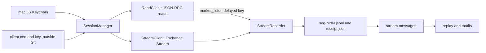

# Betfair Exchange integration: setup, read path and stream recorder

Prepared **2026-10-10**. Implementation guide, not evidence of profitability. No credentials existed and no live call was made when this was written.

**讀資料用 delayed key，落單有獨立閘門；key 唔係安全掣。**

`betangel_research/betfair` 係一個只用 Python 標準庫嘅 Betfair Exchange client：用 REST JSON-RPC 讀 market data、錄 Exchange Stream，再加一個預設 paper 嘅落單閘門。呢份文件講開始之前要準備咩、點樣讀資料同錄 stream。落單規則（arming、對數、kill switch）喺 [落單路徑](betfair-order-path.md)；每個外部事實嘅出處同等級喺 [fact register](betfair-facts.md)，下文嘅 `F01`–`F77` 全部指返嗰度。v1 嘅 live 範圍喺 2026-10-10 收窄咗（冇 live replace、live cancel 只可以整張取消、冇自動 live settlement、live 冇 hedge credit、kill 唔攞 lock），詳情見 [落單路徑 §1](betfair-order-path.md#1-modes)。

點解話「key 唔係安全掣」：Betfair 冇 sandbox，**delayed key 一樣可以喺真 exchange 落真錢**（F44）。所以安全唔可以靠「用 delayed key 就落唔到注」。真正嘅安全掣係落單閘門本身：預設 paper、live 要逐項 arming、每張單要人喺終端機打返一次，同埋 transport 層拒絕任何冇綁定 capability 嘅非讀取 JSON-RPC。



## 1. Evidence labels used

- 每條外部事實都有 F-id，對應 [`research/betfair-facts.json`](../research/betfair-facts.json) 同 [fact register](betfair-facts.md)。值係最多一句嘅 paraphrase，唔係原文；要倚賴之前請睇返原頁。
- `evidence_type` 用 repo 現有詞彙：`official_documentation`、`official_current_policy`、`official_data_specification`、`vendor_documentation`、`vendor_current_pricing`、`forum_participant_opinion`、`self_report_unverified`、`primary_research_simulation`，加上 `inferred`、`unverified` 同 `first_person_observation`。
- `retrieval` 包括 `official_rest_api_storage_read`、`official_page_read`、`official_four_page_pdf_read`、`zendesk_api_read`、`reader_proxy_read`、`wayback_snapshot_<ts>`、`man_page_read` 同 `local_python_check`。
- Betfair 係 exchange operator，佢自己嘅頁面算 `official_*`。`vendor_*` 只指 Bet Angel。`first_person_observation` 留畀我哋自己 first-live-test 嘅收據；2026-10-13 之後 F01、F02、F03、F50、F51、F65、F66 有 `secondary` `first_person_observation`（收據 sha256 喺 [live-test report](../reports/betfair-live-tests-2026-10-13.json)）。
- **只有少數事實喺 live Betfair API 上睇過：** 2026-10-13 Yu 用 delayed key 做咗 T1、T4、T6、T7 同 T8 嘅一部分（全部讀取，冇落單）；其餘未試。有衝突或者未驗證嘅地方，代碼揀較保守嘅做法（已知例外：F39 正好 0.80／1.25 嘅邊界，V14 而家收），詳情見 fact register 嘅 "Conflicts and open questions"。

## 2. Threat model

落單路徑係為咗擋以下呢啲：

- agent、script、cron、CI、雲端 host、錯嘅 checkout 或者錯嘅 working directory 意外或者無人看管咁落 live 單；
- 用過時或者偽造嘅 market data 計價；
- 結果未知之後再落多張，變成雙重下注；
- 本地 state 唔見咗，令風險上限被重設；
- secret 漏入檔案、log 或者 exception。

**佢擋唔到一個以 Yu 嘅 macOS user 身份運行、刻意作惡嘅 process。** 呢種 process 可以撳 Keychain dialog、假扮 pty、或者直接改 Python。終端機輸入同 Keychain dialog 呢類「人喺度」檢查只係拖慢自動化，唔係 Yu 在場嘅密碼學證明。

## 3. Account prerequisites

每個 Betfair account 有一條 Delayed key 同一條 Live key，經 Accounts API Demo Tool 嘅 `createDeveloperAppKeys` 開一次（[Application Keys](https://betfair-developer-docs.atlassian.net/wiki/spaces/1smk3cen4v3lu3yomq5qye0ni/pages/2687105)，`official_documentation`，accessed 2026-10-10）。

| | Delayed key | Live key |
|---|---|---|
| 用途 | development；准許 read-only | live betting applications |
| 費用 | 免費 | 一次過 £499，唔退款（F46，`official_current_policy`，頁面 2026-10-08 更新） |
| 開通條件 | 冇 | 先用 delayed key 測試、account 完成 KYC、有足夠資金扣 £499，再喺 developer.betfair.com 嘅 get-started 頁揀 Exchange API > For My Personal Betting，填頁底嘅申請表（F46；[SA/115003860331](https://support.developer.betfair.com/hc/en-us/articles/115003860331-How-do-I-activate-my-Live-App-Key)，2026-10-12 讀） |
| 價格資料 | 1–180 秒延遲 snapshot，3 層價位，冇 runner totalMatched（F44 嘅文件講法；我哋收據唔夾：2026-10-13 T6 delayed stream 嘅 runner `tv` 喺 1739 個 runner change 入面 677 個大過 0，T8a delayed REST 嘅 runner 有返 `totalMatched` 欄位，收據只數咗有冇、冇記數值；見 [fact register](betfair-facts.md#conflicts-and-open-questions)） | live；account 未入錢或者被 override 就變返 delayed（F47） |
| 只讀唔落注 | 准許 | **唔准許**，可能被限制或者停用（F46） |
| 喺真 exchange 落注 | **可以**（F44），冇 sandbox | 可以 |
| Stream | 2 條 connection、200 個 market，conflate 到 180000 ms（F44、F51） | connection 上限冇公佈（F56） |
| Transaction charge | 適用 | 適用（F61） |

由此引出幾條設計：

- 讀資料同 recorder 預設用 delayed key（`read.app_key_slot` 同 `stream.app_key_slot` 預設 `delayed`）。用 live key 錄 stream 要 `recorder.allow_live_key: true`，因為 live key 只讀係唔准嘅（F46）。
- live 落單一定用 live key：`JsonRpcClient.prepare_order` 要求 `app_key_slot == "live"`。用 delayed key 落單嘅路徑根本冇起。
- arming 唔依賴 key 類型去保證安全，因為 delayed key 都落到真注（F44）。
- 美國、德國、荷蘭、法國、新加坡等地嘅 IP 會被擋（F64）。live arming A10 要求操作者聲明係喺 UK 出網，而且環境冇 CI 或雲端標記。
- Betfair 嗰邊嘅 deposit limit 同 loss limit 冇 API，要自己喺網站 My Account 設定；建議設一個唔高過本地 `max_daily_loss` 嘅 loss limit 做獨立後備（見[落單路徑 §14](betfair-order-path.md#14-compliance-framing)）。

## 4. Certificate setup

預設用 certificate login（non-interactive，F01、F05）。Betfair 嘅 interactive login 頁強烈建議自用嘅 bot 改用 non-interactive endpoint（[DD/2687772](https://betfair-developer-docs.atlassian.net/wiki/spaces/1smk3cen4v3lu3yomq5qye0ni/pages/2687772)，即 F06 嘅來源頁，`official_documentation`；F06 嘅 value 冇講呢句）。網站 2-Step Authentication 唔影響 certificate login：[DD/2687915](https://betfair-developer-docs.atlassian.net/wiki/spaces/1smk3cen4v3lu3yomq5qye0ni/pages/2687915)（v114）同 [SA/115003855392](https://support.developer.betfair.com/hc/en-us/articles/115003855392-Can-I-enable-2-Step-Authentication-and-still-use-the-API-non-interactive-login-method) 都咁寫（`official_documentation`，2026-10-12 讀；唔喺 fact register，F01 嘅 value 冇講）。T1 收據冇記低網站 2-Step Authentication 開咗未，所以 T1 冇驗證到呢句。interactive login 只係後備（F06）。

Certificate 同 key 放喺 **所有 git worktree 以外**，預設 `~/.config/betangel-research/betfair/`。下面嘅命令喺呢部 Mac 用 Homebrew OpenSSL 3.6.2 同一條 synthetic key 試過，試完已刪；咁只證明命令行得通，唔代表 Betfair 接受結果。Betfair 官方步驟係將 `[ ssl_client ]` 加入 openssl.cnf（F05）；呢度改用一個獨立 cnf，加咗 `[ req ]`，令 `openssl req` 唔使互動問 subject。Betfair 文件冇要求特定 subject。

```sh
umask 077
mkdir -p ~/.config/betangel-research/betfair
cd ~/.config/betangel-research/betfair
cat > openssl.cnf <<'EOF'
[ req ]
distinguished_name = req_distinguished_name
prompt = no
[ req_distinguished_name ]
CN = betangel-research-client
[ ssl_client ]
basicConstraints = CA:FALSE
nsCertType = client
keyUsage = digitalSignature, keyEncipherment
extendedKeyUsage = clientAuth
EOF
openssl genrsa -out client-2048.key 2048
openssl req -new -config openssl.cnf -key client-2048.key -out client-2048.csr
openssl x509 -req -days 365 -in client-2048.csr -signkey client-2048.key \
  -out client-2048.crt -extfile openssl.cnf -extensions ssl_client
chmod 600 client-2048.key
rm client-2048.csr
```

- **上載**：登入 betfair.com，開 `https://myaccount.betfair.com/accountdetails/mysecurity?showAPI=1`，喺 "Automated Betting Program Access" 撳 Edit，揀 `client-2048.crt`，再撳 "Upload Certificate"。Betfair 唔會幫你加（F05）。
- **邊啲係 secret**：`.key`、`.pem`、`.p12` 係 secret；`.crt` 唔係；`.csr` 用完可以刪（F05）。
- **權限**：`check_cert_files` 要求兩個都係普通檔案、喺所有 worktree 以外，而且 key 冇 group 或 world 權限位（arming A5）。
- **可選加密（建議）**：最好由一開始就生成加密 key，咁明文 key 從來唔會落 disk。即係將上面第一行 `openssl genrsa …` 換做 `openssl genpkey -algorithm RSA -pkeyopt rsa_keygen_bits:2048 -aes-256-cbc -out client-2048.enc.key`，之後兩行 `openssl req`／`openssl x509` 嘅 `client-2048.key` 全部換做 `client-2048.enc.key`，`chmod 600` 亦一樣。每個命令都會喺終端機問 passphrase；唔好用 `-pass`／`-passin` 將佢放喺命令行。用 `openssl pkey -in client-2048.enc.key -noout` 確認 passphrase 解得開。
  - 已經有明文 `client-2048.key` 先想加密：`openssl pkey -in client-2048.key -aes-256-cbc -out client-2048.enc.key`，再用 `openssl pkey -in client-2048.enc.key -noout` 確認解得開，**之後一定要 `rm client-2048.key`**。揀咗加密就唔可以留低明文 key，否則加密冇保護作用。注意 macOS 嘅 `rm -P` 已經冇效（`man rm`：「This flag has no effect」），APFS／SSD 都唔保證覆寫，所以由一開始就生成加密 key 先係乾淨做法。
  - 用加密 key 就將 config 嘅 `key_path` 指去 `client-2048.enc.key`、`key_passphrase_in_keychain` 設 `true`，再用 `security add-generic-password -U -s betangel-research.betfair.cert-key-passphrase -a default -w` 存 passphrase。冇 passphrase 嘅時候，`make_tls_context` 唔會畀 OpenSSL 彈出輸入提示，加密 key 會直接報 `client_certificate_unloadable`。
  - 呢啲加密命令同樣喺呢部 Mac 用 OpenSSL 3.6.2、synthetic key 同 synthetic passphrase 試過（`openssl pkey -noout` 解得開、Python `ssl` 用 passphrase 載入得到），試完已刪；同樣唔代表 Betfair 接受結果。
- **Git**：repo 嘅 `.gitignore` ignore `*.key`、`*.pem`，同埋 shared-file patch S0 加嘅 `*.crt`、`*.csr`、`*.p12`、`*.pfx`（見 handoff）。無論點都唔好喺 repo 入面整 certificate。`doctor` 會報告 `.gitignore` 有冇 cover。
- **到期**：官方例子用 `-days 365`；續期同 Betfair 係咪只認一張 certificate，文件冇講（fact register 嘅 open questions）。

## 5. Keychain setup

所有 Betfair secret 只放 macOS Keychain。Service 名係寫死喺代碼，唔可以喺 config 改；Keychain 嘅 account 欄係 profile 名（預設 `default`）。

```sh
python3 -m betangel_research.betfair keychain-setup
```

佢只會印出命令，唔會執行：

```
security add-generic-password -U -s betangel-research.betfair.username -a default -w
security add-generic-password -U -s betangel-research.betfair.password -a default -w
security add-generic-password -U -s betangel-research.betfair.app-key.delayed -a default -w
security add-generic-password -U -s betangel-research.betfair.app-key.live -a default -T "" -w
```

- `-w` 一定係最後一個 token，`security` 就會提示你輸入個值（F68，`man_page_read`）。唔好將 secret 直接寫喺命令行，咁會入 shell history 同 `ps`。
- Live key 用 `-T ""`，意圖係冇任何 application 可以靜靜讀佢，每次讀都彈 macOS 授權 dialog。**彈出嚟就撳 Allow，永遠唔好撳 Always Allow**；Always Allow 應該會將 `security` 加入信任名單，之後讀取再冇 dialog（推斷：man page 冇提 Always Allow，所以呢個建議係保守做法、冇文件根據）。man page 寫明 `-T ""` 會拎走建立 item 嘅 application 預設嘅免警告讀取，但冇講之後係咪每次讀都彈 dialog（F73，`partially_unverified`），T0 會觀察；arming 唔依賴佢，因為代碼偵測唔到。
- 未開 live key 嘅話，第四行可以遲啲先做。

| Service | 內容 | 用途 |
|---|---|---|
| `betangel-research.betfair.username` | Betfair username | login |
| `betangel-research.betfair.password` | Betfair password | login |
| `betangel-research.betfair.app-key.delayed` | Delayed key | read path 同 recorder |
| `betangel-research.betfair.app-key.live` | Live key，用 `-T ""` 建立 | 只係 live 落單 |
| `betangel-research.betfair.cert-key-passphrase` | 可選 | 加密咗嘅 `client-2048.key` |
| `betangel-research.betfair.journal-anchor` | **唔係 secret** 嘅 JSON `{genesis_sha256, seq, last_sha256, updated_at}` | live journal anchor（[落單路徑 §7](betfair-order-path.md#7-journal-hash-chain-and-anchor)）；淨係 `credentials.publish_anchor` 會寫：每個 profile 一個 lock，喺 lock 入面先讀 journal head，所以 anchor 唔會退後（re-review R1） |

代碼讀 secret 嘅方法：`/usr/bin/security find-generic-password -s <service> -a <profile> -w`，用絕對路徑、`minimal_env()`（只有 `PATH=/usr/bin:/bin`、`HOME`、`USER`、`LOGNAME`）、capture output、120 秒 timeout（留時間答 dialog）。argv 只有 service 同 account 名。失敗只會報 `keychain_item_unavailable:<kind>`，stdout、stderr 一律唔保留。

代碼永遠唔會：

- 儲存 session token（每次 CLI run login 一次、完咗 logout；recorder 只喺記憶體保留 token）；
- 記錄 header、login body、token、username 或者 app key（`username` 係 forbidden key；但 username 嘅值唔會做 `assert_clean` 嘅 substring 掃描，因為佢係用家自己揀、短、可以合法噉出現喺 profile 名或者 home 路徑入面；唯一儲存嘅衍生值係 strip 同 casefold 之後嘅 account fingerprint。Certificate key passphrase 都唔做 substring 掃描：佢只喺本 process 解開 key 檔，從來唔送出、唔寫落任何地方，短嘅 passphrase 反而會撞中 betId 同 hash，令真單送出之後嘅 journal event 被拒。少過 8 個字嘅值一律唔掃）；
- 未經 `refuse_forbidden` 同 `assert_clean` 就寫任何檔案；
- 寫 TLS key log：`make_tls_context` 直接用 `ssl.SSLContext(PROTOCOL_TLS_CLIENT)`，唔用 `ssl.create_default_context()`（後者會讀 `SSLKEYLOGFILE`，令 OpenSSL 將每個 Betfair session 嘅密鑰寫入一個人人讀得到嘅檔，有 packet capture 就解得返 login、token 同 app key）；`check_tls_context` 亦拒絕任何設咗 `keylog_filename` 嘅 context；
- 儲存 `errorDetails` 或者 `sourceIdKey`。

所有測試都 inject 假嘅 Keychain runner，冇任何測試會 call 真正嘅 `/usr/bin/security`。

## 6. State root

所有 runtime state 放喺一個固定位置，**永遠唔喺任何 repository 入面**：

```
~/Library/Application Support/betangel-research/betfair/
  KILL                                   # 全域 kill file：擋晒所有 profile，paper 同 live 都擋
  .gateway.lock                          # 全域：每部 Mac 只可以有一個 live gateway process
  accounts.json                          # {account_fingerprint: profile}；只限 live
  profiles/<profile>/
    config.json                          # 測試以外唯一用嘅 config 路徑
    auth/login-ledger.jsonl              # 時間、方法、jurisdiction、結果；冇 token、冇 username
    orders/journal-paper.sqlite
    orders/journal-live.sqlite
    orders/.journal-anchor.lock          # live：每次寫 Keychain anchor 都攞嘅 lock（re-review R1）
    live-tests/<test_id>-<UTC>/          # first-live-test 嘅 raw response（私人，永不 commit）
    reads/<request_id>/{response.json,receipt.json}
    catalogue-cache/<market_id>.json
    recordings/run-ledger.jsonl
    recordings/<session_id>/...
```

`~` 係 `pwd.getpwuid(os.getuid()).pw_dir`，唔係 `$HOME`。目錄 mode 0700，檔案 0600。

**點解要喺 worktree 以外。** 呢部 Mac 而家有兩個 worktree：呢個（`feat/betfair-exchange`）同 Codex 用緊嗰個（`research/offline-edge-lab`）。如果 state 放喺 checkout 入面，每個 checkout 就有自己嘅 KILL、lock 同 journal：喺一個 checkout kill 咗，另一個照落單；風險上限變成「每個 checkout 各自計」；`git clean -fdx` 或者 rebase 可能刪走 journal；仲有 commit 錯嘢嘅風險。固定一個 root，加上全域 `KILL`、`.gateway.lock` 同 `accounts.json`（同一個 account 唔准第二個 profile 用，F76），就避免晒。

- `recorder.root` 同 `read.out_root` 可以設做所有 worktree 以外嘅絕對路徑，例如用大啲嘅硬碟。
- 其他嘢都唔可以改位置：`KILL`、`.gateway.lock`、`accounts.json`、`journal-live.sqlite`、`login-ledger.jsonl`、`config.json`。
- `--state-root`、`--config` 同 in-process `deps["home"]` 只喺 `BETANGEL_BETFAIR_FORBID_NETWORK=1` 時有效；嗰個變數係測試用嘅，有佢就連網絡都關埋。實作要求呢個變數喺 process 環境入面，而且被 override 嘅 root 一樣要喺所有 worktree 以外。

`doctor` 會印出解析咗嘅路徑：

```sh
python3 -m betangel_research.betfair doctor
```

佢預設離線，報告 config 有冇效、state 路徑、cert 同 key 嘅位置同權限、Keychain item 在唔在（只講在唔在，唔讀值）、`.gitignore` 覆蓋、arming 狀態同 anchor 狀態。`doctor --network` 先會 login、keepAlive、logout，而且只報 status。2026-10-13 嘅 T1 就係用 delayed key 跑呢個命令：cert login、keepAlive 同 logout 都係 `SUCCESS`，`can_bet` true。

## 7. Config walkthrough

```sh
python3 -m betangel_research.betfair init-config
```

如果 profile 未有 config，佢會將 [`research/betfair-config.example.json`](../research/betfair-config.example.json) 複製去 `profiles/<profile>/config.json`，再印出路徑同 `config_sha256`。之後直接改嗰個檔案。

| Section | 重點 |
|---|---|
| top level | `jurisdiction`（`com`、`com.au`、`it`、`es`、`ro`；live 只限 `com`）、`api_host`（預設 `api.betfair.com`；`api.betfair.com.au` 係 NZ 用嘅（F12），只可以配 `com.au`，即係 AUS/NZ 嘅 `.com.au` SSO host（F01））、`account_currency`（live 只限 GBP） |
| `coexistence.bet_angel` | `unverified`（預設）、`not_running_on_account` 或 `token_survival_verified`；見 §10 |
| `credentials` | `login_method` `cert`；`cert_path`／`key_path` 一定要喺 worktree 以外；`key_passphrase_in_keychain` |
| `session` | keepAlive 間隔（`com` 60–21599 秒，`it`／`es` 60–600，`com.au`／`ro` 60–3600）、`sso_http_method`（F08 有衝突，預設 POST）、login 上限 |
| `http` | timeout、`order_deadline_s`（ceiling 12）、`idle_reconnect_s` 170 |
| `read` | app key slot、throttle、retry backoff、`out_root`、catalogue cache 有效期 |
| `stream` | host（只准 `stream-api.betfair.com` 或 integration host）、port 443、heartbeat 500–5000 ms、`conflate_ms` |
| `recorder` | market filter、market data filter、`motif_compatible`、`max_markets`（ceiling 180）、`refresh_s`、`max_duration_s`、`max_bytes`、`allow_live_key` |
| `orders.caps` / `orders.rules` | 每張單、每個 market、總數、每日虧損、速率等上限；見[落單路徑 §6](betfair-order-path.md#6-risk-rules-r1r12) |
| `orders.paper` | `paper-v1` fill model 參數；`commission_rate` 同 `commission_source` **一定要填** |
| `orders.reconcile` | 對數 polling 參數 |
| `orders.live` | `armed`（預設 false）、`acknowledgements`、egress 聲明、`heartbeat_api_enabled`（一定要 false）、`kill_cancels_own_orders`（一定要 true；`false` 係 `ConfigError`，舊 config 照讀得，但 kill 一定會 sweep） |

規則：

- 唔認識嘅 key 一律拒絕；數字位唔收 bool；錢一定係有限正數、最多 2 個小數位，入面轉做 pence；JSON 有重複 key 都拒絕。
- **冇 `orders.mode` 呢個 key。** mode 只可以由 CLI 嘅 `--mode` 決定；config 自己永遠揀唔到 live。
- 下面嘅上限超過 ceiling 就係 `ConfigError`；要提高 ceiling 一定要改代碼再 review。

| Key | Ceiling | Key | Ceiling |
|---|---|---|---|
| max_stake_per_order | 50 | max_transactions_per_hour | 1000 |
| max_liability_per_order | 100 | max_instructions_per_request | 10 |
| max_market_exposure | 200 | max_price_deviation_ticks | 50 |
| max_total_exposure | 500 | max_book_age_s | 5 |
| max_daily_loss | 200 | funds_max_age_s | 300 |
| max_orders_per_minute | 30 | max_minutes_before_off | 120 |
| max_orders_per_hour | 600 | external_exposure_tolerance | 200 |
| max_orders_per_day | 2000 | http.order_deadline_s | 12 |
| session.max_successful_logins_per_10min | 60 | session.max_consecutive_failed_logins | 3 |
| recorder.max_markets | 180 | | |

- **Commission。** UK 跟 My Betfair Rewards；Betfair 自己嘅例子係 Basic 2%。example config 用 0.05，來源標 `community_secondary_rewards_5pct_conservative_unverified`，因為 5% 同 8% 只有二手來源（F62，`official_current_policy` + secondary `forum_participant_opinion`）。知道自己 package 就改用 `user_package_verified`。
- `config_sha256` 係驗證後 config 嘅 canonical sha256。live confirm token 用佢頭 12 位（[落單路徑 §2](betfair-order-path.md#2-live-arming-a1a19)），所以改 config 會令當日 token 改變。

## 8. Read path

所有讀取都經 `JsonRpcClient.call`，只准 `constants.READ_METHODS` 入面嘅七個 method：`listEventTypes`、`listMarketCatalogue`、`listMarketBook`、`listCurrentOrders`、`listClearedOrders`、`getAccountFunds`、`getAccountDetails`。每個 call 都係單獨一個 JSON-RPC body，唔 batch（F11）。

```sh
python3 -m betangel_research.betfair event-types --bet-angel-paused
python3 -m betangel_research.betfair catalogue --event-type 7 --countries GB,IE --market-types WIN --max 50 --bet-angel-paused
python3 -m betangel_research.betfair book --market 1.234567 --price-data EX_BEST_OFFERS,EX_TRADED --bet-angel-paused
python3 -m betangel_research.betfair orders-current --bet-angel-paused
python3 -m betangel_research.betfair orders-cleared --status SETTLED --from 2026-10-10T00:00:00Z --bet-angel-paused
python3 -m betangel_research.betfair funds --bet-angel-paused
python3 -m betangel_research.betfair account --bet-angel-paused
```

- `coexistence.bet_angel` 仲係 `unverified` 嘅時候，每個要 login 嘅命令都要加 `--bet-angel-paused`（§10）。
- 輸出係一份 JSON：`{"status": "betfair_read_response_personal_use_not_for_redistribution", "key_type", "app_key_slot", "request_started_at", "received_at", "result"}`。Betfair 資料只限個人、非商業用途（F63，T&C 19.3）。
- `book --out` 會喺 `read.out_root`（預設 `profiles/<p>/reads/`）寫 `response.json` 同 `receipt.json`（sha256、時鐘、key_type、code_sha256、config_sha256）。
- `account` 只會返 `currencyCode`、`countryCode`、`discountRate`、`pointsBalance`；任何名字都唔會返、唔會印、唔會寫。
- `listMarketBook` 冇 marketTime、bettingType、marketType、eventTypeId 或 ladder type（F43），所以 `market_snapshot` 會同 catalogue row join；冇 catalogue row 就 `invalid_reason="catalogue_missing"`，落單會被拒。CLOSED market 唔喺 catalogue（F70），cache 落嚟嘅 row 會留低做 settlement。
- **唔存在嘅 market id（T4，2026-10-13，delayed key）。** `book` 一個格式啱但唔存在嘅 market id，Betfair 冇返 JSON-RPC error envelope，淨係返一個空 list；`market_snapshot` 收唔到 book，報 `local:market_book_missing:unrecognized`（exit 2）。所以 T4 嘅 status 係 `no_envelope_observed`，F14、F15 嘅 error 拆解次序仲未喺 live 見過。
- **Delayed REST 嘅 traded ladder 見到係空（T8a，2026-10-13）。** `book --price-data EX_BEST_OFFERS,EX_TRADED` 喺兩個 market 各讀兩次（相隔 302／303 秒），所有 ACTIVE runner 嘅 `tradedVolume` 都係空 list，但 `lastPriceTraded` 同 runner `totalMatched` 欄位都有返（收據只數咗有冇）；兩次讀取 `isMarketDataDelayed` 都係 true。範圍只係呢 4 個 delayed REST book：係咪次次都空、live key 返乜，都未知。同日 T6 嘅 delayed stream 就有 `trd`（§9）。Paper 而家將 delayed（或者 `isMarketDataDelayed` 唔係 false）REST book 嘅空 ladder 當未知：唔 fill、唔當零 baseline，標 `passive_fill_unavailable_delayed_rest_trd_empty`，`paper-step` 喺 stderr 加一行 warning（exit code 照舊）；delayed REST ladder 如果有數，照佢嘅增幅計被動 fill（[落單路徑 §11](betfair-order-path.md#11-paper-model-assumptions) 第 6 步）。要模擬被動 fill，就用 `record` 錄，再 `paper-replay`（§9）；預設 `max_snapshot_age_s` 10 秒，conflate 咗嘅 recording 大部分單會 `paper_book_stale`（落單路徑 §11 第 2 步）。

**Request weight（F16，每個 request 上限 200 分）**

| `listMarketBook` priceData | 分 | 備註 |
|---|---|---|
| 冇 | 2 | |
| `SP_AVAILABLE` | 3 | |
| `SP_TRADED` | 7 | |
| `EX_BEST_OFFERS` | 5 | |
| `EX_ALL_OFFERS` | 17 | 有佢就覆蓋 `EX_BEST_OFFERS` |
| `EX_TRADED` | 17 | |
| `EX_BEST_OFFERS` + `EX_TRADED` | 20 | 代替兩者相加 |
| `EX_ALL_OFFERS` + `EX_TRADED` | 32 | 代替兩者相加 |
| depth > 3 | 總分 × `max(depth, 3)/3` | depth 少過 3 都當 3（較保守） |

Catalogue projection：`MARKET_DESCRIPTION` 同 `RUNNER_METADATA` 各 1 分，其他 0 分。每批 id 數係 `min(floor(200/weight), 250)`：`EX_BEST_OFFERS` 40 個、`EX_BEST_OFFERS+EX_TRADED` 10 個、`EX_ALL_OFFERS+EX_TRADED` 6 個、`EX_BEST_OFFERS` depth 10 係 12 個、乜都唔要係 100 個。`sort="RANK"` 永遠唔會送（F70）。`TOO_MUCH_DATA` 同 `REQUEST_SIZE_EXCEEDS_LIMIT` 當 planner bug，唔會 retry。

**Throttle 同 login 保護**

| 項目 | 本地上限 | Betfair 嘅限制 |
|---|---|---|
| 每個 market 嘅 `listMarketBook` | 每秒 4 次（滑動 1 秒） | 指引每秒 5 次（F17） |
| order projection 讀取同 `listCurrentOrders` in-flight | 2 | 3，兩份文件對計法講法唔同（F18） |
| `listClearedOrders` in-flight | 2 | 計唔計入上面嗰 3 個，DD 同 SA 講法唔同（F18）；本地兩個上限加埋最多 4 |
| 成功 login | 每 10 分鐘 30 次（ceiling 60） | 每分鐘 100 次之後 ban 20 分鐘（F10） |
| 連續失敗 login | 2 次就停，要 `login-reset`（ceiling 3） | 失敗計唔計唔清楚（F10） |
| login ban | 寫入 ledger，鎖 1260 秒，跨 restart 有效 | 20 分鐘（F10） |
| idle connection | 170 秒重連 | 3 分鐘閒置會斷（F13） |

**Login ledger 同 keepAlive（實作細節）。**

- 每次 login 寫兩行：送任何 byte 之前喺 file lock 之下先寫 `login_attempt`，之後再寫 `login_outcome`。冇 outcome 嘅 attempt（crash 或者另一個 process 未完）即刻計入成功上限；超過 `2 × http.timeout_s + 10` 秒仍然冇 outcome 就當失敗。結果未知（可能已到 Betfair）同 `invalid_response` 兩邊都計。Ledger 讀唔到或者有壞行，所有 login（包括 emergency）都 `login_ledger_unreadable`，因為壞行可能遮住一個 ban。
- `login-reset` 會略過壞行；略過咗任何一行，reset row 就加一個 1200 秒 ban（壞行可能本身係 ban），呢段時間連 kill、cancel、reconcile 嘅 emergency login 都會被擋。 `login-reset` 唔會清 ban；佢嘅確認 banner 講明呢兩樣，kill 被 ledger 拒絕時 exit 3 嗰行亦按原因講（[落單路徑 §9](betfair-order-path.md#9-kill-switch) 第 7 步）。冇 token 時嘅 lazy login（`SessionManager.token()`）沿用上一次成功 login 嘅 flag（emergency 同 `coexistence_ack`），同 relogin 一樣。
- Cert login 嘅 `loginStatus` 唔係 `SUCCESS`（包括 `LIMITED_ACCESS`）一律 `AuthError(<status>)`；如果 Betfair 照發 token，會 best-effort logout 一次，ledger 記 `session_refused`。
- keepAlive 失敗（FAIL 或 exception）之後最少等 60 秒先再試；recorder 會寫 `keepalive_failed` event，但唔會因此停錄。

**Retry（只限讀取）。** `unknown_outcome`、`rate_limited` 同 transport error 用 [1, 4, 16] 秒 backoff，一共最多 3 次（即係只會等 1 秒同 4 秒，16 用唔到）；preflight 失敗同確定性嘅 transport code（例如 `redirect_refused`、`response_too_large`、`tls_verification_failed`）唔 retry。`session` 錯誤 relogin 一次再試一次。`planner_bug`、`terminal_account`、`terminal_input`、`app_key`、`unrecognized` 唔 retry。JSON-RPC error 嘅拆解次序見 F14、F15。

## 9. Stream recorder

```sh
python3 -m betangel_research.betfair record --max-seconds 3600 --bet-angel-paused
python3 -m betangel_research.betfair verify-recording \
  --session "<recordings_dir>/<session_id>"      # recordings_dir：`status` 或 `doctor` 印出嘅 paths.recordings_dir
```

`record` 會逐行印 JSON 進度（`segment_opened`、`segment_closed`、每 60 秒 `heartbeat_at`、`gap`、`stopped`），最後印 summary。

**Session 同 segment。** 一次執行係一個 session；一個 subscription 係一個 segment。每個新 subscription 開新 segment，由新嘅 `SUB_IMAGE` 開始；recorder 永遠唔用 clock 續訂。所以每個 segment 檔都可以單獨 replay。訂閱一定送 `segmentationEnabled: false`（F52 未驗證佢一定有效，所以見到分段 line 就 close segment）。

**每個 segment 之前先數 market（避免爆 subscription 上限）。**

1. 用 delayed key 做 `listMarketCatalogue`（`maxResults` 1000、`FIRST_TO_START`），filter 係 `to_rest_market_filter(f, start_from_utc=now−1800 s)`。
2. 如果數目 ≤ `recorder.max_markets` 而且 < 1000，就用粗 filter `to_stream_market_filter(f)`（`subscription_mode="coarse"`）。
3. 否則用 `marketIds = ids[:max_markets]`（`subscription_mode="explicit"`）。
4. segment receipt 記低要求數目同 `requested_market_ids_sha256`。

Delayed key 嘅 stream 上限係 200 個 market（F44、F55），預設 `max_markets` 150。REST 同 stream 嘅 filter key 唔同（F75），`filters.py` 負責轉換，stream filter 永遠冇時間範圍。

**Refresh。** 每 `refresh_s` 重新數一次，喺同一條 connection 送新 subscription。新 subscription 係取代舊嗰個，唔係疊加；舊 segment 以 `scheduled_refresh` 關閉，新 segment 由新 `SUB_IMAGE` 開始。舊 subscription id 嘅 message 會丟棄同計數。收到 `SUBSCRIPTION_LIMIT_EXCEEDED` 就停成個 session（`subscription_limit_exceeded`）、寫 receipt、logout，永遠唔會用同一組再試。

**寫入前逐行檢查（`line_acceptance`）。** 一定要 `op == "mcm"`、`id` 等於 active subscription id、`pt` 係 int（唔係 bool）、`pt` 唔倒退、`segmentType` 係 null、raw line 冇 `\r`。

- `not_mcm` 同 `superseded_id` 唔寫入 segment；status 同 connection message 寫去 `events.jsonl`。
- 其他失敗（`pt_not_int`、`pt_regression`、`segmented`、`carriage_return`）會以該原因關閉 segment、喺 `events.jsonl` 記 `{rejected_line_sha256, reason, pt}`，然後重連。
- `ct=HEARTBEAT`、`con:true` 同 `status:503` 嘅 mcm line 照寫。

**檔案（`<recordings_root>/<session_id>/`，`session_id` 係 `rec-YYYYMMDDTHHMMSSZ-<8 hex>`，目錄唔可以已經存在）**

| 檔案 | 內容 |
|---|---|
| `seg-NNN.jsonl` | 每條通過檢查嘅 raw mcm line，逐 byte 照抄，去咗結尾符再加 `\n`；冇空行，所以第 n 行就係 `stream.messages()` 數嘅第 n 行 |
| `seg-NNN.recv.jsonl` | 每行一個 row：`line`、`byte_offset`、`bytes`、`sha256`、`received_at`、`monotonic_ns`、`pt`、`clk` |
| `events.jsonl` | connected、auth_status、subscribed、echo、status_message、rejected_line、disconnected、gap、segment_closed、stopped，加上 keepalive_failed、refresh_failed、echo_out_of_range、stream_factory_refused、ignored_message，全部有 `at` 同 `monotonic_ns` |
| `receipt.partial.json` | session 開始時已寫一次，之後每個 segment 關閉時 atomic 重寫；crash 之後只得呢個，`"complete": false` |
| `receipt.json` | session 關閉時 atomic 寫入 |

Raw line 唔會包一層 envelope：`stream.messages()` 會丟棄冇 `op` 嘅 line。本地收到時間放喺 sidecar，唔改原始 line。

**Receipt** 記錄 `status: "betfair_stream_recording_not_profitability_evidence"`、key type、endpoint、`data_freshness`（要求同 echo 嘅 conflateMs、heartbeatMs、label `delayed_conflated`／`live_unconflated`／`live_conflated`）、subscription、時鐘來源、每個 segment 嘅 hash、行數、`first_pt`／`last_pt`、`close_reason`、`replay_check`、gap 清單、`coverage: "continuous_within_segment_only_gaps_listed"`、licence note、`config_sha256`、`code_sha256`、git 狀態、`limitations` 同 `economic_result: null`。

- **時鐘。** `pt` 係 Betfair publish time；`received_at` 係本地 wall clock，冇獨立驗證；`monotonic_ns` 只可以喺同一 session 內比較。呢個 recorder 係 repo 第一個真正嘅本地收到時間來源。
- **Gap。** segment 之間嘅時間一律記做 gap，冇 forward-fill。重連會開新 segment（新 `img`），所以唔會靜靜咁將斷線前後駁埋。Paper replay 讀 receipt 嘅 segment `first_pt`／`last_pt` 同 `market_ids`，**按 market、按同一個 window 判斷**（R3#7、R3#8）：
  - 一張落喺 market M 嘅單，要生效時間 `t_a` 同生效 book 嘅時間都喺**同一個**列咗 M 嘅 window 入面先生效，否則 REFUSED（`paper_book_in_recording_gap`）；被動 fill 嘅 interval 要前後兩個 `pt` 都喺同一個列咗 M 嘅 window 入面，跨 gap、跨兩個 window、或者喺一個冇 M 嘅 window 入面都唔 fill。
  - Receipt 列咗、但冇 int `first_pt`..`last_pt` 嘅 segment（`lines 0`：未有 image 已經斷線）係一個空 window，即係嗰段乜都冇睇到；佢唔會令 gap guard 失效。
  - 一個 recording 只有喺冇任何 receipt 列佢時先算「未知」：全部未知就冇 window，report `limitations` 寫 `recording_gaps_unknown_no_receipt` 或者 `recording_gaps_unknown_segment_not_in_receipt`；已知同未知混埋一齊會拒絕（`ValueError("recordings_mix_known_and_unknown_gap_windows")`），因為未知嗰啲會令已知嗰啲嘅 gap guard 失效。
  - 剩餘風險（有記錄）：explicit mode refresh 令一個 segment 中途唔再帶某個 market，嗰個 market 仍然當覆蓋到 segment 嘅 `last_pt`；`max_snapshot_age_s` 限住生效 book 可以幾舊。
- **停止。** `max_duration_s`、`--max-seconds`、`max_bytes`（只停唔刪）、SIGTERM、SIGINT 都會關 segment、寫 receipt、logout。每個關閉咗嘅 session 喺 profile 嘅 `recordings/run-ledger.jsonl` 加一行（`recorder.root` 改咗位置都係寫返 profile 入面）。
- **重連。** `MAX_CONNECTION_LIMIT_EXCEEDED`、`TOO_MANY_REQUESTS` 最少等 60 秒，每次加倍，最多 3600 秒（我哋自己嘅設計，Betfair 冇講）；`max_reconnects_per_hour` 用完就停（`reconnect_budget_exhausted`）。未列明嘅 server code 當 `unrecognized`，停 session。
- **Echo 同 503。** Server echo 嘅 heartbeat 唔喺 500–30000 ms、或者 conflation 唔喺 0–180000 ms，就當冇 echo（記 `echo_out_of_range` event），liveness 用較短嘅 timeout。有 `status`（例如 503）嘅 mcm 照寫入 segment，但之後到下一個冇 status 嘅 mcm 之前，book cache 嘅 `snapshot()` 拒絕（`stream_unreliable`）。讀 recording 嗰陣（Astra C3）：stream 由健康變唔可靠嗰個 message，會將 cache 入面**每一個**有 definition 嘅 market 都以 `invalid_reason="stream_unreliable"` 出 snapshot，唔理個 503 有冇 `mc`、改咗邊個 market（冇改到嘅 market 用嗰個 message 嘅 `pt`、`observed_at` 同 `monotonic_ns`）；之後 503 期間嘅 message 只出佢哋改到嘅 market；第一個健康 message 再喺佢嘅 `pt` 出一次所有受影響 market 嘅可用 snapshot。Paper 唔用唔可用嘅 snapshot fill 或者生效，被動 fill 要前一個 snapshot 可用，traded volume 嘅 high-water mark 喺恢復嗰個 snapshot 先提升，所以 503 期間成交嘅量永遠唔會變成 fill；503 帶住嘅改變（例如 in-play）亦唔會因為 market 之後冇再變而唔見咗。
- **Paper replay 嘅 provenance（Astra C4）。** `paper-replay` 嘅結果唔單止取決於 recording 同 orders，仲取決於 replay 讀嘅其他檔案。所以 report 嘅 `inputs.dependencies` 逐個 recording 記低：`receipt.json` 同 `receipt.partial.json` 在唔在、佢哋嘅 sha256、用咗邊個（`receipt_used`），同 recv sidecar 嘅名、在唔在同 sha256；receipt 由被 hash 嘅同一批 bytes parse。`inputs.resolved` 記低解析出嚟嘅假設：`key_type`、`key_type_source`（`explicit`、`receipt` 或 `inferred_historical`）、gap `windows`（`[first_pt, last_pt, [market_ids]]`）同 `windows_status`（`known`、`unknown_no_receipt`、`unknown_segment_not_in_receipt`）。Ledger row 嘅 key 唔變，但 `source_sha256` 包埋 dependencies 同 resolved，所以同一份 recording 加唔加 receipt 會得出唔同嘅 `source_sha256`。
- **Stream client 一定要用同一個 session 同 config。** `stream_factory()` 返嚟嘅 client 唔係用 recorder 收到嗰個 `SessionManager`，或者 host、port、heartbeat、conflation 同 config 唔同，就停 session（`stream_factory_mismatch:<field>`），唔會連線。`recorder.allow_live_key` 唔係 true 就唔准用 live key 錄。
- **`verify-recording`** 核對 receipt hash 同檔案、recv row 由 1 連續到 `lines`、每行 sha256、`stream.messages()` 食晒每個 segment、`first_pt`／`last_pt` 同資料一致，同埋 receipt 用 `strict_json_loads` 讀得返。

**Delayed key 嘅 180 秒 conflation。** Delayed key 嘅 stream 會 conflate 到 180000 ms（F44、F51）：每 3 分鐘一個 data message，包晒過去 3 分鐘嘅變化；HEARTBEAT 照 heartbeatMs 嚟（T6：conflateMs 冇要求、echo 180000，heartbeatMs echo 5000；600 秒入面 3 條 DELTA、116 條 HEARTBEAT，條條都有 `clk`）。Receipt 會標 `delayed_conflated`。**呢啲資料唔支持任何細過 180 秒嘅 feature**；motif pipeline（`max_snapshot_age_s` 10 秒）會將佢哋當 stale 排除，咁係正確嘅。

**Replay 同 motif 相容性。** `motif_compatible: true` 時 `ladderLevels` 最多 3，預設 fields（`EX_BEST_OFFERS`、`EX_TRADED`、`EX_TRADED_VOL`、`EX_LTP`、`EX_MARKET_DEF`）會產生 `batb`／`batl`、`trd`、`tv`、`ltp`，同 ADV historical data 一樣格式（F59）。`EX_BEST_OFFERS_DISP` 會被拒，因為 microstructure 會當佢係 virtual。`motif_compatible: true` 仲要求有 `EX_BEST_OFFERS`（冇 `batb`／`batl` 嘅 record motif reader 當 `unsupported_basic_or_unknown_fields`），亦拒絕 `EX_ALL_OFFERS`、`SP_TRADED` 同 `SP_PROJECTED`（`atb`／`atl`、`spb`／`spl`、`spn`／`spf` 會令每個 record 變 `unsupported_pro_or_mixed_fields`）：`market_data_filter_fields_not_motif_compatible:<field>`。每個 segment 可以直接畀現有工具用：

```sh
python3 -m betangel_research replay --input <session_dir>/seg-000.jsonl \
  --config research/experiments/sample-preoff-v1.json --out outputs/<new-dir>
python3 -m betangel_research motifs --format adv --input <session_dir>/seg-000.jsonl --out outputs/<new-dir>
```

限制：R3（segment 被 microstructure 判做 ADV）只喺 synthetic 資料上測過；delayed stream 有 runner `tv` 同 `trd`（T6 收據：1739 個 runner change 入面 767 個有 `tv`、677 個 `tv` 大過 0、681 個 `trd` 非空），同 F44「delayed key 冇 "Total Matched by Selection"」唔夾（見 [fact register](betfair-facts.md#conflicts-and-open-questions)）；`replay_check` 要求每個 market 第一個 `mc` 有 `marketDefinition.marketTime`，否則 segment 標 `failed`。

**同現有文件嘅關係。** 用 delayed key 錄 stream 係 Betfair 准許嘅 read-only 用法（F44、F46）。但係：

> this recorder is permitted read-only use, not the research feed `docs/collection-pipeline.md` asks for; `research/data-provider-options.json` exclusions are superseded for this lane only

即係話：[collection pipeline](collection-pipeline.md) 要嘅係有權限、低延遲嘅研究資料；1–180 秒延遲兼 conflate 嘅 delayed stream 唔係。[`research/data-provider-options.json`](../research/data-provider-options.json) 嘅 `actions_excluded`（`credential_creation`、`betting_account_access`、`live_stream_connection`）只係對呢條 Betfair client lane 唔再適用；嗰兩個檔案冇改。Betfair 資料只限個人、非商業用途（F63，T&C 19.3），錄落嚟嘅檔案留喺 Git 以外。

## 10. Coexistence with Bet Angel

同一個 account 可能同時有 Bet Angel 用緊。「新 login 唔會令其他 session 失效」只係推斷，信心低（F67，`inferred`）。

- **`--bet-angel-paused`。** `coexistence.bet_angel` 係 `unverified` 嘅時候，每個要 login 嘅命令都要加呢個 flag，意思係操作者聲明 Bet Angel 已經 logout，或者冇喺度管理倉位。佢會以 `coexistence_ack: true` 記入 login ledger。冇加就 exit 2：`Betfair input error: bet_angel_coexistence_unverified; add --bet-angel-paused (you state Bet Angel is logged out or not managing positions); kill needs no flag`。呢段期間 CLI 印出嚟叫你跑嘅 live 命令（例如 probe bet 冇取消到時嘅 `cancel --mode live …`、`reconcile --mode live`）都會帶埋呢個 flag，照抄就跑得（[落單路徑 §1](betfair-order-path.md#1-modes)）。
- **T3 計劃。** 拎住 token A，喺 Bet Angel 或網站再 login，然後用 A call keepAlive。A 仲有效，就將 `coexistence.bet_angel` 改做 `token_survival_verified`；之後唔再需要個 flag。如果 Bet Angel 根本冇用呢個 account，可以設 `not_running_on_account`。
- **Heartbeat API 唔支援。** 佢停咗心跳就會取消 account 上**所有** LIMIT bet，唔係淨係某條 app key 嘅，包括 Bet Angel 嘅（F58）。transport 根本唔准 call 嗰條 path，arming A9 要求 `heartbeat_api_enabled: false`。
- **Account-wide cancel** 會刪埋 Bet Angel 嘅 hedge 同 stop 單（F31），所以 kill 預設只取消自己嘅單（[落單路徑 §9](betfair-order-path.md#9-kill-switch)）。
- **Kill 同 F67。** `kill` 唔使 `--bet-angel-paused`，用一個獨立嘅 emergency session login（照守 ban 同連續失敗上限）。`coexistence.bet_angel` 仲係 `unverified` 嘅時候，kill 會喺 stderr 印：`Betfair kill: F67 (inferred, unverified): if a new login ends other sessions, Bet Angel and any running gateway may be logged out; check Bet Angel after the kill.` 如果 F67 唔成立，kill 嘅 login 可能令 Bet Angel 或者另一個 gateway logout；kill 之後要睇返 Bet Angel。
- **Transaction charge 係按人計**，Bet Angel 嘅 transaction 都計埋（F61）。
- **R12。** `external_exposure_tolerance` 預設 0：如果 account 上有 Bet Angel 嘅倉位，`getAccountFunds` 嘅 exposure 會超出我哋自己單嘅 worst case，live 落單會 HALT（`unexplained_account_exposure`）。呢個係刻意嘅。
- 我哋嘅單全部用 `customer_strategy_ref`（預設 `bar-manual`）同 `bro…` 開頭嘅 `customerOrderRef`，方便同 Bet Angel 嘅單分開。

## 11. What is implemented / what is not

**已實作**（`betangel_research/betfair/`，只用標準庫；所有測試離線，用假 transport、假 Keychain、假 socket）。呢份文件喺 U2–U5 交付之前起草，integration（2026-10-10）按交付咗嘅代碼改過。下表每個 module 同測試都存在，`test_betfair_facts_doc` 會逐個對；全套測試結果見 [setup report](../reports/betfair-setup-2026-10-10.md)。

| 範圍 | Modules | 主要測試 |
|---|---|---|
| 基礎：常數、錯誤分類、schema、config、路徑、secret、Keychain、capability、收據、filter、transport | `constants.py`、`errors.py`、`schemas.py`、`config.py`、`paths.py`、`secret.py`、`credentials.py`、`capability.py`、`receipts.py`、`filters.py`、`transport.py` | `test_betfair_constants`、`test_betfair_schemas`、`test_betfair_config`、`test_betfair_paths`、`test_betfair_secret`、`test_betfair_credentials`、`test_betfair_receipts`、`test_betfair_filters`、`test_betfair_transport`、`test_betfair_syntax_floor` |
| Login 同 REST read path | `auth.py`、`api.py` | `test_betfair_auth`、`test_betfair_api` |
| Stream client 同 recorder | `esa.py`、`book.py`、`recorder.py` | `test_betfair_esa`、`test_betfair_book`、`test_betfair_recorder` |
| 落單核心（純函數） | `ticks.py`、`validate.py`、`risk.py`、`pnl.py`、`journal.py`、`lifecycle.py`、`paper.py` | `test_betfair_ticks`、`test_betfair_validate`、`test_betfair_pnl`、`test_betfair_risk`、`test_betfair_risk_properties`、`test_betfair_journal`、`test_betfair_lifecycle`、`test_betfair_paper` |
| Gateway 同 CLI | `gateway.py`、`reconcile.py`、`arming.py`、`killswitch.py`、`presence.py`、`cli.py` | `test_betfair_gateway`、`test_betfair_reconcile`、`test_betfair_arming`、`test_betfair_killswitch`、`test_betfair_presence`、`test_betfair_cli`、`test_betfair_boundaries` |
| 文件一致性 | 本文件、[落單路徑](betfair-order-path.md)、[fact register](betfair-facts.md) | `test_betfair_facts_doc`、`test_betfair_reports_no_account_data` |

測試數目、code hash 同 property test 規模見 [setup report](../reports/betfair-setup-2026-10-10.md)。

**未做、或者刻意唔做：**

- 2026-10-10 交付時未設定任何 credentials、未做過 live call。2026-10-13 Yu 用 delayed key 做咗讀取嘅 first-live tests（T1、T4、T6、T7、T8 嘅一部分；[live-test report](../reports/betfair-live-tests-2026-10-13.json)）。未落過任何單；£499 live key 未付。
- 冇自動交易策略；冇策略可以自動落單。程式 API（`source="api"`）只限 paper。
- 冇 order stream 路徑（`subscribe_orders` 有實作但 v1 gateway 唔用）；v1 只用 REST 對數。
- 冇 Heartbeat API、冇 in-play、冇 PERSIST／MOC／LOC／FOK／minFill／betTarget、冇 £1 以下注碼、冇非 GBP、live 只限 `com`。
- v1 live 收窄（Yu 2026-10-10 決定）刻意刪咗：live replace、live 減 size 嘅 cancel、自動 live settlement（改用人手 `settle-market`）同 live 嘅 hedge credit；paper 全部保留。
- 冇雲端部署：shared-file patch S0 會令 Docker image 排除 `betangel_research/betfair/`；Fly worker 只跑 collector。
- `AGENTS.md`、`.gitignore`、`.dockerignore` 同 `betangel_research/__init__.py` 只喺 S0 改：Yu 同 Codex 同意之後，coordinator 用一個獨立 commit 套用；`README.md` 嘅改動係 merge 之前最後一個獨立 commit（`merge_gate.readme_commit`）。

## 12. Sources with access dates

2026-10-10 讀取（fact register 有 14 行 2026-10-12 重讀過）。完整清單（每條事實嘅來源、日期同等級）喺 [fact register](betfair-facts.md)。主要來源：

- Betfair developer docs（`official_documentation`）：[Non-Interactive (bot) login](https://betfair-developer-docs.atlassian.net/wiki/spaces/1smk3cen4v3lu3yomq5qye0ni/pages/2687915)（v114，2026-07-01）、[Interactive login](https://betfair-developer-docs.atlassian.net/wiki/spaces/1smk3cen4v3lu3yomq5qye0ni/pages/2687772)、[Login & Session Management](https://betfair-developer-docs.atlassian.net/wiki/spaces/1smk3cen4v3lu3yomq5qye0ni/pages/2687869)、[Application Keys](https://betfair-developer-docs.atlassian.net/wiki/spaces/1smk3cen4v3lu3yomq5qye0ni/pages/2687105)（v143，2026-05-07）、[Market Data Request Limits](https://betfair-developer-docs.atlassian.net/wiki/spaces/1smk3cen4v3lu3yomq5qye0ni/pages/2687478)、[Exchange Stream API](https://betfair-developer-docs.atlassian.net/wiki/spaces/1smk3cen4v3lu3yomq5qye0ni/pages/2687396)、[Betting Type Definitions](https://betfair-developer-docs.atlassian.net/wiki/spaces/1smk3cen4v3lu3yomq5qye0ni/pages/2687465)。
- Betfair developer support（`official_current_policy`／`official_documentation`，`zendesk_api_read`）：[API 費用](https://support.developer.betfair.com/hc/en-us/articles/115003864531-Are-there-any-costs-associated-with-API-access)（2026-10-08 更新）、[read-only access](https://support.developer.betfair.com/hc/en-us/articles/25033076334748-What-is-read-only-Betfair-API-access)、[Delayed 定 Live key](https://support.developer.betfair.com/hc/en-us/articles/360009638032-When-should-I-use-the-Delayed-or-Live-Application-Key)、[IP 地區限制](https://support.developer.betfair.com/hc/en-us/articles/28271961503516-Which-IP-regions-are-restricted-from-accessing-the-Betfair-API)（2026-09-21 更新）。
- [ESA Swagger schema](https://raw.githubusercontent.com/betfair/stream-api-sample-code/master/ESASwaggerSchema.json)（`official_page_read`）同 [Historical Data Feed Specification](https://historicdata.betfair.com/files/Betfair-Historical-Data-Feed-Specification.pdf)（`official_data_specification`，`official_four_page_pdf_read`）。
- Betfair General T&Cs（`official_current_policy`；live 頁返 403，改讀 [Wayback 2026-05-11](https://web.archive.org/web/20260511012028/https://support.betfair.com/app/answers/detail/betfair-general-terms-and-conditions/)）。
- macOS `man security`、`man 2 fsync`（`man_page_read`，本機）。
