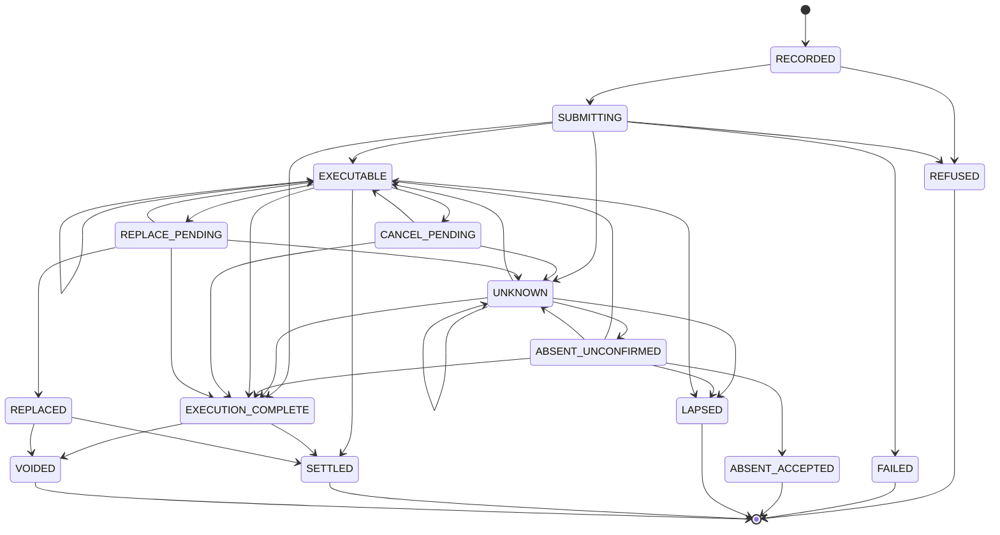

# Betfair order path: paper by default, live gates, reconciliation and kill switch

Prepared **2026-10-10**. Order-path design and operating guide, not evidence of profitability. No credentials existed, no order was placed and no live call was made when this was written.

**預設 paper；live 要全部條件齊、人喺終端機逐張打返，任何未知結果先對數、唔重發。**（RS-19 例外：登記咗嘅 pilot executor 嘅單唔使逐張打，由 Yu 喺自己揀嘅 racing day 最多打一次嘅 `PILOT ARM` 行加 decision record 代替；只喺 [RS-19](betfair-pilot-policy.md) 之下、Yu 畀咗 go-live 同意之後先適用；之前行為照舊。）

呢份文件講 `betangel_research/betfair` 點樣落單、取消、對數、人手 settle 同 kill；改單（replace）只限 paper。v1 嘅 live 範圍喺 2026-10-10 收窄咗（§1，[amendment A3](../.team-work/betfair-exchange-20261010/amendment-v1-live-scope.md)）。Setup、Keychain、state root 同讀資料喺 [接入指南](betfair-integration.md)；外部事實（F-id）喺 [fact register](betfair-facts.md)。威脅模型（擋到咩、擋唔到咩）見 [接入指南 §2](betfair-integration.md#2-threat-model)：一個以 Yu 嘅 macOS user 身份刻意作惡嘅 process 唔喺保護範圍內。

live 安全靠以下七樣嘢，冇一樣係靠 app key 類型：

1. 預設 paper。live 要每個命令都明確寫 `--mode live`，**同時** config 要 arm 咗。
2. 只有一個 choke point：`gateway.py`。每個 capability 綁定準確 request body bytes 嘅 sha256；transport 拒絕任何唔係讀取、又冇對應 digest 嘅 JSON-RPC call。
3. 每張 live 單，Yu 都要喺 `/dev/tty` 打返一次。RS-19 pilot 單例外：Yu 喺自己揀嘅 racing day 喺 `/dev/tty` 最多打一次 `PILOT ARM` 行，每張 pilot 單由 [engineering note](betfair-pilot-engineering.md) §4 嘅 decision record 代替逐張打（E1）；只喺 [RS-19](betfair-pilot-policy.md) 之下、Yu 畀咗 go-live 同意之後先適用；之前行為照舊。
4. 每部 Mac 一個固定 state root，喺所有 worktree 以外；kill file 同 gateway lock 係全域；journal anchor 放 Keychain；每次 live 開始都同 exchange 對數。
5. Journal 只可以加、唔可以改，有 hash chain；每條紀錄喺任何 byte 出網之前用 `F_FULLFSYNC` commit。
6. 未知結果永遠唔當零。UNKNOWN、ABSENT_UNCONFIRMED（同 paper 嘅 provisional replace child）用全額不利 exposure 計，未解決之前唔准再落新單；永遠唔會自動重發。Live 嘅 exchange 證據只可以證明一張 bet 存在、提高已知 matched size，永遠唔會降低計住嘅 worst case；冇任何嘢會自動 settle 一張 live 單（§8）。
7. live mode 下 gateway 自己用 live key 攞 market data，喺風險檢查之前一刻先攞；唔信 caller 畀嘅 book。

## 1. Modes

| | `paper`（預設） | `live` |
|---|---|---|
| 點樣揀 | 唔使做嘢 | 每個命令都要 `--mode live`，而且 `orders.live.armed: true`；config 自己揀唔到 live |
| Gateway | 用 `rpc=None` 起，結構上去唔到任何落單 endpoint | `rpc.app_key_slot == "live"`，`read` 包同一個 rpc |
| Book 來源 | snapshot 檔、recording，或者 delayed key 讀取（只有讀 call） | gateway 自己用 live key 攞；`--book` 會被拒 |
| 落單來源 | `cli_manual` 或者程式 API `source="api"` | 只限 `cli_manual`；`api` 會 `OrderRefused("api_source_paper_only")`。RS-19 例外：`pilot` 只喺 PA1–PA4 同 R13 全部過先收（E3），`api` 照舊只限 paper；只喺 [RS-19](betfair-pilot-policy.md) 之下、Yu 畀咗 go-live 同意之後先適用；之前行為照舊 |
| Journal | `orders/journal-paper.sqlite` | `orders/journal-live.sqlite` |
| 提示 | | 每個提示之前喺 stderr 印 `MODE=LIVE` |

**v1 live 範圍（amendment A3，Yu 2026-10-10 決定 D1–D5）。** Live 收窄到下表嘅命令。原則係：有疑問就刪 live 代碼，唔加 guard；更少 live 狀態、更少 live 命令、更少分支；live 單永遠唔會因為收窄而變得更寬鬆。Paper 保留晒（D5）。決定、理由同逐項 mapping 喺 [amendment 原文](../.team-work/betfair-exchange-20261010/amendment-v1-live-scope.md)；同 `final.txt` 衝突嘅地方以 amendment 為準。

| 命令 | Paper | Live |
|---|---|---|
| `init-config`、`doctor`、`keychain-setup`、`login-reset` | 離線 | 離線 |
| `event-types`、`catalogue`、`book`、`orders-current`、`orders-cleared`、`funds`、`account`、`record`、`verify-recording` | 只讀 | 只讀，冇改（D1） |
| `place` | 有 | 有：只限 LIMIT、`persistenceType` LAPSE；funds 喺 book 之前讀；R8–R10 冇 hedge credit（C1）；送第一個 byte 之前一刻再查（C2，§3）；exit 5（X5）；送出之後 signal 延後；HALT 同觸發佢嘅 event 一齊 journal |
| `cancel` | 有（可以減 size） | 有：只取消自己嘅 bet，**只可以整張取消**（`--size-reduction` 拒絕）；冇 send-by、冇 first-byte gate；capability 喺送出前一刻先 mint；exit 5 |
| `replace` | 有 | **刪咗**：喺任何 Keychain、journal、lock、login 或網絡之前拒絕（`live_replace_removed_v1`，exit 2） |
| `live-probe` | 冇（`probe_is_live_only`） | 有：只係落單再即刻取消；`--replace-step` flag 刪咗；T11 剔走 |
| `paper-step`、`paper-replay` | 有 | 冇 |
| `reconcile` | 冇 exchange 可以對（`paper_has_no_exchange_to_reconcile`） | 有，收窄：只解決 UNKNOWN／ABSENT_UNCONFIRMED，跟 §8 嘅證據規則；唔 refresh open 單、唔用 cleared rows close 單、唔 settle |
| `reconcile --accept REF` | 有 | 有（要打 `ACCEPT ABSENT <ref>`） |
| `settle-market`（新） | 冇：命令冇 `--mode` flag；paper market 經 `paper-step` 用 CLOSED book settle | 新，只限 live：operator 喺網站核對過之後，人手 settle 一個 CLOSED market（§8）；句子喺攞 lock 之前打 |
| `journal`、`status` | 有（paper `status` 計 hedge credit） | 有；`status` 嘅 exposure 冇 hedge credit（`exposure_basis: "worst_case_no_hedge_credit"`） |
| `kill`（own scope） | 有（kill file 同 journal HALT） | 有，改咗（D4）：唔掂 `.gateway.lock`；只 sweep 我哋嘅 bet；固定喺 KILL file 之後 20 秒同 35 秒再掃；journal 唔郁任何單（§9） |
| `kill --scope account --confirm-account-wide` | 冇 | 有，一樣唔攞 lock；冇「之前嘅 cancel-all 未有 report」檢查（§9） |
| `resume` | 有 | 有；有 `--confirm-live` 但冇 `--mode live` 會被拒（`confirm_live_needs_mode_live`） |

**刪咗嘅 live 路徑同拒絕訊息**（stderr 一行）：

| 路徑 | 喺邊度拒絕 | Code／exit | 操作者見到 |
|---|---|---|---|
| `replace --mode live …` | `cli.cmd_replace` 第一句：解析價錢、static arming、開 journal、讀 Keychain、攞 lock、login 之前 | exit 2，`live_replace_removed_v1` | `Betfair order refused: live_replace_removed_v1: live replace is not available in v1; nothing was sent. To move a bet, cancel it (cancel --mode live --market M --bet-id B) and place a new one (place --mode live ...).` |
| 程式 API：live 嘅 `OrderGateway.replace`、`open(command="replace")`、`RiskGuard.evaluate_replace` | 各自第一句 | `OrderRefused("live_replace_removed_v1")` | — |
| `live-probe --replace-step` | argparse（flag 已刪） | exit 2 | argparse 嘅 `unrecognized arguments: --replace-step` |
| `cancel --mode live … --size-reduction X` | `cli.cmd_cancel` 第一句：`_gateway`、Keychain、lock、login 之前；`OrderGateway.cancel` 亦拒絕（live params 嘅 `sizeReduction` 永遠係 null） | exit 2，`live_partial_cancel_removed_v1` | `Betfair order refused: live_partial_cancel_removed_v1: live cancels are full cancels in v1; nothing was sent. To reduce a bet, cancel it and place a new one.` |
| `settle-market --mode …` | argparse（冇呢個 flag） | exit 2 | argparse 嘅 `unrecognized arguments` |
| `orders.live.kill_cancels_own_orders: false` | `config.load_config` | `ConfigError("orders.live.kill_cancels_own_orders_must_be_true")`；kill 係 `kill_incomplete_config_unreadable`，exit 3 加網站／Bet Angel 指示 | — |
| 任何 live replace capability | `RiskGuard.issue`（`ACTION_VERBS` 冇 `replace`） | `OrderRefused("capability_body_mismatch")` | 結構上唔存在 |

**CLI exit code**（永遠唔會印 traceback 或者 raw response）：

| Exit | 意思 | stderr |
|---|---|---|
| 0 | 成功 | |
| 2 | 輸入錯誤或者被拒；乜都冇送 | `Betfair input error: …` 或 `Betfair order refused: <rule>` |
| 3 | `kill_incomplete*` | `Betfair kill incomplete: <reason>; <file state>; cancel open bets on the Betfair website or in Bet Angel now` |
| 4 | 送任何落單 request 之前嘅意外 exception，或者送單之前收到 signal | `Betfair stopped: <ClassName>; inspect local configuration/state` |
| 5 | 只限 live（X5）：命令開始咗一個落單或者取消 request，但冇照要求完成（request 未必真係送咗出去）；live `reconcile` 對完仲有 UNKNOWN 或 ABSENT_UNCONFIRMED 嘅單亦係 5（之前落單嘅結果仍然唔知）。**每張單 stderr 一行講實際情況同下一步**：UNKNOWN 嘅落單唔好重發，跑 `status` 或 `reconcile --mode live`；FAILED 嘅落單冇嘢 live；冇取消到嘅 bet 仲 live，可以再取消 | 見下 |

Exit 5 嘅情況同訊息（JSON 照印，之後先 exit）：

- `place`／`live-probe` 有任何單 FAILED、UNKNOWN 或 ABSENT_UNCONFIRMED，或者 Betfair 已經顯示佢減少咗（`exchange_reduction_withheld_until_settle`），或者 Betfair 只喺 cleared orders 列到佢（`cleared_row_bet_exists_worst_case`）；`cancel` 有目標單係 UNKNOWN、CANCEL_PENDING、帶 `error_code`，或者仲係 EXECUTABLE 有剩餘；`live-probe` 張 probe bet 冇取消到；live `reconcile` 對完仲有 unresolved 單（JSON `unresolved`，見 §8）。
- 落單每張一行：`Betfair order sent; outcome not as requested: <ref> <state> <error_code>; do not resend; run status or reconcile --mode live`。FAILED 就改印 `Betfair order not live: <ref> FAILED <error_code> (<原因>); nothing is live for this order; a fresh place is safe`：`(<原因>)` 係 journal 入面 exception 嘅 code（例如 `connect_failed`、`book_stale_before_send`；`transport_not_sent` 即係一個 byte 都冇寫出去，其他係 Betfair 拒絕咗）。原因係 `kill_engaged_before_send`（送第一個 byte 之前一刻見到 KILL file）就唔會講 fresh place 安全：`Betfair order not live: <ref> FAILED transport_not_sent (kill_engaged_before_send); nothing was sent: a kill is engaged, so do not place again until the kill has been dealt with`。
- Cancel 永遠唔講「唔好重發」：取消只會拎走我哋自己嘅 bet，再送一次冇風險。Bet 仲 live（例如 `cancel_not_processed`：連線或者 preflight 失敗、一個 byte 都冇送，或者 Betfair 拒絕咗個 cancel）：`Betfair cancel not done: <ref> bet <betId> is still live with <剩餘> unmatched (<error_code>); run cancel again now, or cancel it on the Betfair website or in Bet Angel`。結果未知：`Betfair cancel outcome unknown: <ref> bet <betId> <state> <error_code>; it may still be live: run reconcile --mode live, then cancel it again if it is still live, or cancel it on the Betfair website or in Bet Angel`。取消之前已經 match 咗部分或者全部、而家冇剩餘：exit 0，另外印一行資訊 `Betfair cancel: <ref> bet <betId> matched <m> before the cancel; nothing of it remains unmatched`。
- Betfair 顯示一張單已經（部分或者全部）取消、lapse 或者 void，但 journal 照 worst case 計住（`exchange_reduction_withheld_until_settle`，§8；包括 kill 取消咗嘅單）：`Betfair order <ref> bet <betId>: Betfair shows part or all of it cancelled, lapsed or voided (exchange_reduction_withheld_until_settle); it stays counted at worst case and shows as EXECUTABLE until you settle its market with settle-market after the market closes; status and reconcile change nothing; cancel it again only if orders-current still shows an unmatched part`。
- Probe bet 冇取消到：`Betfair live-probe: probe bet <betId> (LAY 1.00 @ 1.01) may still be live; cancel it now: cancel --mode live --market <M> --bet-id <betId>, or on the Betfair website or in Bet Angel`（冇 betId 就叫你跑 `reconcile --mode live` 再去網站或 Bet Angel 睇）。
- Betfair 只喺 cleared orders 列到張單（`cleared_row_bet_exists_worst_case`，§8：張 bet 存在，但唔係 current，例如 lapse 咗、喺網站或者 Bet Angel 取消咗、或者 kill 取消咗）：`Betfair order <ref> bet <betId>: Betfair lists this bet only among its cleared orders (lapsed, cancelled, voided or settled), not as a current bet (cleared_row_bet_exists_worst_case); it is not resting; it stays counted at worst case and shows as EXECUTABLE until you settle its market with settle-market after the market closes; status and reconcile change nothing; cancel it again only if orders-current still shows an unmatched part`。以前落單會 exit 0（好似仲掛住），cancel 會叫你「run cancel again now」，跟住做只會一路 UNKNOWN 到 `consecutive_unknown_outcomes` HALT（round 4）。
- 送出之後收到 signal：落單 `Betfair stopped after an order request was sent (<SIG>); result above; do not resend`；送出之後嘅意外 exception：`Betfair stopped after an order request was sent (<ClassName>); do not resend; run status or reconcile --mode live`。Cancel 永遠唔講「唔好重發」（round 4）：`Betfair stopped after a cancel request was sent (<SIG 或 ClassName>)[; result above]; the bet may still be live: check orders-current and cancel it again if it is, or cancel it on the Betfair website or in Bet Angel`；`live-probe`：`Betfair stopped after an order request was sent (...)[; result above]; do not run the probe again; the probe bet may still be live: check orders-current and cancel it, or cancel it on the Betfair website or in Bet Angel`。「Sent」由 `on_send` 決定，而 `on_send` 喺 cancel capability mint 咗之後、request 交畀 API client 之前一刻先 call：mint 被拒（乜都冇送）期間收到 signal 係 exit 4。
- Live `reconcile` 對完仲有 unresolved 單：每張一行 `Betfair reconcile: <ref> in market <M> is still <state> (<error_code>); new orders stay blocked; do not resend; run reconcile --mode live again later, and check the Betfair website or Bet Angel`；ABSENT_UNCONFIRMED 就改講 `if the Betfair website and Bet Angel show no such bet, run reconcile --mode live --accept <ref> --confirm-live TOKEN`。JSON `status` 照係 `reconciled`（amendment §3.3），exit 5。
- **`--bet-angel-paused` 喺印出嚟嘅命令入面。** `coexistence.bet_angel` 係 `unverified`（example config 嘅值，T3 之前）嘅時候，A12 拒絕冇呢個 flag 嘅每個 live 命令（kill 除外），所以上面每一行叫你跑嘅 live 命令（`reconcile --mode live`、`cancel --mode live …`、`orders-current`、`settle-market`）都會帶 ` --bet-angel-paused`，照抄就跑得（round 4：以前冇帶，照抄係 exit 2，probe bet 繼續 live）。Coexistence 拒絕嗰行亦講明點做：`Betfair input error: bet_angel_coexistence_unverified; add --bet-angel-paused (you state Bet Angel is logged out or not managing positions); kill needs no flag`。`live_replace_removed_v1` 同 `live_partial_cancel_removed_v1` 嗰兩句喺讀 config 之前印，所以冇帶 flag；照抄被拒嘅話，拒絕嗰行會講要加。冇 `--mode live` 嘅 `cancel` 係 paper：live 嘅 betId paper journal 唔識（`validation:V2`），嗰行會加 `this ran in paper mode (the default): for a live bet add --mode live`。
- **Open 之後先發現之前嘅 UNKNOWN 單 live 咗（round 4）。** `place`／`live-probe` 嘅 `open()` 會對之前嘅 UNKNOWN 單（§3 第 4 步）；對到 Betfair 有呢張 bet（EXECUTABLE 或 EXECUTION_COMPLETE），呢次落單就喺 risk decision 之前拒絕，乜都唔 journal、唔送（`earlier_unknown_resolved_at_open`，exit 2）：句子係喺 open 之前打嘅，嗰陣之前嗰張單仲係「結果未知、唔好重發」，所以新單可能正正係重發。JSON `orders` 列出嗰啲之前嘅單，每張一行：`Betfair: earlier order <ref> in market <M> had an unknown outcome and Betfair shows it as a bet: <state> bet <betId> matched <m> unmatched <r>; this order was not sent: check status and orders-current, then run the command again only if you still want it`。再跑一次就冇嘢要對，照常送。
- Order result 入面嘅 `decision` 係 risk guard 嘅決定，唔係 Betfair 嘅結果：發生咗咩要睇每張單嘅 `state`、`error_code`、`size_remaining` 同 `size_cancelled`。Paper 嘅 exit code 冇變（A9）。

**Signal。** 每個 gateway 命令都裝 SIGINT、SIGTERM 同 SIGHUP handler。第一個落單 request 送出之前收到：停低、照樣 close 同 logout，exit 4。由第一個落單 request 開始（gateway 嘅 `on_send` hook，喺 `_send` 封鎖 signal 之後、cancel capability mint 之後、request 交畀 API client 之前一刻 call），CLI 將 signal 延後：report、UNKNOWN 嘅對數（§3 第 15 步）、close 同 logout 全部照做，印咗 JSON 先 exit 5。即係送咗單之後撳 Ctrl-C 會等佢做完；要即刻停就喺另一個終端機跑 `kill`。`kill` 自己唔延後 signal（§9）。

## 2. Live arming A1–A19

每個失敗都有 code，而且會列晒所有失敗，唔係淨係第一個。

**靜態檢查（攞 lock 同 login 之前）**

| # | 條件 | 失敗 code |
|---|---|---|
| A1 | 有 `--mode live` **而且** `orders.live.armed is True` | `not_armed` |
| A2 | `--confirm-live` 等於 `live-<config_sha256[:12]>-<UTC YYYYMMDD>`；永遠唔讀環境變數 | `confirm_token_mismatch` |
| A3 | `orders.live.acknowledgements` 嘅集合等於全部 ack id | `acknowledgements_incomplete` |
| A4 | macOS、`credentials.source == "keychain"`、username、password 同 live key 三個 Keychain item 都在 | `keychain_credentials_missing` |
| A5 | cert 同 key 喺所有 worktree 以外；key 冇 group 或 world 權限位 | `cert_files_unsafe` |
| A6 | 所有 cap 都有，而且唔超過 ceiling | `caps_invalid` |
| A7 | `kill_engaged(paths)` 係 False（fail-closed），journal fold 冇 `halted` | `halted` |
| A8 | `jurisdiction == "com"` 同 `account_currency == "GBP"` | `jurisdiction_or_currency_unsupported` |
| A9 | `heartbeat_api_enabled is False`；Heartbeat API 會取消 account 上**所有** LIMIT bet，包括 Bet Angel 嘅（F58） | `heartbeat_unsupported_v1` |
| A10 | `operator_attests_uk_egress is True`，而且環境冇任何 CI／雲端標記（`CI`、`GITHUB_ACTIONS`、`GITLAB_CI`、`BUILDKITE`、`CODESPACES`、`KUBERNETES_SERVICE_HOST`、`AWS_EXECUTION_ENV`、`FLY_APP_NAME`、`FLY_MACHINE_ID`）（F64） | `egress_unattested_or_cloud` |
| A11 | `confirmer.require_present()`：stdin 係 tty，`/dev/tty` 讀寫得 | `operator_tty_required` |
| A12 | `coexistence.bet_angel != "unverified"`，或者有 `--bet-angel-paused` | `bet_angel_coexistence_unverified` |
| A13 | `paths.overridden is False`；root 喺所有 worktree 以外；`check_anchor(journal.anchor(), anchor_read())` 冇問題，而且 journal 喺 anchor `seq` 嗰條 event 仲係 anchor 記低嘅 hash；Keychain 讀唔到唔當冇 anchor。**先讀 Keychain anchor、後讀 journal head**：另一個 process 永遠先寫 journal 後寫 anchor，所以同時有人 append 都只會得出 journal ≥ Keychain，唔會誤報 mismatch（amendment A18）。`kill` 嘅 static A13 只查 state root | `state_root_invalid`／`journal_anchor_mismatch`／`journal_anchor_missing`／`journal_anchor_unreadable` |

**動態檢查（攞 lock、驗 journal、login 同 startup reconcile 之後）**

| # | 條件 | 失敗 code |
|---|---|---|
| A14 | login `SUCCESS` 而且 `can_bet` | `login_cannot_bet` |
| A15 | `accounts.json` 將 account fingerprint 對應到呢個 profile（或者未有，咁就登記），而且冇第二個 profile 嘅 live journal 帶住同一個 fingerprint（`accounts.json` 唔見咗都擋得住）；journal meta fingerprint 一致（F76）。Fingerprint 係 strip 同 casefold 之後嘅 username 嘅 sha256 | `account_registered_to_other_profile`、`account_registry_write_refused` |
| A16 | `get_account_details()["currencyCode"] == "GBP"`；冇呢個值都當失敗（F66） | `account_currency_not_gbp_or_unknown` |
| A17 | startup reconcile 冇 foreign order、冇同 journal 矛盾嘅 bet（§7），fold 冇任何 unresolved 狀態嘅單 | `unresolved_or_foreign_orders` |
| A18 | 自己攞嘅 book：`fetched_by="gateway_self_fetch"`、`app_key_slot="live"`、`is_market_data_delayed is False`、`catalogue_present`，而且用 `monotonic_ns` 同 `observed_at`（wall clock）兩個時鐘都計 `0 <= age <= max_book_age_s`（F47；macOS 嘅 monotonic clock 喺部機瞓覺時停，所以單靠佢會將瞓覺之前嘅價當新） | `market_data_delayed_or_stale` |
| A19 | journal fold 有 `ref_roundtrip_verified` event（只可以由 `live-probe` 產生，§13） | `ref_roundtrip_unverified` |

**Acknowledgements。** `orders.live.acknowledgements` 一定要包齊以下八個（載入 config 唔要求齊，arming 先要求）：

| id | 意思 |
|---|---|
| `delayed_key_places_real_bets` | delayed key 都落到真注，冇 sandbox（F44） |
| `no_sandbox` | 冇測試環境，所有 live 嘢都係真錢 |
| `account_shared_with_bet_angel` | 同一個 account 可能有 Bet Angel 喺度用 |
| `heartbeat_disabled_by_default` | Heartbeat API 唔支援；斷線唔會自動取消單（F58） |
| `transaction_charges_apply` | transaction charge 適用（F61） |
| `personal_use_only` | 個人 account、自己啲錢、資料只限個人用途（F63） |
| `unknown_outcomes_block_until_reconciled` | 未知結果會擋住新單，直到對完數 |
| `kill_cannot_undo_matched_bets` | kill 只取消未 match 嘅部分，已 match 嘅注收唔返 |

**Confirm token。** `live-` + `config_sha256` 頭 12 位 + `-` + UTC 日期 `YYYYMMDD`，例如 `live-0123456789ab-20261010`。佢只係每日一次嘅摩擦：`config_sha256` 唔係秘密，所以 token 冇保密作用（HMAC 方案因此被否決）。`status` 會顯示計算用嘅 `config_sha256` 同 UTC 日期；冇 `arm-token` 命令，token 只可以由 `--confirm-live` 傳入，永遠唔讀環境變數。

**每個命令要過邊啲檢查**

| 命令 | 檢查 |
|---|---|
| `place` | A1–A19 |
| `live-probe` | A1–A18（唔使 A19） |
| `cancel` | A4、A5、A8、A10、A12、A13；然後 A14（只要 login，唔使 `can_bet`）同 A15。halt 或者 kill 咗都照准；只可以整張取消，冇打句子，即刻送 |
| `reconcile` | 同 `cancel`；`--accept` 加 A1、A2、A11 |
| `settle-market`（只限 live） | 同 `reconcile --accept`：A1、A2、A4、A5、A8、A10、A11、A12、A13，然後 A14（只要 login）同 A15。唔要 A7：halt 或者 kill 咗都准，因為佢唔送單。`coexistence.bet_angel` 係 `unverified` 嘅時候（T3 之前）一定要 `--bet-angel-paused` |
| `kill`（own scope） | 只要 A4 同 A13 嘅 state-root 部分；**唔攞、唔等 `.gateway.lock`**。kill file 同 journal HALT 喺任何檢查之前已經寫好；login 係 emergency login |
| `kill --scope account` | 再加 A11 同打一句確認（§9） |
| `resume`（live） | A2、A11、A13；kill file 一定要已經唔存在 |
| `pilot-register`（RS-19） | Yu 打 `REGISTER PILOT` 行，go-live 同意之後（[engineering note](betfair-pilot-engineering.md) §14）：A2、A11、A13；寫 registration receipt |
| `PILOT ARM` 行（RS-19） | Yu 每個 racing day 最多打一次：A2、A11、A13；開一個 session（[engineering note](betfair-pilot-engineering.md) §3） |
| `pilot-run --mode live`：決定同落單（RS-19） | executor，喺 arm 咗嘅 session：每次 placement open 都過 A1–A19、PA1–PA4、R1–R13、[engineering note](betfair-pilot-engineering.md) §4–§6 同 §5 嘅 first-byte gate |
| `pilot-run`：剩餘取消（RS-19） | executor：`cancel` 嗰套（A4、A5、A8、A10、A12–A15，只要 login）；HALT 同 KILL 期間照行；冇 PA gate；只可以整張取消自己嘅 pilot 單；KILL 期間跟 [engineering note](betfair-pilot-engineering.md) §8 |
| `pilot-run` 入面嘅 `SETTLE MARKET`（RS-19） | Yu 喺 settle point 打：`settle-market` 嗰套，再加 [engineering note](betfair-pilot-engineering.md) §8 嘅 settle-point 規則 |
| `pilot-capture`（RS-19，只讀） | session 入面由 executor 喺 placement open 之間跑；session 之後 Yu 打（[engineering note](betfair-pilot-engineering.md) §11）：唔使 arming 行、乜都唔送、唔郁單嘅狀態或者 exposure；有 session arm 住嗰陣 Yu 自己跑會被拒 |
| `PILOT ACK` 行（RS-19） | Yu 打：A2、A11、A13；清一個 review stop，包括 RS-19 嘅 −£150 停頓（[engineering note](betfair-pilot-engineering.md) §10） |

RS-19 嗰幾行（`pilot-*` 同 `PILOT …`）嘅代碼喺 RS-19 嘅 build 同意之後先寫同 merge；Yu 畀 go-live 同意、再跑 `pilot-register` 之前冇 registration receipt，PA1–PA3 會拒絕所有 pilot 落單。表入面其他行照舊。

Live `replace` 冇 arming：喺任何檢查之前已經拒絕（§1）。`status`、`journal`、`doctor`、`keychain-setup` 同 `init-config` 全部離線，唔使 arming。

- `open()` 自己會再跑一次靜態檢查（defence in depth）；開唔到或者動態檢查失敗，成個 process 都當未 arm，之後每個 live place、probe、cancel、reconcile、settle-market 都即刻 `NotArmed`，唔會出提示、唔會讀、唔會落單。
- `place`、`live-probe`、`cancel`、`reconcile`（包括 `--accept`）嘅 `open()` 做 startup reconcile（§7）。`settle-market` 唔做：佢按每張單嘅 worst case 入數，唔理 exchange 顯示乜，而 foreign bet 本來就唔喺 journal，所以 startup reconcile 喺度保護唔到任何錢（amendment K26／K35）。`kill` 同 `kill --scope account` 唔做，因為 sweep 本身讀同樣嘅 exchange 腿，緊急 kill 唔應該等多餘嘅讀取。
- CLI 嘅 `kill` 唔使 `--bet-angel-paused`。Config 讀唔到（包括 `kill_cancels_own_orders` 唔係 `true`）、static arming 失敗、或者 `--scope account` 冇 `--confirm-account-wide`，都係 exit 3 `kill_incomplete_*`（kill file 已經 engage 咗），唔係 exit 2。

## 3. Choke point, capability and transport digest gate

```mermaid
flowchart LR
    CLI[cli.py place] --> SA[static_arming A1-A13]
    SA --> TTY[preconfirm: operator echo on /dev/tty, no lock held]
    TTY --> OPEN[gateway.open: lock, journal verify, anchor check, login, startup reconcile, anchor write]
    OPEN --> FUNDS[getAccountFunds, journal funds_check]
    FUNDS --> BOOK[self-fetch book with live key]
    BOOK --> DA[dynamic_arming A14-A19]
    DA --> RG[validate + RiskGuard R1-R12]
    RG -->|approved| PREP[prepare_order: body bytes + sha256]
    PREP --> CAP[RiskGuard.issue: capability bound to sha256, TTL 5 s]
    CAP --> J[journal submit, F_FULLFSYNC]
    J --> KILL{KILL file?}
    KILL -->|engaged| HALT[REFUSED, nothing sent]
    KILL -->|clear| SEND[send_order: send_by = min of book freshness and capability expiry, consume capability]
    SEND --> GATE[transport digest gate, then connect]
    GATE --> FB{first-byte gate: send_by, KILL file, book age on both clocks}
    FB -->|refused| NS[FAILED transport_not_sent, zero bytes]
    FB -->|clear| BF[(Betfair placeOrders)]
    RG -->|refused| REF[journal refusal, exit 2]
```



**Live place 逐步：**

1. CLI 解析參數。錢同價錢用 `ticks.parse_money`／`parse_price`；`nan`、`inf`、`1e1`、≤ 0 全部拒絕。
2. `static_arming`；有任何失敗就拒絕，exit 2。
3. 叫操作者確認（`gateway.preconfirm`）：喺 `open()` 攞 lock **之前**，`confirmer.confirm_line(order_echo_line(...), banner=LIVE_BANNER)`，stderr 先印 `MODE=LIVE`。打好嘅行留喺嗰個 gateway object；`place` 用一次就消耗，並 journal 做 `operator_confirm`（`typed_before_lock: true`）。冇打過嘅行會 `OrderRefused("operator_confirmation_missing")`。咁樣一個冇人答嘅提示唔會攞住全域 lock、擋住另一個 process 嘅 kill。RS-19 pilot 單冇呢步：冇逐張打嘅行，由 session 嘅 `PILOT ARM` 行加 [engineering note](betfair-pilot-engineering.md) §4 嘅 decision record 代替（E1）；reservation、fetch 同 decision 全部喺 `open()` 之後、lock 之下做；只喺 [RS-19](betfair-pilot-policy.md) 之下、Yu 畀咗 go-live 同意之後先適用；之前行為照舊。
4. `gateway.open()`：再跑一次 static arming；攞全域 `.gateway.lock`（最多等 `order_deadline_s + 5` 秒；成個 process 期間都持有；`kill` 永遠唔攞，§9）；驗 journal hash chain；喺 lock 之下再對一次 Keychain anchor（A13，先讀 Keychain 後讀 journal head）；fold 入面 SUBMITTING 嘅單變 UNKNOWN（`crash_between_submit_and_report`），仲係 RECORDED 嘅單變 REFUSED（`crash_before_submit`：submit 一定喺任何 byte 之前 journal，所以未有 submit 嘅單一定冇送過）；兩樣都係 compare-and-append，對住 fold 之前讀嘅 head（round 4：一個 `.gateway.lock` 檔被換咗嘅 gateway 可以喺 fold 同 append 之間 journal 自己嘅 submit，以前會將一張送緊嘅單變 REFUSED、零 exposure），head 郁咗就乜都唔寫，單留喺原位（SUBMITTING 照讀做 UNKNOWN，RECORDED 嘅落單唔計 exposure），下一次 open 再做；login；檢查 account registry；`startup_reconcile`（§7）；`place` 同 `live-probe` 再為每張 UNKNOWN 單跑 `reconcile_unknown`（最新嗰張先；成個 open 最多 120 秒；只 fold 一次揀單，之後每對完一張先再 fold，所以成本跟 unresolved 單數，唔跟 journal 有幾多張單；KILL file 一出現就停，張單保持 UNKNOWN、照全額不利計，唔同 kill 爭 F18 嘅 3 個 concurrency；對到之前嘅單係 live bet，呢次落單就會被拒，`earlier_unknown_resolved_at_open`，§1）；最後經 `publish_anchor` 將 journal head 寫入 Keychain anchor（§7）。寫唔到 anchor 嘅話，`place`、`live-probe`、`reconcile --accept` 同 `settle-market` 拒絕（`journal_anchor_write_failed`；佢哋等另一個寫 anchor 嘅人最多 `credentials.ANCHOR_PUBLISH_WAIT_S`，30 秒）；`cancel` 同 `reconcile` 照做，記低 note，而且最多只等 `killswitch.JOURNAL_BUSY_TIMEOUT_S`（2 秒），因為佢哋等緊嘅時候攞住 `.gateway.lock`、cancel 未送（§7）。
5. 用 `getAccountFunds` 攞新 funds（journal 做 `funds_check`）。Funds 喺 book **之前**讀（amendment C2）：book 嘅年齡窗口限住送單時間，所以呢個窗口只需要包 risk decision、journal append 同連線，唔使包 funds 嗰個 round trip。
6. 自己攞 book：`read.market_snapshot(market_id, fetched_by="gateway_self_fetch")`，用 live key。Book 喺操作者打完之後先攞；按 monotonic clock 或者 wall clock 已經舊過 `max_book_age_s` 就再攞一次（V10 同 A18 亦兩個時鐘都要過）。之後 `dynamic_arming`（連 A18）、`validate_place` 同 `guard.evaluate_place`（§6）。被拒就 journal `intent` 同 `risk_decision(refused)`，exit 2。RS-19 pilot 單冇人逐張打：send book 喺 [engineering note](betfair-pilot-engineering.md) §4 嘅 PLACE record 之後先攞，照樣過 A18、V0–V14 同 V9b，再加 V13，off 要同 record 一樣；決定只由 decision book 做，唔會用 send book 重新決定；只喺 [RS-19](betfair-pilot-policy.md) 之下、Yu 畀咗 go-live 同意之後先適用；之前行為照舊。
7. 砌 params，`prepared = rpc.prepare_order(PLACE_METHOD, params)`。
8. `cap = guard.issue(decision, prepared, now_monotonic_ns=...)`：TTL 5 秒，綁 `prepared["body_sha256"]`。
9. Journal `submit`（body sha、refs、decision id、params），用 `F_FULLFSYNC` commit。寫之前查兩樣，任何一樣唔啱就唔送、單變 REFUSED：(a) `.gateway.lock` 個 path 仲係指住我哋鎖住嗰個檔（`gateway_lock_lost`，live 會 HALT；例如有人當佢係舊 lock 刪咗，第二個 gateway 鎖咗個新檔）；(b) 由 risk guard fold 嗰刻到而家，journal 入面只有呢張單自己嘅 event（`journal_changed_since_decision`）。`submit` 本身係 compare-and-append：喺同一個 `BEGIN IMMEDIATE` 入面對 head，所以查完同寫之間冇嘢插得入。拒絕嘅 `risk_decision` 將呢個 request 自己未送嘅 ref 變 REFUSED；另一個 gateway 已經 REFUSED 咗嘅 ref（佢 open 時嘅孤兒 pass）就照留，唔會令 append 失敗（round 4）。
10. 再檢查 `kill_engaged(paths)`（fail-closed）。如果 engaged：capability 唔用、乜都唔送，單變 `REFUSED(kill_engaged_after_submit_journal)`；HALT 同呢個 `report` event 一齊寫（payload `halts`，見 §7），唔係之後另一條 event。（以前嘅 `book_clock_disagreement_before_send` 檢查刪咗：第 12 步嘅 first-byte gate 喺送第一個 byte 之前一刻用兩個時鐘查 book 年齡，已經包埋佢。）
11. 用 `signal.pthread_sigmask` 擋住 SIGINT、SIGTERM 同 SIGHUP，然後（cancel 嘅 capability 喺呢度 mint 完之後）call `on_send` hook：CLI 由呢刻開始延後 signal（§1）；mint 被拒就唔會 call，所以乜都冇送嘅 cancel 唔會被當成「送咗」。
12. `rpc.send_order(cap, prepared, send_by_monotonic_ns=..., send_gate=...)`。`send_by` = book 嘅 `monotonic_ns` + `max_book_age_s`，API client 再同 capability 嘅到期時間取較早嗰個。Transport 連好線之後、喺 `conn.endheaders(payload)` 之前一刻（`putrequest`／`putheader` 只係 buffer，未寫任何 byte）先查：過咗 `send_by` 就 `send_window_expired`；KILL file 存在（fail-closed）就 `kill_engaged_before_send`；book 按任何一個時鐘舊過 `max_book_age_s` 就 `book_stale_before_send`。任何一樣成立：`TransportError(phase="send", may_have_arrived=False)`，一個 byte 都冇寫出去，單變 `FAILED(transport_not_sent)`，code 寫入 journal 嘅 exception payload。所以慢嘅 TLS 連線、瞓過覺嘅 Mac 或者啱啱 engage 嘅 kill 都唔會令一張舊價錢嘅單出網。
13. Journal `report`，或者連 exception 結果嘅 `report`；呢次結果觸發嘅 HALT（例如 `terminal_account`、`unrecognized`、連續第 3 次或之後嘅 UNKNOWN）喺同一條 event 嘅 payload `halts` 入面（R3#13），唔會因為 process 喺兩條 event 之間死咗而唔見。
14. 解除 signal 封鎖。
15. 分類同轉狀態（§5）；有 UNKNOWN 就對數。`place`／`live-probe` 喺對數之前同每張單之前都睇 KILL file：出現咗就即刻停，單保持 UNKNOWN（仍然全額不利），交畀 kill 嘅再掃取消（§9）。
16. （刪咗。）以前呢步會喺 kill 之後用 betId 取消呢個 process 啱啱落嘅單；佢同 kill 自己嘅 cancel 重複，仲會因為 `BET_TAKEN_OR_LAPSED` 留低一張擋住 R3／A17 嘅 UNKNOWN。而家由 kill 嘅再掃負責（amendment A12）。
17. `close()`：用 `publish_anchor` 寫 anchor（§7 Anchor；等另一個寫 anchor 嘅人最多 `killswitch.JOURNAL_BUSY_TIMEOUT_S`，2 秒），放 lock；之後 CLI logout。`close()` 寫唔到 anchor 只會喺 stderr 印 `Betfair warning: <code>; the Keychain anchor lags the journal ...`（`journal_anchor_write_failed`、`journal_anchor_publish_busy`、`journal_anchor_lock_unavailable`，或者 Keychain anchor 讀唔到嘅 `journal_anchor_unreadable`／`journal_anchor_invalid`），exit code 唔變：單可能已經送出，非零 exit code 會引人重發。下一個 live 命令嘅 `open()` 會補寫。例外係 `journal_anchor_not_extended`（journal 喺 session 期間被還原做舊版本，§7）：warning 講 anchor 留咗喺前面，下一個 live 命令會因為 `journal_anchor_mismatch` 拒絕。

**Book 規則。** live mode 嘅 `book=` 一定係 None（`book_source_not_allowed_live`），CLI 用 `--mode live` 加 `--book` 會被拒。Book 喺操作者確認之後先攞，所以唔會舊過確認；攞完再查一次年齡，超過 `max_book_age_s` 就再攞。確認嘅內容係 market、selection、side、price、size；`marketVersion` 用最新 book 嘅。

**Capability。** `OrderCapability` 只可以喺 `capability.py` 建立，`_mint` 只可以由 `risk.py` call（AST 測試）。佢綁定 decision id、method、body sha256 同 mode，只限 live，5 秒過期，用一次就燒（唔夾、過期、重用都燒）。`send_order` 先 consume capability，再將同一個 digest 交畀 transport。

**Send bound 嘅結構規則（amendment C2）。** `JsonRpcClient.send_order` 係一張單嘅 body 唯一可以走嘅路。placeOrders body 一定要同時有 `send_by_monotonic_ns` 同 `send_gate`，否則 `OrderRefused("capability_send_bound_required")`；其他 method 帶任何一個都拒絕（`send_bound_not_for_this_method`）。兩個拒絕都喺 consume capability 之前發生，capability 照燒，結果係 FAILED_NOT_SENT。Transport 亦拒絕喺冪等讀取帶呢兩個參數（`invalid_request`）。Cancel、kill 嘅 sweep cancel 同 account-wide cancel 全部唔帶：遲咗取消自己嘅 bet 唔會加風險。佢哋嘅 capability 喺 `_send` 入面、`submit` append 之後、`send_order` 之前一刻先 mint，所以慢嘅 journal 或者慢嘅重連都唔會令 kill 嘅 cancel 過期；mint 被拒會當 FAILED_NOT_SENT journal（CANCEL_PENDING → EXECUTABLE，`cancel_not_processed`）。

**Transport digest gate。** 兩條 JSON-RPC path 嘅 body 一定要係單一 JSON object（唔准 batch），結構正好係 `{jsonrpc: "2.0", method, params, id}`，key 唔可以重複。`method` 喺 `READ_METHODS` 就唔准帶 digest；其他 method 一定要喺 betting path、`order_digest == sha256(body)`、`idempotent=False`，而且嗰個 digest 一定要係同一個 process 入面一個已 consume 嘅 capability 記低咗、未用過嘅（`capability.take_consumed`，用一次就冇；淨係計到 body 嘅 sha256 唔夠），否則 `TransportError(phase="preflight", code="unbound_rpc_refused")`，一個 byte 都唔送。呢個係 in-process 防手誤：同一個 process 嘅代碼始終掂得到個私有 set，所以真正嘅控制仍然係 gateway、risk guard 同終端機確認。Heartbeat API 嘅 path 根本唔喺 allowlist。

**字串放邊。** 只有 `gateway.py` 有 `SportsAPING/v1.0/placeOrders` 同 `cancelOrders` 呢啲 literal；`replaceOrders`（live replace 喺 v1 刪咗）、`updateOrders` 同 `HeartbeatAPING` 喺成個 package 邊度都冇（boundary test）。

**Place params（v1）**

```
{"marketId", "customerRef", "customerStrategyRef", "marketVersion": {"version": book.version},
 "instructions": [{"orderType": "LIMIT", "selectionId", "handicap": 0, "side", "customerOrderRef",
                   "limitOrder": {"size", "price", "persistenceType": "LAPSE"}}]}
```

- 永遠唔送：`async`、`timeInForce`、`minFillSize`、`betTargetType`、MOC／LOC。
- Cancel：`{"marketId", "customerRef", "instructions": [{"betId", "sizeReduction"}]}`，betId 一定係自己嘅，最多 60 個（F20）。Live 嘅 `sizeReduction` 永遠係 `null`（整張取消）；減 size 只限 paper。
- Account-wide cancel（只限 kill switch）：只有 `{"customerRef"}`（F31）。
- Replace 只限 paper（paper exchange 模擬，唔會砌任何 replaceOrders body）；live replace 喺 v1 刪咗（§1）。
- **永不重發。** 每個 `customerRef` 同 `customerOrderRef` 只用一次。再試即係新 intent、新 ref，而且要等嗰個 market 嘅未知結果解決咗先得。Betfair 60 秒內嘅 `customerRef` 去重（F21）只係後備。

## 4. Operator presence

- `TtyConfirmer.require_present()`：stdin 一定係 tty，`/dev/tty` 一定讀寫得；否則 `NotPresent("operator_tty_required")`。
- `confirm_line(expected, banner=...)`：先清走預先打咗嘅字，喺 `/dev/tty` 寫 banner 同 `Type exactly: <expected>`，再由 `/dev/tty` 讀一行（最多 1024 bytes）；`.strip()` 之後要完全一樣，否則 `OrderRefused("operator_echo_mismatch")`。`answer_timeout_s`（預設 120 秒）之內冇答完就 `OrderRefused("operator_echo_timeout")`。
- 落單要打嘅一行，例如 `1.234567 12345 LAY 1.01 1.00`（market、selection、side、price、size）。Live replace 刪咗，冇 replace 嘅句子；paper 乜都唔使打。Live cancel 冇句子，即刻送。
- 其他要打嘅句子：`PROBE <market> <selection> LAY 1.01 1.00`、`ACCEPT ABSENT <ref>`、`SETTLE MARKET <market>`（先印 §8 嘅 banner，列晒我哋喺嗰個 market 嘅單同 worst case）、`RESUME LIVE`、`RESET LOGIN FAILURES`、`CANCEL ALL UNMATCHED ON ACCOUNT INCLUDING BET ANGEL STOPS`。RS-19 pilot 加三句：`REGISTER PILOT <contract12> <code12>`、`PILOT ARM <contract12> <YYYYMMDD> UNTIL <HHMM>Z`、`PILOT ACK <contract12> <stop-id>`（[engineering note](betfair-pilot-engineering.md) §3、§6、§10）；只喺 [RS-19](betfair-pilot-policy.md) 之下、Yu 畀咗 go-live 同意之後先適用；之前行為照舊。
- Banner 講真話（round 4）：`LIVE_BANNER`（`MODE=LIVE: this sends a real order to Betfair with real money.`）只用喺落單同 probe。`ACCEPT ABSENT` 嘅 banner 由一次唯讀 fold 砌：`MODE=LIVE: ACCEPT ABSENT sends no order. It stops counting order <ref> (market <M> sel <s> <side> @ <price> size <size>, now <state>, worst case £x.xx) as possibly live, and lets new orders through. Do this only after the Betfair website or Bet Angel shows no such bet.`（journal 冇呢張單就喺打句子之前拒絕，`accept_unknown_order`）。`RESUME LIVE`：`MODE=LIVE: RESUME sends no order. It clears the journal HALT as of journal seq <n> (halt reasons: …); after it, live place and live-probe can send orders again once every other arming condition passes.` Account-wide 嗰句：`MODE=LIVE: this cancels every unmatched bet on the Betfair account, Bet Angel's included; matched bets cannot be undone.` `RESET LOGIN FAILURES` 嘅 banner 講明 ban 唔會清、修壞行會開一個 20 分鐘、連 kill 都擋嘅 ban（§9 第 7 步）。
- `place`、`live-probe`、`reconcile --accept` 同 `settle-market` 嘅句子喺 `open()` 攞 lock 之前打（`OrderGateway.preconfirm`，§3）。Account-wide 嗰句係 spec 要求喺 kill 開咗之後先打；kill 唔攞 lock，所以呢個提示唔會擋住任何人，`answer_timeout_s` 照樣做後備。

**佢證明到咩、證明唔到咩。** 佢令 cron、CI、agent、冇 tty 嘅 script 落唔到 live 單，亦令每張單都要人睇過內容先出。佢唔係密碼學證明：一個以 Yu 身份運行、刻意作惡嘅 process 可以假扮 pty。佢只係拖慢自動化，唔係認證。RS-19 pilot 單例外：Yu 成個 session 喺終端機前面睇住，但唔會逐張睇；每張單嘅內容由 [engineering note](betfair-pilot-engineering.md) §4 嘅 decision record 定。打行仍然只係摩擦，所以禁止 agent 同 script 起 `pilot-run` 或者打 pilot 句子嘅係 [RS-19](betfair-pilot-policy.md) 本身（[engineering note](betfair-pilot-engineering.md) §3），由 RS-19 嘅 build 同意起生效。唔逐張睇嘅例外只喺 [RS-19](betfair-pilot-policy.md) 之下、Yu 畀咗 go-live 同意之後先適用；之前行為照舊。

## 5. Lifecycle state machine



- **Unresolved**（擋住個 market，live mode 擋晒所有 market，而且用全額不利 exposure 計）：`SUBMITTING`、`UNKNOWN`、`ABSENT_UNCONFIRMED`、`CANCEL_PENDING`、`REPLACE_PENDING`，加上任何 provisional replace child（後兩者只會喺 paper 出現）。
- 狀態圖同 `lifecycle.TRANSITIONS` 一致（測試會對）。四條係設計規格原本轉換表以外補充嘅：`SUBMITTING → REFUSED`（submit 已 journal、但 kill file 喺送出前 engaged，乜都冇送）；`REPLACED → SETTLED／VOIDED`（被 replace 嘅單已 match 嘅部分保留 betId，照常 settle）；`ABSENT_UNCONFIRMED → UNKNOWN`（張單喺 exchange 再出現，但 size 未知）；`EXECUTABLE → SETTLED`（amendment A3 D3：淨係 live `settle-market` 會寫，operator 喺網站核對過、exchange 顯示 market CLOSED 而且冇我哋嘅單仲 current 先至得；剩低嘅 size 照 journal 記錄保留，按 worst case 計入當日已實現虧損；paper 永遠唔寫）。
- Journal 已經記低 SUBMITTING 嘅單，要搬去 LAPSED 或 ABSENT_UNCONFIRMED（兩者都只可以由 UNKNOWN 去；live 對數已經唔會寫 LAPSED），fold 會先經 UNKNOWN（`crash_between_submit_and_report`）。`journal.append` 會先喺 fold 嘅副本試行一次，摺唔到嘅 event（例如非法轉換）喺寫入之前已經 `JournalError`，唔會入 journal。
- 終結狀態要交代晒成張單嘅 size：EXECUTION_COMPLETE、LAPSED 同 REPLACED 一定要 `matched + cancelled + lapsed == size`、remaining 0，否則 `final_state_size_unaccounted`；LAPSED 唔可以帶已 match size（`lapsed_with_matched_size_use_execution_complete`）。
- 圖入面嘅 `[*]` 係「冇再出去嘅轉換」，同 `lifecycle.TERMINAL_STATES`（唔再喺 exchange 掛住、唔再計 exchange-side exposure）唔完全一樣：
- **`TERMINAL_STATES` 但唔係 `[*]`：** `REPLACED`。被 replace 嘅 parent 已經唔再喺 exchange 掛住，所以喺 `TERMINAL_STATES`；但佢已 match 嘅部分保留 betId，仍然會轉去 SETTLED 或 VOIDED，所以圖冇畫佢去 `[*]`（測試會對）。
- `UNKNOWN → UNKNOWN` 係每次對數嘗試都 journal 一次、attempts 加一；`EXECUTABLE → EXECUTABLE` 係 size 更新。
- `ABSENT_ACCEPTED` 只可以由操作者喺 live mode 用 `reconcile --accept REF` 做，而且最後一輪搜尋要乾淨（§8）。

**v1 收窄之後嘅 live lifecycle（amendment A3 §3.2）。** `TRANSITIONS` 係 paper 同 live 共用嘅，paper 仲用晒上面每條邊。Live 入面以下嘅邊已經冇代碼會寫，所以喺 live 行唔到；fold 冇另外加 live 專用嘅 guard（amendment A10），boundary 同 reconcile 測試證明冇 live writer：

| Live 已經冇 writer 嘅轉換 | 點解 |
|---|---|
| EXECUTABLE → REPLACE_PENDING；REPLACE_PENDING → 任何；REPLACED → 任何；provisional child intent | D2：live replace 刪咗 |
| EXECUTION_COMPLETE／REPLACED → VOIDED | `settle_from_cleared` 刪咗 |
| EXECUTION_COMPLETE → SETTLED（由 cleared rows） | 改由 operator 用 `settle-market` 做 |
| UNKNOWN／ABSENT_UNCONFIRMED → LAPSED | 證據規則（§8） |
| UNKNOWN／ABSENT_UNCONFIRMED → EXECUTION_COMPLETE，而且帶住 journal 唔知嘅減少 | 證據規則：改落 EXECUTABLE，worst case 照計 |
| EXECUTABLE → EXECUTABLE／EXECUTION_COMPLETE／LAPSED（refresh） | `refresh_open_orders` 刪咗 |
| ABSENT_UNCONFIRMED → UNKNOWN（kill sweep 嘅 cancel） | kill 唔郁任何單（§9） |
| CANCEL_PENDING → EXECUTABLE 而剩餘部分被 live 減 size | live 減 size 刪咗（§1） |

Live 仲有嘅邊：RECORDED → REFUSED／SUBMITTING；SUBMITTING → EXECUTABLE／EXECUTION_COMPLETE／FAILED／UNKNOWN／REFUSED；EXECUTABLE → CANCEL_PENDING／SETTLED（operator）；CANCEL_PENDING → EXECUTABLE／EXECUTION_COMPLETE／UNKNOWN；UNKNOWN → EXECUTABLE／EXECUTION_COMPLETE／ABSENT_UNCONFIRMED／UNKNOWN；ABSENT_UNCONFIRMED → EXECUTABLE／EXECUTION_COMPLETE／ABSENT_ACCEPTED；EXECUTION_COMPLETE → SETTLED（operator）。新加、兩個 mode 共用：EXECUTABLE → SETTLED（paper 永遠唔寫）。

**Place report 點分類（每條 instruction，第一條啱嘅規則為準）：**

1. `size_matched > 0`：按 `orderStatus` 變 EXECUTION_COMPLETE 或 EXECUTABLE，記低 size，保留 `error_code`。`orderStatus` 冇或者唔啱，就係 UNKNOWN，已 match 嘅 size 當最少值。**有 match 嘅單永遠唔會當 FAILED。**
2. 有 `bet_id`、`size_matched` 係 0 或 null、status FAILURE（包括 `BET_TAKEN_OR_LAPSED`）：UNKNOWN（`bet_id_echoed_on_failure`），再用 `listCurrentOrders(betIds=[id])` 確認（F25）。
3. Status SUCCESS 而 `orderStatus` 係 EXECUTABLE 或 EXECUTION_COMPLETE：就係嗰個狀態。比 spec 嚴：SUCCESS 或者有 match 但冇 `bet_id` 係 UNKNOWN（`bet_id_missing_on_success`／`bet_id_missing_with_matched_size`）；EXECUTION_COMPLETE 但 `size_matched` 係 null、係 0、或者少過成張單，都係 UNKNOWN（`matched_size_missing`／`complete_size_unaccounted`），永遠唔當零 exposure。
4. Status SUCCESS 而 `orderStatus` 係其他（null、PENDING、EXPIRED）：UNKNOWN（`unexpected_order_status`）。
5. Status FAILURE、冇 `bet_id`、`size_matched` 0 或 null，而且 error code 屬於確定類別（`terminal_*`、`market_state`、`planner_bug`）：FAILED。
6. TIMEOUT，或者任何 `unknown_outcome`／`unrecognized` code：UNKNOWN。

Execution 層面：`PROCESSED_WITH_ERRORS` 逐條分類（F27）；FAILURE 有確定 `errorCode` 但冇 `instructionReports`：全部 FAILED；TIMEOUT 或未知 code 又冇 report：全部 UNKNOWN；report 嘅 `customerOrderRef` 或數目對唔上：全部 UNKNOWN（`report_ref_mismatch`）。

Exception：`TransportError(may_have_arrived=False)` → FAILED（`transport_not_sent`）；`may_have_arrived=True` → UNKNOWN。`ApiError` 屬 `session`、`app_key`、`rate_limited`、`planner_bug`、`terminal_account`、`terminal_input` → FAILED（處理之前已被拒），**冇 relogin 再送**；屬 `unknown_outcome`、`unrecognized` → UNKNOWN。

**Provisional child（只限 paper）。** Paper replace 之前，journal 先記一張 provisional child：自己嘅 `customer_order_ref`、同一個 selection 同 side、新價錢、parent 而家嘅剩餘 size。冇 provisional child 嘅 replace 就算成功都唔會變 REPLACED，parent 係 UNKNOWN（`replace_child_untracked`）。佢未解決之前，同 parent 一齊用不利 exposure 計（R8）。Paper 模擬 replaceOrders 嘅「先取消、再 atomic place、冇 rollback」（F32）。Live replace 喺 v1 刪咗，所以新 bet 會唔會繼承 ref（F33）唔再影響 live 代碼，T11 亦剔走。一張 RECORDED 但未有 `submit` 嘅單（例如 crash 喺 child intent 同 submit 之間）會喺下一次 `open()` 變 REFUSED（`crash_before_submit`，R3#14），唔會永遠計住。

## 6. Risk rules R1–R12

所有錢用整數 pence，所有價錢用整數 hundredths（3.50 = 350）。`evaluate_*` 係純函數：同樣輸入、同樣輸出。規則按次序檢查；第一條失敗嘅係 `rule`，`detail.failures` 列晒所有失敗。

| # | Rule | 內容 |
|---|---|---|
| R1 | `halted` | kill file engaged（fail-closed；guard 冇 `paths` 又冇明確 `kill_engaged` 就當 `kill_state_unknown` 拒絕），或者 fold `halted`／`clock_regression` |
| R2 | `not_armed` | live：`arming["failures"]` 唔係空 |
| R3 | `unresolved_orders` | 個 market 喺 `unresolved_markets`；live mode 任何地方有 unresolved 單都觸發 |
| R4 | `validation:<V-code>` | V1–V14 同 V9b，見下 |
| R5 | `stake_cap` | size ≤ `max_stake_per_order`；LAY 嘅 `size × (price − 1)` ≤ `max_liability_per_order` |
| R6 | `rate_minute`／`rate_hour`／`rate_day` | 所有**已送出**嘅 place instruction（paper 加 replace），唔理結果都計；最近 60 秒、3600 秒、當日 UTC，加今次 ≤ cap |
| R7 | `transactions_hour` | 當前 UTC 鐘點（同之後嘅鐘點，所以時鐘倒退都唔會重開）嘅 transaction 加今次 ≤ `max_transactions_per_hour`；每條 paper replace instruction 預留 2 個（§12） |
| R8 | `market_exposure` | 新 instruction 當不利未 match 單加入之後，`worst_case_market_loss ≤ max_market_exposure`。Live：已 match 部分只計佢哋嘅虧損（冇 hedge credit，係預設）；R12 用計咗 credit 嘅數（見下） |
| R9 | `total_exposure` | 所有有 open 或未 settle 單嘅 market，Σ `L_m` ≤ `max_total_exposure` |
| R10 | `daily_loss` | `max(0, −realized_today) + Σ L_m(after) ≤ max_daily_loss`；賺錢唔會擴大額度。Live 嘅已實現值係 `settle-market` 入數嘅 worst case（§8）；fold 欄位唔見或者唔啱就當成個每日上限已用晒（fail closed） |
| R11 | `funds` | live：funds 一定要有檢查時間，舊過 `funds_max_age_s` 或者冇時間就要先用 `getAccountFunds` 更新；Σ(BACK size + LAY size × (p − 1)) ≤ `availableToBetBalance − funds_reserve`；paper replace 用重落 size 全額計，唔扣原單 |
| R12 | `unexplained_account_exposure` | live：`external = abs(api.exposure) − Σ L_m(before)`，一定 journal；超過 `external_exposure_tolerance` 就 HALT 兼拒絕。`abs()` 因為正負號未驗證（F65） |

**V-codes（R4）。** V1 market id `^1\.\d{1,12}$`；V2 selection 係正整數、`handicap == 0`、喺 book 入面；V3 BACK／LAY；V4 價錢正好喺 CLASSIC ladder 上，唔會自動 snap（F41）；V5 size 正好 2 位小數、≥ `min_stake`、最少 £1.00（F38、F40）；V6 只限 LAPSE；V7 instruction 數目 ≤ `min(max_instructions_per_request, 200)`（F20）；V8 唔可以自己食自己（同一 selection 嘅 LAY 價一定低過所有 BACK 價，包括今次、EXECUTABLE 同 unresolved 單）；V9 market OPEN、runner ACTIVE、唔係 in-play、有 `version`、`betting_type` ODDS、`number_of_winners` 1、market type 同 event type 喺 config 清單、CLASSIC ladder、有 catalogue、`invalid_reason` 係 null；V9b（live）有 `market_time` 而且 `0 < market_time − now ≤ max_minutes_before_off`；V10 book 年齡（live 用 A18，paper 用模擬時間 ≤ `paper.max_snapshot_age_s`）；V11 ref 格式同長度（F21、F23、F24），live 一定要綁 `customer_ref` 同每張單嘅 `customer_order_ref`，否則 `issue()` 都拒絕（`capability_refs_unbound`）；V12 GBP；V13 同參考價相差 ≤ `max_price_deviation_ticks`（BACK 用最佳 back、LAY 用最佳 lay、否則 ltp；冇參考價就 `no_reference_price`；probe 豁免）；V14 `profit_ratio_ok`：round 咗嘅 profit ÷ 準確 profit，用 half-up 同 half-even 兩種 rounding 都要大過 0.80 兼細過 1.25（F39：round 去最近一個 penny 有文件；tie-break 同正好 0.80／1.25 嘅邊界冇文件）；正好 0.80 或 1.25 照官方句字面讀當唔過，喺本地拒絕（`low`、`high` 係百分比 80、125，拒 `scaled ≤ low × exact` 或者 `scaled ≥ high × exact`；2026-10-12 delta CODE IMPACT 第 6 項）。

**Worst-case 點計（R8）。** Outcome 集合 O = book 入面嘅 runner ∪ 我哋有單嘅每個 selection（即使唔喺 book）∪ {other}。單 k 喺 outcome o 嘅 P&L：BACK 係 `+s(p−1)`（o 係佢揀嘅 selection）否則 `−s`；LAY 係 `−s(p−1)` 否則 `+s`。已 match 部分用平均成交價計：**live 冇 hedge credit**，只計 `min(0, pnl_k(o))`（BACK 計 stake、LAY 計 `max(avg, limit)` 嘅 liability）；paper 先用準確 P&L（正數都計，即 hedge credit）。未 match 部分、同 SUBMITTING、UNKNOWN、ABSENT_UNCONFIRMED、CANCEL_PENDING 嘅單，兩個 mode 都用 `min(0, pnl_k(o))` 全額計。Paper 嘅 REPLACE_PENDING parent 加 provisional child 每個 outcome 用 `min(parent_adverse(o), child_adverse(o))`。`L_m = max(0, max_o −Σ_k contrib_k(o))`。

**點解 live 唔計 hedge credit（Astra C1，amendment §5b）。** 正數 credit 靠 journal 記低嘅平均成交價，但已 match 嘅價錢之後可以變：Betfair 嘅 Rule 4／non-runner reduction 會降低已 match 嘅價錢（[Exchange Horse Racing Rules](https://support.betfair.com/app/answers/detail/exchange-horse-racing-rules/)，Astra 2026-10-10 讀取；未入 fact register），而 v1 唔再 refresh open 單（§8）。Astra 嘅例子：BACK £2 @ 3.50 已 match，exchange 平均價變咗 2.00，journal 唔知，再落 LAY £2 @ 3.50 會因為舊嘅正數 credit 而過關，但真實 worst case 係 £3.00，超過 £2.00 嘅 cap。冇 credit 嘅話，matched BACK 計 stake、matched LAY 計 `max(avg, limit)` 嘅 liability，兩樣都唔受平均價、market version、Rule 4（只會降低 LAY 嘅價）同 non-runner void（只會減少風險）影響，所以 EXECUTION_COMPLETE 嘅倉位唔使 refresh。代價：一個 hedge 要兩邊嘅虧損加埋都入得 cap 先准（預設 cap 下 BACK £2 加 LAY £2 @ 3.50 係 500p ≤ 2000p，過）；單張單唔受影響。`hedge_credit=True` 只可以喺以下地方明確傳入（boundary test 會對）：paper guard 嘅 R8–R10（`RiskGuard.hedge_credit = mode == "paper"`）、R12 嘅 `before`（credit 只會令我哋解釋到嘅 exposure 變細，`external` 只會更大，所以 R12 冇放寬），同 paper 嘅 `status`／journal summary。Live `status`、live journal summary 同 settle-market banner 用預設（冇 credit）。

**例子（全部係虛構數字）：**

| 情況 | 揀中 selection 時 | 其他 outcome | `L_m` |
|---|---|---|---|
| BACK £2.00 @ 3.50，未 match | `min(0, +500p)` = 0 | `min(0, −200p)` = −200p | **£2.00** |
| LAY £2.00 @ 3.50，未 match | `min(0, −500p)` = −500p | `min(0, +200p)` = 0 | **£5.00**（即 liability） |
| BACK £2.00 @ 3.50 同 LAY £2.00 @ 3.00 都已 match（paper，有 hedge credit） | +500p − 400p = +100p | −200p + 200p = 0 | **£0.00** |
| 同上，live（冇 hedge credit） | 0 − 400p = −400p | −200p + 0 = −200p | **£4.00** |
| LAY £2.00 @ 3.50，UNKNOWN（可能根本冇到 Betfair） | −500p | 0 | **£5.00**，而且 R3 擋住新單直到解決 |
| Paper：LAY £2.00 @ 3.50 replace 去 4.00，parent 同 provisional child 都未解決 | `min(−500p, −600p)` = −600p | 0 | **£6.00**（兩者較差嗰個，唔係相加） |

Paper replace 用兩個結局計：(a) 原單留低（取消失敗）、(b) 剩餘 size 喺新價重落。R8–R10 量度送出之後嘅狀態：每個 parent 變 REPLACE_PENDING，加一張 provisional child，每對用較差嗰個；咁就包括晒多條 instruction 時每條各自成功或失敗嘅所有組合，至少同 `max(L(a), L(b))` 一樣保守。上面最後一行 (a) 係 £5.00、(b) 係 £6.00，所以用 £6.00。R6 當一次 placement；R7 預留 2 個 transaction，因為取消部分失敗會多計一個。

**R10 例子。** 今日已實現 −£8.00、open `L` £5.00：8 + 5 = 13 ≤ 20，過。如果今日賺咗 £30.00：`max(0, −30) = 0`，額度仍然係 £20.00，唔會因為贏錢而放大。已實現值未知時，當日已 settle 單嘅 worst case（`settled_worst_loss_pence`：已 match 部分嘅 liability，live 再加 `settle-market` 時記錄嘅剩餘 size 嘅 worst case）全數當虧損，再加埋未 settle 嘅已 match liability：寧願重複計，都唔少計。兩個數都由 journal fold 提供；任何一個唔見或者唔啱，R10 當成個每日上限已經用晒（amendment A26），唔會自己重算。Live 冇任何代碼寫 `settled_profit_*`：`settle-market` 將每張單嘅 worst case 當已實現虧損，Betfair 嘅 P&L 只係資訊（`orders-cleared` 或網站）。Startup reconcile 嘅 exchange floor 照用，佢只會收緊 R10。

**Cancel** 永遠准（halt 或 kill 咗都准），只做 `validate_cancel`：betId 一定係自己嘅、每次最多 60 個、一個 market。可以取消嘅係任何仲可能未 match 嘅自己單：有剩餘嘅 EXECUTABLE、UNKNOWN、ABSENT_UNCONFIRMED、CANCEL_PENDING、（paper）REPLACE_PENDING 同未終結嘅 provisional child；部分減 size 只限 paper 嘅 EXECUTABLE（live 只可以整張取消）。Kill sweep 喺 exchange 搵到、journal 冇嘅自己單（我哋嘅 strategy ref 或者 journal betId 證明係我哋嘅；`sourceIdKey` 已經唔係 kill 嘅腿）只可以喺 journal 已經 halted 時整張取消。除咗 Betfair 每秒 1000 個 instruction 嘅上限（F19），冇其他速率限制。

**Replace**（只限 paper；live 第一句就 `live_replace_removed_v1`）先做 R1–R3 同 R4（V1–V14 用**新**價錢，對住最新嘅 book），再做 R5–R12（R2、R11、R12 喺 paper 即刻過）。

**測試要求嘅性質**（`test_betfair_risk_properties`，seeded random sequence；預設 40 seeds × 120 steps，merge 前用 300 × 200）：冇任何 gateway call 序列可以令一張被接受嘅單違反 R5–R10（用不利 settlement 計）；速率窗口任何時刻都成立；kill 之後零張被接受；由 journal 重建 guard 得出一樣嘅決定；fake transport 見到嘅每個 order RPC 都正好對應一個已 consume 嘅 capability 同一個 body sha 相同嘅 journal `submit`；UNKNOWN 同 ABSENT_UNCONFIRMED 永遠唔會當零 exposure。

## 7. Journal, hash chain and anchor

`journal.py` 用 SQLite：

- `journal_meta`（`schema_version`、`mode`、`created_at`、`account_fingerprint`）只可以 insert；fingerprint 只可以設一次。
- `events` 有 `seq`、`event_id`、`recorded_at`、`monotonic_ns`、`kind`、`mode`、refs、`bet_id`、`market_id`、`state_after`、`payload_json`、`prev_sha256`、`event_sha256`。`kind` 限於 `intent`、`risk_decision`、`operator_confirm`、`submit`、`report`、`reconcile`、`cancel_intent`、`replace_intent`、`funds_check`、`startup_reconcile`、`halt`、`resume`、`kill`、`settle`、`probe_result`、`ref_roundtrip_verified`、`operator_accept`、`note`。
- 兩個 table 都有 `BEFORE UPDATE`／`BEFORE DELETE` trigger：`journal is append-only`。每個 `customer_order_ref` 只可以有一個 `intent`。
- `event_sha256` = 除咗自己以外所有欄（payload 先 parse）嘅 canonical sha256；第一條 `prev_sha256` 係 64 個 `0`。`verify()` 重算成條 chain。
- 開檔時：`PRAGMA journal_mode=WAL`、`synchronous=FULL`、`fullfsync=ON`、`checkpoint_fullfsync=ON`。macOS 嘅 `fsync` 唔會 flush 硬碟 cache，`F_FULLFSYNC` 先會（F74）。開一個已經有 schema 嘅檔只係讀（查 schema、trigger 同 mode），唔攞 write lock，所以另一條 connection 寫緊都唔使等；新檔先喺 `BEGIN IMMEDIATE` 入面建 schema。
- 每次 `append` 喺 `BEGIN IMMEDIATE` 入面讀最後嘅 sha 同 seq，commit 咗先返。所以 `submit` 一定喺任何網絡寫入之前 durable，幾個 process 同時寫都唔會分叉。`append(..., expect_head=...)` 係 compare-and-append：head 唔係 caller 見到嗰個就拒絕（`journal_head_moved`）；`resume`、每個 place（同 paper replace）`submit` 同 `settle-market` 嘅 `settle` 都用佢。**Kill 喺另一個 process 同時寫係安全嘅（amendment §4 第 3 步，驗過，唔係假設）：** `append` 開 `BEGIN IMMEDIATE`、喺 transaction 入面讀 head、喺入面追上 fold、commit 咗先返；connection 預設有 `busy_timeout=30000` 同 `timeout=30`（`OrderJournal(..., busy_timeout_s=...)`）。`fold()` 唔會預熱 `_fold_cache`，所以每條 connection 第一次 append 會喺寫 transaction 入面 fold 成個 journal：一個 append 可能要等另一條 connection 嘅成個 fold 加 commit；但幾個 process 同時 append 都唔會令 chain 分叉（`test_betfair_journal` 有兩條 connection、兩個 thread 交錯 append 嘅測試，包括一條幾千 event 嘅 journal 上面嘅第一次 append，同一個強制另一個 writer 喺 head 讀咗之後、insert 之前插入嘅測試）。Kill 嘅 connection 只等 `killswitch.JOURNAL_BUSY_TIMEOUT_S`（2 秒），寫唔入就唔寫，照樣取消（§9 第 3、9 步）；佢嘅 cancel capability 喺 append 之後先 mint，所以 append 慢都唔會令 cancel 過期。
- **Payload 慣例。** `report` 同 `risk_decision` 可以帶 `"halts": [...]`：fold 用嗰條 event 嘅 seq 將佢哋當 global HALT 套用，所以 HALT 同觸發佢嘅狀態改變一齊 commit，唔會因為 process 喺兩條 event 之間死咗而唔見（R3#13）；`_check_payload` 驗個 list。Paper journal 嘅 `report`、`settle` 同 `note` 帶 `paper_state`（排隊位置、每個 market 最後嘅 book、已食咗嘅顯示 size、traded high-water mark、生效次序，`schema_version` 2 再加 closed-market 標記 `closed`，re-review R2，§11），同 fill 喺同一條 event（R3#12）；live journal 拒絕 `paper_state`（`paper_state_in_live_journal`）。`settle` 亦接受 `echo`、`shown_sha256`、`basis` 同 `market_status`（`settle-market` 打嘅句子就喺入面，冇另一條 `operator_confirm`）。
- `append` 會 `refuse_forbidden(payload)` 同 `assert_clean(payload_json)`：token、username、app key、`sourceIdKey`、`errorDetails` 一律唔入。

**Anchor（A13）。** 每次 live `open()` 嘅尾（送任何嘢之前）、`close()`（kill：journal 可信先寫，而且只喺 sweep 之後，§9）同 live `resume` 之後，`credentials.publish_anchor(journal, paths)` 將 `{genesis_sha256, seq, last_sha256, updated_at}` 寫入 Keychain item `betangel-research.betfair.journal-anchor`（唔係 secret）。成個 package 淨係 `publish_anchor` 會叫 `anchor_write`（`test_betfair_boundaries` 檢查）。下次 live 開始：

- 有 anchor，但 journal 檔唔見、genesis 唔同、或者 `seq` 細過 anchor：`journal_anchor_mismatch`。
- 有 anchor，journal 亦冇變短，但 journal 喺 anchor `seq` 嗰條 event 嘅 hash 唔係 anchor 記低嗰個（例如還原咗舊 backup 再寫過）：`journal_anchor_mismatch`。`resume` 亦會先驗成條 chain。
- 冇 anchor，但 journal 已經有 live event：`journal_anchor_missing`。例外：journal 入面一張單都冇（只有 kill、halt、note、startup 讀取之類），可以攞佢第一個 anchor；咁第一次 session 寫 anchor 失敗都唔會永久鎖死 live mode。
- CLI 嘅 `kill` 只會將 `kill`、`halt` 寫入已經有 event 嘅 live journal；冇 journal 或者空 journal 就交畀 gateway 寫，gateway 喺 close 時寫 anchor，所以 kill 唔會留低一個有 event 但冇 anchor 嘅 journal。
- Keychain 讀唔到（鎖住、拒絕、timeout）唔會當「冇 anchor」：`anchor_read` 只喺兩次查詢都 exit 44（errSecItemNotFound，T0 未驗證）先當冇，其他情況一律 fail closed。
- 讀嘅次序：每個命令都係先讀 Keychain anchor、再讀 journal head（A18）。寫嘅一方永遠先寫 journal、後寫 anchor，所以同時有人寫都只會見到 journal ≥ Keychain，唔會有假嘅 `journal_anchor_mismatch`。
- **Anchor 只會向前（re-review R1，同埋之後嘅覆核）。** 以前每個寫 anchor 嘅地方都係「讀 journal head，再 `anchor_write`」，冇 lock：A 讀咗 head 1 停住，B append event 2 再寫 anchor 2，A 返嚟用 anchor 1 蓋過佢，Keychain 退後，一個已經過時嘅 journal snapshot（冇 event 2，例如冇咗嗰個 HALT）就會過到 anchor 檢查。而家每次寫都經 `publish_anchor`：攞 per-profile 嘅 flock `profiles/<p>/orders/.journal-anchor.lock`（`paths.anchor_lock`；`file_lock` 嘅 inode 檢查），**喺 lock 入面先讀 journal head 同 Keychain anchor**，head 要「接得上」Keychain anchor（同 A13 一樣：genesis 一樣、`seq` 唔細過、journal 喺 anchor `seq` 嗰條 event 仲係 anchor 記低嘅 hash）先 `anchor_write`，寫完先放 lock。
  - **Lock 唔夠：journal 喺 session 期間被還原。** Journal 只會變長呢個講法，只係對同一個檔嘅內容成立。喺一個 live session 開住 journal 嘅時候，有人將佢還原做舊版本（例如 `sqlite3 journal-live.sqlite ".restore backup"`，即係 SQLite backup API；所有開住嘅 connection 之後都會讀到還原咗嘅內容），以前呢個 session 嘅下一次寫（holder 嘅 `open()` 喺 A13 之後、holder 或者 kill 嘅 `close()`）就會將舊 head 寫入 Keychain：anchor 退後，冇咗 HALT 嘅舊 journal 之後過到 A13。而家呢種 head 接唔上 Keychain anchor，`publish_anchor` 拒絕（`journal_anchor_not_extended`），乜都唔寫，anchor 留喺前面，下一次 open 就會 `journal_anchor_mismatch`。Keychain anchor 讀唔到（`journal_anchor_unreadable`／`journal_anchor_invalid`）亦一樣乜都唔寫；冇 anchor 就照寫第一個。Kill 嘅代價係 `close()` 入面（sweep 之後）多一次 Keychain 讀取，冇 cancel 會因此遲。用 rename 換走成個檔（`mv`、Finder 複製）嘅還原，開住嘅 session 睇唔到，佢寫嘅係舊 inode 較新嘅 head，還原咗嘅檔照樣過唔到 A13。
  - **寫嘅期間 lock 檔被換咗。** `held()` 喺寫之前查一次，寫完再查一次：`security` 最多可以行 120 秒（例如等緊 Keychain dialog），期間 lock 檔被刪或者被換（「stale lock clean-up」），另一個寫嘅人會鎖住新檔、寫較新嘅 head，之後我哋較舊嘅寫先落地，以前仲報成功。而家寫完發覺 lock 冇咗，就喺重新攞到嘅 lock 入面再讀再寫（最多 `credentials.ANCHOR_PUBLISH_ATTEMPTS`，3 次），所以 anchor 最後跟返最新嘅 head，中間只係短暫落後（A13 接受）；次次都被換就報 `journal_anchor_lock_unavailable`，anchor 可能落後 head 一次寫。冇 Keychain compare-and-swap，呢個係剩低嘅限制。
  喺 lock 外面先讀 Keychain 再比較都仲係 race，所以比較喺 lock 入面做。Append 唔攞呢個 lock：一個卡住喺 Keychain dialog 嘅寫（`anchor_write` 最多等 120 秒）只會令其他寫 anchor 嘅人等，唔會擋住任何 journal append（包括 kill 嘅）。冇用 journal 自己嘅 `BEGIN IMMEDIATE` 嚟做呢個 lock，就係因為咁會令所有 append（例如另一個 holder 送咗單之後嘅 `report`，busy timeout 30 秒）等住 Keychain。等 lock：淨係 `place`、`live-probe`、`reconcile --accept` 同 `settle-market` 嘅 `open()`（寫唔到就拒絕）同 `resume` 最多等 `credentials.ANCHOR_PUBLISH_WAIT_S`（30 秒）；其他（kill、`cancel` 同 `reconcile` 嘅 `open()`、所有 `close()`）最多 `killswitch.JOURNAL_BUSY_TIMEOUT_S`（2 秒）。原因：kill 嘅 `close()` 同 `resume` 攞住 anchor lock 但冇攞 `.gateway.lock`；佢哋卡住（Keychain dialog 冇人答、Ctrl-Z）嘅時候，以前一個手動 `cancel` 要等 30 秒先送，再喺 `close()` 等 30 秒，成段時間攞住 `.gateway.lock`，第二個 `cancel`（等 `order_deadline_s + 5` 秒）就會 `lock_busy`、張單仲 live。寫唔到嘅話只係 note 或者 warning，下一次寫會追返，所以等耐咗冇好處。等唔到（`journal_anchor_publish_busy`）、開唔到 lock 檔或者寫之前 lock 檔已經被換咗（`journal_anchor_lock_unavailable`）就乜都唔寫：anchor 停喺 journal head 或者之前，A13 接受，下一次寫會追返；`place`、`live-probe`、`reconcile --accept` 同 `settle-market` 嘅 `open()` 照舊當 `journal_anchor_write_failed` 拒絕。未驗證：`anchor_write` timeout 咗、`security` 被 kill 之後，Keychain 會唔會遲啲先完成嗰次寫（T0 未測）。`kill` 嘅 static A13 只查 state root；佢喺 `open()` 入面嘅一次 anchor 檢查失敗，只會令 journal 變「唔可信」，sweep 照做（§9）。

v1 冇 override。**復原係刻意嘅人手步驟**：先搞清楚點解唔夾（例如還原咗舊 backup）；將有問題嘅 `journal-live.sqlite` 搬去一邊保留（唔好刪）；再人手刪 anchor：

```sh
security delete-generic-password -s betangel-research.betfair.journal-anchor -a default
```

之後第一次 live 開始會用新 journal。新 journal 冇今日嘅本地紀錄，所以每日上限靠下面嘅 exchange floor 撐住；呢個正正係 anchor 想防止嘅風險，所以唔好當例行操作。

**Startup reconcile（每次 live `open()`，`since_utc` = 今日 00:00Z）。** `iter_current_orders(customerStrategyRefs=<config ref ∪ 見過嘅 ref>, orderProjection="ALL", dateRange={"from": since}, includeSourceId=True)`、`iter_cleared_orders(SETTLED|LAPSED|CANCELLED, ...)`，再加 `sourceIdKey == live key` 嗰條腿（F71）。

- 一張 exchange bet 只喺以下情況先算係我哋嘅：betId 等於 journal 某張單嘅 betId；或者 `customerOrderRef` 對到一張仲係 unresolved、而且未有 betId 嘅 journal 單。其他（包括 ref 對到一張已經 ABSENT_ACCEPTED、FAILED、LAPSED、REPLACED 或者已經有另一個 betId 嘅單）都係 foreign：HALT `foreign_strategy_order`，A17 失敗。任何一個讀取失敗，`foreign` 就係未知（`None`），A17 一樣失敗。
- Exchange 話仲係 EXECUTABLE、但 journal 嗰張單唔係 EXECUTABLE、CANCEL_PENDING 或者 unresolved（例如 journal 話已經 EXECUTION_COMPLETE）：`contradictions`，HALT `exchange_journal_contradiction`，A17 失敗。Journal 已經 close 咗嘅單（唔係 open 或者 unresolved），exchange 嘅 matched size（current 嘅 `sizeMatched`、SETTLED row 嘅 `sizeSettled`）大過 journal 嘅 `size_matched_p`（journal 係 SETTLED 嘅單，上限係 `size_matched_p + size_remaining_p`，即係 `settle-market` 按 worst case 入咗數嘅 size：v1 唔再 refresh，一張後來先 match 嘅掛單會帶住舊嘅 matched size 去 SETTLED，同日再開唔應該當矛盾），或者 journal 話冇嘢 match 住（LAPSED、FAILED、ABSENT_ACCEPTED、VOIDED 等）但 exchange 有任何 matched size：一樣係 `contradictions`（`exchange_matched_size_exceeds_journal`）。Open 嘅單 journal 慢過 exchange 係正常，唔計。
- 贏咗但 commission 未知嘅 market 當已實現 0，永遠唔當盈利；讀唔到 `placedDate` 嘅單照計入 `exchange_orders_today`。
- `exchange_orders_today` 同已實現 P&L 寫入 `startup_reconcile` event，變成 `exchange_floor`。Guard 用 `max(journal, exchange_floor)` 計 `orders_today`，已實現 P&L 用兩者較差嗰個。

## 8. Reconciliation timeline

`reconcile_unknown` 喺 UNKNOWN 結果之後即刻跑、喺 `place`／`live-probe` 嘅 `open()` 跑、亦可以用 `reconcile --mode live` 命令跑。每次最多阻塞 `max(40 s, window_s + grace_s + 10 s)`；嘗試次數會持久化。Kill 唔攞 lock，所以冇嘢要等呢個 call，亦冇「讓路畀 kill」嘅機制；淨係 `place`／`live-probe` 喺每張單之前睇 KILL file，出現咗就唔再對（§3 第 15 步）。

```
t0        submit 已 journal（F_FULLFSYNC），然後送出
t0 + 5 s  Betfair 落單 call 自己嘅 timeout（TIMEOUT）                       F28
t_obs     本地觀察到結果（report 或 exception）；記 wall clock 同 monotonic
          每 1 s：listCurrentOrders(customerOrderRefs=[ref], marketIds=[m], orderProjection=ALL)
deadline  = max(t0 + 15 s + 5 s grace, t_obs + 15 s)                       F28：要預 15 s 先出現
之後      不靠 ref 搜尋：listCurrentOrders(marketIds=[m], customerStrategyRefs=[ours],
          dateRange.from = t0 − 5 s, BY_PLACE_TIME)，再加 sourceIdKey == live key 嗰條腿
          再查 listClearedOrders(LAPSED、CANCELLED、SETTLED、VOIDED, customerOrderRefs=[ref], from = t0 − 60 s)
```

**Live 證據規則（amendment A3 D3，binding）。** 喺 live mode，exchange 嘅證據（current-order rows、cleared rows）只可以證明一張 bet 存在（記低佢嘅 betId）同提高已知嘅 matched size；**永遠唔會降低一張單計住嘅 worst case，亦永遠唔會將單搬去終結或者零 exposure 嘅狀態。** 降低 live exposure 嘅只有三樣嘢：(a) 呢個 process 自己送出嘅落單或取消 request 嘅 report（`lifecycle.classify_*`）；(b) `reconcile --accept`（ABSENT_UNCONFIRMED → ABSENT_ACCEPTED，要打句子）；(c) `settle-market`（要打句子）。`reconcile.py` 只係 live 用（paper 永遠唔對數），所以規則直接寫喺佢入面。

- 只有成功返回、冇 error 嘅 poll 先計數。**任何讀取錯誤都令單保持 UNKNOWN，永遠唔當「搵唔到」。**
- 時鐘：wall clock 只喺開頭讀一次（計 window 仲剩幾耐）同用嚟寫 Betfair 嘅 date range；poll 時間、window 跨度、最後 5 秒規則同硬上限全部用 monotonic clock。Poll 期間 wall clock 同 monotonic clock 嘅流逝相差超過 2 秒（例如 NTP 跳鐘），就乜都唔下結論：保持 UNKNOWN（`clock_step_during_reconcile`）。
- 不靠 ref 搜尋除咗用 strategy ref，仲加一條 `sourceIdKey == live key` 嘅腿（F71）；佢只會令嘢 HALT，永遠唔會取消或者 close 任何單。
- 搵到嘅單一定要係我哋嘅 selection、side、價錢同 size，而且 `sizeMatched + sizeRemaining + sizeLapsed + sizeCancelled + sizeVoided` 正好等於成張單（void 咗嘅部分由 `sizeMatched` 搬去 `sizeVoided`），否則保持 UNKNOWN，嗰個 market HALT `found_order_inconsistent`。之後：exchange 報嘅 cancelled、lapsed 同 voided 加埋多過 journal 已知嘅，就變 EXECUTABLE（`exchange_reduction_withheld_until_settle`）：cancelled／lapsed／voided 用 journal 嘅數，`size_matched_p` 用 journal 同 exchange 較大嗰個，剩餘 = size − matched − 已知減少（≥ 0；journal 嘅 matched 大過 exchange，例如 Betfair void 咗部分已 match 嘅注，剩餘就係 0，咁係一張有效嘅 `matched_exact` EXECUTABLE 紀錄）。否則用 exchange 嘅狀態（EXECUTABLE，或者 matched 加已知減少等於成張單時 EXECUTION_COMPLETE）。由搵到嘅 row 直接判 LAPSED 嘅路已經刪咗。
- Betfair 嘅 size 同金額係 double（官方例子 `"sizeMatched":3.4400000000000004`）：response 嘅金額同一個整數 penny 相差唔多過 0.000001 就當嗰個 penny（`reconcile.pence`），否則當用唔到；我哋送出去嘅仍然一定要正好 2 位小數。
- 不靠 ref 搜尋搵到同一 selection、side、價錢、size，而 journal 唔識個 betId：保持 UNKNOWN，HALT `unattributed_candidate_order`。
- **Cleared rows 只證明 bet 存在。** 任何 status（LAPSED、CANCELLED、SETTLED、VOIDED）嘅 row，只要全部指向同一個有效 betId（張單已經有 betId 就一定要係佢）：單變 EXECUTABLE、記低 betId（`cleared_row_bet_exists_worst_case`），size 唔郁，未交代嘅部分照當剩餘、照 worst case 計，直到 `settle-market`。Rows 指向唔同 betId：保持 UNKNOWN（`cleared_rows_inconsistent`）。冇 row 就照下面嘅 absent 路線。冇任何 cleared row 會令單變 SETTLED、VOIDED 或 LAPSED。單靠 cleared orders 搵唔到唔足夠（F36 係推斷：forum 話 lapsed／cancelled 要 settle 之後先出現喺 cleared orders）。
- **ABSENT_UNCONFIRMED** 一定要同時：`t_obs` 之後、今次 call 入面最少 `min_successful_polls`（3）次成功 poll，由第一次到最後一次跨度最少 `window_s`（15 秒）；最後 5 秒每次 poll 都成功；不靠 ref 搜尋同 cleared orders 查詢都成功而且係空。佢**仍然係 unresolved**，仍然用全額不利 exposure 計，永遠唔會重新落單。已知有 match size 嘅單永遠唔會變 ABSENT_UNCONFIRMED：exchange 自己證明咗張單存在，所以保持 UNKNOWN，嗰個 market HALT `matched_size_known_never_absent`；`--accept` 亦拒絕（`accept_order_has_matched_size`）。
- **ABSENT_ACCEPTED** 只可以經 `reconcile --accept REF --mode live --confirm-live TOKEN`：要打 `ACCEPT ABSENT <ref>`，同一次 `open()` 嘅 startup reconcile 要乾淨（冇讀取失敗，嗰個 market 冇 foreign 或者矛盾嘅 bet；否則 `accept_startup_not_clean`），而且最後一輪再搜一次要乾淨；會加 `operator_accept` event。
- 未知 cancel：`listCurrentOrders(betIds=[id])`，一樣跟證據規則。
- Live `reconcile` 只解決 UNKNOWN 同 ABSENT_UNCONFIRMED（`OPEN_RECONCILE_BUDGET_S` 之內），之後如果某個 market 再冇 unresolved 單，就清走嗰個 market 嘅 market-scope HALT；global HALT 仍然要 `resume`。結果 key：`mode`、`status`（`reconciled`）、`reconciled`、`market_halts_cleared`、`unresolved`、`journal_seq`。`unresolved` 列晒對完之後仲係 unresolved 嘅單（有冇喺今次對都列）：`customer_order_ref`、`market_id`、`state`、`bet_id`、`error_code`；唔係空就每張一行、exit 5（§1；以前 exit 0、stderr 乜都冇，跟住再打同一張單就會兩張 bet，round 4）。`reconciled` 每一項有 `customer_order_ref`、`final_state`、`reason`、`error_code`（張單對完之後嘅 code，例如 `exchange_reduction_withheld_until_settle` 即係 Betfair 顯示佢減少咗、journal 照 worst case 計，要等 `settle-market`）同 `halt`。仲係 ABSENT_UNCONFIRMED（`still_absent`）嘅單，普通 `reconcile` 唔會再郁佢：要 `reconcile --mode live --accept <ref> --confirm-live TOKEN`。
- **v1 刪咗**（D3）：refresh open 單（`refresh_open_orders`）、用 cleared rows close 單（`close_from_cleared`）、自動 settlement（`settle_from_cleared`、`pnl_basis_mismatch`）、`stopped_for_kill`。代價：一張冇 match、自己 lapse 咗嘅單，會一直按 worst case 計，直到你 `settle-market`。

**Live 嘅 P&L 只係資訊。** 冇任何代碼路徑會為 live 寫 `settled_profit_*`；Betfair 嘅 settled P&L 用 `orders-cleared` 或者網站睇。

### Settling a market by hand（`settle-market`）

Live 單永遠唔會自動 settle。一個 market 喺 Betfair settle 咗之後，operator 先喺 Betfair 網站（或者 Bet Angel）核對嗰個 market 嘅 settled bets，再用呢個命令話 journal 知：

```sh
python3 -m betangel_research.betfair settle-market --market <id> --confirm-live <token> --bet-angel-paused
```

- 只限 live：parser 冇 `--mode`（`--mode` 係 argparse exit 2）；程式 API 喺 paper call `settle_market` 係 `settle_market_is_live_only`。`coexistence.bet_angel` 係 `unverified`（T3 之前嘅預設）嘅時候 `--bet-angel-paused` 係必須嘅，冇就 exit 2 `bet_angel_coexistence_unverified`。Arming 見 §2；halt 或者 kill 咗都准，因為佢唔送任何單。
- **句子喺攞 lock 之前打**（`preconfirm`，好似其他提示一樣）：先 read-only fold 一次 journal，做下面嘅 P0，再印 banner，要你打 `SETTLE MARKET <market>`。Banner 原文：

```
MODE=LIVE: SETTLE MARKET BY HAND. No order is sent.
Do this only after the market has settled: check this market's settled bets on the Betfair website
(or in Bet Angel) first.
After you type, settle-market checks that Betfair shows the market CLOSED and none of our bets in it
as current; if not, it refuses and nothing is settled.
Our orders in this market (journal):
  <ref> bet <betId|none> <BACK|LAY> sel <id> @ <price> size <s> matched <m> remaining <r> <state> worst-case loss <w>
  ...
Worst-case exposure counted now in this market (no hedge credit): <L_M as £x.xx>
Booked as today's (UTC) realised loss for the daily cap: <Σ w as £x.xx> (each order's worst case
added up; it can exceed the line above)
Orders the kill cancelled, or whose cancel report was lost, are still counted here and are booked at
worst case.
Betfair's settled P&L is not used: see orders-cleared or the Betfair website.
Settling stops counting these orders as open exposure. It cannot be undone.
```

（`Type exactly: SETTLE MARKET <market>` 嗰行由 `confirm_line` 自己印。）打錯就 `operator_echo_mismatch`，乜都冇寫。

**前提（全部喺攞 lock、`open()` 之後再查；任何一樣唔啱就 exit 2 `Betfair order refused: settle_market_*`，印 JSON 同建議，乜都冇 settle）：**

| | 檢查 | 拒絕 code |
|---|---|---|
| P0 | Journal：我哋喺呢個 market 嘅單（唔計 RECORDED、REFUSED）至少一張；冇任何 unresolved（SUBMITTING、UNKNOWN、ABSENT_UNCONFIRMED、CANCEL_PENDING、REPLACE_PENDING）或者未終結嘅 provisional child，有就先跑 `reconcile --mode live`，對完仲係 ABSENT_UNCONFIRMED 嘅就要 `reconcile --mode live --accept <ref> --confirm-live TOKEN`（拒絕嗰行會講）；最少一張 EXECUTABLE 或 EXECUTION_COMPLETE；由 lock 之下嘅 fold 重新砌嘅清單 sha256 同你打句子時見到嘅一樣 | `settle_market_no_orders_in_market`、`settle_market_unresolved_orders`（`detail.refs`）、`settle_market_nothing_to_settle`、`settle_market_journal_changed` |
| P2 | 單一 id 嘅 `listMarketBook` 話 market 係 CLOSED | `settle_market_book_read_failed`（`detail.code`）、`settle_market_book_missing`（Betfair 已經唔再返呢個 market：佢嘅 worst case 會一直計住）、`settle_market_not_closed`（`detail.status`） |
| P3 | 我哋喺呢個 market 冇任何 bet 仲係 current：兩條腿都要成功而且返空，`listCurrentOrders(customerStrategyRefs=<config ref ∪ 見過嘅 ref>, marketIds=[M], ALL)` 同 `listCurrentOrders(betIds=<journal 喺 M 嘅 betId>, ALL)`，每批最多 250 | `settle_market_current_read_failed`、`settle_market_bets_still_current`（`detail.count`、`detail.bet_ids`；去網站或 Bet Angel 睇呢啲 bet，Betfair settle 咗之後再試） |

冇 P1：佢唔會做 startup reconcile（§2）。冇 `listClearedOrders`、冇 runner 結果。**P3 嘅前提係推斷（`inferred`，F77）**：market settle 咗之後 listCurrentOrders 會唔再列嗰啲 bet，而 listMarketBook 會返 CLOSED 一段未驗證嘅時間。如果 Betfair 其實繼續列 CLOSED market 嘅舊 bet，`settle-market` 只會拒絕（唔會更寬鬆），first-live-test T10 會睇到。

**寫入。** 一條 `settle` event，用 `_append`（fold 唔到就拋，乜都冇 settle），而且係 compare-and-append：head 一定要係 lock 之下 fold 嗰刻嘅 head，變咗（包括另一個 process 嘅 kill event）就 `settle_market_journal_changed`，再跑一次就得。Payload：`{"basis": "operator_settled_worst_case", "echo": "SETTLE MARKET <M>", "shown_sha256", "market_status": "CLOSED", "commission_p": 0, "transitions": [...]}`。EXECUTION_COMPLETE → SETTLED；EXECUTABLE → SETTLED（剩餘 size 照 journal 記錄保留，因為唔知佢之後有冇 match）；reason `operator_settle_market`，`settled_profit_own_p` 同 `settled_profit_betfair_p` 都係 null。之後清走已經冇 unresolved 單嘅 market HALT。結果（exit 0）：`{"mode": "live", "status": "settled", "market_id", "orders", "worst_case_exposure_before_pence", "booked_realized_loss_pence", "market_halts_cleared", "journal_seq"}`。

**Exposure 變成點。** Settle 咗嘅單係終結狀態：`L_M` 變 0，個 market 離開 R8／R9。R10 嘅已實現 P&L 用每張單嘅 worst case：`settled_worst_loss_pence(o) = matched_worst_loss_pence(o) + 剩餘 size 嘅 worst case`（BACK：剩餘 stake；LAY：`ceil(剩餘 × (price − 1))`）。Paper SETTLED 單剩餘永遠係 0，所以 paper 冇變。

- `Σ w`（每張單 worst case 加埋）可以大過 `L_M`（之前計住嘅 market 冇 credit worst case），例如同一隻 runner 一張 BACK 一張 LAY；所以 settle 一個 market 之後 `daily_used = realised + Σ L_m` 可以**升**。刻意保留 `Σ w`，因為佢較保守，又唔使 market 層面嘅欄位（amendment A19）。
- 所以 `max_daily_loss` 其實係限住當日 settle 咗嘅 worst case：預設 £20，大約等於每個 UTC 日 settle 十張 £2 BACK，唔理結果。
- 虧損計喺 `settle` event 嘅 UTC 日：喺個 market 自己嗰個 UTC 日 settle。
- 一張冇 match、自己 lapse 咗嘅 bet，會一直按 worst case 計，直到你 settle 個 market，之後當嗰日嘅虧損入數；開賽之前自己 cancel 只會喺 cancel 嘅 report 返到 journal 先釋放。**Kill 取消咗嘅單、或者 cancel report 唔見咗嘅單，會一直係 EXECUTABLE、按 worst case 計**（kill 唔郁任何單；之後人手 cancel 會得到 `BET_TAKEN_OR_LAPSED` → UNKNOWN → 證據規則下嘅 EXECUTABLE，cancel 命令 exit 5），settle 嗰陣按 worst case 入數。
- **Market CLOSED 之後盡快 settle。** listMarketBook 會返 CLOSED market 幾耐未驗證（F77）。Betfair 唔再返嘅 market 喺 v1 settle 唔到，佢嘅 worst case 會永遠計入 Σ L_m，長期食咗 R9／R10 嘅額度。v1 冇 override。**Yu 喺 2026-10-11 決定保留呢個保守做法（amendment A20）**：操作規則係 CLOSED 之後盡快 settle。之後可能會考慮一個「forget-market」，但要等 first-live T-tests 做完，再重新設計同 review；v1 一定唔會有。

**同日 startup reconcile（唔會誤報矛盾）。** 冇 refresh 嘅話，一張後來先 match 嘅掛單會帶住舊嘅 `size_matched_p` 去 SETTLED；同一個 UTC 日下一次 live open 會讀到 `sizeSettled` 大過佢嘅 SETTLED row。所以 startup reconcile 對 SETTLED 單用 `size_matched_p + size_remaining_p`（即 worst case 入咗數嘅 size）做上限；超過呢個上限先算矛盾（§7）。

## 9. Kill switch

**Engage**：`kill`（任何 scope；佢第一步就寫 kill file，唔使 lock、唔使 login、唔使 config）：

```sh
python3 -m betangel_research.betfair kill --reason "stop now"
```

如果連呢個 command 都行唔到，就人手建立 kill file，但路徑要用 `status`、`doctor` 或者 `kill` 印出嚟嗰個 `paths.kill_file`（`kill` 印 `kill.kill_file`）。State root 係密碼資料庫入面嘅 home（`pwd.getpwuid(os.getuid()).pw_dir`），**唔係 `$HOME`**：喺改過 `HOME` 嘅 shell、wrapper 或者 `sudo -E` 入面，`$HOME/Library/...` 會整出一個 gateway 永遠唔會查嘅檔案，你仲以為已經停咗落單。唔肯定嘅話就用下面呢句，佢直接由密碼資料庫攞 home：

```sh
touch "$(python3 -c 'import os, pwd; print(pwd.getpwuid(os.getuid()).pw_dir)')/Library/Application Support/betangel-research/betfair/KILL"
```

**人手 `touch KILL` 只會停新單，唔會取消任何 bet；要取消就要跑 `kill`**（或者去網站／Bet Angel）。

**Kill 流程（amendment A3 D4；own scope 同 account-wide 一樣）：**

1. CLI 先好似每個落單命令咁修返 state root（`paths.ensure()`，目錄全部 0700；失敗只記低，唔會停），再 `killswitch.engage(paths, reason)`：用 `O_CREAT|O_EXCL|O_NOFOLLOW` 0600 建立 `STATE_ROOT/KILL`，`full_fsync` 個檔、`fsync` 個目錄；唔攞 lock、唔讀 config、唔 login。**T0** = engage 之後即刻讀嘅 monotonic clock（檔案本來已經存在都一樣），之後嘅再掃全部由 T0 計。CLI 自己 engage 失敗嘅話就冇 T0：KILL file 幾時出現唔知（之後可能由 gateway 嘅 engage 或者另一個 process 建立），所以 gateway 由佢自己 engage 嗰刻計（最後一次掃一定喺 KILL file 出現之後最少 35 秒）。stderr 即刻印：`Betfair kill: KILL file engaged; no gateway sends a new order from now on. If this kill does not end with "kill complete", cancel open bets on the Betfair website or in Bet Angel.` 寫唔到 kill file（`OSError`）都唔會停：照樣試 journal HALT 同 sweep，最後 exit 3，JSON 寫明 `kill_file_engaged: false`。`--profile` 唔係合法嘅 profile 名（例如緊張之下打咗 `Main`）：KILL file 照樣 engage（佢喺 state root，每個 profile 都係同一個），之後即刻 exit 3 `kill_incomplete_invalid_profile` 加指示；冇 journal、config、login 或者 sweep，因為呢啲屬於 profile（round 4：以前 exit 2 `invalid_profile`，KILL file 冇 engage、冇指示）。
2. 由嗰刻開始，所有 place 同 probe 都被拒（R1），包括其他 process；第一個 byte 之前嘅 gate 亦會擋（§3 第 12 步）。
3. 喺已經有 event 嘅 live journal 加 `kill` 同 `halt` event。冇 journal 或者空 journal 就交畀之後嘅 gateway 寫（§7）。`journal.append` 喺另一個 process 寫緊時都安全（§7：`BEGIN IMMEDIATE`、head 喺 transaction 入面讀；有一個 test 強制另一個 writer 喺 head 讀咗之後、insert 之前插入）。**Kill 唔會等 journal：** 開一個已經有 schema 嘅 journal 只係讀（WAL 嘅 reader 唔會等 writer），kill 嘅 connection 最多等 `killswitch.JOURNAL_BUSY_TIMEOUT_S`（2 秒）；另一個 writer 攞住 write lock（例如喺 append 入面俾人 Ctrl-Z 停咗）就記低 `journal_halt: failed:OperationalError`，照樣 login 同 sweep。Journal 根本開唔到或者讀唔到（唔係 database、冇權限、另一個 schema、一行 SQLite decode 唔到）：記低 `"journal": "unreadable"`，**照樣** login 同 sweep（第 6 步：gateway 用一個每次讀寫都 `journal_unreadable` 嘅 `journal.UnreadableJournal` 替身，淨係用 config 嘅 strategy ref；個檔唔會被改、被換或者被修），最後 exit 3 `kill_incomplete_journal_unreadable`（round 4：以前喺 login 之前就停，我哋掛住嘅 bet 繼續 live）。
4. Config：`orders.live.kill_cancels_own_orders` 一定要係 `true`（`false` 係 `ConfigError`，kill 係 `kill_incomplete_config_unreadable`，exit 3 加指示；JSON 嘅 `error` 同 stderr 都寫明係邊個錯，例如 `orders.live.kill_cancels_own_orders_must_be_true`）；以前淨係寫 kill file 嘅 `kill_file_only` 刪咗。
5. Static arming：A4（account scope 加 A11）同 A13 嘅 state-root 部分；**唔讀 Keychain anchor、唔讀 journal head**。`--scope account --confirm-account-wide` 但冇 operator 終端機（淨係 A11 失敗）：照樣當普通 `kill` sweep 我哋嘅 bet，account-wide 嗰部分 fail closed（`account_wide: {"status": "not_sent", "reason": "operator_tty_required"}`），kill 係 `kill_incomplete`，exit 3。
6. **開 gateway 但唔攞 lock。** Kill 永遠唔攞、唔等 `.gateway.lock`，所以一個攞住 lock、慢或者唔穩定嘅 process 擋唔到 kill（R3#0）。之後：驗 hash chain；唯一一次 anchor 檢查（先讀 Keychain、後讀 journal head，所以同時有人寫唔會誤報）；emergency login；**account 檢查（只讀）**：login 咗嘅 account fingerprint 同 journal 記低嗰個唔同（Keychain 嘅 credentials 而家係另一個 Betfair account），就係 `account_differs_from_journal`；**唔寫 account registry**（kill 冇 A15；冇 lock 嘅 read-modify-write 可能整唔見另一個 profile 嘅登記，F76）；fold。**唔可信嘅 journal**：hash chain 斷咗、fold 唔到、anchor 檢查失敗、或者 account 唔係 journal 嗰個，都唔會停 sweep；讀 journal 拋任何嘢（一行唔係 JSON 或者唔係 object、SQLite decode 唔到嘅 row、開唔到嘅檔）亦一樣當唔可信（note `journal_unreadable` 或者對應嘅 code），kill 自己嘅 journal 寫入係盡力而為（第 9 步），所以都唔會擋 sweep（round 4：以前只接 `JournalError`，一行壞 JSON 或者一個 `sqlite3.Error` 會令 kill 喺 sweep 之前停）：gateway 記低 `_journal_untrusted`，用冇單嘅替身 state sweep（冇 `strategy_refs_seen`，所以淨係用 config 嘅 strategy ref：一定係我哋嘅 bet），journal 寫得入就加 note `journal_untrusted_sweep_uses_config_strategy_ref`，**唔寫 Keychain anchor**，而且無論 sweep 搵到乜，kill 都係 `kill_incomplete`（exit 3 加指示），因為我哋嘅 bet 列唔齊。Journal 可信都好，kill 喺 sweep 之前都**唔寫** anchor（re-review R1）：佢只喺 `close()`、成個 sweep（包括 35 秒嗰次再掃同最後核實）之後經 `publish_anchor` 寫一次，等另一個寫 anchor 嘅人最多 `killswitch.JOURNAL_BUSY_TIMEOUT_S`（2 秒）；寫唔到只會喺 stderr 印 `Betfair warning: journal_anchor_publish_busy; ...`（或者其他 code），kill 嘅結果同 exit code 唔變。代價：kill sweep 期間 process 死咗，CLI 加嘅 `kill`、`halt` 未有 anchor 保護，直到下一個 live 命令寫 anchor；KILL file 照樣擋住所有新單。
7. **Session。** Emergency login 跳過成功 login 上限，但照守持久 ban 同連續失敗上限；login ledger 嘅 lock（最多 `LEDGER_LOCK_TIMEOUT_S` 10 秒）只喺寫 reservation 時攞，HTTP login 期間唔攞。唔使 A12／`--bet-angel-paused`。每個階段之前 stderr 印進度：`Betfair kill: reading credentials from the Keychain; if macOS asks, click Allow (not Always Allow)`（F73：man page 寫明 `-T ""` 會拎走建立者預設嘅免警告讀取，之後係咪每次讀都彈 dialog 未驗證；每次讀最多等 120 秒），之後 `Betfair kill: logging in (emergency session)`。**只限 `coexistence.bet_angel` 仲係 `unverified` 嘅時候**再印：`Betfair kill: F67 (inferred, unverified): if a new login ends other sessions, Bet Angel and any running gateway may be logged out; check Bet Angel after the kill.` Kill 嘅 JSON 有 `"session": {"logged_in": true, "login": "emergency", "coexistence": <config 值>}`：`login` 係 gateway 真正用嘅 login（`OrderGateway.login_kind`），唔係寫死嘅字；冇 login 到（未 arm、login 失敗）就係 `"logged_in": false`，冇 `login`。**Login 失敗就 exit 3 `kill_incomplete_no_session`：即刻去 Betfair 網站或者 Bet Angel 人手取消。** Login ledger 拒絕嘅話，exit 3 嗰行按原因加一句（round 4：以前 ban 都叫你 login-reset，但 login-reset 唔會清 ban；壞行就乜都冇講）：連續失敗上限 `; the login ledger refused (login_failures_need_operator): check why logins failed, then login-reset`；ban `; the login ledger refused (login_banned): logins, the kill's included, are banned until <UTC>; login-reset does not lift a ban`；讀唔到（例如 crash 撕爛咗最後一行）`; the login ledger is unreadable (login_ledger_unreadable; a line torn by a crash?): login-reset repairs it but starts a 20-minute login ban that also blocks the kill's login`。所以三種情況都係即刻去網站或者 Bet Angel 取消。另外，session 嘅 lazy login（`SessionManager.token()`，冇 token 時讀取之前自動 login）沿用上一次成功 login 嘅 flag，同 `invalidate_and_relogin` 一樣：kill 嘅 emergency relogin 失敗之後，下一次讀取嘅 login 仍然係 emergency，唔會被成功 login 上限擋（round 4）。
8. **Sweep：只取消我哋嘅 bet。** 目標集合係兩條腿嘅聯集：`strategy_ref` 腿 `listCurrentOrders(customerStrategyRefs=<config ref ∪ 見過嘅 ref>, orderProjection="EXECUTABLE")`，同 `bet_id` 腿 `listCurrentOrders(betIds=<journal 非終結單嘅 betId>, orderProjection="EXECUTABLE")`，每批最多 250；journal 唔可信就淨係用 config ref。以前嘅 `sourceIdKey` 腿刪咗：一張冇我哋 strategy ref、journal 又唔識嘅 bet，除咗明確嘅 account-wide scope，永遠唔會被取消（startup reconcile 同 `reconcile_unknown` 仲有呢條腿，但只會 HALT）。逐個 market 用明確 betId 取消，每次最多 60 個，一次一個 request。**一個 market 嘅 cancel 拋任何 `Exception`，都唔會停其他 market、之後嘅再掃或者最後核實**：記喺 `cancel_failures`（`raised: true`），kill 一定係 `kill_incomplete`（note `kill_cancel_raised`）；SIGINT、Ctrl-C 呢類 `BaseException` 照樣即刻停（第 12 步）。
9. **Kill 唔郁任何單。** 每個 cancel 都喺冇單、halted 嘅替身 state 上面行，所以 kill 只 journal `cancel_intent`（帶 `kill_targets`）、`submit`（action cancel、`transitions []`）同 `report`（report、transactions、`transitions []`）：journal 繼續按 worst case 計我哋嘅 bet，直到一個落單 report、`reconcile --accept` 或者 `settle-market` 話唔係（§8）。Cancel 冇 send-by、冇 first-byte gate，capability 喺 `cancel_intent` 同 `submit` append 之後、`send_order` 之前一刻先 mint：journal 慢或者重連慢都唔會令 kill 嘅 cancel 過期。**Kill 嘅 journal 寫入係盡力而為：** 第一條寫唔入嘅 kill event（journal 被鎖過咗 busy timeout、或者被拒）之後，kill 唔再寫任何 event，但照送晒每個 cancel，最後係 `kill_incomplete`（`journal_write_failed`、note `kill_journal_write_failed`）。呢個係「submit 喺任何 byte 之前 journal」唯一嘅例外：kill 嘅 cancel submit 唔郁任何單（冇 CANCEL_PENDING 要 crash 之後解決），所以只係紀錄；為咗等佢而唔取消，會令我哋嘅 bet 繼續 live。
10. **固定再掃。** 喺 T0 + `RESWEEP_OFFSETS_S = (20, 35)` 秒（monotonic clock）再掃兩次；時間已經過咗就即刻掃；冇一次等超過 35 秒。唔理有冇單啱啱送出都照掃（以前睇 journal submit 時間、`RECENT_SUBMIT_S`、unresolved 單同 wall clock 嘅條件全部刪咗）。**點解 35 秒夠：** 有咗 first-byte gate，KILL file 一存在，冇 gateway 會再寫 placeOrders request 嘅第一個 byte（gate 喺 `conn.endheaders(payload)` 之前一刻，嗰句會寫晒成個細 request），所以 T0 之前每張落單 request 嘅 bytes 已經交咗畀 kernel。Betfair 可能用盡落單 call 嘅 5 秒 timeout（`ORDER_TIMEOUT_S`，F28），張單可能要 15 秒先出現（`ORDER_VISIBILITY_S`，F28），再加最多 12 秒 in-play delay（`IN_PLAY_DELAY_MAX_S`，F42：V9 只會用最多 `max_book_age_s` 舊嘅 book 拒絕 in-play，中間個 market 可能已經轉咗 in-play），即 32 秒；35 秒嗰次留 3 秒畀傳送。`killswitch.py` import 時檢查 `RESWEEP_OFFSETS_S[-1] >= ORDER_TIMEOUT_S + ORDER_VISIBILITY_S + IN_PLAY_DELAY_MAX_S + 3`，而且 offsets 係遞增。**剩餘風險（exit 0 都會印）：** 一個 TCP 遲咗重傳嘅 request（`_drop()` 係 close 唔係 abort），或者一個 process 喺 gate 同寫入之間被暫停，仍然可能喺最後一次掃之後先到 Betfair。進度：`Betfair kill: pass N of 3; next pass in S s (orders sent just before the kill can still appear; bound 35 s after the KILL file)` 同 `Betfair kill: final check`。
11. **最後核實**（`orderProjection="EXECUTABLE"`）：冇我哋嘅 EXECUTABLE bet、冇讀取失敗、冇 cancel 拋 exception、journal 可信而且寫得入，先係 `kill_complete`；exit 0 時 stderr 印：`Betfair kill complete: none of our bets has an unmatched (EXECUTABLE) part on the final check. A request delayed in the network can still arrive later: if an order was being sent when you killed, check Bet Angel or the website.`（呢句只講最後核實見到嘅嘢。`orders-current` 會唔會繼續列 match 咗或者取消咗嘅 bet、列到幾時，未驗證：推斷，F77 只講 market settle 咗之後唔再列；T10 會睇。以前呢句當事實講，round 4 改咗。）JSON 嘅 `cancel_requested_bet_ids` 列晒 kill 叫 Betfair 取消嘅 bet；有嘅話再印：`Betfair kill: cancels were requested for <n> bet(s) of ours (cancel_requested_bet_ids above); the kill moves no order in the journal, so status still shows those it knows as EXECUTABLE, counted at worst case, until you settle their market with settle-market after it closes; none has an unmatched part left, so do not cancel them again`。否則 `kill_incomplete`，HALT `kill_incomplete`。
12. **Exit。** 只有 `kill_complete` 而且 KILL file 已 engage 先係 0；其他全部 exit 3：`Betfair kill incomplete: <reason>; <file state>; cancel open bets on the Betfair website or in Bet Angel now`（account 唔係 journal 嗰個、或者 account-wide 冇終端機，`<reason>` 後面會講）。**每一個 exit 3** 都會喺寫得入嘅 journal 加 HALT `kill_incomplete`（JSON `journal_halt_kill_incomplete`），包括 login 失敗、未 arm、config 錯同最後 KILL file 唔見咗；gateway 嘅 kill 已經寫咗就唔再寫。Engage 之後任何時候收到 SIGINT、SIGTERM、SIGHUP 或者 KeyboardInterrupt：`kill_incomplete_interrupted`，照印 JSON、exit 3 同一句指示，journal 寫得入就加 HALT `kill_incomplete`（R3#17）。Kill **唔會**延後 signal：Ctrl-C 一定停得到佢。Kill 路徑任何意外 exception 都係 exit 3 `kill_incomplete*`，唔會係 exit 4。

**要幾耐（由代碼常數計，唔係量度）。** 平常（第一次讀就成功）大約 40 秒，由 35 秒嗰次掃決定。最差：Keychain 讀 3 次（cert key 有 passphrase 就 4 次），每次最多 120 秒，但只會喺 macOS dialog 冇人答時發生；ledger lock ≤ 10 秒；login ≤ 大約 2 × `http.timeout_s`；每次讀 ≤ 3 次嘗試 × `timeout_s` 10 秒 + 1 秒 + 4 秒 backoff ≈ 35 秒，加一次 relogin；4 輪 × 2 條腿（≤ 250 個 ref 同 ≤ 250 個 betId）= 8 次讀 ≈ 280 秒；每個 cancel ≤ `order_deadline_s`（10 秒，ceiling 12）；再掃嘅等待同讀取重疊。預設設定、dialog 有人答、每次讀都失敗兩次：大約 6 分鐘；三個 dialog 冇人答：大約 12 分鐘。Kill 一開始嗰句已經話你可以即刻去網站取消，唔使等。

**同時有一個攞住 lock 嘅 process 會點**（kill 唔等佢、亦唔通知佢）：place／probe 喺 risk decision 之前 → R1 `halted`；decision 同 submit 之間 → compare-and-append 失敗（`journal_changed_since_decision`，kill 嘅 `kill`／`halt` 郁咗 head）；submit journal 之後 → 第 10 步 REFUSED，或者 first-byte gate FAILED；bytes 已經送咗 → 佢 journal 自己嘅 report，kill 嘅再掃負責取消嗰張 bet。Place／live-probe 嘅 holder 一見 KILL file 就唔再對數（單保持 UNKNOWN、按 worst case 計），唔同 kill 爭 F18 嘅 3 個 concurrency。Holder 係 `cancel`、`reconcile` 或 `settle-market` 就照做完（kill 咗都准）。**已知重疊：** (a) F18 嘅 3 個 concurrency 係每個 account 計，同 Bet Angel 同 holder 共用，kill 嘅讀取可能得到 `TOO_MANY_REQUESTS`（試 3 次，之後 exit 3）；(b) 如果 F67 唔成立（T3 未做），kill 嘅 emergency login 可能令 holder 嘅 session 失效、holder relogin 又令 kill 嘅失效：kill 嘅讀取就會失敗，exit 3。以前「讓路畀 kill」嘅機制（`kill_lock_wait_s`、`_kill_watch`、`_kill_arrived`、`reconcile_unknown(abort=)`、`reconcile_abandoned_for_kill`、`stopped_for_kill`、holder 喺 kill 之後自己取消（第 16 步））全部刪咗。

**Own scope 對 account-wide。** 預設只取消自己嘅單。`kill --scope account --confirm-account-wide` 一樣先做 own-orders sweep（一樣唔攞 lock），之後要再打 `CANCEL ALL UNMATCHED ON ACCOUNT INCLUDING BET ANGEL STOPS`，然後送一個冇 marketId、冇 instruction 嘅 `cancelOrders`（F31）。冇 flag、打錯句子、被拒、FAILURE 或者 exception，全部記喺 `account_wide`，結果係 `kill_incomplete`（HALT 保留，exit 3）。**佢會刪埋 Bet Angel 嘅 hedge 同 stop 單。** 以前「之前一個 cancel-all 未有 report 就拒絕」嘅 journal 檢查刪咗：冇 lock 嘅情況下佢只係 check-then-act，而且一個 crash 咗嘅 account-wide kill 會永遠擋住之後所有。按 F31，同時兩個 cancel-all 會被拒或者出 `ERROR_IN_MATCHER`：嗰個 kill 嘅 `account_wide.status` 唔係 `SUCCESS`，所以係 `kill_incomplete`、exit 3 加指示，operator 再跑 `kill` 或者去網站睇。即係 fail-closed，唔係「冇害」。

**點解唔用 Heartbeat API。** Heartbeat 停咗就會取消 account 上所有 LIMIT bet，唔分 app key，包括 Bet Angel 嘅；仲可以靜靜咁 unregister（F58）。所以 v1 唔支援：A9 要求 `heartbeat_api_enabled: false`，transport allowlist 根本冇嗰條 path。代價係：process 死咗嘅話，未 match 嘅單唔會自動取消，要用 `kill` 或者網站。

**Kill 做唔到嘅嘢。** 已 match 嘅注收唔返；kill 只取消未 match 嘅部分。要對沖已 match 嘅倉位就要落新單，嗰個係另一個決定，要照足 live 規則。Kill 取消咗嘅單喺 journal 仍然按 worst case 計，直到你 `settle-market`（§8）。

**Resume。** 先人手刪 kill file。live：`resume --mode live --confirm-live TOKEN`，再打 `RESUME LIVE`；paper：`resume`（唔使 token）。Live resume 唔讀任何 credentials，但會先驗 hash chain 同完整 A13（包括 anchor `seq` 嗰條 event 嘅 hash），之後先寫 Keychain anchor（`publish_anchor`，喺 `.gateway.lock` 放咗之後；head 喺 anchor lock 入面先讀，而且要接得上 Keychain anchor，所以唔會蓋過一個 holder 或者 kill 啱啱寫咗嘅較新 anchor，亦唔會寫一個中途被還原咗嘅 journal，§7）。提示會顯示 journal head 嘅 `seq` 同將會清走嘅 halt reasons；提示期間唔攞 lock（冇人答都唔會擋住 kill）。打完句子之後，喺 `.gateway.lock` 之下再查一次 kill file（仲在：`kill_engaged_during_resume_prompt`），然後用 compare-and-append 寫 `resume`：提示期間 journal 有任何新 event（另一個 process 嘅 kill、halt）就拒絕（`journal_changed_during_resume_prompt`），HALT 保留。`resume` event 帶 `cleared_through_seq`，fold 只清嗰個 seq 或之前嘅 halt 同 kill。寫完再查 kill file，啱啱 engage 咗就即刻補一個 HALT。`scope` 一定要寫明 `global` 或 `market`，唔認得嘅 scope 乜都唔清。

**自動 HALT（live）：** `terminal_account`；`terminal_input`（journal 做 `validator_gap`）；order call 上嘅 `planner_bug`；`app_key`；`unrecognized`（包括 report 解析唔到、送單時嘅非 Betfair exception）；R12 解釋唔到嘅 exposure；`kill_incomplete`；`kill_engaged_after_submit_journal`；`consecutive_unknown_outcomes`（連續第 3 張或之後每一張 UNKNOWN 都 HALT 一次：`resume` 唔會重設計數，所以 resume 之後再嚟一張 UNKNOWN 會再 HALT；計數只喺一個有 move 但冇單變 UNKNOWN 嘅 report 先歸零）；`clock_regression`；`foreign_strategy_order`；`exchange_journal_contradiction`；`gateway_lock_lost`；`unattributed_candidate_order`；`found_order_inconsistent`（只限嗰個 market）；`matched_size_known_never_absent`（只限嗰個 market；market 冇 unresolved 單之後由 live `reconcile` 或 `settle-market` 清走）。由一個落單結果、R12 嘅 risk decision、`gateway_lock_lost` 或者 `kill_engaged_after_submit_journal` 觸發嘅 HALT，同觸發佢嘅 event 一齊寫（payload `halts`，§7），唔會分開兩條。`pnl_basis_mismatch` 同 `unresolved_replace` 跟自動 settlement 同 live replace 一齊刪咗。

## 10. Error taxonomy

每次分類都要講明 surface：同一個 code 喺唔同 surface 意思唔同，例如 `UNEXPECTED_ERROR` 喺 aping 係 `unknown_outcome`，喺 stream 係 `stream_reconnect`（F15、F29、F49）。

| Category | 例子（surface: code） | 讀取 | 落單 | Stream |
|---|---|---|---|---|
| `session` | aping／account_aping: INVALID_SESSION_INFORMATION, NO_SESSION | relogin 一次、再試一次 | FAILED（被拒），唔重發 | relogin；新 segment |
| `app_key` | NO_APP_KEY, INVALID_APP_KEY | 停 | FAILED + HALT | 停 |
| `rate_limited` | aping／account_aping: TOO_MANY_REQUESTS | backoff，最多 3 次 | FAILED（未處理），唔重發 | n/a |
| `login_ban` | sso_login: TEMPORARY_BAN_TOO_MANY_REQUESTS | 持久鎖定 | 持久鎖定 | 持久鎖定 |
| `planner_bug` | TOO_MUCH_DATA, REQUEST_SIZE_EXCEEDS_LIMIT, INVALID_INPUT_DATA（account_aping 亦係）；jsonrpc −32700／−32601／−32602；部分 DSC | raise，唔 retry | FAILED + HALT（`validator_gap`） | n/a |
| `terminal_account` | INSUFFICIENT_FUNDS, LOSS_LIMIT_EXCEEDED, PERMISSION_DENIED, REJECTED_BY_REGULATOR, NO_CHASING；aping ACCESS_DENIED | raise | FAILED + HALT | n/a |
| `terminal_input` | INVALID_BET_SIZE, INVALID_ODDS, INVALID_MARKET_VERSION, INVALID_PROFIT_RATIO, TOO_MANY_INSTRUCTIONS 等 | raise | FAILED + HALT（`validator_gap`） | n/a |
| `market_state` | MARKET_SUSPENDED, MARKET_NOT_OPEN_FOR_BETTING, BET_TAKEN_OR_LAPSED, RUNNER_REMOVED | n/a | FAILED、唔 HALT，**但要先過 §5 嘅 matched size 同 betId 規則** | n/a |
| `unknown_outcome` | TIMEOUT, TIMEOUT_ERROR, UNEXPECTED_ERROR, SERVICE_BUSY（aping 同 account_aping）, BET_IN_PROGRESS, ERROR_IN_MATCHER, DUPLICATE_TRANSACTION；jsonrpc −32603；HTTP 5xx；transport may_have_arrived | retry | UNKNOWN → 對數；永不重發 | n/a |
| `partial` | PROCESSED_WITH_ERRORS, BET_ACTION_ERROR | n/a | 逐條 instruction 分類 | n/a |
| `replace_split` | CANCELLED_NOT_PLACED, RELATED_ACTION_FAILED, ERROR_IN_ORDER | n/a | §5 replace 規則（只限 paper；live 冇 replaceOrders） | n/a |
| `no_change` | NO_ACTION_REQUIRED, NO_CHANGE | n/a | 只作資訊 | n/a |
| `stream_fatal` | NOT_AUTHORIZED, INVALID_INPUT, INVALID_REQUEST, TIMEOUT | n/a | n/a | 停；journal |
| `stream_backoff` | MAX_CONNECTION_LIMIT_EXCEEDED, TOO_MANY_REQUESTS | n/a | n/a | backoff ≥ 60 秒，指數上升 |
| `stream_reconnect` | UNEXPECTED_ERROR, CONNECTION_FAILED；local liveness_timeout, line_too_long | n/a | n/a | 新 segment |
| `stream_clock` | INVALID_CLOCK | n/a | n/a | 丟 clock，攞新 image |
| `stream_subscription_limit` | SUBSCRIPTION_LIMIT_EXCEEDED | n/a | n/a | 停 session，永不重試同一組 |
| `unrecognized` | 其他所有，包括 angx ANGX-* | raise | UNKNOWN + HALT | 停 |

`stream_fatal` 同 `stream_backoff` 點處理係我哋自己設計；stream 文件只列 code，冇講復原策略。完整 `(surface, code)` 表喺 `errors.ERROR_CATEGORIES`。

Login 狀態（`classify_login`）：`SUCCESS` → 繼續；`LIMITED_ACCESS` → 只讀（`can_bet=False`）；`CERT_AUTH_REQUIRED` → `cert_setup_required`；其他 `*_REQUIRED` → `operator_action_on_website`；`TEMPORARY_BAN_TOO_MANY_REQUESTS` → `login_ban`；其他 → `AuthError(status)`（F04、F06）。

## 11. Paper model assumptions

`paper-v1` 係確定性嘅：整數 pence 同 hundredths、冇隨機、report key 排序。

1. **時間。** recording 用 `pt`，REST snapshot 用 `observed_at`。單喺 `t_submit + submit_latency_ms` 生效。REST 嘅 `observed_at` 係本地 fetch 時間，唔係資料本身嘅時間：delayed key 嘅資料遲 1–180 秒（F44），但個 book 嘅時間睇唔出遲咗幾多。
2. **生效時嘅 book** 係時間 ≤ 生效時間嘅最新 snapshot（同一個時間有幾個 snapshot 就用最後嗰個，即係嗰個時間嘅 message 全部處理完先生效）。舊過 `max_snapshot_age_s` 或者有 `invalid_reason`，就 REFUSED（`paper_book_stale`／`paper_book_invalid`）。年齡由第 1 步嘅時間計，所以 delayed REST book 嘅延遲，`max_snapshot_age_s`（呢度同 paper 嘅 V10，§6）都睇唔到，啱啱攞嘅 delayed REST book 照過。Recording 就唔同：佢用 `pt`，而 delayed stream 名義上 conflate 到 180 秒，snapshot 只喺有 data message 改到嗰個 market 先出（HEARTBEAT 冇 `mc`；例外：stream 每次由健康變唔可靠、同每次恢復嗰刻，冇改到嗰個 market（甚至冇 `mc`）都會出 snapshot，見第 7 步），所以生效 book 可以舊到大約 180 秒或者更舊。`paper_book_stale` 有兩種：生效時間或之前嗰個 market 一個 snapshot 都冇（早過佢第一個 snapshot，或者 recording 冇呢個 market）；或者生效時間減生效 book 嘅時間大過 `max_snapshot_age_s`（預設 10 秒；正好等於照過）。生效 book 有 `invalid_reason` 喺年齡之前檢查（`paper_book_invalid`）；冇超過年齡都仲要過其他 gate（`paper_book_in_recording_gap`，第 7 步；market 狀態，第 3 步）。要用呢啲 recording，就要明確放寬 `orders.paper.max_snapshot_age_s`（report 嘅 `params` 會記低），或者令生效時間（`submit_pt + submit_latency_ms`）落喺一個改到嗰個 market 嘅 data `pt` 之後 `max_snapshot_age_s` 以內。Paper 冇任何 gate 拒絕 delayed 資料：拒絕 delayed 或者未知 book 嘅只有 live 路徑（V10 `market_data_delayed_or_unknown`、arming A18 `market_data_delayed_or_stale`），標 delayed 嘅只有 `paper-replay` 嘅 report（第 9 步）。
3. **閘門。** OPEN、唔係 in-play、runner ACTIVE；否則 `paper_rejected_market_state`。
4. **即時 match。** BACK @ p 由最好開始食 `back`（availableToBack）入面價 ≥ p 嘅層；LAY @ p 食 `lay` 入面價 ≤ p 嘅層。每層 fill `min(剩餘, floor_pence(層 size × displayed_size_fraction))`，用嗰層價（price improvement）；我哋喺某個 market、selection、ladder、價錢已經即時食咗幾多會累積落去，之後每個 snapshot 嗰層都要減返（真 feed 永遠唔會反映我哋 paper fill），所以就算 snapshot 換咗、或者分開幾個 CLI process 落單，都唔會 fill 超過顯示深度。
5. **排隊。** 掛住嘅 BACK @ p 排喺 `lay` ladder 嘅 p；掛住嘅 LAY 排喺 `back` ladder 嘅 p。p 喺顯示範圍內：`queue_ahead` = p 顯示嘅 size（冇顯示就 0）。p 喺範圍外：`queue_ahead` 未知，永遠唔會被動 fill（`passive_fill_blocked_queue_unknown`）。
6. **被動 fill（`trd_queue_conservative`）。** 只喺連續兩個 OPEN snapshot 之間，而且前一個 snapshot 嘅時間要 ≥ 張單嘅生效時間（生效前或者唔知幾時生效嗰段一律唔計，`passive_fill_skipped_pre_activation_interval`）：`Δ = traded[p]_now − max(traded[p]_prev, 見過嘅最高值)`，所以 baseline 倒退或者 volume 跌完再升都唔會重複計（`traded_volume_already_counted_ignored`）；負數或 settlement 歸零（F54）唔理、要標記；`consumed = Δ / traded_volume_divisor`（預設 2：PRO 資料當 backer stake × 2 計，live API 未驗證，F60，刻意少 fill）；先減 `queue_ahead`，再按生效次序 fill 我哋喺同一價錢嘅單（後面嘅單只見到前面嘅單食剩嘅量）。前面有人取消唔會令我哋前移；冇 trade-through fill；冇 `traded` 就冇被動 fill（`passive_fill_unavailable_no_trd`）。**Delayed REST 嘅空 ladder 當未知（`passive_fill_unavailable_delayed_rest_trd_empty`）。** 一個 interval 前後任何一個 book 係 REST `listMarketBook`，而且用 delayed key 或者 `isMarketDataDelayed` 唔係 false（即係 live V10 嘅 delayed-or-unknown），而張單嗰隻 runner 前後任何一邊嘅 ladder 係空（`tradedVolume []` normalise 做 `{}`）：個空 ladder 當未知，唔 fill、唔郁排隊、永遠唔當零 baseline，標 `passive_fill_unavailable_delayed_rest_trd_empty`。呢個檢查喺 `passive_fill_unavailable_no_trd` 之後、settlement 歸零之前，所以呢啲 book 由有數變空都係標呢個 flag，唔再係 `settlement_zeroing_ignored`。其他 source 嘅 book（`fixture`、`recording`、`stream_cache`）同 live key 加 `isMarketDataDelayed` false 嘅 REST book 照舊規則：live key 嘅 `tradedVolume` 未驗證（T8），所以佢 `{}`→`{}` 仍然靜靜咁冇 fill。原因係 2026-10-13 T8a（delayed key）：2 個 market 各讀 2 次（即係 4 個 delayed REST book），每隻 ACTIVE runner 嘅 `tradedVolume` 都係空 list，但 `lastPriceTraded` 同 runner `totalMatched` 欄位都喺度。以前個空 ladder 當咗零：Δ 係 0、冇 flag，掛單靜靜咁唔 fill；空完再有數，成條 ladder 仲會當一個 interval 嘅成交。而家 high-water mark 照樣由有數嗰個 book 提升，之後只計增幅。T8a 只係呢 4 次讀取：係咪次次都空、live key 返乜，都未知；delayed REST ladder 如果有數，照佢嘅增幅計被動 fill。`paper-step` 有任何單帶呢個 flag，stderr 就加一行 `Betfair warning: passive_fill_unavailable_delayed_rest_trd_empty (<N> order(s)): a delayed-or-unknown REST interval had an empty traded ladder, which is not evidence that nothing traded; for passive fills run record, then paper-replay on its segments`；exit code 照舊係 0（warning 永遠唔改 exit code）。**`paper-step` 嘅 flag 點樣入 journal（唔會多寫 event）。** 一步入面有單 move（fill 或 lapse），嗰條 `report` event 帶晒每張單嘅 `flags`。冇 move 嘅一步，非空嘅 flag 跟住呢一步本來就要寫嘅第一條 event 入 journal：CLOSED 嗰陣嘅 lapse `report`，或者 `paper_advance_state` `note`。唔會為 flag 額外寫 event，所以每一步、每張單最多留一份 flag list；flag 只會令本來就要寫嘅 event 大啲，journal 係 append-only，寫咗就一直留。一步乜都冇寫（例如再 step 同一個 book、paper state 完全冇變），flag 就只喺嗰次嘅 stdout JSON 見到（delayed REST 嗰個 flag 仲有 stderr warning）。2026-10-14 呢次改動之前嘅 code，冇 move 嘅一步嘅 note 同 CLOSED lapse `report` 都唔帶 flag，舊 journal 搵唔返嗰啲 flag。`paper-replay` 仍然寫自己嘅 `journal.sqlite`，但唔將呢啲 flag 寫入 journal；flag 喺 replay report 每張單嘅 `flags`。**要模擬被動 fill，就用 stream recording。** 唔好用 `place`／`paper-step --fetch-book`（paper 自己 fetch 預設用 delayed key（`read.app_key_slot`），即係上面 T8a 嘅情況）；用 `record` 錄，再 `paper-replay --input <session_dir>/seg-000.jsonl --orders <orders.json> --out outputs/<new-dir>`（orders 檔係 `{"schema_version": 1, "orders": [...]}`，每張單啱啱好有 `submit_pt`、`market_id`、`selection_id`、`side`、`price`、`size`）。Receipt（`receipt.json`，或者 crash 之後嘅 `receipt.partial.json`）同 `seg-000.recv.jsonl` 都要留喺 segment 隔籬：冇 receipt，`key_type` 就推斷做 `historical`（`data_freshness` 係 `as_recorded`，limitation 加 `key_type_inferred_historical_no_receipt`，第 9 步），gap window 亦唔知（`recording_gaps_unknown_no_receipt`），gap 檢查成個關咗；`seg-000.recv.jsonl` 只係提供收到時間（`observed_at`／`monotonic_ns`），冇佢 `observed_at` 就用返 `pt`，佢在唔在同 sha256 記喺 `inputs.dependencies`。同日 T6 嘅 delayed stream 有 `trd`（[接入指南 §9](betfair-integration.md#9-stream-recorder)），但係 180 秒 conflate：同一個 market 嘅 interval 名義上大約 180 秒（嗰個 market 喺一個 conflation window 冇變就更長），唔係保證嘅下限：initial image（按 code 推斷，T6 冇量度最短相隔）同 stream 可靠性轉變嗰陣出嘅 snapshot（見第 7 步）可以令 interval 短啲，實際以每個 market 嘅 `pt` 相隔為準；生效 book 嘅年齡上限見第 2 步；生效前嗰個 interval 同兩個 OPEN snapshot 之間 `version` 變咗嘅 interval 都係成段唔計。
7. **Lapse。** 第一個 `inplay=true` 嘅 snapshot、runner 被移除、另一隻 runner 新變 REMOVED（conflated 資料或者 recording gap 會睇唔到中間嗰個 SUSPENDED）、或者 `version` 改變而前後任何一個 snapshot 係 SUSPENDED（當作 material change），未 match 嘅部分 lapse。普通 suspend 保留單但唔 fill；兩個 OPEN snapshot 之間 `version` 變咗都唔 fill（`passive_fill_blocked_version_change`）。Lapse 喺有 `invalid_reason` 嘅 book 一樣判斷，`invalid_reason` 只係擋 fill。Full-depth（atb/atl）stream ladder 喺 suspend 再開之後、未有新 image 之前只得重發過嘅價位，snapshot 會帶 `invalid_reason="ladder_partial_after_suspension"`，paper 唔會當中間冇顯示嘅價位排隊係 0；market 唔係 OPEN 時收到（因而丟咗）atb／atl，例如 suspend 期間嘅 image，都一樣標。一個帶 `status`（503）嘅 message 令 stream 由健康變唔可靠嗰刻，cache 入面**每一個**有 definition 嘅 market 都會以 `invalid_reason="stream_unreliable"` 出 snapshot（唔理個 message 有冇 `mc`、改咗邊個 market；時間用嗰個 message 嘅 `pt`），之後 503 期間嘅 message 只出佢哋改到嘅 market（in-play 之類嘅改變即刻見到，但唔 fill、唔生效）；第一個健康 message 會喺佢嘅 `pt` 再出一次所有受影響 market 嘅可用 snapshot。被動 fill 要前一個 snapshot 可用，traded volume 嘅 high-water mark 喺恢復嗰個 snapshot 先提升，所以 503 期間成交嘅量永遠唔會計（Astra C3）。Recording 有 receipt 嘅話，gap 按 market 同 window 計（R3#7／R3#8）：每個 window 帶住嗰個 segment 嘅 `market_ids`；張單要生效時間同生效 book 嘅時間都喺**同一個**列咗呢個 market 嘅 window 入面先生效，否則 REFUSED（`paper_book_in_recording_gap`）；被動 fill 嘅 interval 要前後兩個時間都喺同一個列咗呢個 market 嘅 window 入面（`passive_fill_blocked_recording_gap`）。
8. **Settlement。** 由 CLOSED market definition 嘅 WINNER／LOSER。有 REMOVED runner：佢已 match 嘅注 void，成個 market 唔計入 P&L（`rule4_adjustment_not_modelled`）；`number_of_winners == 1` 但多過一個 WINNER：唔計（`dead_heat_not_modelled`）。Commission 用 `evaluation.settled_market_costs(gross_by_market, commission_rate)`，並寫返 `commission_source`。
9. **標籤。** `paper-replay` 嘅 report 有 `model`、參數、input sha256、`PAPER_ASSUMPTIONS`、`key_type`、資料新鮮度（`data_freshness`）同 `commission_source`；delayed input 加 `delayed_data_paper_fills_unreliable`；冇 receipt 嘅 recording 當 `historical`（`data_freshness` 嘅 label 係 `as_recorded`，limitation 加 `key_type_inferred_historical_no_receipt`）。只有 `paper-replay` 有呢啲標籤：gateway 嘅 `place`、`replace`、`paper-step` 結果冇 `data_freshness`、冇 delayed 標籤，所以 delayed REST book 上面嘅即時 fill 都冇標；`paper-step` 只有結果 `flags` 入面嘅 flag（入 journal 嘅規則見第 6 步）同第 6 步嗰行 stderr warning。
10. **兩個 mode 都唔支援**（所以行為一致）：in-play、PERSIST、FOK、minFill、betTarget、MOC／LOC、async、£1 以下注碼。

**`PAPER_ASSUMPTIONS`（`paper.py` 原文，report 會逐字寫入；`test_betfair_facts_doc` 檢查兩邊一致）**

- An order becomes active submit_latency_ms after submission; the book used is the latest snapshot at or before activation (after every snapshot sharing that time), refused if older than max_snapshot_age_s or marked invalid.
- Immediate matches walk displayed levels best first and take at most floor(level size x displayed_size_fraction) per level, at that level's price; what our orders have taken at a price is subtracted from that level in every later snapshot of the market, because the feed never shows our paper fills; nothing fills beyond displayed depth.
- A resting BACK queues behind the displayed availableToLay size at its price and a resting LAY behind the displayed availableToBack size; beyond the displayed range the queue is unknown and the order never fills passively.
- Passive fills come only from traded volume increases at the order's exact price between consecutive OPEN snapshots, the earlier one at or after the order's activation, above the highest volume already seen there, divided by traded_volume_divisor, consumed by the queue ahead first and then by our earlier orders at that price in activation order; cancellations ahead never help and nothing fills by trading through.
- Negative traded volume changes and settlement-zeroing frames are ignored and flagged.
- Unmatched size lapses at the first in-play snapshot, when the runner is removed, when another runner newly shows as removed, or when the market version changes across a SUSPENDED snapshot (either side of the change); a plain suspension only blocks fills, and so does a version change between two OPEN snapshots.
- Settlement uses the WINNER and LOSER runner statuses of the CLOSED market; a removed runner (rule 4) or a dead heat excludes the market from P&L totals.
- Commission is charged on positive market totals through evaluation.settled_market_costs at the configured, labelled commission_rate.
- Unsupported in paper exactly as in live: in-play, PERSIST, FOK, minFill, betTarget, MOC/LOC, async and stakes below 1.00.

`paper-replay` 輸出 `outputs/<new>/report.json`、`summary.md`、`journal.sqlite`，喺 `outputs/run-ledger.jsonl` 加一行（`experiment_id = "paper-replay:<orders_sha256[:12]>"`，`status = "paper_simulation_not_execution_evidence"`），report 有 `economic_result: null`。Paper 結果唔係成交證據。Report 嘅 `inputs.dependencies` 記低每個 recording 讀過嘅其他檔案（`receipt.json`、`receipt.partial.json`、recv sidecar：在唔在、sha256、用咗邊個 receipt），`inputs.resolved` 記低解析出嚟嘅假設（`key_type` 同佢嘅來源 `explicit`／`receipt`／`inferred_historical`、gap window 同 `windows_status`）；ledger 嘅 `source_sha256` 包埋兩樣，所以同一份 recording 加唔加 receipt 會得出唔同嘅 `source_sha256`（Astra C4，詳情見[接入指南 §9](betfair-integration.md#9-stream-recorder)）。

CLI 嘅 paper 單（`place`、`replace`、`cancel`、`paper-step`）喺唔同 process 之間將排隊位置、每個 market 最後一個 book、我哋已經即時食咗嘅 displayed size（`taken`）、每張掛單嘅生效時間、同一價錢嘅生效次序（`activation` 同 `sequence`，R3#9）同每個價位見過嘅最高 traded volume，放喺 paper journal 嘅 payload `paper_state`，同改變佢嘅 fill 喺同一條 `report`／`settle` event（一個冇 move 嘅 `paper-step` 改咗 state 就寫一條 `note` `paper_advance_state`）。所以 process 喺 report 之後死咗，都唔會重複 fill 或者多食顯示深度（R3#12）。每次 paper `open()` 都由 journal 最新嘅 `paper_state` 重建；舊 profile 嘅 `profiles/<p>/orders/paper-state.json` 只喺 journal 未有任何 `paper_state` 時讀一次，之後唔再寫。比上一個 book 舊嘅 book：`place`／`replace` 會拒絕（`paper_book_older_than_last_seen`），`paper-step` 會忽略（`paper_book_older_than_previous`），traded volume 嘅基準永遠唔會倒退。`paper-step` 收到另一個 market 嘅 book 會喺任何 fold、fill 或 settle 之前拒絕（`paper_book_market_mismatch`，R3#6）。Paper 嘅 request 喺 submit 同 report 之間斷咗（Ctrl-C、crash）：paper state 只隨 report 寫入（R3#12），下一次 `open()` 重建嘅 paper exchange 從來冇見過嗰個 request，所以 `open()` 直接準確解決（`paper_interrupted_before_report`，open report 嘅 `interrupted_resolved`）：落單當冇發生（SUBMITTING → FAILED；replace 嘅 provisional child → REFUSED），取消同 replace 當冇發生（CANCEL_PENDING／REPLACE_PENDING → EXECUTABLE，剩餘照 journal）。以前會變 UNKNOWN：一張有部分 match 嘅單 `reconcile --accept` 拒絕（`accept_order_has_matched_size`），之後嗰個 market 每張 paper 單都被拒，CLOSED 都 settle 唔到（round 4）。Paper 嘅 UNKNOWN 只可以用 `reconcile --accept` 清（paper 唔使 token）；RECORDED 但未有 submit 嘅單喺下一次 `open()` 變 REFUSED（`crash_before_submit`，R3#14）。**Closed market 離開 paper state（round 4），但留低一個細嘅 closed 標記（re-review R2）。** `paper-step` 收到 CLOSED book、lapse 同 settle 完之後，如果嗰個 market 每張單都終結咗（或者係冇 match 嘅 EXECUTION_COMPLETE，即係取消晒或者 lapse 晒），就由 paper state 刪走佢嘅 book、`taken`、traded high-water mark 同佢啲單嘅排隊同生效次序（`PaperExchange.close_market`），用一條 `note` 記低；以前每條 paper event 都帶住每個掂過嘅 market，journal 大約按 market 數嘅平方增長。Round 4 連個 CLOSED book 都刪埋，即係連 chronology 嘅屏障都冇埋：一個 close 之前嘅 OPEN book 會再被接受，喺知道結果之後再食同一個顯示深度（Astra 嘅 repro：BACK 2.00 @ 3.50 再 match 2.0），再 step 同一個 CLOSED book 就 settle 多一張 200p、賺 500p 嘅注。而家 `paper_state` 係 `schema_version` 2，多咗 `closed`：`{"markets": {market_id: closed_ms}, "floor_ms": null 或者整數}`，`closed_ms` 係嗰個 market 最後一個 CLOSED book 嘅時間（recording 用 `pt`，其他用 `observed_at`）。Step 到 CLOSED 嗰一刻就寫入標記，所以嗰一步嘅每條 event（lapse 嘅 `report`、`settle`、最後嘅 `note`）都帶住佢，process 喺中間死咗都唔會唔見（死喺 `settle` 之後：book 同標記都仲喺度，再 step 一次 CLOSED 先刪 book）。Paper state 見過 CLOSED 嘅 market（有標記，或者 paper state 入面佢嘅 book 係 CLOSED）：`place`／`replace` 一律拒絕（`paper_market_closed`），`paper-step` 除咗時間唔早過 close 嘅 CLOSED book 之外一律忽略（`paper_market_closed`），兩樣都乜都唔寫入 journal。再 step CLOSED 係容許嘅（Betfair close 咗之後 listMarketBook 會返 CLOSED 一段時間，F77）：佢只會 lapse 同 settle close 嗰陣仲未終結嘅單，因為 close 之後冇新單可以出現。Betfair 會唔會重開一個 CLOSED market，fact register 冇記錄（冇查過）；paper 當 CLOSED 係終結，同 `paper-replay` 一樣（replay 讀到一個 market 第一個 CLOSED snapshot 就停，之後先生效嘅單係 FAILED `paper_rejected_market_state`）。**唔經 `paper-step` 嘅 CLOSED book（re-review R2 跟進，2026-10-12）。** 以前 `place`／`replace`（`--book`、`--fetch-book`，或者 gateway 自己 fetch）收到 CLOSED book 只係喺 V9 拒絕（`market_not_open`），乜標記都冇寫、亦冇留 book；之後喺 `max_snapshot_age_s` 之內交一個 close 之前嘅 OPEN book 就照接受，再 step CLOSED 就 settle（verify-4-0：BACK 2.00 @ 3.50 match 2.0，settle 賺 500p；`replace` 嘅 child 一樣），即係睇到結果先落注。`paper-step` 因為舊過上一個 book 而忽略嘅 CLOSED book 一樣冇寫標記。而家 `place`、`replace`（包括自己 fetch 嘅 book）同 `paper-step` 嘅忽略路徑收到一個 CLOSED book，只要佢 schema 有效、係嗰個命令自己嘅 market、有時間，而 paper state 未當嗰個 market closed，就即刻用嗰個 book 嘅時間寫標記（`OrderGateway._note_paper_closed`）。嗰個 market 喺 paper state 有 book（即係仲有掛單），而 CLOSED book 唔舊過佢，就用 CLOSED book 取代佢，同 step 到 CLOSED 之後一樣。咁樣標記之後被踢走都仲係 closed：floor 唔理有有時間 book 嘅 market，佢舊嘅 OPEN book 嘅 chronology 會再接受一個 close 之前、但係新過嗰個 OPEN book 嘅 book。新嘅 paper state 喺嗰個 request 寫任何其他 event 之前，就用一條 `note` 寫入 journal（`reason` 係 `paper_market_closed`，`market_id` column 係嗰個 market）。做法同 `paper-step` 冇 move 嘅 `paper_advance_state` note 一樣，喺 paper lock 入面 append，冇新 event kind，`paper_state` 照舊 `schema_version` 2。之後先做 risk decision，所以 submit 嘅 compare-and-append basis 已經包埋呢條 note。Process 喺 note 之後死咗，標記都已經喺 journal。Operator 見到嘅冇變：嗰次照樣係 `validation:V9`（exit 2），`paper_book_older_than_last_seen` 同 floor 嘅拒絕亦一樣，CLI 嘅 JSON 只係 `journal_seq` 由條 note 開始；之後同一個 market 嘅單同 book 就同 step 過 CLOSED 一樣（`paper_market_closed`）。**刻意嘅例外：** 呢啲拒絕，同 `paper-step` 忽略嘅 CLOSED book（舊過上一個 book，或者喺 floor 或之前），會寫一條 `note`，唔再係「乜都唔寫」。已經 closed 嘅 market 嘅 `paper_market_closed` 拒絕照舊乜都唔寫。唔算嘅 book：另一個 market 嘅 book（V1 `book_market_mismatch`；`paper-step` 照舊喺任何改動之前 `paper_book_market_mismatch`，R3#6），同 schema 無效嘅 book（V9 `book_schema_invalid`）。一個 CLOSED book 舊過嗰個 market 留低嘅 OPEN book（所以冇取代佢）：嗰個 market 嘅標記永遠唔會被踢走（`_evict_paper_closed`，2026-10-12 覆核 finding）。以前會由最早 close 嗰個開始踢，踢走之後 floor 唔理佢（佢有一個有時間嘅 book），佢 OPEN book 嘅 chronology 會接受之後任何 book：close 之前已經掛住嘅 BACK 2.00 @ 3.50 喺見到 CLOSED book 之後被動 fill，再 settle 賺 500p；floor 已經過咗嗰個 CLOSED book 嘅時間嘅話，標記喺同一個 call 入面就被踢走，乜都冇寫，market 即刻當開。呢類 market 成個 book、排隊同 `taken` 本身已經喺 paper state，所以多留一個標記差唔多冇增長；之後一個唔舊過留低 book 嘅 CLOSED step 令留低嘅 book 變 CLOSED、lapse 掛單，標記先可以踢。剩低擋唔到嘅：gateway 從來冇收過嘅 CLOSED book（operator 喺第二度睇到結果，再交 close 之前嘅 book，verify-4-0 D），包括只交咗畀一個已經冇咗 paper lock 嘅 gateway 嘅 CLOSED book（見下面 paper lock：嗰個 gateway 會 `gateway_lock_lost`，乜都唔寫）。Live 冇呢個問題：live 唔收 caller 嘅 book（`book_source_not_allowed_live`），每次都自己 fetch（A18）。**Paper lock（2026-10-12 覆核）。** `paper_state` 係 last-writer-wins，而每個 gateway 只喺 `open()` 讀一次。`.paper.lock` 個 path 被刪或者被換（例如當佢係舊 lock 清走），第二個 gateway 鎖住新檔之後，舊 gateway 以前照樣寫自己過時嘅 paper state：`place`／`replace` 收到 CLOSED book 嘅 note（喺 V9 之前，冇查 lock；之前 `place` 淨係 submit 過咗 `_submit_refusal` 之後先寫 paper state）、`paper-step`、`cancel`，同 `replace` 拒絕時嘅 report。之後每次 `open()` 都冇咗新 gateway 寫嘅 `taken`（同一個顯示深度再食多次：2.0 嘅深度 match 咗 200p）同 closed 標記（close 之前嘅 book 再被接受，再 settle 賺 500p）。而家一個 paper gateway 只係喺 paper lock 個 path 仲指住自己鎖住嗰個檔嘅時候先會寫 paper state（`OrderGateway._require_paper_lock`）：`paper-step`、`cancel` 同 `replace` 一開始就查；`place`／`replace` 收到 CLOSED book，寫 note 之前查；每條帶 `paper_state` 嘅 event append 之前再查一次。冇咗 lock 就拒絕（`gateway_lock_lost`，exit 2），乜都唔寫。`place` 收到 OPEN book 照舊喺 submit 之前拒絕（`gateway_lock_lost`；嗰啲拒絕 event 冇 paper state）。Request 中途冇咗 lock（submit 之後、report 之前）：report 同佢嘅 paper state 都唔寫，張單留喺 mid-request，下一次 `open()` 準確解決（`paper_interrupted_before_report`）。剩低嘅窗口：`held()` 查完到 append 之間 lock 先被換，同 `_submit_refusal` 一樣冇 compare-and-swap 擋得住；持有新 lock 嘅 gateway 亦唔會重讀 paper state。Live 唔受影響：live 冇 paper state。**增長上限：** 每個標記大約 28 bytes（例如 `"1.234567890":1760000000000,`），但會喺每條 paper `report`、`settle`、`note` 出現，所以最多留 `PAPER_CLOSED_MARKERS_MAX`（256）個，即係每條 event 最多多大約 7.2 KB（256 個 11 字元 market id 量過係 7206 bytes）；多出嚟就由最早 close 嗰個開始踢走（paper state 留低嘅 book 唔係 CLOSED 嘅 market 除外，見上面；所以標記數可以多過上限，最多多出 paper state 入面 book 嘅數目），`floor_ms` 升到佢嘅 close 時間。之後時間唔遲過 `floor_ms` 嘅 book，如果嗰個 market 喺 paper state 冇一個有時間嘅 book，`place`／`replace` 拒絕、`paper-step` 忽略（`paper_book_at_or_before_closed_floor`）：被踢走嘅 market 嘅 state 喺 close 時已經刪咗，只可以由 floor 之後嘅 book 重新開始，所以佢 close 之前嘅 book 永遠用唔返。代價：有標記被踢走之後，一個 paper state 冇佢 book 嘅 market 用 floor 或之前嘅 book（例如亂次序咁 step 舊 recording）會被拒（只會拒多，唔會放多）；呢種用法應該用 `paper-replay`，或者開一個新 profile。已經有一個有時間嘅 book 嘅 market（例如仲有掛單）照用自己嘅 chronology，floor 唔影響佢。**舊 journal：** `schema_version` 1 嘅 paper state（R2 之前寫嘅）照讀；冇 `closed`，`open()` 就由 journal 補返標記：round 4 嘅 code 喺 close 嗰一步嘅 `note`（`paper_advance_state`，`market_id` column 係嗰個 market）刪 book，而 `paper-step` 其他時候一定留低自己 market 嘅 book，所以一條咁嘅 `note` 嘅 `paper_state` 冇自己 market 嘅 book，就代表嗰個 market 喺嗰度 close 咗。嗰陣冇記低 CLOSED book 嘅時間，所以用嗰條 `note` 嘅 `recorded_at`（只會拒多：早過佢嘅 CLOSED 再 step 會被忽略，floor 亦只會更高）。Round 4 之前嘅 paper state 冇刪過任何 market，佢留住嘅 CLOSED book 本身就令嗰個 market 當 closed。下一條 paper event 就寫 `schema_version` 2；R2 之前嘅 code 讀到 `schema_version` 2 會 `paper_state_unreadable`（fail closed）。Paper bet id 由 `customer_order_ref` 確定性產生。

## 12. Transaction charges

**只計數，唔計錢。** Betfair 只喺某個鐘點超過 5000 個 transaction 先收費；每個 transaction 幾錢按類型計，以 live charges 頁為準（2025 年 7 月存檔嗰個劃一 0.2p 已經被取代；F61，`documented`），代碼唔計金額。

本地計法（R7，按 UTC 鐘點）：落單 1；落單失敗 1；成功取消 0；取消失敗 1；paper replace 1，如果佢嘅取消部分失敗再加 1，所以 R7 每條 paper replace instruction 預先留 2 個。上限 `max_transactions_per_hour` 預設 300（ceiling 1000），遠低過 5000。注意 Betfair 按人計，同一個人嘅 Bet Angel transaction 都計埋（F61）；本地計數睇唔到 Bet Angel 嘅。

## 13. live-probe and the first-live-test checklist

`live-probe` 係唯一可以設 A19（`ref_roundtrip_verified`）嘅方法，所以佢自己豁免 A19。

```sh
python3 -m betangel_research.betfair live-probe --market <id> --selection <id> --confirm-live <token> --bet-angel-paused
```

- 固定落 `LAY £1.00 @ 1.01`，selection 由 Yu 揀。就算 match 咗最多輸 £0.01（liability = 1.00 × 0.01）。除咗 V13 豁免，其他規則全部照過，cap 唔變。
- 流程：喺攞 lock 之前打 `PROBE <market> <selection> LAY 1.01 1.00` 確認，之後落單 → **趁張單仲生效**用 `listCurrentOrders(customerOrderRefs=[ref], orderProjection=ALL)` 確認搵到 → 即刻用 betId 取消（查詢出錯或者拋 exception 都照取消）→ 再讀一次 `listCurrentOrders`，記低取消後仲搵唔搵到 → `listClearedOrders(CANCELLED|LAPSED, customerOrderRefs=[ref])`（T10）→ raw response 寫入 `live-tests/probe-<ts>/`（`current_orders.json`、`current_orders_after_cancel.json`、兩個 cleared）→ 加 `probe_result`（`lookup: before_cancel`）；只有取消前用 `customerOrderRef` 搵到先加 `ref_roundtrip_verified`。
- 點解喺取消之前查（2026-10-21 第一次 live probe，私人收據 `probe-20261021T114801Z-…`）：一張完全冇 match、取消咗嘅單，取消之後即刻喺 `listCurrentOrders` 消失，兩分鐘後再讀都冇；settle 之前 CANCELLED／LAPSED 嘅 cleared views 亦冇佢。舊流程先取消後查，所以永遠搵唔到，A19 設唔到。改咗之後張單會多生效一次讀取嘅時間，最多都係輸 £0.01。
- Probe 只係落單再取消：`--replace-step` 同 live replace 一齊刪咗（argparse exit 2），T11 剔走。Probe bet 冇取消到就 exit 5，stderr 寫明 betId 同點樣即刻取消（§1）。
- T10 加長（F77）：probe 嘅 market settle 咗之後，用 `settle-market` 嗰兩個讀取睇 listMarketBook 返 CLOSED 返幾耐、listCurrentOrders 係咪唔再列已 settle 嘅 bet。

完整 first-live-test checklist（T0–T10；T11 跟 live replace 一齊剔走）喺 [fact register](betfair-facts.md#first-live-test-checklist)。2026-10-13 做咗嘅 delayed-key 讀取 tests，收據 sha256 喺 [live-test report](../reports/betfair-live-tests-2026-10-13.json)。**每一項都要 Yu 明確同意、本人喺終端機前面。** Raw output 只留喺 `STATE_ROOT/profiles/<p>/live-tests/`；`reports/` 只放 test id、status、error code、field 名、boolean、數量、時間長度、冇 id 嘅 CLI 命令同私人收據嘅 sha256，絕對唔放 betId、ref、餘額或者 connection id（`test_betfair_reports_no_account_data` 會掃）。

## 14. Compliance framing

條款編號跟 Betfair General T&Cs 嘅 [Wayback 2026-05-11 存檔](https://web.archive.org/web/20260511012028/https://support.betfair.com/app/answers/detail/betfair-general-terms-and-conditions/)（`official_current_policy`；live 頁返 403）。

- **個人 account、自己嘅錢。** account 只可以自己用，唔可以代任何第三方（T&C 4.1.4），只可以作個人消閒用途（11.2.5）；一人一個 account（6.1，F76）。所以冇「幫人落單」、冇 managed account；`accounts.json` 拒絕同一 account 用第二個 profile。
- **API 係落注渠道。** T&C 18.3 將 API 列為 betting channel；12.1.4 准 Betfair 處理以機械或自動方式落嘅注，但明確唔包括經 API 落嘅（F63）。
- **資料只限個人、非商業用途**（19.3，F63）。recording、讀取結果同 live-test 收據留喺 Git 以外，唔再分發。
- **IP 地區限制**（F64）：A10 要求操作者聲明喺 UK 出網，並拒絕 CI／雲端環境。
- **UK 稅務（一般講法，未核實）。** HMRC Business Income Manual 嘅一般立場係個人投注通常唔算 trading（[BIM22015](https://www.gov.uk/hmrc-internal-manuals/business-income-manual/bim22015)，2026-10-10 讀取）；冇按 Yu 嘅個人情況核實，唔係稅務意見。
- **Betfair 嗰邊嘅 deposit 同 loss limit 要自己喺網站設**（My Account → Safer Gambling Tools）。Accounts API 冇任何設定或讀取呢啲 limit 嘅 operation（由 [Accounts API operation 清單](https://betfair-developer-docs.atlassian.net/wiki/spaces/1smk3cen4v3lu3yomq5qye0ni/pages/2687725) 推斷，`inferred`）。API 只會喺落單時見到效果：`LOSS_LIMIT_EXCEEDED`、`INSUFFICIENT_FUNDS` 屬 `terminal_account`，會 FAILED 兼 HALT。建議設一個唔高過本地 `max_daily_loss` 嘅 Betfair loss limit，做一個唔靠我哋代碼嘅後備。

## 15. No strategy may auto-trade

- 冇任何策略可以自動落 live 單。程式 API（`OrderGateway`，`source="api"`）**只限 paper**，留畀將來凍結咗嘅實驗做模擬；live 用就係 `OrderRefused("api_source_paper_only")`。要開放 live 程式落單，一定要先改 `AGENTS.md`，而且要 Yu 批准。
- **RS-19 例外（pilot executor）。** [RS-19](betfair-pilot-policy.md) 登記咗嘅 pilot executor 可以為 Yu 登記嘅一份 contract 計 live 決定，經 order gateway 送出（intent source `pilot`），只限 Yu arm 咗、本人睇住嘅 session；其他策略、agent、script 或者 scheduler 一律唔得。呢個例外只喺 RS-19 之下、Yu 畀咗 go-live 同意之後先適用；之前行為照舊。`source="api"` 照舊只限 paper。
- `test_betfair_boundaries` 用 AST 掃 `betangel_research/betfair/*.py`（唔 import）：落單 method literal（`placeOrders`、`cancelOrders`）只喺 `gateway.py`；`replaceOrders`、`updateOrders` 同 `HeartbeatAPING` 邊度都冇；`risk.ACTION_VERBS` 冇 `replace`；`hedge_credit=True` 只喺 §6 列出嘅地方；`send_gate`／`send_by_monotonic_ns` 只由落單路徑傳入；`_mint` 只喺 `risk.py` call；`OrderCapability` 只喺 `capability.py` 建立；`reveal()` 只喺 transport、auth、esa、credentials、killswitch、gateway；`transport.request` 只喺 auth 同 api；`order_digest=` 只喺 api；`gateway` 只畀 `cli` import；只用標準庫；冇 `logging`；root modules 唔 import betfair；`betfair/__init__.py` 冇 import；`__main__` 有 guard；冇 `frozen_experiment` 字串。
- Root package（replay、motifs、collector）唔 import betfair；collector 嘅 Fly image 經 S0 之後唔包 betfair。

## 16. What is implemented

呢份文件喺 U2–U5 交付之前起草，integration（2026-10-10）按交付咗嘅代碼改過，之後再按 v1 live 收窄（amendment A3）改過：上面每節講嘅比設計規格更嚴嘅地方，係代碼實際行為。下表每個 module 同測試都存在，`test_betfair_facts_doc` 會逐個對；全套測試結果見 [setup report](../reports/betfair-setup-2026-10-10.md)。

| 部分 | Modules | 測試 |
|---|---|---|
| Ticks、驗證、風險、P&L | `ticks.py`、`validate.py`、`risk.py`、`pnl.py` | `test_betfair_ticks`、`test_betfair_validate`、`test_betfair_risk`、`test_betfair_risk_properties`、`test_betfair_pnl` |
| Journal 同狀態機 | `journal.py`、`lifecycle.py` | `test_betfair_journal`、`test_betfair_lifecycle` |
| Paper fill model | `paper.py` | `test_betfair_paper` |
| Arming、presence、對數、kill | `arming.py`、`presence.py`、`reconcile.py`、`killswitch.py` | `test_betfair_arming`、`test_betfair_presence`、`test_betfair_reconcile`、`test_betfair_killswitch` |
| Gateway 同 CLI | `gateway.py`、`cli.py`、`__main__.py` | `test_betfair_gateway`、`test_betfair_cli`、`test_betfair_boundaries` |
| Capability 同 transport gate | `capability.py`、`transport.py`、`api.py` | `test_betfair_transport`、`test_betfair_api` |

全部測試離線：假 transport、假 Keychain、假 tty、假時鐘；冇一個測試會連 Betfair。測試數目同 property test 規模見 [setup report](../reports/betfair-setup-2026-10-10.md)。

**刻意刪咗（v1 live 收窄，Yu 2026-10-10 決定）：** live replace（同 `live-probe --replace-step`、T11）；live 減 size 嘅 cancel；自動 live settlement（由 cleared rows close 或 settle、`pnl_basis_mismatch`），改用人手 `settle-market`；live 嘅 hedge credit；kill 等 `.gateway.lock`、kill 嘅 `sourceIdKey` 腿同 `kill_file_only`。Paper 保留 replace、減 size 同 settlement model。

**未做：** 未落過任何 live 單；first-live-test 只做咗 2026-10-13 嘅 delayed-key 讀取（T1、T4、T6、T7、T8 嘅一部分，[fact register](betfair-facts.md#first-live-test-checklist)），落單嗰啲（T9、T10）未做；冇 order stream；冇 live 程式 API（RS-19 嘅 pilot executor 只係 [RS-19](betfair-pilot-policy.md) 同 [engineering note](betfair-pilot-engineering.md) 入面嘅設計，代碼仲未寫；佢只喺 RS-19 之下、Yu 畀咗 go-live 同意之後先可以落 live 單）；冇 Heartbeat API；冇 in-play 或其他 order 類型；live 只限 UK `.com` 同 GBP；Betfair 唔再返嘅 CLOSED market 喺 v1 settle 唔到，worst case 一直計住（Yu 2026-10-11 決定保留，CLOSED 之後盡快 settle，§8；amendment A20）。Shared-file patch S0（`AGENTS.md`、`betangel_research/__init__.py`、`.gitignore`、`.dockerignore`）已經套用（Yu 同 Codex 同意，獨立 commit）；merge 去 main 之前仲要過 merge gate（`BETANGEL_BETFAIR_MERGE_GATE=1`，見 handoff）。
