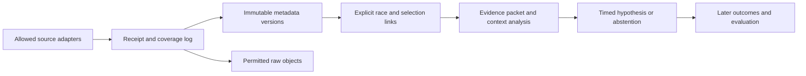

# Information collection pipeline

As of **10 October 2026**. [Provider research](data-provider-options.md) and [infrastructure choices](infra-options.md) support this design. [Machine-readable plan](../research/collection-plan.json) records what is proposed versus running. The current implementation is a local metadata receipt/version store; cloud services, scheduled API adapters, entity resolution and live semantic inference have not been deployed.

## Collect four different kinds of evidence

| Lane | What it supplies | Main limitation |
| --- | --- | --- |
| Race reference | Racecards, declared runners, horse/race IDs, going, later results | Today's returned record may contain revisions that were unavailable earlier. |
| Exchange market | Market definitions, selection IDs, scheduled times, quotes, volume, suspension/removal | Publisher time is not collector receipt time; a reconnect can break continuity. |
| News discovery | Article links, titles, provider metadata, changes and public statements | Discovery is incomplete; publication, indexing and receipt are different clocks. |
| Conditions | Weather forecasts and official course reports | Preserve the forecast/report vintage; later observations cannot become earlier features. |

An API subscription is useful only if it supplies the needed field, coverage, timestamp and retention rights. NewsAPI's documented article response has publication time and truncated content, rather than a verified race-event time or a complete article. Its Developer plan has a 24-hour delay and permits development/testing only, including restrictions on internal production. [Endpoint contract](https://newsapi.org/docs/endpoints/everything), [pricing and plan restrictions](https://newsapi.org/pricing).

Betfair's current personal Live App Key activation is £499 for betting purposes, with read-only access expressly not permitted. A data-only collector therefore needs an appropriate permitted route; paying that fee alone is not a research-feed solution. Existing public historical samples remain sufficient for local format work. [Official API cost/access notice](https://support.developer.betfair.com/hc/en-us/articles/115003864531-Are-there-any-costs-associated-with-API-access).

## Proposed flow



**Receipt before interpretation.** The collector records request start, completion/receipt, response status, query/window/page and parser version. A timeout, 429, error or exhausted page cap is a coverage limitation. A successful empty response means this request returned nothing; it never proves no relevant news exists. Every source has its own request budget and last-success marker. Recovery uses bounded backoff and `Retry-After` when supplied, overlapping time windows, idempotency and explicit gap markers. These network controls are a production design, not implemented by the local store.

**Immutable versions, separate repeats.** Identity is scoped to the source: provider article ID where present, otherwise the exact supplied URL. Changed metadata creates another version; an identical receipt retry creates no extra event. The same story syndicated by another outlet remains a separate source observation until an explicit story-cluster relation exists. Do not aggressively strip URL parameters, merge horse names or treat ten copies of a press release as ten independent signals.

**Link entities with evidence.** Keep provider horse/race IDs, Betfair market/selection IDs, meeting/date and market type separate. A name match is a candidate link, not a confirmed identity. Each accepted link needs `link_known_at`, source and mapping version. Ambiguous runners or multiple meetings remain unlinked. Actual future results must not be used to repair an earlier mapping retroactively.

**Then interpret.** A later reasoner receives only the available evidence packet and produces structured facts, affected entities, source IDs, novelty/uncertainty, an alternative explanation, analysis completion and expiry. Distinguish a factual non-runner announcement, a tipster opinion and a copied old headline. Retrieved text is evidence data; embedded requests never grant tools, credentials or order authority. A headline alone may be insufficient, and permitted full text is a separate acquisition question.

**Release only when ready.** A future context adapter must enforce:

```text
ready_at = max(received_at, normalization_completed_at,
               link_known_at, analysis_completed_at)
ready_at <= decision_cutoff < effective_expiry
```

`published_at`, provider first-seen and event time remain distinct nullable fields. A backfill retrieved today is available today, even if the article says it was published last year. Corrections receive their own receipt times. Current metadata storage keeps microsecond precision; any later bridge to the existing millisecond motif contract must not round availability backward. No metadata record is automatically promoted to P03 `compatible` context.

## What is implemented

The dependency-free [collection module](../betangel_research/collection.py) stores normalized metadata in local SQLite:

| Table/view | Purpose |
| --- | --- |
| `news_sources` | Explicit immutable source registration and synthetic/supplied classification. |
| `news_receipts` | Poll status, clocks, parser version, metadata hash, counts and coverage meaning. |
| `news_articles` | Source-qualified identity and immutable first local observation. |
| `news_versions` | Title, URL, optional publication/revision clocks and first receipt for each metadata version. |
| `news_observations` | A version's presence in a particular poll, with acceptance/quarantine flags. |
| `news_accepted_versions` | First non-quarantined receipt per version; publication time is never used as availability. Returns all accepted versions, not a latest-as-of selector. |

The store validates supplied clocks, records unknown publication as null and quarantines future publication/revision timestamps. A later valid observation may first become accepted later, without rewriting its earlier quarantine. Exact retries are idempotent; other receipts must advance strictly per source. Each poll is transactional; replaying a file is a series of poll transactions. Database triggers prevent ordinary UPDATE/DELETE of receipt/version records. This is not independent timestamp authentication, a licensed-news archive or a complete retention service.

The module accepts only metadata fields, with no article body. It does not fetch URLs, follow instructions in text, manage secrets or place orders. SQLite databases, raw responses and local operational outputs are ignored by Git; private GitHub contains code, synthetic fixtures and research notes. Any eventual provider-specific retention/deletion requirement must be implemented before collecting that provider's production data.

```sh
python3 -m betangel_research collect-demo \
  --fixture research/fixtures/news-metadata.json \
  --db data/private/news-demo.sqlite
```

Run it twice to inspect idempotent receipt replay. The CLI explicitly accepts synthetic fixtures only. A future real collector can call `configure_sources` and `ingest_metadata` with its actual recorded receipt clocks; this module labels those clocks caller-supplied, not independently verified. The current schema does not yet persist every proposed production field above, such as query pagination, provider first-seen, entity links or normalization completion.

## Infra boundaries and first experiment

Start with this Mac for parser and fixture work. For 24/7 collection, use one persistent Linux worker close to the data/database region. A small Fly Machine or AWS Lightsail instance can perform this role; platform-specific prices and assumptions are in the [infra comparison](infra-options.md). Supabase is a candidate for managed Postgres and a later dashboard, not a requirement for initial single-writer SQLite work. Keep exchange stream chunks in compressed object storage where permitted; keep receipts, identities, extracted features and experiment indices in the database.

Separate a persistent stream worker from bounded scheduled pollers. Supabase Edge Functions have finite wall-clock and CPU limits; they cannot be treated as an unrestricted daemon. [Official limits](https://supabase.com/docs/guides/functions/limits). A later Bet Angel execution bridge needs its own supported Windows host; the proposed Python/Linux collector is separate. No Windows host or cloud resources have been created.

The next acquisition experiment should fix a small consecutive meeting/date window and approved source list before observing outcomes. Measure source coverage, 429/error frequency, publication-to-receipt lag where publication is trustworthy, revisions, missing links, duplicate story clusters and analysis completion latency. Include empty/failed polls and source outages. Compare a mechanical metadata/coverage gate with semantic analysis at equal availability and delay; greater collection volume is not by itself an edge.

A single bounded GDELT DOC query was actually attempted on 10 October: HTTP 429 after about 11.4s. No article metadata was returned or counted as absent. That checks the failure path only; it does not measure GDELT's racing coverage or normal service latency. The local receipt and probe summary are recorded in the [verification report](../reports/collection-infra-2026-10-10.md).
