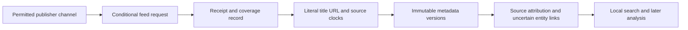

# NewsAPI public-interface research and direct publisher sources

Checked **2026-10-10**. **可以自己建立 metadata collection pipeline；即時可用嘅兩個來源係 GOV.UK equine Atom 同 Met Office news RSS。** 兩者只提供馬匹健康／政策及天氣背景，唔代表已取得完整賽馬新聞。The [candidate registry](../research/news-source-candidates.json) separates recommendations, policy holds and actual probes. Deployment is handled separately; this research did not create accounts, subscribe or retain full articles.

## What we can actually know about NewsAPI

| Public evidence | Supported conclusion | What remains unknown |
|---|---|---|
| `/v2/top-headlines/sources` lists the subset supplying Top Headlines, with publisher ID/name/URL/category/language/country | Useful catalogue for that endpoint | It is not the full Everything source universe. [Sources contract](https://newsapi.org/docs/endpoints/sources) |
| `/v2/everything` advertises over 150,000 sources/blogs, query/domain filters, date bounds, pagination and sorting | Search/discovery interface with publisher URLs | Racing recall, first ingestion time, refresh policy and version completeness. [Everything](https://newsapi.org/docs/endpoints/everything) |
| Official examples identify `bbc-news`, `techcrunch`, and domain search for `wsj.com` | Concrete documented publisher examples | Current availability and BHA/Racing Post/Sporting Life/ATR inclusion were not tested with a key. [Getting started](https://newsapi.org/docs/get-started), [homepage](https://newsapi.org/) |
| Terms describe aggregation of publicly available web pages using proprietary technology | The aggregation function is public; implementation is not | Feed/crawler mix, licensing contracts, queues, parser code, deduplication and ranking architecture. [Terms](https://newsapi.org/terms) |

The [public country catalogue](https://newsapi.org/sources) leads to a [UK example using `country=gb`](https://newsapi.org/s/uk-news-api), while the current [Top Headlines parameter table](https://newsapi.org/docs/endpoints/top-headlines) lists only `us`. That is a documentation inconsistency, not evidence that a UK request succeeds. No authenticated catalogue or article payload was downloaded here.

`publishedAt` describes article publication in UTC, not NewsAPI detection, our receipt or a race event. Returned `content` is truncated to 200 characters. Search date ranges do not prove immutable article vintages. Developer is 100 requests/day with 24-hour delay and excludes staging/internal production; Business displays $449/month billed monthly. [Response fields](https://newsapi.org/docs/endpoints/everything), [pricing](https://newsapi.org/pricing).

The terms restrict software reverse engineering, competing news databases and certain data disclosure. This project uses public contracts to design **its own direct-source collector**; it does not inspect private implementation or copy NewsAPI's database. Publisher rights remain separate from API access. [NewsAPI terms](https://newsapi.org/terms).

## A reproducible alternative design — inference, not NewsAPI internals

A publisher may expose RSS/Atom, a news sitemap or article structured data. RSS `pubDate`, Atom `published`/`updated`, news-sitemap publication date and JSON-LD `datePublished`/`dateModified` have different meanings. This suggests possible discovery/extraction adapters; it **does not establish that NewsAPI uses them**, or that any site permits our automated reuse. [RSS specification](https://www.rssboard.org/rss-specification), [Atom standard](https://www.rfc-editor.org/info/rfc4287/), [news sitemaps](https://developers.google.com/search/docs/crawling-indexing/sitemaps/news-sitemap), [NewsArticle schema](https://schema.org/NewsArticle).

Use feeds only initially. **The richer contract proposed here** includes publisher/source ID, literal headline and direct URL, source item ID, original clock text, nullable parsed clocks, local request/receipt times, payload metadata hash, response status and provenance. The current adapter returns normalized display text and UTC dates; original clock strings are not persisted. Literal-title requirements need separate source-policy verification, not an assumption that normalization preserves everything. Do not fetch article bodies or images. Keep publisher text separate from derived labels. HTTP `Date`, feed-level update time, `Last-Modified` and ETag are not article publication clocks. Do not turn a day-only label into an exact instant.

`ready_at` must include actual receipt, normalization, identity-link knowledge and analysis completion. A feed update is not necessarily the first announcement of an event; repeated syndication is not independent confirmation. No returned item, an unchanged response and a failed request have different coverage meanings. Limited feed windows cannot establish complete historical or current coverage.

## Two sources suitable for the initial collector

| Source and exact feed | Observed probe | Proposed operating policy |
|---|---|---|
| [GOV.UK equine Atom](https://www.gov.uk/search/news-and-communications.atom?keywords=equine&order=updated-newest) | HTTP 200, 20 entries, 12,749 bytes; 2026-10-10 08:29:21Z. ETag present. Entries had `updated`, no `published`. | Hourly conditional GET; `published_at=null`, `updated` as source revision/update clock. Broad equine health/policy discovery, unrelated matches possible. |
| [Met Office news RSS](https://www.metoffice.gov.uk/feed/syndication/news-rss.xml) | HTTP 200, one item, 6,268 bytes; 2026-10-10 08:30:29Z. `pubDate` present; no ETag/Last-Modified. | Hourly GET; preserve literal title/link/date, omit description, `content:encoded` and images. Weather press releases, not racecourse going or complete forecasts. |

GOV.UK explicitly provides feeds for applications and publishes most content under OGL. That licence permits reuse with attribution, subject to exceptions including personal data and third-party rights. Keep source/author notices and the licence link; do not imply government endorsement. [GOV.UK terms](https://www.gov.uk/help/terms-conditions), [OGL v3](https://www.nationalarchives.gov.uk/doc/open-government-licence/version/3/).

Met Office's [official feed directory](https://weather.metoffice.gov.uk/guides/rss) links that news feed. Its [RSS terms](https://www.metoffice.gov.uk/policies/tandc) allow use for any purpose but require unchanged content/links, functional direct links and attribution; general OGL provisions have exclusions. Preserve the supplied metadata verbatim and keep derived analysis separate. Do not apply these RSS terms automatically to paid weather APIs or warning-distribution products.

Hourly cadence and a 30-day initial metadata retention review are **our engineering choices**, not provider SLAs or mandatory licence limits. Honour `Retry-After`, conditional headers, bounded retries and feed removal notices. No scheduled run was enabled by this research author. An independent archive/restore policy remains separate.

## Racing publishers: useful channels, held adapters

| Publisher | Concrete public channel | Why it is not enabled by this recommendation |
|---|---|---|
| BHA | [Press releases](https://www.britishhorseracing.com/press_releases/) and [racing updates](https://www.britishhorseracing.com/racing-updates/) | [Terms](https://www.britishhorseracing.com/terms-conditions/) restrict commercial reuse/automated extraction. Intended recurring research use and feed scope need clearance. |
| Racing Post | [News](https://www.racingpost.com/news/) | Automated feed availability unverified; [site rights](https://help.racingpost.com/hc/en-us/articles/208996085-Terms-and-conditions) are restrictive. No paywall bypass. |
| Sporting Life | [Racing news](https://www.sportinglife.com/racing/news) | [Terms](https://www.sportinglife.com/terms-and-conditions) expressly prohibit data capture and require permission for storage/reproduction. |
| BBC Sport | [Horse-racing RSS](https://feeds.bbci.co.uk/sport/horse-racing/rss.xml) | One metadata feasibility GET returned 200/11 items; current [feed-use terms](https://www.bbc.co.uk/usingthebbc/terms/can-i-use-bbc-content/) were inaccessible in this review. No ongoing permission assumed. |
| Guardian | [Horse-racing section](https://www.theguardian.com/sport/horse-racing) | Held: current terms restrict automated aggregation/AI; permission required. [Terms](https://www.theguardian.com/help/terms-of-service) |
| At The Races | [News](https://www.attheraces.com/news) | Feed not verified; [terms URL](https://www.attheraces.com/terms-and-conditions) returned 429 in the web reader. No retry or permission assumption. |
| Jockey Club/racecourses | [Official press releases](https://www.thejockeyclub.co.uk/about-us/media-centre/press-releases/) | Useful original fixture statements; no supported feed or automated reuse grant verified under [website terms](https://www.thejockeyclub.co.uk/terms-and-conditions/). |

These holds are source-specific acquisition decisions; the two open sources let the pipeline proceed now. A later racing coverage audit needs a fixed meeting list and independently observed announcements, with measured misses, ambiguous IDs and first local receipts. A working RSS fetch proves transport and parse feasibility, not racing relevance, earliest delivery or a profitable edge.
